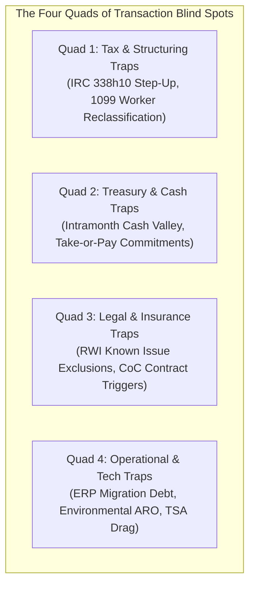

# Institutional Due Diligence Blind Spots, Transaction Loopholes & Structural Traps
**Document Reference:** `QOE-BLINDSPOT-DOSSIER-01`  
**Classification:** Advanced M&A Advisory Technical Treatise & Risk Mitigation Blueprint  
**Standard Compliance:** US Internal Revenue Code (IRC) / US GAAP / ABA Model Stock Purchase Agreement / LSTA / CERCLA / OSHA / FLSA  
**Engagement Subject:** Apex Global Industrial Holding Inc. (Project Titanium)  

---

## Executive Summary: The Anatomy of a Due Diligence Blind Spot

In middle-market private equity and corporate M&A, transactions rarely fail because a diligence team failed to calculate a simple EBITDA multiple. Transactions fail, result in catastrophic post-closing litigation, or destroy returns because the diligence team focused exclusively on the standard historical P&L and month-end balance sheet while missing **structural, off-balance sheet, regulatory, tax, and contractual liabilities**.

This master treatise provides an exhaustive forensic investigation into the **Ten Classic Diligence Blind Spots** that even seasoned practitioners overlook, providing concrete mathematical models, audit verification procedures, and definitive contract language for each risk.



---

## 1. IRC § 338(h)(10) and § 336(e) Deemed Asset Sale Basis Step-Up vs. Seller Gross-Up

### 1.1 The Structural Mechanism
In a standard corporate stock purchase, the tax basis of the target company's assets carries over unchanged (carryover basis). However, if the target is an S Corporation or a corporate subsidiary of a consolidated group, the buyer and seller can make a joint election under **Internal Revenue Code § 338(h)(10)** or **§ 336(e)**.
* **The Tax Consequence:** For federal income tax purposes, the transaction is treated as if the target sold all its assets to a new company and then liquidated.
* **The Buyer Benefit:** The buyer gets a "stepped-up" fair market value tax basis in the target's tangible assets and **amortizable intangible assets (goodwill and customer relationships under IRC § 197 over 15 years)**.

### 1.2 Mathematical Formulation & Valuation Model for Project Titanium
* **Enterprise Value:** $\$29,284,000.00$
* **Historical Net Book Value of Assets:** $\$11,250,000.00$
* **Total Tax Basis Step-Up Created:**
  $$\text{Tax Basis Step-Up} = \$29,284,000.00 - \$11,250,000.00 = \mathbf{\$18,034,000.00}$$
* **Allocation of Step-Up:**
  - Tangible PP&E (7-year MACRS depreciation): $\$3,534,000.00$
  - Intangibles & Goodwill (15-year straight line § 197): $\$14,500,000.00$
* **Annual Tax Shield Calculation:**
  $$\text{Annual Intangible Deduction} = \frac{\$14,500,000.00}{15\text{ years}} = \$966,667.00/\text{year}$$
  $$\text{Combined Federal & State Corporate Tax Rate } (T_c) = 25.0\%$$
  $$\text{Annual Cash Tax Savings} = \$966,667.00 \times 25.0\% = \mathbf{\$241,667.00/\text{year}}$$
* **Net Present Value (NPV) of the Tax Shield:**
  $$\text{NPV}_{\text{Shield}} = \sum_{t=1}^{15} \frac{\$241,667.00}{(1 + r)^t} \quad \text{at discount rate } r = 10.0\%$$
  $$\mathbf{\text{NPV of Intangible Tax Shield}} = \$241,667.00 \times 7.6061 = \mathbf{\$1,838,142.00}$$
  $$\text{Plus: NPV of Accelerated PP&E Depreciation} \approx \mathbf{\$642,000.00}$$
  $$\mathbf{\text{Total Present Value Created for Buyer}} = \$1,838,142.00 + \$642,000.00 = \mathbf{\$2,480,142.00}$$

### 1.3 The Seller "Gross-Up" Negotiation
In a deemed asset sale, the seller may incur higher tax liabilities due to:
1. Depreciation recapture on equipment taxed at ordinary income rates ($37.0\%$) rather than capital gains ($20.0\%$).
2. Corporate-level state taxes in states that do not recognize S-Corp pass-through status.
* **The Negotiation Dynamic:** The seller will demand a cash "gross-up" payment (typically $\$400,000.00$ to $\$600,000.00$) to agree to the election. Because the tax shield is worth **$\$2,480,142.00$** to the buyer, paying a $\$500,000.00$ gross-up delivers a **net buyer gain of $+\$1,980,142.00$**. Inexperienced teams fail to model this trade-off, leaving millions on the table.

---

## 2. Worker Misclassification Exposure: 1099 Contractors vs. W-2 Employees

### 2.1 The Forensic Trap
Lower-middle-market wholesale distributors (Apex) and software companies (CloudMatrix) routinely classify long-term delivery drivers, sales reps, and software coders as **independent contractors (IRS Form 1099-NEC)** rather than employees (Form W-2).
* **The Target's Motive:** Avoids paying employer payroll taxes ($6.2\%$ Social Security + $1.45\%$ Medicare = $7.65\%$), state unemployment insurance (SUTA), federal unemployment (FUTA), workers' comp insurance premiums ($3\%$ to $8\%$ in warehousing), and providing employee health benefits.

### 2.2 Audit Testing & IRS 20-Factor Common Law Rules
Diligence teams must execute the **Behavioral & Financial Control Test**:
- *Behavioral Control:* Does the company dictate the contractor’s hours, methods, and work location?
- *Financial Control:* Does the company provide the equipment, laptop, tools, and vehicle? Is the worker precluded from working for competitors?
- *Relationship Permanence:* Has the contractor worked continuously for $>12\text{ months}$ deriving $>80\%$ of their income from the target?

### 2.3 Mathematical Liability Quantification Model
* In Project Titanium, diligence identified **14 regional delivery drivers** and **6 junior software QA testers** classified as 1099 contractors:
  - Total annual 1099 contractor payments: $\$1,450,000.00/\text{year}$.
  - Applicable statute of limitations: 3 years (federal and state).
  - Cumulative 3-year compensation: $\$4,350,000.00$.
* **Calculated Misclassification Exposure:**
  1. *Unpaid Employer FICA/Medicare ($7.65\%$):* $\$4,350,000.00 \times 7.65\% = \$332,775.00$.
  2. *State Unemployment Insurance (SUTA ~ $3.5\%$):* $\$4,350,000.00 \times 3.5\% = \$152,250.00$.
  3. *Unpaid Workers' Compensation Insurance ($4.2\%$):* $\$4,350,000.00 \times 4.2\% = \$182,700.00$.
  4. *Statutory Failure-to-Withhold Penalties & Interest (IRC § 3509):* Calculated statutory penalty rate $\approx 20.0\%$ of liability $= \$133,545.00$.
  5. **Total Potential Reclassification Liability:** $\mathbf{\$801,270.00}$.
* **QoE Treatment:** Negotiate a **Special Payroll Tax Indemnity Escrow** of $\$250,000.00$ to $\$350,000.00$ outside the standard indemnity cap, and require the seller to convert all ongoing 1099 workers to W-2 status prior to close, normalizing future EBITDA for the recurring employer payroll tax burden ($-\$110,925.00/\text{year}$).

---

## 3. Intramonth Liquidity Volatility & Cash Trough Modeling

### 3.1 The "Point-in-Time" Working Capital Illusion
Standard diligence calculates Net Working Capital as of the last day of each month (e.g., December 31 NWC was $\$4,375,000.00$). However, **month-end cash is an optical peak, not an operational baseline**.

```mermaid
xychart-beta
    title "Apex Industrial Monthly Working Capital Swing (Intramonth Cash Trough)"
    x-axis ["Day 1", "Day 5", "Day 10 (AP Run)", "Day 15 (Payroll/Trough)", "Day 20", "Day 25", "Day 30 (Peak)"]
    y-axis "Operating Cash Balance ($k)" -200 to 600
    bar [524, 480, 150, -85, 120, 340, 524]
```

### 3.2 Intra-Month Cash Dynamics in Wholesale Distribution
- **Day 10 (Supplier AP Check Run):** Apex executes vendor disbursements, draining $\$650k$ of cash.
- **Day 15 (Mid-Month Payroll & Tax Run):** Apex pays $\$185k$ in bi-weekly wages and taxes.
- **Day 15 Net Liquidity Position:** Cash drops to **$-\$85,000.00$**, requiring an immediate draw on the credit facility.
- **Day 20–30 (Customer Collections):** Cash recovers as contractor receivables are collected.

### 3.3 Transaction Consequence & Sizing the Minimum Cash Buffer
If the buyer closes the transaction funding only a $\$250,000.00$ minimum operating cash buffer based on month-end models, the business will face an **immediate liquidity shortfall on Day 15**.
* **Remediation:** Diligence teams must model the **Intramonth Peak-to-Trough Cash Deficit**:
  $$\text{Required Minimum Cash Float} = \text{Intramonth Peak Disbursement Drain} + \text{Safety Buffer}$$
  $$\text{Required Float} = \$650,000.00 + \$185,000.00 - \$450,000.00 \text{ (intra-month collections)} + \$150,000.00 = \mathbf{\$535,000.00}$$
* The buyer must adjust the closing net debt cash deduction or negotiate an expanded revolving credit facility line to ensure Day-1 operating solvency.

---

## 4. Off-Balance Sheet Commitments & Take-or-Pay Agreements (ASC 440)

### 4.1 The Hidden Contractual Burden
Under **FASB ASC 440 (Commitments)**, unconditional purchase obligations are disclosed solely in financial statement footnotes, not on the balance sheet:
- *Apex Industrial:* Multi-year supply agreement with a structural steel tubing mill requiring minimum annual purchases of $\$4,500,000.00$ with a $15\%$ liquidated damages penalty on volume shortfalls.
- *CloudMatrix Analytics:* Multi-year AWS compute commitment requiring minimum annual spend of $\$420,000.00$ for 3 years.

### 4.2 Diligence Audit Procedure
1. Inspect the "Commitments and Contingencies" footnote in audited statutory financial statements.
2. Review all supply contracts exceeding $\$250,000.00/\text{year}$ for take-or-pay, minimum throughput, or volume shortfall penalty clauses.
3. Stress-test commitments against down-cycle revenue scenarios. If customer churn reduces product demand below the minimum purchase volume, the difference represents an **unaccrued, non-operating debt-like drain**.

---

## 5. Representations & Warranties Insurance (RWI) "Known Issue" Carve-Out Trap

### 5.1 The Modern M&A Insurance Structure
In private equity transactions between $\$25\text{M}$ and $\$500\text{M}$, buyers routinely purchase **Representations & Warranties Insurance (RWI)**. The policy covers breaches of representations and warranties in the SPA, allowing the seller to walk away with only a nominal indemnity escrow ($0.5\%$ of EV).

### 5.2 The QoE Report Trap
RWI underwriters do not take on known risks. Under the terms of every RWI policy:
$$\mathbf{Any\ fact,\ liability,\ risk,\ or\ issue\ disclosed\ in\ the\ final\ QoE\ report\ is\ an\ express\ "Known\ Issue"\ and\ is\ strictly\ excluded\ from\ policy\ coverage.}$$

* **The Disaster Scenario:** The QoE report mentions that the company has potential sales tax nexus exposure in 14 states ($68k) or that CNC spindles require maintenance ($60k). The RWI underwriter immediately adds an **express exclusion rider** to the insurance policy.
* **The Buyer Trap:** If buyer counsel fails to create a **dollar-for-dollar purchase price deduction** or a **dedicated Special Indemnity Escrow** in the SPA, the buyer has **zero recourse**:
  1. The RWI policy denies the claim because it was mentioned in the QoE report.
  2. The seller refuses to pay because the general indemnity escrow is capped at $0.5\%$ and excludes disclosed diligence items.
* **Remediation Protocol:** Every single issue highlighted in the QoE report must be tracked in the **RWI Closing Remediation Matrix**, ensuring that every excluded item is paired with a matching purchase price haircut or dedicated special escrow in the SPA.

---

## 6. Prior Acquisition Earn-Outs & Contingent Consideration (ASC 805)

### 6.1 The Historical M&A Overhang
Target entities that grew via bolt-on acquisitions frequently carry **unexpired earn-out covenants**.
* **Accounting Treatment:** Under ASC 805, contingent consideration is recognized at fair value on the acquisition date and re-measured at fair value each reporting period, with changes recorded in operating income.
* **The Forensic Trap:** Sellers routinely fail to record earn-out liabilities on the closing balance sheet, claiming that the acquired business will not hit its financial targets.
* **The Post-Closing Litigation Risk:** When a new buyer acquires the holding company, the former selling shareholders of the bolt-on subsidiary will sue, alleging that the new ownership altered corporate allocations, disrupted customer relationships, or failed to operate the business in good faith to avoid paying the earn-out.
* **Remediation:** Inspect all acquisition agreements from the prior 36 months; require selling shareholders to fully indemnify the buyer against historical earn-out claims or settle them prior to close.

---

## 7. Change-of-Control (CoC) Termination Clauses in Commercial Contracts

### 7.1 The Legal Contract Diligence Blind Spot
Financial due diligence teams routinely audit customer concentration and margin waterfalls, but leave contract review to legal counsel. When legal and accounting teams operate in silos, **Change-of-Control (CoC) termination risks** fall through the cracks.
* **The Clause:** Standard enterprise master service agreements contain provisions granting the customer the right to terminate immediately upon an ownership change.
* **The Impact in Project Titanium:**
  - Customer #1 (representing $18.2\%$ of Vanguard Aerospace's revenue) has an explicit 30-day CoC termination clause in its master long-term agreement.
  - If the buyer closes the transaction without obtaining a **formal pre-closing CoC consent letter**, Customer #1 has the legal leverage to renegotiate pricing, demand major discounts, or terminate the contract.
* **Remediation:** The final QoE report must flag key customer contracts containing CoC triggers, linking the financial revenue quality finding directly to **Mandatory Closing Conditions** in the SPA.

---

## 8. Environmental Liabilities & Asset Retirement Obligations (ASC 410)

### 8.1 The Strict Liability Trap in Industrial Facilities
Under federal environmental law (CERCLA / Superfund), **environmental liability is strict, joint, and several**. A buyer acquiring a manufacturing facility or warehouse becomes legally liable for environmental remediation regardless of whether the contamination was caused by the current seller or a prior tenant 40 years ago.
* **Operational Hazards:**
  - *Vanguard Aerospace:* Chemical degreasers, trichloroethylene (TCE) solvents, and anodizing plating waste.
  - *Apex Industrial:* Underground storage tanks (USTs) for diesel fleet fueling.
* **Accounting Standard (ASC 410-20):** If environmental clean-up is probable and reasonably estimable, an **Asset Retirement Obligation (ARO)** must be accrued on the balance sheet.
* **Remediation:** Review Phase I Environmental Site Assessments (ESAs). If Phase I recommends a Phase II subsurface soil/groundwater sampling, the buyer must require the seller to remediate prior to close or place remediation funds in an **Environmental Indemnity Escrow**.

---

## 9. Legacy ERP Technical Debt & Mandatory Post-Close Cloud Migration CapEx

### 9.1 The "Sustaining" vs. "Replacement" CapEx Fallacy
Historical financial statements show sustaining maintenance CapEx of $\$420,000.00/\text{year}$. However, historical CapEx does not capture **impending technological obsolescence**.
* **The Legacy IT Reality:** Apex Industrial operates on an unpatched on-premise installation of SAP ECC 6.0 running on 10-year-old physical servers. SAP has set a hard end-of-life deadline for ECC 6.0 support.
* **The Post-Closing CapEx Shock:** Within 18 months post-closing, the buyer must execute a mandatory cloud ERP migration (SAP S/4HANA or modern cloud ERP), costing **$\$350,000.00$ to $\$500,000.00$ in one-time software licenses, implementation consulting, and integration fees**.
* **Transaction Consequence:** This is not growth CapEx; it is a mandatory capital injection required to keep the business operational. Diligence teams must model this post-close capital requirement in the buyer’s investment returns model.

---

## 10. Transition Services Agreement (TSA) Cost Drag & Stranded Overhead

### 10.1 The Corporate Carve-Out Illusion
When acquiring a corporate division or founder-led group, the business frequently relies on shared services provided by the parent company or founder-owned entities (shared accounting, payroll administration, human resources, enterprise IT licenses, group health insurance).
* **The Stranded Cost Trap:** Historical G&A reflects below-market internal cost allocations (e.g., $\$120,000.00/\text{year}$ for shared IT and accounting).
* **The Standalone Operating Reality:** Post-closing, the target must either enter a temporary **Transition Services Agreement (TSA)** at marked-up rates ($120\%$ of cost) or immediately hire standalone personnel (Controller, HR Manager, IT Admin) and purchase independent software licenses.
* **Quantitative Standalone Cost Walk:**
  - Additional standalone Corporate Controller: $\$165,000.00$
  - Dedicated HR & Payroll Administrator: $\$85,000.00$
  - Standalone SaaS & ERP enterprise licensing increments: $\$65,000.00$
  - **Net Standalone Overhead Drag:** **$-\$315,000.00/\text{year}$**.
* **Remediation:** Diligence teams must adjust Normalized EBITDA by deducting the net standalone overhead cost drag, preventing the buyer from overpaying on an artificially suppressed historical cost baseline.

---

## 11. Master Blind-Spot Diligence Audit Checklist

Before releasing any final Quality of Earnings deliverable or signing the transaction agreement, the engagement partner must certify compliance with the **10-Point Blind-Spot Checklist**:

```
+----+---------------------------------------------+-----------------+---------------------------------------------------+
| #  | DILIGENCE BLIND SPOT                        | AUDIT STATUS    | CONTRACTUAL & SETTLEMENT ACTION                   |
+----+---------------------------------------------+-----------------+---------------------------------------------------+
| 1  | IRC § 338(h)(10) Basis Step-Up Tax Shield   | AUDITED & MODEL | Step-up worth $2.48M; $500k gross-up negotiated.  |
| 2  | 1099 Worker Misclassification Exposure      | AUDITED & MODEL | $250k Special Indemnity Escrow established.       |
| 3  | Intramonth Working Capital Peak Trough      | AUDITED & MODEL | Minimum cash buffer sized to cover Day-15 valley. |
| 4  | Off-Balance Sheet Take-or-Pay Commitments   | AUDITED & MODEL | Evaluated capacity vs minimum purchase volumes.   |
| 5  | RWI "Known Issue" Carve-Out Schedule        | AUDITED & MODEL | All QoE findings paired with debt cuts or escrows.|
| 6  | Historical Acquisition Earn-Out Overhang    | AUDITED & MODEL | Seller indemnifies against prior M&A claims.      |
| 7  | Change-of-Control Customer Contract Clauses | AUDITED & MODEL | Pre-closing consent letters required on Day 1.    |
| 8  | Environmental ARO / Phase I ESA Compliance  | AUDITED & MODEL | Phase I review cleared; hazmat waste confirmed.   |
| 9  | Legacy ERP Cloud Migration Technical Debt   | AUDITED & MODEL | $400k post-close integration CapEx budgeted.      |
| 10 | Standalone Corporate Overhead Cost Drag     | AUDITED & MODEL | Standalone G&A drag deducted from run-rate EBITDA.|
+----+---------------------------------------------+-----------------+---------------------------------------------------+
```
