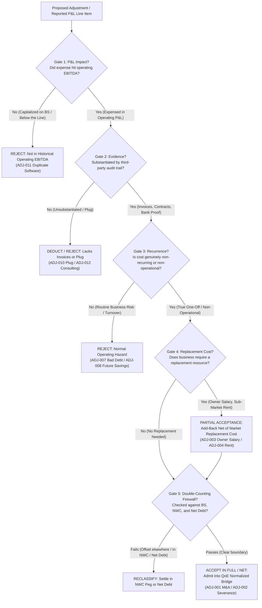

# Professional EBITDA Adjustment Decision Framework & Evaluation Gates
**Document Reference:** `QOE-FRAMEWORK-DEC-05`  
**Workstream:** `05 — EBITDA Normalization and Adjustments`  
**Classification:** Quality of Earnings Decision Architecture & Adjudication Standard  

---

## 1. The 5-Gate Adjustment Evaluation Protocol

Every management-proposed add-back, reported financial item, or potential diligence deduction must traverse five rigorous, sequential gates before admission into the QoE Normalized EBITDA bridge:

---

## 2. Gate Specifications & Adjudication Criteria

### Gate 1: P&L Verification & Accounting Location
* **Threshold Question:** Did this specific dollar expenditure flow through historical Operating Expenses or Cost of Goods Sold, thereby reducing reported historical operating EBITDA?
* **Verification Procedure:** Query General Ledger transaction journals for the specific transaction debit. Confirm that the offsetting credit was Cash or Accounts Payable, and the debit was an operating expense line (`GL 5-xxxx` or `GL 6-xxxx`).
* **Failure Modes:**
  * The invoice was capitalized into Fixed Assets or Intangible Assets under ASC 350 / ASC 360 (e.g., `ADJ-011` NetSuite ERP implementation fees).
  * The item was booked below the line in Interest Expense (`GL 8-xxxx`) or Income Taxes (`GL 9-xxxx`).
* **Verdict on Failure:** **Immediate Rejection.** Adding back an expenditure that never reduced operating EBITDA results in double-counting earnings.

---

### Gate 2: Evidentiary Substantiation & Source Documentation
* **Threshold Question:** Is the claimed expenditure corroborated by independent, third-party documentary evidence matching the exact general ledger dollar amount?
* **Required Evidence Inventory:**
  * Third-party vendor invoices detailing specific dates, unit rates, and service descriptions.
  * Executed legal contracts, engagement letters, or settlement agreements.
  * Canceled checks, bank debit advices, or electronic wire settlement records.
* **Failure Modes:**
  * Internal journal entry vouchers lacking attached external invoices (e.g., `ADJ-010` topside rebate plug).
  * Broad consulting retainers without statements of work, timesheets, or tangible deliverables (e.g., `ADJ-012` strategic coaching).
* **Verdict on Failure:** **Rejection or Mandatory QoE Deduction.** Unsubstantiated claims are rejected; unsubstantiated topside credits are forcibly reversed from baseline earnings.

---

### Gate 3: Recurrence & Operational Relevance Assessment
* **Threshold Question:** Is the expense truly extraordinary, unusual, and non-recurring in nature, or does it represent an ongoing operational cost or inherent commercial hazard of the business model?
* **Analytical Standard:**
  * A 3-to-5 year lookback across general ledger accounts to evaluate historical frequency.
  * Industry benchmark evaluation: Is this cost a normal friction of doing business?
* **Failure Modes:**
  * Customer bad debt write-offs: In credit-granting B2B distribution, customer defaults occur cyclically. A customer bankruptcy is a normal commercial risk, not a non-recurring add-back (e.g., `ADJ-007` Great Plains default).
  * Routine employee severance: Standard annual churn and routine management replacements are operating expenses.
  * Routine repairs and deferred maintenance: Wear and tear on plant machinery is recurring; calling it "extraordinary" because it was delayed violates QoE principles.
* **Verdict on Failure:** **Full Rejection.** The expenditure remains embedded in operating expenses.

---

### Gate 4: Replacement Cost & Standalone Burden
* **Threshold Question:** If the historical cost is eliminated post-closing, does the ongoing enterprise require a replacement resource, market-rate lease, or additional administrative burden to maintain operations?
* **Benchmarking Standards:**
  * Executive compensation: Third-party compensation surveys (Mercer, ERI, Robert Half) matching industry code (NAICS), revenue tier, and geographic location.
  * Real estate occupancy: Independent certified commercial appraisal (MAI) establishing Fair Market Rent (FMV) per square foot on a triple-net (NNN) basis.
* **Failure Modes:**
  * Seller claims 100% add-back of founder/CEO salary because the founder is retiring, ignoring the necessity of hiring a replacement General Manager (e.g., `ADJ-003`).
  * Seller adds back related-party rent while expecting the buyer to occupy the warehouse rent-free (e.g., `ADJ-004`).
* **Verdict on Failure:** **Partial Acceptance.** Only the variance between historical actuals and certified market replacement cost is permitted as an add-back:
$$\text{Net Add-Back} = \text{Historical Actual Cost} - \text{FMV Replacement Cost}$$

---

### Gate 5: Double-Counting & Transaction Boundary Firewall
* **Threshold Question:** Does this financial item interact with or duplicate adjustments made in Net Working Capital (NWC), Net Debt, or Capital Expenditures (CapEx)?
* **Boundary Rules:**
  * **EBITDA vs. Net Debt:** One-off transaction bonuses, severance accruals unpaid at closing, or pending litigation settlements must be deducted dollar-for-dollar from Enterprise Value as Debt-Like Items. They cannot be added back to EBITDA *and* deducted from purchase price.
  * **EBITDA vs. Net Working Capital:** Accounts receivable reserves, inventory obsolescence write-downs, and customer rebate accruals are settled through the NWC target peg and closing true-up mechanism. They cannot be stripped from historical EBITDA to boost EV while concurrently penalizing the seller in working capital.
  * **Net Income Offsets:** If a casualty loss was partially recovered via insurance, the gross repair add-back must be netted against the insurance proceeds received, and any insurance gain credited to income must be eliminated (e.g., `ADJ-005` & `ADJ-006`).
* **Verdict on Failure:** **Reclassification.** The item is assigned to its proper transaction mechanism (NWC peg, Debt-like item, or CapEx deduction).

---

## 3. Formal Decision Classification Taxonomy

| Decision Code | Meaning | Transaction Impact | Example |
| :--- | :--- | :--- | :--- |
| `Accepted-Addback` | Fully verified, non-recurring, zero replacement cost needed, clear of double-counting. | Increases Normalized EBITDA dollar-for-dollar. | `ADJ-001` M&A Legal Fees ($145k) |
| `Accepted-Partial` | Verified non-operational cost, but ongoing business requires a replacement resource or FMV adjustment. | Increases Normalized EBITDA by net variance only. | `ADJ-003` Owner Salary ($200k Net) |
| `Accepted-Deduction` | Non-operating or non-trading income credit that artificially inflated reported baseline earnings. | Decreases Normalized EBITDA dollar-for-dollar. | `ADJ-006` Insurance Gain (-$55k) |
| `QoE-Mandatory-Deduction` | Correction of technical accounting errors, cut-off violations, or unsupported topside management plugs. | Decreases Normalized EBITDA dollar-for-dollar. | `ADJ-009` Bill-and-Hold (-$152k) |
| `Rejected-Addback` | Management claim failed evidence, recurrence, P&L location, or timing tests. | Zero impact on EBITDA; management bridge haircut. | `ADJ-007` Bad Debt ($110k Rejected) |
| `Unresolved / Pending` | Documentation requested from client; pending invoice or contract delivery. | Held in escrow; excluded from bridge until proven. | `ADJ-012` Consulting ($50k Unsubstantiated) |

---

## 4. Management Pushback & Resolution Protocols

During buy-side due diligence, sellers and investment bankers vigorously defend their proposed add-backs. The following protocols govern how QoE teams respond to standard management arguments:

### Pushback 1: *"This expense was entirely discretionary. We won't spend it next year."*
* **QoE Adjudication Standard:** Discretionary does **not** equal non-recurring. Almost all corporate spending—marketing campaigns, staff training, IT consulting, customer entertainment—is technically discretionary.
* **Resolution Protocol:** If the spending generated commercial benefits (e.g., brand recognition, employee retention, sales pipeline) or maintained operational readiness, it is a normal recurring expense. Demand that management prove how the business can maintain identical revenue and growth without that function. If they cannot, the add-back is rejected in full.

### Pushback 2: *"This customer bankruptcy was an unprecedented one-in-ten-year event."*
* **QoE Adjudication Standard:** In any B2B enterprise granting trade credit, customer insolvencies happen periodically. While that specific customer may not go bankrupt again, another customer will inevitably experience credit stress over the next cycle.
* **Resolution Protocol:** Reconstruct bad debt expense as a percentage of revenue over a 3-to-5 year lookback. If the historical bad debt expense averages 0.25% to 0.40% of sales, credit losses are an enduring cost of capital. Reject the single-customer add-back, or at most allow an add-back for the variance above the 5-year average bad debt rate.

### Pushback 3: *"We signed a new contract that permanently cuts our costs. Why can't we add it back?"*
* **QoE Adjudication Standard:** Historical EBITDA measures historical performance under historical operating conditions. Prospective cost savings represent unearned, future execution opportunities.
* **Resolution Protocol:** Firmly exclude unimplemented or mid-period cost savings from the Historical QoE Normalized EBITDA bridge. Offer to present the cost savings in a separate "Pro Forma Synergy Sensitivity Deck" clearly marked as buyer-underwritten execution upside, subject to integration and volume risk.

### Pushback 4: *"The founder is retiring at close, so you don't need to burden the business with his salary."*
* **QoE Adjudication Standard:** A business cannot run itself. If the founder performed active executive functions (managing key vendor relationships, overseeing operations, approving expenditures), an institutional buyer must hire a professional General Manager.
* **Resolution Protocol:** Engage a reputable third-party executive search salary benchmark (e.g., Mercer or Robert Half) for an executive in that industry, geography, and revenue tier. Burden the historical earnings with the market-rate base salary, bonus, and benefits. Accept only the excess compensation as an add-back.
