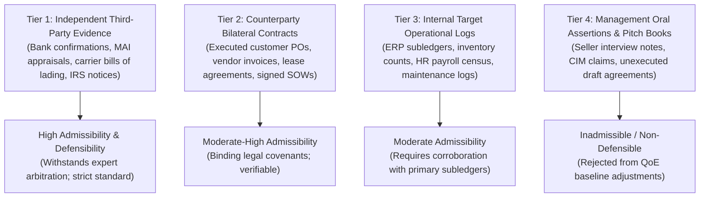

# Review & Dispute Adjudication Evidence Matrix
**Document Reference:** `QOE-EVID-MATRIX-08`  
**Engagement:** Apex Global Industrial Holding Inc. (Project Titanium)  
**Standard:** AICPA CS Section 100 / AAA Commercial Arbitration Evidentiary Standards  

---

## 1. Governance & Evidentiary Standard Architecture

In financial due diligence review and pushback defense, the credibility of an adjustment depends entirely on the tier of underlying documentary evidence.

---

## 2. Master Review & Adjudication Evidence Matrix

The matrix below maps every contested diligence finding to its required primary defense evidence, rebuttal evaluation criteria, acceptable concession triggers, arbitration admissibility standards, and mandatory partner sign-off tier.

| Ref ID | Contested Diligence Finding | Primary Diligence Defense Evidence | Rebuttal Evaluation Criteria | Acceptable Concession Trigger | Arbitration Admissibility Standard | Mandatory Partner Sign-off |
| :--- | :--- | :--- | :--- | :--- | :--- | :---: |
| `ADJ-009` | **Bill-and-Hold Margin Reversal** ($152,000) | 1. Customer PO stating FOB Destination 2. Carrier Bill of Lading dated Jan 6 3. Physical warehouse inventory logs showing unsegregated stock Dec 31 | Must satisfy all 4 SEC criteria under ASC 606: substantive reason, customer request, segregation, ready for shipment. | **Zero Concession Permitted.** Objective accounting error. Concede only if seller produces pre-Dec 31 customer-signed dock pickup receipt. | Absolute Admissibility. ASC 606 & SEC guidelines establish binding precedent for arbitration referee. | **Practice Leader & QRP** |
| `ADJ-003` | **Founder Replacement Compensation** ($150,000) | 1. Current organizational chart 2. Key customer account manager listings 3. Mercer Executive Compensation Survey (Midwest Distribution GM P50 $250k) | Determine actual commercial and executive scope of founder duties. Contrast against proposed junior replacement. | Verified independent executive compensation survey showing regional P40-P50 benchmarks for equivalent revenue scale ($20M-$30M). | High Admissibility. Independent salary surveys (Mercer, Robert Half) accepted by referees as standard FMV metric. | **Engagement Partner** |
| `ADJ-004` | **Related-Party Warehouse Rent** ($60,000) | 1. Certified MAI Appraisal by Cushman & Wakefield 2. 5 verified industrial NNN lease comps within 15-mile radius 3. Facility spec sheet (28ft clear height, 6 dock doors) | Comps must match functional utility: clear height, loading dock ratio, sprinkler rating, and NNN lease terms. | Newly produced certified MAI appraisal with closer comps matching exact physical specs and term. | High Admissibility. MAI appraisals conforming to USPAP standards are given presumptive weight in arbitration. | **Engagement Partner** |
| `ADJ-007` | **Customer Bad Debt Provision** ($110,000) | 1. 3-year historical AR write-off ledger 2. Customer bankruptcy docket (Great Plains) 3. Historical sales & margin run-rates | Commercial trade credit risk is inherent. Normalization must match credit losses against revenue earned. | Concede only if seller can prove bad debt was caused by external fraud covered by insurance with paid claim. | High Admissibility. GAAP matching principle requires bad debt expense against revenue generated. | **Engagement Partner** |
| `ADJ-008` | **Prospective 3PL Freight Savings** ($180,000) | 1. Historical outbound freight invoices 2. Echo Logistics contract analysis 3. Fuel surcharge schedule | Normalized historical EBITDA measures past maintainable performance under actual conditions, not future synergies. | Concession into Historical EBITDA strictly prohibited. Permitted only as separate Pro-Forma Synergy exhibit. | Inadmissible in Historical EBITDA. Accounting referees strictly exclude prospective unearned synergies. | **QRP Concurring Sign-off** |
| `ADJ-012` | **Commercial Strategy Consulting Fees** ($75,000) | 1. Consulting engagement agreement 2. Monthly advisory invoices & deliverables 3. SOW project descriptions | Expense must represent genuine one-off corporate transaction or reorganization, not ongoing commercial strategy. | Executed SOW and work deliverables proving fees were directly incurred for M&A data room preparation. | Moderate-High Admissibility. Third-party invoices and specific SOW deliverables establish one-off character. | **Engagement Partner** |
| `DBT-004` | **Stretched Accounts Payable > 60 Days** ($250,000) | 1. Detailed AP Aging subledger as of Dec 31 2. Supplier credit hold notices (Timken, Midwest Steel) 3. 24-month historical DPO trend curve | AP beyond standard trade credit terms that triggers credit holds represents non-operating borrowed cash. | Concede only if seller provides formal written vendor agreements establishing extended payment terms as standard policy. | High Admissibility. Vendor demand letters and credit hold notices provide objective proof of non-ordinary trade debt. | **Engagement Partner & QRP** |
| `DBT-006` | **Sales and Use Tax Nexus Exposure** ($68,000) | 1. Multi-state shipment sales reports 2. State-by-state economic nexus thresholds 3. Customer exemption certificate audit log | Under *South Dakota v. Wayfair*, physical presence is not required; economic nexus creates strict tax liability. | Concede only if seller produces valid, executed state resale exemption certificates for challenged customer accounts. | High Admissibility. State statutory nexus rules are strictly applied by arbitration referees. | **Engagement Partner** |
| `DBT-007` | **Unfunded Vacation / PTO Liability** ($45,000) | 1. Target employee handbook PTO policy 2. Year-end payroll census with accrued unused hours 3. State wage payment statutes (Kansas/Missouri) | Earned, unused vacation time represents a legal liability that vests upon employee termination. | Concede only if seller can prove company policy enforces an absolute 'use-it-or-lose-it' forfeiture upheld by state law. | High Admissibility. Statutory labor laws and written employee handbook terms govern referee determinations. | **Engagement Partner** |
| `DBT-008` | **SaaS Deferred Revenue Fulfillment Cost** ($110,000) | 1. AWS hosting infrastructure invoices 2. Engineering support timesheets 3. Customer SLA contracts | Under ASC 805, buyer inherits legally binding obligation to perform software services without cash inflow. | Concede pre-paid third-party software licenses and verifiable profit margins exceeding direct cost-to-serve. | Moderate-High Admissibility. ASC 805 fair value allocation standards govern treatment of contract liabilities. | **Practice Leader & QRP** |
| `DBT-009` | **Machinery Deferred Maintenance** ($60,000) | 1. DMG Mori certified technician report 2. Spindle vibration diagnostic logs (ISO 10816) 3. Factory overhaul price quotes | Maintenance halted to artificially maximize pre-deal cash flow resulting in imminent mechanical failure risk. | Seller executes spindle overhaul prior to closing with certified sign-off, or provides proof of OEM warranty coverage. | Moderate-High Admissibility. Independent technical engineering reports provide strong objective basis. | **Engagement Partner** |
| `PEG-001` | **Working Capital Target Peg Collar** ($0 True-Up) | 1. Executed LOI and draft SPA Exhibit B 2. 24-month historical NWC model 3. Closing Net Working Capital Statement ($4.375M) | Peg must reflect working capital required to support underwritten run-rate revenue without intra-year liquidity deficit. | Agreement on symmetrical collar band (+/- $75,000.00) around $4,300,000.00 target peg. | Absolute Admissibility. Contractual collar mechanisms in SPA Exhibit B govern closing true-up definitively. | **Practice Leader & Engagement Partner** |

---

## 3. Adjudication Sign-Off Authority & Escalation Protocol

To uphold professional independence and comply with AICPA quality control standards, the following governance protocol is enforced:

1. **Engagement Director / Senior Manager:** Authority to negotiate factual data verifications (e.g., verifying vendor invoices, recalculating payroll tax arithmetic). Zero authority to grant adjustments or concessions.
2. **Engagement Partner:** Authority to adjudicate Gate 2 documentary evidence items and Gate 3 commercial benchmark adjustments up to $\$50,000.00$.
3. **Quality Review Partner (QRP):** Mandatory concurring review and clearance required for any concession exceeding $\$50,000.00$, any reclassification across transaction pillars, and all technical accounting interpretations (ASC 606, ASC 805, ASC 842).
4. **National Transaction Advisory Practice Leader:** Mandatory consultation and approval required for:
   * Any concession involving an alleged objective accounting error.
   * Formal withdrawal of an issued diligence opinion or issues deck.
   * Responding to formal legal threats or litigation notices issued by target counsel or investment bankers.
