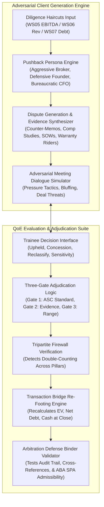

# Simulator Functional Specification: Review, Pushback Adjudication & Audit Defense
**Document Reference:** `QOE-SIM-SPEC-08`  
**Module:** Financial Due Diligence Simulator — Engine 08 (Adjudication & Defense)  
**Architecture Standard:** Full-Stack Simulation Engine / Python Backend & Relational SQL  

---

## 1. System Architecture Overview

Engine 08 simulates the high-stakes adversarial phase of financial due diligence. The system is split into two primary operational components:

1. **Adversarial Client Generation Engine:** Simulates realistic target CFO and sell-side M&A advisor behaviors, dynamically generating pushback arguments, submitting counter-calculation models, and uploading supplemental data room artifacts.
2. **QoE Evaluation Suite:** Evaluates the trainee's performance in conducting independent cold reviews, defending diligence haircuts during adversarial meetings, applying non-negotiable accounting rules, and assembling an audit-defensible arbitration binder.



---

## 2. Adversarial Client Generation Engine Specification

### 2.1 Persona Generation & Pushback Parameter Engine
The engine instantiates target negotiation agents parameterized by behavioral traits:

* **Aggressive M&A Investment Banker:** High pushback intensity (attacks every haircut over $\$25,000$), employs bluffing and relationship threats ("You will kill this deal and our firm will never hire your advisory practice again").
* **Defensive Founder:** Emotionally attached to historical owner expenses (defends personal travel and high salary), cites informal handshake agreements.
* **Technocratic Target CFO:** Provides voluminous, confusing operational reports and alternative accounting interpretations (claims deferred revenue has zero incremental delivery cost).

### 2.2 Dynamic Pushback Generation Algorithm (Pseudocode)

```python
class PushbackDisputeGenerator:
    def __init__(self, haircut_item, persona):
        self.item = haircut_item
        self.persona = persona

    def generate_pushback(self):
        # Determine pushback strategy based on haircut classification
        if self.item.classification == "Objective_Accounting_Error":
            # Target attempts to argue commercial intent or immateriality
            return {
                "dispute_id": f"PB-{self.item.id}",
                "argument": f"Customer verbally agreed to terms; reversing Invoice #{self.item.doc_id} penalizes us for shipment delays.",
                "counter_amount": 0.0,
                "evidence_type": "Oral_Assertion",
                "bluff_level": self.persona.aggression * 0.8
            }
        elif self.item.classification == "Discretionary_Expense":
            # Target claims termination at closing
            return {
                "dispute_id": f"PB-{self.item.id}",
                "argument": "Expenses were 100% discretionary and terminated prior to close; will never recur.",
                "counter_amount": 0.0,
                "evidence_type": "Executed_Termination_Agreement",
                "bluff_level": self.persona.aggression * 0.4
            }
        elif self.item.classification == "Debt_Like_Deduction":
            # Target claims ordinary working capital
            return {
                "dispute_id": f"PB-{self.item.id}",
                "argument": f"{self.item.account_name} is normal working capital trade float; deducting as debt is double-dipping.",
                "counter_amount": 0.0,
                "evidence_type": "Alternative_NWC_Model",
                "bluff_level": self.persona.aggression * 0.6
            }
```

---

## 3. QoE Evaluation Suite & Scoring Algorithms

The simulator scores the trainee across four competency dimensions:

1. **Accounting Integrity Score (Weight: 35%):** Penalizes any concession on objective GAAP errors (ASC 606 revenue recognition, topside plugs, funded debt). A concession on an objective error results in an immediate failing grade for that scenario.
2. **Evidentiary Rigor Score (Weight: 25%):** Evaluates whether concessions granted by the trainee were supported by Tier 1/Tier 2 evidence rather than oral management assertions.
3. **Tripartite Firewall Integrity (Weight: 20%):** Validates that concessions granted do not create double-counting or orphan adjustments across EBITDA, working capital, and net debt.
4. **Negotiation Value Retention (Weight: 20%):** Measures the percentage of defensible buyer cash savings retained post-adjudication against the optimal partner benchmark.

### 3.1 Scoring Algorithm Formulation

$$\text{Final Trainee Score} = (0.35 \times S_{\text{GAAP}}) + (0.25 \times S_{\text{Evidence}}) + (0.20 \times S_{\text{Firewall}}) + (0.20 \times S_{\text{Value}})$$

Where:
* $S_{\text{GAAP}} = 100 \times \left(1.0 - \frac{\text{Concessions on Objective Errors}}{\text{Total Objective Error Dollars}}\right)$
* $S_{\text{Evidence}} = 100 \times \left(\frac{\text{Concessions Backed by Tier 1/2 Evidence}}{\text{Total Concessions Granted}}\right)$
* $S_{\text{Firewall}} = 100 \times (1.0 - \text{Double Counting Instances})$
* $S_{\text{Value}} = 100 \times \min\left(1.0, \, \frac{\text{Retained Haircuts by Trainee}}{\text{Defensible Haircuts Benchmark}}\right)$

---

## 4. Relational Data Schemas (SQL DDL)

The simulation engine persists review files, disputes, and adjudication outcomes using the following production relational SQL schema:

```sql
-- Table 1: Quality Review Partner Cold Review Checklist & Audit Log
CREATE TABLE ReviewChecklist (
    query_id VARCHAR(32) PRIMARY KEY,
    workstream_ref VARCHAR(32) NOT NULL,
    contested_item_desc VARCHAR(255) NOT NULL,
    target_division VARCHAR(64) NOT NULL,
    preliminary_amount DECIMAL(15, 2) NOT NULL,
    cold_review_query TEXT NOT NULL,
    primary_team_response TEXT NOT NULL,
    clearance_status VARCHAR(32) CHECK (clearance_status IN ('OPEN', 'PENDING_EVIDENCE', 'CLEARED', 'CLEARED_WITH_OBSERVATION', 'REJECTED')),
    clearance_date DATE,
    partner_notes TEXT,
    created_at TIMESTAMP DEFAULT CURRENT_TIMESTAMP
);

-- Table 2: Seller & Broker Pushback Disputes
CREATE TABLE PushbackDispute (
    dispute_id VARCHAR(32) PRIMARY KEY,
    workstream_origin VARCHAR(32) NOT NULL,
    contested_line_item VARCHAR(128) NOT NULL,
    target_division VARCHAR(64) NOT NULL,
    preliminary_haircut DECIMAL(15, 2) NOT NULL,
    seller_pushback_argument TEXT NOT NULL,
    seller_counter_amount DECIMAL(15, 2) NOT NULL,
    qoe_rebuttal_evidence TEXT NOT NULL,
    evidence_tier VARCHAR(16) CHECK (evidence_tier IN ('TIER_1_THIRD_PARTY', 'TIER_2_BILATERAL', 'TIER_3_INTERNAL', 'TIER_4_ORAL')),
    status VARCHAR(32) DEFAULT 'PENDING_MEETING'
);

-- Table 3: Formal Partner Adjudication Decisions
CREATE TABLE AdjudicationDecision (
    decision_id VARCHAR(32) PRIMARY KEY,
    dispute_id VARCHAR(32) NOT NULL REFERENCES PushbackDispute(dispute_id),
    adjudication_ruling VARCHAR(32) CHECK (adjudication_ruling IN ('UPHELD_IN_FULL', 'PARTIAL_CONCESSION', 'RECLASSIFIED_SENSITIVITY', 'COLLAR_COMPROMISE', 'CONCEDED_IN_FULL')),
    final_adjudicated_amount DECIMAL(15, 2) NOT NULL,
    concession_delta DECIMAL(15, 2) NOT NULL,
    tripartite_classification VARCHAR(32) CHECK (tripartite_classification IN ('EBITDA_Normalizations', 'Revenue_Quality_Reversal', 'Debt_Like_Items', 'Working_Capital_Peg', 'Pro_Forma_Sensitivity')),
    partner_signoff VARCHAR(32) CHECK (partner_signoff IN ('PENDING', 'PARTNER_APPROVED', 'PRACTICE_LEADER_APPROVED', 'REJECTED')),
    concession_justification TEXT NOT NULL,
    adjudicated_at TIMESTAMP DEFAULT CURRENT_TIMESTAMP
);

-- Table 4: Post-Closing Arbitration Defense Binder Line Items
CREATE TABLE AuditDefenseBinderLineItem (
    binder_id VARCHAR(32) PRIMARY KEY,
    dispute_ref VARCHAR(32) NOT NULL,
    contested_account_name VARCHAR(128) NOT NULL,
    spa_section VARCHAR(64) NOT NULL,
    diligence_value DECIMAL(15, 2) NOT NULL,
    seller_position TEXT NOT NULL,
    referee_standard TEXT NOT NULL,
    evidence_document_paths TEXT NOT NULL,
    win_probability_pct DECIMAL(5, 2) NOT NULL,
    expected_recovery_value DECIMAL(15, 2) NOT NULL,
    workpaper_index_ref VARCHAR(32) NOT NULL,
    created_at TIMESTAMP DEFAULT CURRENT_TIMESTAMP
);
```

---

## 5. State Machine: Dispute Adjudication Lifecycle

The lifecycle of every contested diligence finding is governed by a finite state machine:

```
[Preliminary Finding Issued] 
           │
           ▼
[QRP Cold Review] ───(Query Flagged)───► [Technical Challenge Log]
           │                                        │
      (Cleared)                                (Supplemental Proof)
           │                                        │
           ▼◄───────────────────────────────────────┘
[Sponsor Alignment Triage]
           │
           ▼
[Seller Pushback Received] ───► [Dispute Logged in Register]
                                            │
                                            ▼
                               [Adversarial Defense Meeting]
                                            │
                                            ▼
                               [Three-Gate Evaluation]
                                     │     │     │
                 ┌───────────────────┘     │     └───────────────────┐
                 ▼                         ▼                         ▼
         [Gate 1: Standard]       [Gate 2: Evidence]         [Gate 3: Benchmark]
         (Hold Line / Upheld)     (Calibrate Fact Delta)     (Collar / Sensitivity)
                 │                         │                         │
                 └───────────────────┬─────┴─────────────────────────┘
                                     │
                                     ▼
                      [Tripartite Firewall Re-Audit]
                                     │
                                     ▼
                      [Partner Adjudication Sign-Off]
                                     │
                                     ▼
                      [Audit Defense Binder Lockdown]
```
