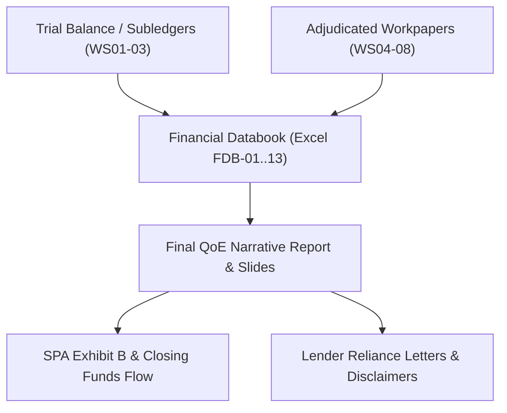

# Final Reporting & Disclosure Evidence Matrix
**Document Reference:** `QOE-EVID-MATRIX-09`  
**Engagement:** Apex Global Industrial Holding Inc. (Project Titanium)  
**Standard:** AICPA CS Section 100 / Professional Quality Control Standards / ABA Model SPA  

---

## 1. Governance & Cross-Referencing Architecture

In institutional transaction reporting, every narrative statement, analytical exhibit, and balance sheet disclosure in the final report must be mathematically and evidentiary anchored to an underlying workpaper and Financial Databook coordinate.

---

## 2. Master Reporting & Disclosure Evidence Matrix

The matrix below links every major report finding, valuation adjustment, and balance sheet disclosure to its underlying workpaper origin, Financial Databook cell coordinate, required legal disclaimer, reliance eligibility, and mandatory partner sign-off level.

| Report Section Ref | Disclosed Diligence Finding | Underlying Workpaper Ref | FDB Tab & Cell Coordinate | Mandatory Legal Disclaimer / Disclosure Note | Reliance Eligibility | Liability Cap Multiple | Mandatory Sign-off Level |
| :--- | :--- | :--- | :--- | :--- | :--- | :---: | :---: |
| **Section 1.1** | **Headline Enterprise Value ($29,284,000)** | `WS08-ADJ-DEC-01` | `01_ExecSummary!E12` | Based on 8.0x agreed LOI multiple applied to Adjudicated Normalized EBITDA; subject to closing working capital true-up. | Full Reliance | 2.0x Fees | **Lead Engagement Partner** |
| **Section 1.2** | **Final Equity Purchase Price ($24,797,550)**| `WS08-FIN-EVB-01` | `01_ExecSummary!E24` | Reflects cash delivered at close after funded debt payoffs, debt-like deductions, and working capital collar deadband. | Full Reliance | 2.0x Fees | **Lead Engagement Partner** |
| **Section 3.1** | **Normalized Operating EBITDA ($3,660,500)** | `WS05-NORM` / `WS08` | `04_EBITDA_Bridge!N45` | Normalization adjustments reflect maintainable operating performance; excludes unearned future 3PL cost savings. | Full Reliance | 2.0x Fees | **Quality Review Partner** |
| **Section 3.2** | **Founder Replacement Compensation ($225,000)** | `WS05-ADJ-003` / `WS08` | `04_EBITDA_Bridge!N15` | Based on independent regional Mercer P40 executive compensation benchmark for Kansas City wholesale distribution GM. | Full Reliance | 2.0x Fees | **Lead Engagement Partner** |
| **Section 3.3** | **Related-Party Warehouse Rent ($60,000 Add-Back)**| `WS05-ADJ-004` / `WS08` | `04_EBITDA_Bridge!N16` | Supported by certified Cushman & Wakefield MAI appraisal conforming to USPAP standards (28ft clear height comps). | Full Reliance | 2.0x Fees | **Lead Engagement Partner** |
| **Section 4.1** | **ASC 606 Bill-and-Hold Reversal ($152,000 Margin)**| `WS06-REV-001` / `WS08` | `04_EBITDA_Bridge!N28` | Fails ASC 606 criteria; contract specifies FOB Destination terms; carrier BOL proves shipment occurred Jan 6. | Full Reliance | 2.0x Fees | **Quality Review Partner** |
| **Section 4.2** | **Customer Bad Debt Provision Rejection ($110,000)**| `WS05-ADJ-007` / `WS08` | `04_EBITDA_Bridge!N22` | Commercial trade credit risk is inherent to customer relationship; 3-year historical credit loss rate averaged 0.30%. | Full Reliance | 2.0x Fees | **Lead Engagement Partner** |
| **Section 5.1** | **Target Working Capital Peg ($4,300,000)** | `WS07-PEG-01` / `WS08` | `08_WorkingCapital!P22`| Percentage-of-revenue run-rate methodology; subject to agreed contractual +/- $75k collar band in SPA Exhibit B. | Full Reliance | 2.0x Fees | **Lead Engagement Partner** |
| **Section 5.2** | **Closing Working Capital True-Up ($0.00)** | `WS07-PEG-ADJ` / `WS08` | `08_WorkingCapital!P34`| Delivered Closing NWC of $4,375,000 lands on upper collar boundary; results in exactly $0.00 cash adjustment at close. | Full Reliance | 2.0x Fees | **Practice Leader** |
| **Section 6.1** | **Stretched Accounts Payable Over 60 Days ($250,000)**| `WS07-DBT-004` / `WS08` | `09_NetDebt!D14` | Reclassified to Net Debt due to vendor credit holds and cash drag; excluded from Delivered Working Capital. | Full Reliance | 2.0x Fees | **Quality Review Partner** |
| **Section 6.2** | **State Sales and Use Tax Exposure ($68,000)** | `WS07-DBT-006` / `WS08` | `09_NetDebt!D16` | Economic nexus established under South Dakota v. Wayfair; requires segregated 24-month indemnity escrow. | Full Reliance | 2.0x Fees | **Lead Engagement Partner** |
| **Section 6.3** | **SaaS Deferred Revenue Haircut ($110,000)** | `WS07-DBT-008` / `WS08` | `09_NetDebt!D18` | Post-close obligation fulfillment cost under ASC 805; net of verified $40k pre-paid third-party software licenses. | Full Reliance | 2.0x Fees | **Quality Review Partner** |
| **Section 6.4** | **CNC Machinery Deferred Maintenance ($60,000)** | `WS07-DBT-009` / `WS08` | `09_NetDebt!D19` | Deliberate 12-month deferral; verified via DMG Mori vibration report; net of $25k pre-close fix and $35k warranty. | Full Reliance | 2.0x Fees | **Lead Engagement Partner** |
| **Section 7.1** | **Unlevered Free Cash Flow Conversion (71.5%)** | `WS07-FCF` / `WS09` | `10_CapEx_FixedAssets!N32`| Reflects maintenance CapEx of $420k (1.7% of rev); excludes discretionary growth CapEx of $365k. | Lender Reliance Only | 1.0x Fees | **Technical Review Partner** |
| **Section 8.1** | **Prospective 3PL Freight Savings ($180,000 Pro-Forma)**| `WS05-ADJ-008` / `WS08` | `04_EBITDA_Bridge!N55` | Excluded from historical normalized baseline; presented as pro-forma sensitivity exhibit for debt-sizing purposes. | Informational Only | Zero Reliance | **Lead Engagement Partner** |
| **Section 10.1**| **AICPA CS 100 Scope & Liability Disclaimers** | `WS09-DISCLAIMER` | `00_Index!B40` | Standard transaction consulting scope limitations; report prepared solely for client; no audit opinion expressed. | All Parties | N/A | **Practice Leader** |

---

## 3. Legal Reliance Standards & Liability Caps

To manage legal exposure and uphold professional practice standards, the following reliance framework is enforced:

1. **Private Equity Sponsor (Client):** Full legal reliance granted under the primary Master Services Agreement (MSA), with aggregate liability capped at two times ($2.0\text{x}$) total professional fees paid.
2. **Senior Syndicated Lenders:** Full legal reliance granted upon execution of a formal tripartite **Lender Reliance Letter**, subject to a maximum liability cap of one times ($1.0\text{x}$) professional fees paid, an aggregate 12-month claim survival window, and standard carve-outs for subsequent events or unauthorized syndication.
3. **Secondary Co-Investors & Equity Syndicates:** Access permitted strictly on a **Non-Reliance / Hold-Harmless** basis. Secondary parties must execute a formal acknowledgment that the report was prepared solely for the primary sponsor and cannot be relied upon for investment decisions.
4. **Target Company & Sell-Side Advisors:** Review copies distributed strictly as **"Privileged & Confidential — Draft for Discussion Only"** for factual verification; zero third-party reliance permitted under any circumstances.
