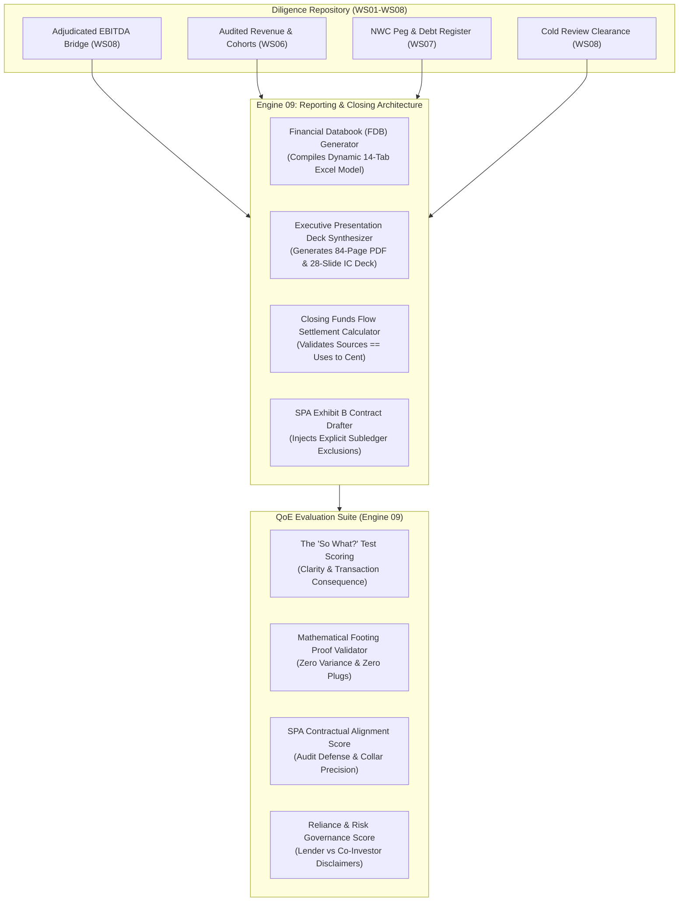

# Simulator Functional Specification: Final Reporting & Transaction Closing
**Document Reference:** `QOE-SIM-SPEC-09`  
**Module:** Financial Due Diligence Simulator — Engine 09 (Reporting & Closing Engine)  
**Architecture Standard:** Full-Stack Simulation Engine / Python Backend & Relational SQL  

---

## 1. System Architecture Overview

Engine 09 represents the concluding delivery module of the QoE Simulator. It simulates the compilation of dynamic, formula-linked financial databooks, generates high-impact executive presentation decks, and evaluates trainee performance in translating forensic diligence findings into definitive transaction closing contracts.



---

## 2. Dynamic Financial Databook & Report Generation Engine

### 2.1 Formula Linkage & Integrity Engine
The simulator's Python backend programmatically compiles the multi-tab Financial Databook (FDB) using dynamic formulas rather than static values:

```python
class DatabookCompilationEngine:
    def __init__(self, target_data, adjustments, debt_items, working_capital):
        self.data = target_data
        self.adj = adjustments
        self.debt = debt_items
        self.wc = working_capital

    def compile_ebitda_bridge_tab(self):
        """Generates dynamic formulas linking reported EBITDA to normalized EBITDA."""
        rows = []
        # Row 1: Reported Operating EBITDA
        rows.append({"label": "Reported Operating EBITDA", "formula": "=03_IncomeStatement_Monthly!N45"})
        
        # Rows 2..k: Normalization Add-Backs
        for item in self.adj:
            rows.append({
                "label": item.description,
                "formula": f"=SUMIFS(Master_Adjustments!D:D, Master_Adjustments!A:A, '{item.id}')",
                "classification": item.pillar
            })
            
        # Summary Row: Adjudicated Normalized EBITDA
        rows.append({
            "label": "Normalized Operating EBITDA",
            "formula": "=SUM(E10:E35)",
            "check": "Zero plug validation"
        })
        return rows
```

### 2.2 Executive Summary "So What?" Evaluation Algorithm
The system parses executive findings drafted by trainees and scores them against the institutional three-part structure:

$$\text{Clarity Score } (S_{\text{SoWhat}}) = \frac{\sum_{i=1}^{N} \left( w_1 \cdot \text{Fact}_i + w_2 \cdot \text{Evidence}_i + w_3 \cdot \text{Consequence}_i \right)}{N}$$

Where:
* $\text{Fact}_i \in \{0, 1\}$: Identifies the empirical accounting observation.
* $\text{Evidence}_i \in \{0, 1\}$: Cites specific third-party documents (e.g., carrier BOL, appraisal, subledger).
* $\text{Consequence}_i \in \{0, 1\}$: Explicitly states dollar impact on valuation multiple, net debt, or escrow holdback.
* $w_1 = 0.20, \quad w_2 = 0.30, \quad w_3 = 0.50$.

---

## 3. QoE Trainee Evaluation Suite & Scoring Metrics

Trainees are evaluated across four core performance dimensions:

1. **Mathematical Footing & Cross-Tab Integrity (Weight: 30%):** Validates that all report exhibits, bridges, and databook tabs foot to the exact cent without balancing plugs or rounding errors.
2. **Executive Clarity & The "So What?" Test (Weight: 25%):** Assesses whether risk observations and findings communicate clear commercial consequences for investment committee decision-makers.
3. **Legal SPA Alignment & Funds Flow Precision (Weight: 25%):** Verifies that SPA Exhibit B accounting language correctly incorporates all debt-like exclusions and target peg collar terms, and that Closing Funds Flow Sources and Uses balance to $\$0.00$.
4. **Reliance & Quality Governance (Weight: 20%):** Evaluates appropriate use of lender reliance letters, liability caps, and AICPA CS Section 100 scope limitations.

### 3.1 Composite Engine 09 Score Formulation

$$\text{Final Reporting Score} = (0.30 \times S_{\text{Footing}}) + (0.25 \times S_{\text{SoWhat}}) + (0.25 \times S_{\text{SPA}}) + (0.20 \times S_{\text{Governance}})$$

Any discrepancy in the Sources and Uses equation ($\sum \text{Sources} \neq \sum \text{Uses}$) triggers an automatic $S_{\text{Footing}} = 0.00$ failure.

---

## 4. Relational Data Schemas (SQL DDL)

The reporting module utilizes the following relational database schema to persist report deliverables, databook schemas, findings, and closing settlement transactions:

```sql
-- Table 1: Final Deliverable Package & Governance Tracker
CREATE TABLE ReportDeliverable (
    deliverable_id VARCHAR(32) PRIMARY KEY,
    deliverable_name VARCHAR(255) NOT NULL,
    classification VARCHAR(64) CHECK (classification IN ('Core Diligence Report', 'Financial Model', 'Executive Briefing Deck', 'Financing Diligence Pack', 'Legal Transaction Exhibit', 'Closing Settlement Schedule', 'Operating Segment Report', 'Audit Defense Dossier')),
    target_entity VARCHAR(128) NOT NULL,
    file_format VARCHAR(32) CHECK (file_format IN ('PDF_Document', 'Excel_Workbook', 'PowerPoint_Deck', 'Word_Legal_Doc')),
    page_tab_count VARCHAR(32) NOT NULL,
    primary_stakeholder VARCHAR(128) NOT NULL,
    reliance_status VARCHAR(64) CHECK (reliance_status IN ('Full Legal Reliance', 'Internal Confidential', 'Privileged Contract Schedule', 'Definitive Closing Execution', 'Privileged Defense File')),
    liability_cap_multiple DECIMAL(5, 2),
    signoff_partner VARCHAR(64) NOT NULL,
    archive_status VARCHAR(32) DEFAULT 'ARCHIVED_LOCKED',
    created_at TIMESTAMP DEFAULT CURRENT_TIMESTAMP
);

-- Table 2: Financial Databook Master Tabs & Formula Dependencies
CREATE TABLE DatabookTab (
    tab_id VARCHAR(32) PRIMARY KEY,
    tab_name VARCHAR(64) NOT NULL,
    tab_classification VARCHAR(64) NOT NULL,
    subject_area VARCHAR(128) NOT NULL,
    periodicity VARCHAR(32) NOT NULL,
    formula_dependencies TEXT NOT NULL,
    key_metrics_generated TEXT NOT NULL,
    reconciliation_anchor TEXT NOT NULL,
    audit_status VARCHAR(32) DEFAULT 'AUDITED_LOCKED'
);

-- Table 3: Executive Findings & The "So What?" Registry
CREATE TABLE ExecutiveFinding (
    finding_id VARCHAR(32) PRIMARY KEY,
    report_section VARCHAR(64) NOT NULL,
    finding_title VARCHAR(255) NOT NULL,
    factual_observation TEXT NOT NULL,
    forensic_evidence TEXT NOT NULL,
    transaction_consequence TEXT NOT NULL,
    valuation_impact_usd DECIMAL(15, 2) NOT NULL,
    balance_sheet_impact_usd DECIMAL(15, 2) NOT NULL,
    risk_severity VARCHAR(16) CHECK (risk_severity IN ('HIGH', 'MEDIUM', 'LOW')),
    fdb_cell_reference VARCHAR(64) NOT NULL
);

-- Table 4: Master Closing Funds Flow Settlement Items
CREATE TABLE ClosingFundsFlowItem (
    item_id VARCHAR(32) PRIMARY KEY,
    flow_category VARCHAR(32) CHECK (flow_category IN ('Sources_of_Funds', 'Uses_of_Funds')),
    pillar_classification VARCHAR(64) NOT NULL,
    payor_entity VARCHAR(128) NOT NULL,
    payee_entity VARCHAR(128) NOT NULL,
    wire_routing_ref VARCHAR(64) NOT NULL,
    amount_usd DECIMAL(15, 2) NOT NULL,
    payment_method VARCHAR(64) NOT NULL,
    verification_doc_ref VARCHAR(128) NOT NULL,
    accounting_treatment TEXT NOT NULL,
    created_at TIMESTAMP DEFAULT CURRENT_TIMESTAMP
);
```

---

## 5. State Machine: Transaction Deliverable & Closing Execution

```
[Adjudicated Findings Locked (WS08)]
                  │
                  ▼
[Financial Databook Compilation (FDB)] ───► [Cross-Tab GL Tie-Out Audit]
                  │                                     │
                  │◄────────────────────────────────────┘
                  ▼
[QoE Narrative Report & IC Deck Drafting]
                  │
                  ▼
[Independent QRP Cold Review Sign-Off]
                  │
                  ▼
[Buyer Sponsor "Draft for Discussion" Walkthrough]
                  │
                  ▼
[Multi-Party Management Read-Out Meeting]
                  │
        ┌─────────┴─────────┐
        ▼                   ▼
[Lender Reliance Letter] [SPA Exhibit B Legal Schedule]
        │                   │
        └─────────┬─────────┘
                  │
                  ▼
[Definitive Closing Funds Flow Execution (Sources == Uses)]
                  │
                  ▼
[Post-Closing True-Up Settlement & Archive Lockdown]
```
