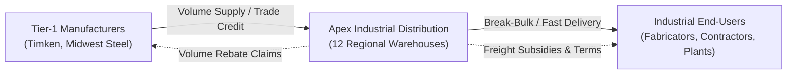

# Quality of Earnings Reference Guide: Industrial Distribution & Wholesale
**Document Reference:** `QOE-MODEL-DIST-01`  
**Industry Classification:** Wholesale Trade / Industrial Equipment & Supply Distribution (NAICS 423830 / 423840)  
**Standard Compliance:** US GAAP / AICPA Transaction Advisory Practice Guidelines  
**Representative Subject:** Apex Industrial Distribution (Division 1 of Project Titanium)  

---

## 1. Industry Economic Architecture & Business Model Dynamics

Industrial distribution businesses function as the critical logistical and financing intermediaries between high-volume manufacturers (OEMs) and fragmented B2B industrial customers.

### Core Economic Fundamentals:
- **Low Operating Margin / High Capital Velocity:** Wholesale distribution operates on thin gross margins ($14.0\%$ to $18.0\%$) and modest EBITDA margins ($4.0\%$ to $8.0\%$). Valuation is driven by **invested capital velocity**—the ability to turn working capital rapidly without bad debt leakage.
- **The Vendor Rebate Profit Engine:** In many industrial sectors, up to $30\%$ to $50\%$ of reported net operating income is generated not from the gross spread on invoices, but from backend **vendor volume rebates, co-op marketing funds, and prompt-pay cash discounts**.
- **Customer Credit Financing:** Distributors effectively act as unrated commercial banks, extending Net 30 to Net 60 trade credit to local contractors while attempting to negotiate Net 60 to Net 90 terms with large suppliers.

---

## 2. Critical Quality of Earnings Diligence Focus Areas

In financial due diligence on wholesale distributors, QoE practitioners audit five core risk areas:

### 2.1 Vendor Volume Rebates & Clawback Exposure
* **The Accounting Mechanism:** Distributors accrue vendor rebates monthly based on estimated annual purchase tiers under vendor rebate agreements.
* **The Forensic Hazard:** Management routinely over-accrues rebates by assuming the company will achieve the highest tier discount (e.g., $6.0\%$ rebate on $\$10\text{M}$ annual purchases). If Q4 purchasing slows, the distributor misses the volume threshold, triggering retroactive clawbacks and unearned accrual write-offs.
* **QoE Audit Procedure:**
  1. Inspect executed vendor rebate agreements for all Tier-1 suppliers ($>70\%$ of spend).
  2. Audit purchase tracking schedules vs. actual vendor invoices to verify progress toward tier thresholds.
  3. Reconcile year-end vendor confirmations against accrued rebate receivables.
  4. Normalize EBITDA by reversing unachieved tier accruals (`ADJ-DIST-REB`).

### 2.2 Inventory Obsolescence & Dead Stock (LCNRV / ASC 330)
* **The Operational Reality:** Distributors stock thousands of slow-moving replacement parts (SKUs) to guarantee next-day delivery to customers.
* **The Forensic Hazard:** Management resists writing down aging inventory, claiming parts "do not spoil and will eventually be sold." In reality, discontinued lines, superseded technical specs, and customer cancellations leave significant "dead stock" on the warehouse floor.
* **Quantitative Aging Standard:**
  $$\text{Obsolescence Reserve Requirement} = \sum \left( \text{SKU Value}_{>180\text{d}} \times 25\% \right) + \sum \left( \text{SKU Value}_{>360\text{d}} \times 50\% \right) + \sum \left( \text{SKU Value}_{>720\text{d}} \times 100\% \right)$$
* **QoE Finding in Project Titanium:** Audit of 14,200 SKUs uncovered $\$270,000.00$ in inventory with zero movement in $>360$ days, against a reported reserve of only $\$125,000.00$, requiring a **$-\$145,000.00$ working capital reserve expansion**.

### 2.3 Stretched Accounts Payable & Supplier Credit Holds
* **The Cash Window-Dressing Tactic:** To artificially preserve cash prior to sale, sellers stretch vendor payables beyond contractual terms (e.g., increasing DPO from 42 days to 60+ days).
* **The Diligence Reclassification:** Aged payables $>60$ days past due that trigger supplier credit holds or COD restrictions cease to function as normal operating working capital. Leaving them in NWC forces the buyer to inject emergency Day-1 cash to restore supply.
* **Standard Treatment:** Reclassify the stretched portion directly to **Debt-Like Items** ($-\$250,000.00$ in Apex Industrial), reducing the purchase price dollar-for-dollar.

### 2.4 Outbound Freight Subsidies & Delivery Margin Leakage
* **The Hidden Margin Drag:** Distributors frequently offer "Free Freight" on orders exceeding minimal thresholds to win accounts. In periods of diesel fuel inflation, outbound shipping costs erode delivered margins.
* **QoE Procedure:** Reconcile gross product margins against outbound freight invoices by customer account to determine **Net Delivered Customer Margin**.

---

## 3. Working Capital Drivers & Cash Conversion Cycle

The cash generation profile of industrial distribution is governed by the Cash Conversion Cycle (CCC):

$$\text{Cash Conversion Cycle (CCC)} = \text{DSO} + \text{DIO} - \text{DPO}$$

### Benchmark Working Capital Metrics (Apex Industrial Baseline):
* **Days Sales Outstanding (DSO):** $51.2\text{ days}$ (Target trade terms: Net 30; aging indicates slow collections in construction tier).
* **Days Inventory Outstanding (DIO):** $58.4\text{ days}$ (Reflects branch warehouse safety stock).
* **Days Payable Outstanding (DPO):** $41.5\text{ days}$ (Normalized baseline; unadjusted Q4 reported was $58.2\text{ days}$ due to deliberate stretching).
* **Normalized Cash Conversion Cycle:** $51.2 + 58.4 - 41.5 = \mathbf{68.1\text{ days}}$.

---

## 4. Standard Diligence Schedules & Analytical Workpapers

In every wholesale distribution engagement, the diligence file must include:
1. **Vendor Rebate Waterfall & Confirmation Matrix:** SKU purchase volumes, contractual tier thresholds, accrued rebate balances, and post-closing audit tie-outs.
2. **SKU Velocity & Inventory Aging Model:** Unit counts, extended cost, 12-month trailing consumption, and Lower of Cost or Net Realizable Value (LCNRV) reserve analysis.
3. **Accounts Payable Aging Stratification:** Current, 1–30, 31–60, 61–90, and 90+ days past due, cross-referenced to supplier credit hold letters.
4. **Customer Gross Margin Distribution Curve:** Net delivered profitability stratified across customer deciles, isolating unprofitable accounts receiving excessive freight subsidies.
