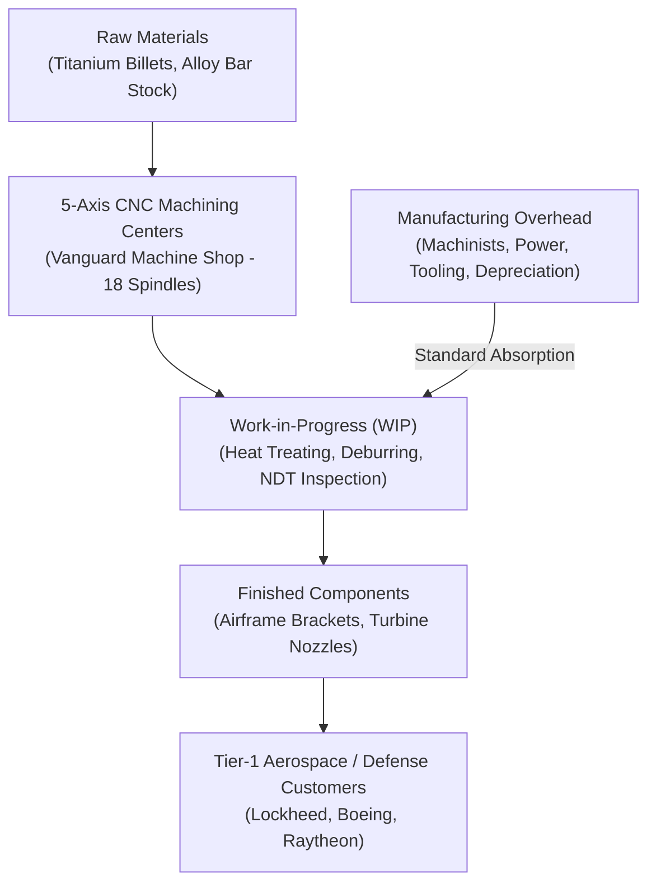

# Quality of Earnings Reference Guide: Precision Manufacturing & Defense Components
**Document Reference:** `QOE-MODEL-MFG-02`  
**Industry Classification:** Precision Turned Product & Aerospace Parts Manufacturing (NAICS 332721 / 336412)  
**Standard Compliance:** US GAAP / ASC 606 / AS9100 Quality Standards / FAR Cost Principles  
**Representative Subject:** Vanguard Aerospace Components (Division 2 of Project Titanium)  

---

## 1. Industry Economic Architecture & Manufacturing Operations

Precision aerospace and defense manufacturing operates within a high-barrier, capital-intensive environment characterized by multi-axis CNC machining, tight physical tolerances ($\pm 0.0001\text{ inches}$), specialized alloy metallurgy (Titanium, Inconel), and strict regulatory certifications (AS9100 / FAA / ITAR).

### Core Economic Fundamentals:
- **Capital Intensity & Fixed Cost Absorption:** Gross margins are relatively high ($35.0\%$ to $45.0\%$), but profitability is heavily sensitive to **machine spindle utilization (Overall Equipment Effectiveness - OEE)**. Unabsorbed overhead during production volume drops creates immediate margin compression.
- **Multi-Year Program Lifecycles:** Aerospace components are sole-sourced under multi-year platform contracts (e.g., F-35 Joint Strike Fighter program). Winning a platform provides stable revenue for 10–20 years, but exposes the manufacturer to severe contract renegotiation and cancellation risk.
- **Complex Inventory Costing:** Inventory consists of three distinct stages: Raw Materials, Work-in-Progress (WIP), and Finished Goods, carrying absorbed direct labor and capitalized factory overhead.

---

## 2. Critical Quality of Earnings Diligence Focus Areas

In financial due diligence on precision manufacturers, QoE teams audit six core risk areas:

### 2.1 Standard Costing & Overhead Absorption Variance (ASC 330)
* **The Accounting Mechanism:** Manufacturers utilize a standard costing system, allocating direct labor and factory overhead to WIP and Finished Goods based on predetermined standard labor hours and machine rates.
* **The Forensic Hazard (Over-Absorption Distortion):**
  - When production volume is high, the company "over-absorbs" fixed manufacturing overhead into inventory assets on the balance sheet, artificially lowering Cost of Goods Sold (COGS) and inflating reported EBITDA.
  - If inventory builds up prior to a transaction, reported EBITDA reflects **unearned factory overhead capitalization** rather than genuine commercial profitability.
* **QoE Audit Procedure:**
  1. Inspect annual and monthly standard cost variance accounts (Material Price Variance, Labor Efficiency Variance, Overhead Volume Variance).
  2. Verify whether production volume variance was properly credited against inventory or flushed to COGS at year-end.
  3. Normalize EBITDA by reversing the profit impact of inventory build-up driven by over-absorption (`ADJ-MFG-ABS`).

### 2.2 ASC 606 Contract Revenue Recognition: Percentage-of-Completion vs. Point-in-Time
* **The Revenue Mechanism:** Long-term defense subcontracts often attempt to recognize revenue "over time" using the **Cost-to-Cost Input Method** (percentage-of-completion) under ASC 606-10-25-27.
* **The Forensic Hazard:** Management frequently overestimates the percentage of completion or underestimates "Estimated Costs at Completion" (EAC), recognizing revenue prematurely on uncompleted production lots.
* **Contract Loss Accruals (Onerous Contracts):** Under ASC 605-35 / ASC 606, when current estimates indicate a long-term fixed-price contract will result in a total loss, **the entire anticipated loss must be recognized immediately in the current period**, not deferred across future production runs.

### 2.3 Machinery Maintenance: Discretionary vs. Deferred CapEx (OEE & Vibration Analysis)
* **The Cash Generation Illusion:** To inflate cash flow in the 12–24 months prior to sale, target owners routinely defer scheduled spindle overhauls, coolant system replacements, and axis calibrations on CNC machining centers.
* **The Forensic Inspection:**
  - Standard manufacturer specifications (DMG Mori, Mazak, Makino) require spindle rebuilds every 8,000–10,000 cutting hours.
  - Independent engineering inspection reports and **vibration spectrum analysis (ISO 10816)** identify worn bearings, spindle runout, and imminent catastrophic failure.
* **Standard Treatment in Project Titanium:** The $\$120,000.00$ deferred maintenance backlog on Vanguard’s 4 CNC centers was adjudicated as an unrecorded operational debt; net of $\$25,000.00$ pre-closing repairs and $\$35,000.00$ warranty coverage, a **$-\$60,000.00$ Net Debt deduction** was enforced.

### 2.4 Tooling Ownership, Capitalization & Amortization
* **The Ownership Conflict:** High-precision manufacturing requires expensive custom tooling, dies, and CNC fixtures ($10,000 to $100,000 per part).
* **The Diligence Audit:** Verify whether tooling is owned by the manufacturer (capitalized PP&E) or owned by the aerospace customer (customer-funded tooling). If customer-funded tooling is capitalized on the target’s balance sheet, it represents an unrecorded liability to return or maintain customer assets.

### 2.5 Scrap Rate Normalization & Secondary Metal Recovery
* **The Normalization Issue:** High-value titanium and nickel alloy machining generates significant scrap shavings ($30\%$ to $60\%$ of input billet weight).
* **QoE Treatment:** Scrap metal sales are recurring operational recoveries that reduce net material costs. However, one-time sales of accumulated scrap stockpiles or spikes in scrap prices must be normalized to trailing historical baseline scrap yields.

---

## 3. Working Capital & Inventory Valuation Framework

Manufacturing Net Working Capital is dominated by multi-tier inventory:

$$\text{Manufacturing NWC} = \text{Receivables} + (\text{Raw Materials} + \text{WIP} + \text{Finished Goods} - \text{E&O Reserve}) - \text{Trade AP} - \text{Accrued Payroll/Overhead}$$

### Benchmark Working Capital Metrics (Vanguard Aerospace):
* **Raw Materials Holding Period:** $45.2\text{ days}$ (Required due to specialized aerospace alloy mill lead times of 16–24 weeks).
* **WIP Cycle Time:** $32.8\text{ days}$ (Machining, heat treatment, anodizing, CMM quality inspection).
* **Finished Goods Holding Period:** $18.4\text{ days}$ (Buffer stock for customer pull-signal release under LTAs).
* **Total Manufacturing DIO:** $45.2 + 32.8 + 18.4 = \mathbf{96.4\text{ days}}$.

---

## 4. Standard Diligence Schedules & Analytical Workpapers

In every precision manufacturing engagement, the diligence file must include:
1. **Long-Term Contract EAC & Revenue Recognition Audit Schedule:** Contract price, total costs incurred to date, estimated costs at completion, percentage complete, and recognized revenue tie-out.
2. **Standard Cost Absorption & Variance Analysis:** Monthly labor and machine hour absorption, spending variance, efficiency variance, and overhead roll-up.
3. **Machine Center Utilization & Maintenance Schedule:** Machine age, cutting hours, spindle runout measurements, OEM scheduled maintenance history, and estimated replacement cost.
4. **Scrap Yield & Material Balance Reconciliation:** Input metal weight vs. finished part weight vs. documented scrap metal recovery sales.
