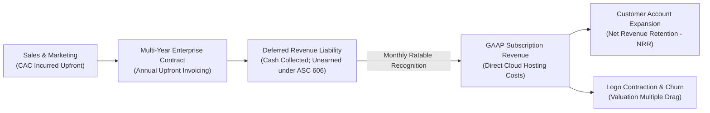

# Quality of Earnings Reference Guide: B2B Enterprise SaaS & Cloud Software
**Document Reference:** `QOE-MODEL-SAAS-03`  
**Industry Classification:** Prepackaged Software & Cloud SaaS (NAICS 511210 / 518210)  
**Standard Compliance:** US GAAP / ASC 606 / ASC 805 / ASC 350-40  
**Representative Subject:** CloudMatrix Analytics (Division 3 of Project Titanium)  

---

## 1. Industry Economic Architecture & SaaS Business Model

B2B Enterprise Software-as-a-Service (SaaS) businesses operate on recurring subscription revenue models, multi-year customer commitments, low marginal delivery costs ($70\%$ to $85\%$ gross margins), and negative working capital cycles driven by upfront annual customer billing.

### Core Economic Fundamentals:
- **Negative Operating Working Capital:** Customers pay annual subscription fees in advance (Day 1), creating a substantial **Deferred Revenue (Contract Liability)** on the balance sheet. Operating cash flow typically leads GAAP revenue and EBITDA.
- **Valuation Anchored on ARR & Retention:** Enterprise SaaS transactions are primarily priced on **multiples of Annual Recurring Revenue (ARR)** and **Net Revenue Retention (NRR)** rather than historical GAAP net income.
- **Unit Economics & Payback:** Growth efficiency is evaluated via Customer Acquisition Cost (CAC) payback periods, Lifetime Value to CAC (LTV/CAC) ratios, and the SaaS Magic Number.

---

## 2. Critical Quality of Earnings Diligence Focus Areas

In financial due diligence on B2B enterprise software companies, QoE teams audit six core risk areas:

### 2.1 The ASC 805 Deferred Revenue Haircut (The Net Debt Fulcrum)
* **The Accounting Mechanism:** In an M&A transaction (business combination), GAAP requires the buyer to record acquired assets and liabilities at **Fair Value** on the closing date under **FASB ASC 805**.
* **The Forensic Reality:**
  - The seller collected the annual cash subscription upfront and spent it.
  - The buyer inherits a legally binding contractual performance obligation to host the software, maintain servers, and provide 24/7 technical customer support for the unexpired term without receiving any future cash inflow from that customer until renewal.
  - Under ASC 805, the fair value of this contract liability equals the **direct cost to fulfill the obligation plus a reasonable market profit margin** (typically $40\%$ to $50\%$ of unearned revenue).
* **The Debt-Like Reclassification:**
  - Sellers argue deferred revenue belongs in operating working capital.
  - Diligence teams defend deducting the fulfillment cost as a **Debt-Like Item** ($-\$110,000.00$ in Project Titanium), ensuring the buyer is cash-compensated for fulfilling the seller's pre-collected revenue obligations.

### 2.2 ARR Waterfall Reconciliation: Bookings vs. Billings vs. GAAP Revenue
* **The Reconciliation Challenge:** SaaS companies report non-GAAP metrics (ARR and MRR) in pitch books that frequently diverge from the audited general ledger.
* **The Master ARR Waterfall Equation:**
  $$\text{Ending ARR} = \text{Beginning ARR} + \text{New Logo ARR} + \text{Expansion ARR} - \text{Contraction ARR} - \text{Churned ARR}$$
* **Diligence Tie-Out Standard:**
  Every dollar of reported ARR must reconcile to:
  1. An executed, binding customer master service agreement (MSA) and order form.
  2. The monthly billing subledger (e.g., Stripe, Chargebee, NetSuite).
  3. The general ledger deferred revenue roll-forward and GAAP earned subscription revenue accounts.
  4. Non-recurring implementation fees, custom development, and hardware pass-throughs must be stripped from ARR.

### 2.3 Customer Cohort Retention & Churn Dynamics (GLR vs. NRR)
* **Gross Logo Retention (GLR):** Measures the percentage of customer accounts retained over a 12-month period, regardless of expansion:
  $$\text{GLR} = \frac{\text{Beginning ARR} - \text{Contraction ARR} - \text{Churned ARR}}{\text{Beginning ARR}} \times 100\% \quad (\text{Threshold: } \ge 85\%)$$
* **Net Revenue Retention (NRR):** Measures the total revenue generated from the same customer cohort over 12 months, including up-sells and expansion:
  $$\text{NRR} = \frac{\text{Beginning ARR} + \text{Expansion ARR} - \text{Contraction ARR} - \text{Churned ARR}}{\text{Beginning ARR}} \times 100\% \quad (\text{Threshold: } \ge 105\%)$$
* **The Forensic Red Flag in Project Titanium:** Management claimed an NRR of $108.5\%$. Cohort analysis revealed that gross logo churn accelerated from $4.2\%$ to $11.8\%$ in Q4, and net expansion was concentrated in a single enterprise pilot contract. Without that single customer, NRR was deteriorating ($96.2\%$).

### 2.4 Capitalized Software Development Costs (ASC 350-40 vs. Expensed R&D)
* **The EBITDA Manipulation Tactic:**
  - Companies capitalize internal software engineering payroll under **ASC 350-40 (Internal-Use Software)** during the "application development stage."
  - Capitalizing software moves cash payroll expenses out of operating expenses (OpEx) and onto the balance sheet as an intangible asset, **artificially boosting reported EBITDA dollar-for-dollar**.
* **QoE Audit Procedure:**
  1. Audit engineering timesheets, GitHub/Jira commit histories, and sprint logs.
  2. Differentiate between genuine new architectural functionality (capitalizable) vs. routine bug fixing, minor feature updates, and software maintenance (strictly expensed).
  3. Where timesheet documentation is deficient, reverse capitalized payroll back to operating expenses, reducing Normalized EBITDA.

### 2.5 Multi-State Sales Tax Economic Nexus (Software & SaaS Taxation Post-Wayfair)
* **The Compliance Trap:** Over 30 U.S. states now tax SaaS and digital automated services under economic nexus statutes. Small software companies frequently fail to register, collect, or remit state sales tax.
* **QoE Procedure:** Execute a state-by-state gross revenue threshold audit ($>\$100,000.00$ sales or $>200$ transactions) to quantify historical uncollected sales tax, interest, and penalties as a **Debt-Like Item**.

---

## 3. SaaS Working Capital & Cash Conversion Cycle

Because customers pay subscriptions annually in advance, enterprise SaaS exhibits an inverted (negative) working capital profile:

$$\text{SaaS NWC} = \text{Billed AR} + \text{Prepaid Hosting} - \text{Accounts Payable} - \text{Accrued Payroll} - \text{Deferred Revenue}$$

* **Negative NWC Reality:** Operating current liabilities routinely exceed current assets. In a growing SaaS company, working capital provides cash rather than consuming it.
* **Target Peg Standard:** The working capital target peg must exclude deferred revenue (handled separately via the ASC 805 haircut) to prevent distorting ordinary trade receivables and payables.

---

## 4. Standard Diligence Schedules & Analytical Workpapers

In every enterprise SaaS engagement, the diligence file must include:
1. **Contract-Level ARR / MRR Master Waterfall:** Account-by-account monthly ARR roll-forward, tracking new logos, expansions, down-sells, and cancellations.
2. **24-Month Customer Cohort Retention Matrix:** Vintage cohort tables tracking customer revenue retention by signup quarter.
3. **ASC 805 Deferred Revenue Valuation Model:** Contract-by-contract unearned revenue, direct AWS hosting allocations, support labor costs, and calculated fulfillment reserve.
4. **Capitalized Software Payroll Audit:** Developer-by-developer salary, capitalized percentage, sprint ticket verification, and GAAP compliance check.
5. **CAC Payback & LTV Unit Economic Schedule:** Fully loaded customer acquisition costs, gross margin per account, monthly churn rate, and implied LTV/CAC ratios.
