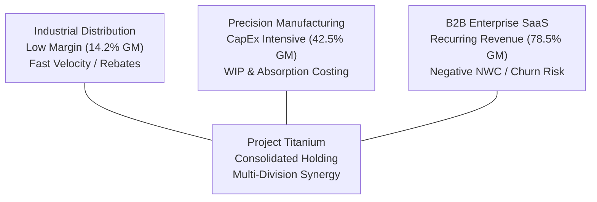

# Master Cross-Industry Comparative Matrix: Financial Diligence Across Business Models
**Document Reference:** `QOE-CROSS-IND-01`  
**Classification:** Comparative Due Diligence Framework & Industry Benchmark Guide  
**Standard Compliance:** US GAAP / AICPA CS Section 100 / Private Equity M&A Underwriting Standards  

---

## 1. Executive Summary & Comparative Taxonomy

Financial due diligence cannot be applied as a generic, one-size-fits-all checklist. A forensic anomaly that represents a routine operational convention in wholesale distribution (e.g., negative cash cycles from vendor trade credit) may represent a catastrophic red flag in precision manufacturing (e.g., unabsorbed factory overhead) or enterprise SaaS (e.g., deferred revenue fulfillment debt).

This comparative matrix establishes how accounting standards, earnings quality, working capital cycles, and transaction risks diverge across our three core target sectors and synthesize into the consolidated corporate holding structure:



---

## 2. Master Cross-Industry Comparative Architecture

The comprehensive matrix below contrasts operational, financial, and diligence attributes across all three business models:

| Diligence Dimension | Industrial Distribution (Apex) | Precision Manufacturing (Vanguard) | B2B Enterprise SaaS (CloudMatrix) | Consolidated Corporate Group (Titanium) |
| :--- | :--- | :--- | :--- | :--- |
| **Primary Revenue Driver** | Product volume shipments & catalog breadth. | Fixed-price platform manufacturing contracts. | Multi-year recurring software subscriptions. | Integrated supply chain & technical services. |
| **Gross Margin Profile** | **Thin ($14.0\% - 18.0\%$)**; sensitive to freight. | **Moderate-High ($35.0\% - 45.0\%$)**; OEE sensitive. | **High ($75.0\% - 85.0\%$)**; cloud hosting cost. | **Blended ($34.6\%$)**; intercompany eliminations. |
| **EBITDA Margin Profile** | **$4.0\% - 8.0\%$**; low fixed overhead. | **$12.0\% - 18.0\%$**; high operating leverage. | **$15.0\% - 25.0\%$** (Mature) / negative (growth). | **$14.9\%$ Normalized** ($13.3\%$ reported). |
| **Valuation Metric** | Multiple of Adjusted EBITDA ($6.0\text{x} - 8.0\text{x}$). | Multiple of Adjusted EBITDA ($7.0\text{x} - 9.0\text{x}$). | Multiple of ARR ($4.0\text{x} - 10.0\text{x}$) or EBITDA. | **Blended Multiple: $8.0\text{x}$ EBITDA**. |
| **Working Capital Profile** | **High Positive NWC ($15\% - 22\%$ rev)**. | **Moderate Positive NWC ($18\% - 25\%$ rev)**. | **Inverted / Negative NWC ($-10\% \text{ to } -25\%$)**. | **Positive NWC ($17.8\%$ of run-rate revenue)**. |
| **Cash Conversion Cycle** | **$60 - 80\text{ days}$** (Receivables + Stock). | **$90 - 120\text{ days}$** (Long WIP cycle). | **Negative ($-30 \text{ to } -60\text{ days}$)**. | **$64.5\text{ days}$ Consolidated**. |
| **Core Revenue Diligence** | Bill-and-hold cut-off, rebate clawbacks. | Percentage-of-completion EAC, contract losses. | ARR/MRR waterfalls, gross logo churn, NRR. | Intercompany sales elimination ($\$1.25M$). |
| **Core EBITDA Adjustments** | Owner perks, warehouse rent, bad debt. | Scrap yield, standard cost over-absorption. | Capitalized R&D payroll (ASC 350-40). | Standalone corporate overhead & CEO replacement. |
| **Primary Debt-Like Items** | Stretched AP $>60$ days, prompt-pay drag. | CNC machine deferred maintenance backlog. | ASC 805 deferred revenue fulfillment cost. | Funded bank debt ($\$3.5M$), shareholder note ($\$524.5k$). |
| **CapEx Characteristics** | **Low CapEx ($0.8\% - 1.5\%$ rev)**; forklifts/IT. | **Heavy CapEx ($4.0\% - 7.0\%$ rev)**; CNC centers. | **Low Physical CapEx ($1.0\% - 2.0\%$)**; IT servers. | **Blended CapEx: $3.2\%$ of revenue**. |
| **Free Cash Conversion** | **Moderate ($65\% - 75\%$)**; working capital drag. | **Capital Dependent ($55\% - 65\%$)**; maintenance. | **High ($80\% - 90\%$)**; upfront cash collections. | **$71.5\%$ Unlevered FCF Conversion**. |

---

## 3. Deep-Dive Sectoral Diligence Nuances

### 3.1 Revenue Recognition Standards: ASC 606 Across Sectors
* **Distribution:** Point-in-time revenue recognition upon physical transfer of control to the customer. Critical risk is **premature cut-off billing (bill-and-hold)** on shipping docks without customer request or physical segregation.
* **Manufacturing:** Over-time revenue recognition utilizing the **Cost-to-Cost Input Method** for defense subcontracts with no alternative use and an enforceable right to payment. Critical risk is **understating Estimated Costs at Completion (EAC)** to inflate current-period margins.
* **SaaS:** Over-time ratable monthly recognition of subscription fees over the contract term (typically 12 to 36 months). Critical risk is **failing to carve out upfront implementation or custom engineering fees** that should be amortized over the estimated customer lifetime.

### 3.2 Working Capital Mechanics & Balance Sheet Reserves
* **Distribution (Inventory Aging):** Inventory is predominantly Finished Goods across thousands of SKUs. Reserve diligence focuses on **turnover velocity and secondary market liquidation values**.
* **Manufacturing (Multi-Tier Inventory):** Inventory carries capitalized labor and overhead across Raw Materials, WIP, and Finished Goods. Reserve diligence focuses on **standard cost variance absorption and contract-specific obsolescence**.
* **SaaS (Contract Liabilities):** Current assets are primarily trade receivables; physical inventory is zero. Reserve diligence focuses on **deferred revenue fair-value fulfillment obligations under ASC 805**.

### 3.3 EBITDA Normalization Conventions & Rejection Precedents
* **Distribution:** Sponsoring brokers routinely attempt to add back customer bad debt as "unprecedented black swan events." Diligence teams **hold the line and reject bad debt add-backs**, proving credit loss is an inherent trade financing cost.
* **Manufacturing:** Sellers attempt to characterize machinery maintenance overhauls as "discretionary growth investments." Diligence teams **reclassify deferred maintenance into Debt-Like deductions** based on OEM vibration diagnostic standards.
* **SaaS:** Companies capitalize internal software developer salaries under ASC 350-40 to inflate EBITDA. Diligence teams **re-expense routine bug fixes and platform maintenance**, reducing normalized maintainable earnings.

---

## 4. Synthesis: The Consolidated Multi-Division Engagement (Project Titanium)

In a diversified holding company structure, the diligence team must bridge disparate operating models into a unified transaction settlement:

```
+-------------------------------------------------------------------------------------------------------------+
|                                  PROJECT TITANIUM CONSOLIDATED SEGMENT WALK                                 |
|                                                                                                             |
|   Segment                     Audited Revenue     Gross Margin %    Normalized EBITDA    CapEx Intensity %  |
|   -------------------------------------------------------------------------------------------------------   |
|   Apex Distribution            $15,620,000.00         14.2%          $1,540,500.00             1.1%         |
|   Vanguard Manufacturing        $6,790,000.00         42.5%          $1,410,000.00             5.8%         |
|   CloudMatrix SaaS              $2,580,000.00         78.5%          $  710,000.00             1.6%         |
|   Intercompany Eliminations   -$ 1,250,000.00          —            $        0.00              —          |
|   Corporate Overhead Allocation         $0.00          —           -$  300,000.00              —          |
|   -------------------------------------------------------------------------------------------------------   |
|   CONSOLIDATED TOTAL          $24,645,000.00         34.6%          $3,660,500.00             3.2%         |
+-------------------------------------------------------------------------------------------------------------+
```

$$\text{Final Equity Value Check: } (\$3,660,500.00 \times 8.0) - \$4,486,450.00 \text{ (Net Debt)} + \$0.00 \text{ (WC Collar)} \equiv \mathbf{\$24,797,550.00}$$
