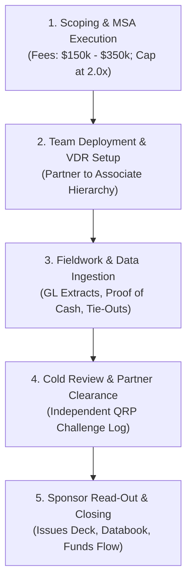

# Financial Due Diligence (FDD) Engagement Operations Manual
**Document Reference:** `QOE-OPS-MANUAL-01`  
**Classification:** Professional Advisory Practice Governance & Operating Standards  
**Standard Compliance:** AICPA CS Section 100 / AICPA Code of Professional Conduct ET 1.100 / Big 4 Quality Management Standards  

---

## 1. Engagement Governance, Scoping & Fee Economics

Financial due diligence engagements are professional consulting services governed by the **AICPA Statement on Standards for Consulting Services (CS Section 100)**. Unlike statutory audits under GAAS, due diligence engagements do not express an audit opinion; rather, they perform analytical, inquiry, and forensic procedures to evaluate transaction quality.



### 1.1 Fee Structures & Economic Models
- **Fixed-Fee Model (Standard Institutional PE):** Bounded fee arrangements (typically $\$150,000.00$ to $\$350,000.00$ for middle-market deals with $\$20\text{M}$ to $\$100\text{M}$ enterprise value).
- **Time & Materials with Cap (T&M Cap):** Deployed when target accounting records are chaotic (e.g., carve-outs, legacy family businesses), with hourly billing capped at an agreed limit.
- **Break Fees / Dead Deal Discounts:** If a deal aborts during preliminary diligence due to a fatal flaw uncovered by the QoE team, advisory firms bill accrued time up to a negotiated "dead deal cap" (typically $50\%$ to $75\%$ of full fee).

---

## 2. Professional Staffing Hierarchy & Division of Labor

An institutional transaction advisory team is structured across five distinct tiers:

| Staffing Tier | Primary Responsibilities & Operational Scope | Key Deliverables Owned | Hourly Billing Rate Benchmark |
| :--- | :--- | :--- | :---: |
| **Lead Engagement Partner** | Overall engagement execution, client relationship management, negotiation defense, SPA Exhibit B alignment, and signing final report. | Final QoE Report Sign-Off, Reliance Letters, CIM Exhibits. | $850 - $1,250 / hr |
| **Quality Review Partner (QRP)** | Independent concurring technical review, testing GAAP compliance, mathematical footing, sample sufficiency, and tripartite firewall integrity. | Concurring Cold Review Challenge Log, Clearance Memo. | $900 - $1,300 / hr |
| **Director / Senior Manager** | Day-to-day engagement leadership, leading target management interviews, adjudicating pushbacks, and directing complex financial bridges. | Normalized EBITDA Bridge, NWC Peg Model, Net Debt Register. | $550 - $750 / hr |
| **Engagement Manager** | Fieldwork management, supervising data preparation, reviewing subledger reconciliations, and drafting narrative report sections. | Monthly Financial Databook, Proof of Cash, Cohort Waterfall. | $400 - $525 / hr |
| **Senior Associate / Associate** | Raw data ingestion, trial balance normalization, vouching sample invoices, tickmark reconciliations, and GL cross-referencing. | COA Mapping Template, AP/AR Subledger Tie-Outs, PVM Model. | $250 - $350 / hr |

---

## 3. Virtual Data Room (VDR) & Q&A Protocol Operations

### 3.1 VDR Management & Hygiene Rules
1. **Centralized Data Ingestion:** All files uploaded by the target must be cataloged in the Master Document Tracker within 4 hours of upload, assigned unique alphanumeric tracking IDs (`SRC-xxx`), and archived in clean local mirrors.
2. **Permission Firewalls:** Sensitive payroll census records containing employee names and social security numbers must be segregated in restricted folders, accessible only to senior diligence staff.

### 3.2 Dynamic Information Request List (IRL) & Q&A Tracker
* The diligence team maintains an active, priority-ranked **Information Request List (IRL)** shared with the seller's M&A advisor:
  - *Priority 1 (Critical Path):* Monthly trial balances, general ledger extracts, customer billing subledgers, bank statements.
  - *Priority 2 (Analytical Testing):* Detailed payroll census, vendor contracts, inventory aging, fixed asset roll-forwards.
  - *Priority 3 (Confirmatory):* Facility leases, utility bills, board minutes, patent documentation.
* **The 48-Hour Escalation Rule:** If a Priority 1 request remains unanswered for $>48\text{ hours}$, the Engagement Manager formally escalates the delay to the private equity deal lead to address with the investment banker.

---

## 4. Client Communication Cadence & Negotiating Triage

Maintaining client alignment without compromising objectivity is governed by strict communication protocols:

```
+-------------------------------------------------------------------------------------------------------------+
|                                    STANDARD DILIGENCE COMMUNICATION CADENCE                                 |
|                                                                                                             |
|   Frequency          Meeting / Deliverable                     Participants              Focus              |
|   -------------------------------------------------------------------------------------------------------   |
|   Daily (Morning)    15-Minute Deal Team Standup               FDD Manager + PE Assoc    IRL Tracker & VDR  |
|   Bi-Weekly          Diligence Progress & Findings Call        FDD Director + PE VP/MD   Emerging Haircuts  |
|   Weekly             Adversarial Q&A Session                   FDD Team + Target CFO     Pushback Defense   |
|   Milestone (Day 14) Preliminary Issues List Deck              Lead Partner + PE IC      Valuation Levers   |
|   Milestone (Day 21) Final Report Read-Out Meeting             Full Deal Team + Target   Final Settlement   |
+-------------------------------------------------------------------------------------------------------------+
```

### 4.1 Negotiating Triage: Hard Haircuts vs. Commercial Levers
During weekly sponsor updates, the FDD team categorizes findings into three distinct negotiation buckets:
1. **Hard Valuation Haircuts (Non-Negotiable):** Objective accounting errors (ASC 606 revenue reversals, unevidenced topside plugs, funded bank debt payoffs). These must be deducted from the purchase price.
2. **Commercial Negotiating Levers (Subject to Deal Strategy):** Valuation benchmark ranges (founder replacement compensation, target peg collar bands, customer churn run-rates).
3. **Post-Closing Indemnity / Escrow Items:** Unasserted tax exposures (sales tax nexus), worker misclassification risks, and pending litigation.

---

## 5. Professional Independence & AICPA CS Section 100 Compliance

To uphold professional independence and comply with AICPA standards:
* **The Anti-Deal-Advocacy Rule:** The diligence practitioner serves as an objective fact-finder, not an advocate for the transaction. The team must never manipulate findings or suppress red flags to facilitate deal completion.
* **Managing Client Deal Pressure:** When private equity clients request waiving a legitimate diligence haircut to preserve deal momentum, the FDD team:
  1. Refuses to remove the finding from the formal report.
  2. Documents the item as a **"Client-Waived Commercial Item"** in the executive presentation.
  3. Preserves the independent diligence baseline in the permanent audit defense file.
