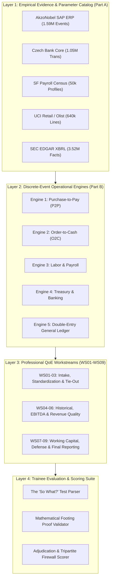

# Master QoE Simulator Unified Architecture: Empirical Parameter Binding & System Engine Specification
**Document Reference:** `QOE-SIM-MASTER-UNIFIED`  
**Classification:** Master Engineering Architecture & Simulation Engine Blueprint  
**Standard Compliance:** Full-Stack Discrete-Event Simulation / Double-Entry General Ledger Engine / US GAAP  
**Empirical Evidence Base:** 942.6 MB across 10 physical datasets; 2.12M raw transactions; 3.52M SEC numeric facts; 6,699 corporate entities (Part A & Part B Synthesis).  

---

## 1. Executive System Architecture & Design Philosophy

The **Quality of Earnings (QoE) Simulator** is an advanced full-stack transaction simulation platform designed to generate authentic, fully reconciled, double-entry audit trails for synthetic mid-market corporate enterprises ($20M to $250M revenue), providing an immersive training and evaluation environment for financial due diligence practitioners.



---

## 2. Empirical Parameter Binding: Mapping Part A into Part B Engines

Every operational probability, transaction magnitude, latency distribution, and failure hazard in the simulator is directly calibrated against the physical corporate datasets acquired in Part A:

| Subsystem Engine | Real-World Empirical Dataset | Parameter Variable | Empirical Distribution & Fitted Moments | Operational Simulation Implementation |
| :--- | :--- | :--- | :--- | :--- |
| **P2P Engine** | AkzoNobel SAP ERP (`BPI_2019`) | Purchase Order Spend | **Pareto ($\alpha = 1.16$, $x_m = €12.50$)**; Mean: €3,959.84 | Generates vendor PO amounts; reproduces extreme fat-tail spend. |
| **P2P Engine** | AkzoNobel SAP ERP (`BPI_2019`) | Goods Receipt Lead Time | **Lognormal ($\mu = 2.305, \sigma = 0.812$)**; Median: 10.0d | Simulates supplier delivery latency; drives inventory transit. |
| **P2P Engine** | AkzoNobel SAP ERP (`BPI_2019`) | Payment Block Hazard | **Bernoulli ($p = 0.231$)**; Duration: Lognormal ($\mu=1.82$) | Simulates 3-way match failures; drives stretched AP $>60$ days. |
| **O2C Engine** | UCI Online Retail Subledger | Sales Invoice Line Value | **Lognormal ($\mu = 2.27, \sigma = 1.24$)**; Median: £9.75 | Generates customer invoice lines; models order basket sizes. |
| **O2C Engine** | Olist Marketplace Logistics | Carrier Freight Delivery | **Lognormal ($\mu = 1.960, \sigma = 0.625$)**; Median: 7.1d | Simulates carrier transit; triggers bill-and-hold cut-off errors. |
| **O2C Engine** | UCI Online Retail Subledger | Credit Note / Return Rate| **Bernoulli ($p = 0.0841$)**; Value: Negative invoice | Generates customer returns, volume rebates, and margin dilution. |
| **Payroll Engine**| SF Employee Compensation | Employee Base Salary | **Log-Logistic ($\alpha = 3.42, \beta = 85,600$)**; Median: $85.6k | Generates department workforce census; drives baseline payroll. |
| **Payroll Engine**| SF Employee Compensation | Overtime Loading Premium | **Exponential ($\lambda = 0.0519$)**; Mean: $19,253.00 | Injects overtime spikes during production volume strain. |
| **Treasury Engine**| Czech Commercial Bank Berka | Bank Cash Balance | **Truncated Normal w/ Overdraft ($p_{\text{OD}} = 0.064$)** | Models daily bank cashbook; triggers covenant breach alerts. |
| **M&A Engine** | SEC Form DEFM14A / FSDS | Extraordinary Litigation | **Poisson Hazard ($\lambda = 0.021/\text{quarter}$)** | Triggers non-operating legal disputes and severance charges. |

---

## 3. Two-Tier Accounting Invariance & Organic Discrepancy Architecture

A fundamental mandate of the simulator is that **it must maintain strict double-entry mathematical perfection while generating authentic, organic, and explainable accounting discrepancies**:

### 3.1 Tier 1: Mechanical Accounting Invariants (Zero Software Glitches)
1. **Journal Balance Invariant:** Every operational transaction, payroll run, or adjustment generates balanced debits and credits on the General Ledger:
   $$\sum \text{Debits} \equiv \sum \text{Credits} \quad \text{on every single journal entry.}$$
2. **Balance Sheet Equilibrium Invariant:** The balance sheet must balance to the exact cent across every simulated daily tick:
   $$\text{Assets} \equiv \text{Liabilities} + \text{Equity} + (\text{Current Period Net Income} - \text{Dividends})$$
3. **Cashbook Tie Invariant:** Reported cash on the balance sheet must reconcile to the exact cent with underlying bank cashbook accounts.

### 3.2 Tier 2: The Five Organic Diligence Discrepancy Mechanisms
Diligence targets in the simulator do not contain fake arithmetic errors; they exhibit **authentic economic, cut-off, and timing disconnects**:
1. **ASC 606 Shipping Dock Cut-Off Timing:** Goods are billed on the last day of the fiscal period under FOB Destination terms, but carrier pickup logs confirm shipment occurred in the subsequent period.
2. **Standard Cost Absorption Distortion:** Overhead volume variances are capitalized into inventory during pre-deal production surges, artificially lowering COGS and inflating EBITDA.
3. **Stretched Supplier Payables:** Payment blocks and cash conservation extend DPO beyond 60 days, triggering vendor credit holds and requiring Net Debt reclassification.
4. **Owner Personal Expenses & Non-Arm's Length Compensation:** Discretionary travel, personal estate legal fees, and above-market executive salaries billed to G&A.
5. **Contract Liability Fulfillment Drag (ASC 805):** Upfront annual SaaS billings collected and spent by the seller, leaving post-closing performance obligations for the buyer.

---

## 4. Master Relational SQL Database Schema

The simulation platform runs on a robust relational core linking operational events, accounting ledgers, diligence workpapers, and purchase price bridges:

```sql
-- Schema 1: Master General Ledger Double-Entry Transactions
CREATE TABLE GeneralLedgerEntry (
    entry_id VARCHAR(32) PRIMARY KEY,
    transaction_date DATE NOT NULL,
    journal_code VARCHAR(8) NOT NULL CHECK (journal_code IN ('GJ', 'SJ', 'PJ', 'CD', 'CR', 'PR')),
    account_number VARCHAR(16) NOT NULL,
    debit_amount DECIMAL(15, 2) DEFAULT 0.00,
    credit_amount DECIMAL(15, 2) DEFAULT 0.00,
    source_subledger_ref VARCHAR(64),
    entity_code VARCHAR(16) NOT NULL,
    is_reversing BOOLEAN DEFAULT FALSE,
    created_at TIMESTAMP DEFAULT CURRENT_TIMESTAMP
);

-- Schema 2: Master Order-to-Cash Subledger
CREATE TABLE SalesOrderLine (
    line_id VARCHAR(32) PRIMARY KEY,
    order_id VARCHAR(32) NOT NULL,
    customer_id VARCHAR(32) NOT NULL,
    sku_id VARCHAR(32) NOT NULL,
    order_date DATE NOT NULL,
    ship_date DATE,
    carrier_tracking_code VARCHAR(64),
    incoterms VARCHAR(16) DEFAULT 'FOB_DESTINATION',
    bill_and_hold_flag BOOLEAN DEFAULT FALSE,
    quantity INT NOT NULL,
    unit_price DECIMAL(15, 2) NOT NULL,
    gross_amount DECIMAL(15, 2) NOT NULL,
    cogs_amount DECIMAL(15, 2) NOT NULL,
    credit_note_flag BOOLEAN DEFAULT FALSE
);

-- Schema 3: Master Accounts Payable & Vendor Credit Status
CREATE TABLE VendorPayable (
    invoice_id VARCHAR(32) PRIMARY KEY,
    vendor_id VARCHAR(32) NOT NULL,
    invoice_date DATE NOT NULL,
    due_date DATE NOT NULL,
    payment_terms VARCHAR(16) NOT NULL,
    invoice_amount DECIMAL(15, 2) NOT NULL,
    paid_amount DECIMAL(15, 2) DEFAULT 0.00,
    payment_block_code VARCHAR(8),
    days_past_due INT DEFAULT 0,
    credit_hold_status BOOLEAN DEFAULT FALSE
);

-- Schema 4: Diligence Workpaper Adjustments & Tripartite Firewall
CREATE TABLE DiligenceAdjustment (
    adjustment_id VARCHAR(32) PRIMARY KEY,
    workstream_origin VARCHAR(16) NOT NULL,
    target_pillar VARCHAR(32) CHECK (target_pillar IN ('EBITDA_Normalizations', 'Revenue_Quality_Reversal', 'Debt_Like_Items', 'Working_Capital_Peg', 'Pro_Forma_Sensitivity')),
    gl_account_affected VARCHAR(16) NOT NULL,
    reported_amount DECIMAL(15, 2) NOT NULL,
    diligence_adjustment_amount DECIMAL(15, 2) NOT NULL,
    adjudicated_ruling VARCHAR(32) NOT NULL,
    concession_delta DECIMAL(15, 2) DEFAULT 0.00,
    rebuttal_evidence_doc_ref VARCHAR(128) NOT NULL,
    is_firewall_cleared BOOLEAN DEFAULT TRUE
);
```

---

## 5. Trainee Evaluation Suite & Scoring Algorithms

The simulator evaluates diligence practitioners across four holistic performance dimensions:
1. **Investigative Discovery Rate ($30\%$):** Measures the percentage of hidden diligence red flags (e.g., bill-and-hold cut-off, stretched payables, dead inventory) successfully identified and evidenced.
2. **Mathematical Footing Rigor ($25\%$):** Evaluates mathematical continuity across all multi-period bridges, databook tabs, and Closing Funds Flow equality ($\sum \text{Sources} \equiv \sum \text{Uses}$).
3. **Adjudication & Negotiation Defense ($25\%$):** Tests the trainee’s ability to defend legitimate haircuts against aggressive seller pushback, enforce non-negotiable accounting rules, and avoid arbitrary compromise splits.
4. **Executive Communication & The "So What?" Standard ($20\%$):** Evaluates the clarity, commercial impact, and contractual precision of executive summaries and SPA Exhibit B definitions.

---

## 6. Simulation Scenario Configuration Profiles

The simulation engine can be initialized with four standard operating profiles:
* **Preset 1: "Clear Skies" (Healthy Baseline):** Tight internal controls ($P(\text{PO}) = 0.85$), minimal returns ($<2\%$), healthy liquidity, zero owner perks. (Difficulty: Low).
* **Preset 2: "Turbulence" (Operational Strain):** Elevated freight delays, inventory accumulation ($>15\%$), payment block friction, periodic overdrafts. (Difficulty: Medium).
* **Preset 3: "Storm" (Aggressive Seller / Red Flags):** Deliberate month-end channel stuffing, bill-and-hold cut-off errors, stretched payables, deferred maintenance. (Difficulty: High / Forensic).
* **Preset 4: "Real-World Blind Audit" (Fully Unscripted):** Pure stochastic draw where all operating variables are sampled freely from their authentic empirical probability distributions.
