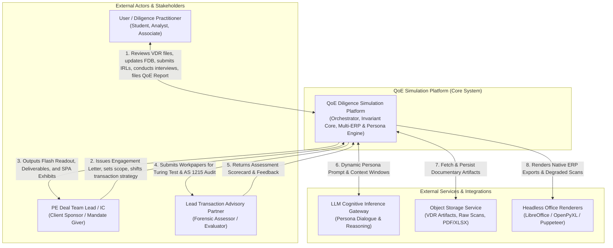
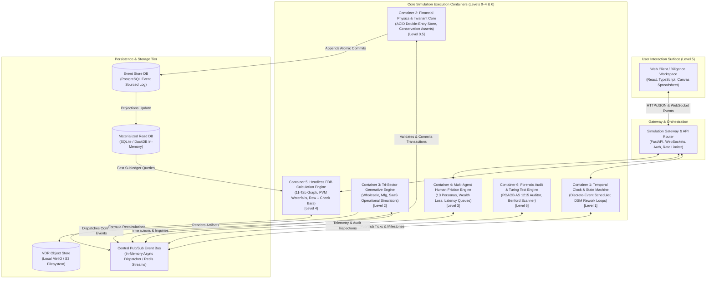
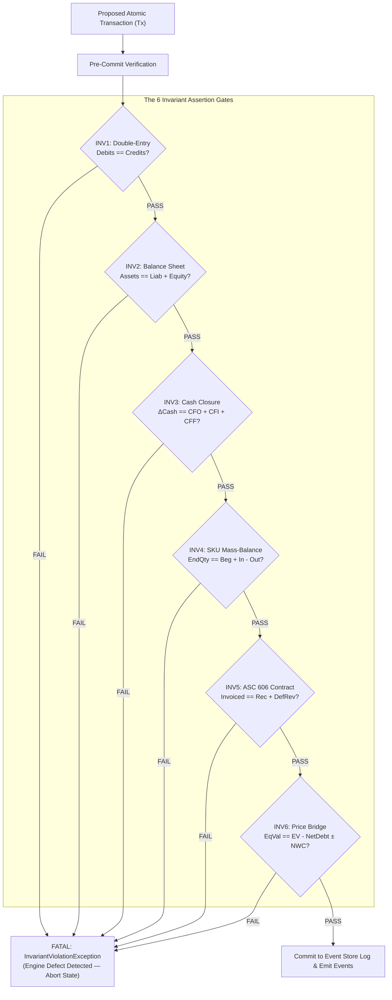
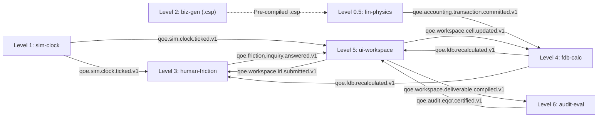
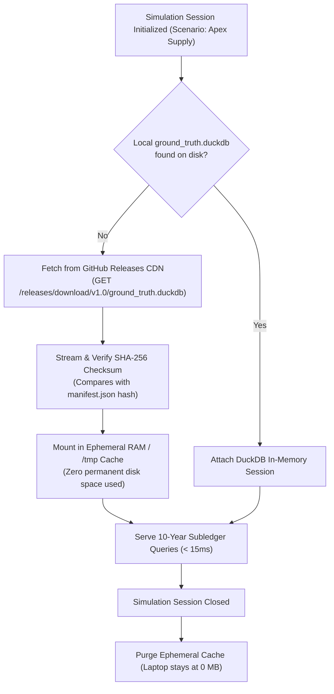

# QoE Simulator Systems Design — Level 0
# Systems Architecture Charter, Topographical Blueprint, Event Bus & State Store Specification

**Document Title:** Systems Architecture Charter, Topographical Blueprint, Event Bus, State Store, and Invariant Core Specification  
**Document Code:** `00_SYSTEMS_ARCHITECTURE_CHARTER_AND_TOPOGRAPHY`  
**System Design Level:** `Level 0: Architecture Charter & Topography` (incorporating `Level 0.5: Invariant Ground-Truth Core`)  
**Architectural Standards Compliance:** ISO/IEC/IEEE 42010 (Systems and Software Engineering — Architecture Description); C4 Model for Software Architecture (Context, Containers, Components); Martin Fowler Event Sourcing & CQRS; ACID Transactional Semantics (Gray & Reuter 1993); PCAOB AS 1215; AICPA AU-C 230 / CS 100; ICAEW Guideline 71.  
**Core Architectural Axiom:** *The simulation engine must strictly enforce absolute mathematical conservation laws (The Laws of Financial Physics) at the ground-truth state store layer before any observational distortion, human friction, or documentary defect is rendered to the user. Every state mutation must be deterministic, event-sourced, and mechanically reproducible.*

---

## 1. Executive Charter & Architectural Scope

The objective of the **Quality of Earnings (QoE) Simulation Platform** is to deliver an authentic, high-fidelity, adversarial training and evaluation environment for financial due diligence in Mergers & Acquisitions (M&A). 

To satisfy the **126 simulation realism requirements** established in the Part C Research Programme ([Master Realism Specification](file:///c:/Users/ADMIN/Desktop/QOE%20%20data%20aquisition/QOE_REALISM_RESEARCH/09_MASTER_REALISM_SPECIFICATION/master_qoe_simulation_realism_specification.md)), the software architecture must resolve the foundational paradox of financial simulation:
> **The Epistemic Paradox of Financial Diligence:** The simulator must generate realistic accounting errors, management fraud, documentary omissions, and human obfuscation ("The Natural Occurrences"), while ensuring that the underlying simulation engine never hallucinates, leaks value, or suffers from software-induced mathematical inconsistencies ("The Invariant Ground-Truth").

This document defines the **Level 0 Architecture**: the system boundaries, container topography, communication backbones, state persistence models, and the non-negotiable **Financial Physics Invariant Engine (Level 0.5)** that governs every computation across the entire platform.

---

## 2. System Context & Boundary Model (C4 Level 1)

The system context defines how the QoE Simulation Platform interfaces with human users, external AI cognitive agents, and transaction stakeholders:



### 2.1 Boundary Definitions and Access Rules
1. **The Diligence Boundary:** The user operates strictly within the epistemic constraints of an outside consultant under **AICPA CS Section 100** and **ICAEW Guideline 71** ([Module 07](file:///c:/Users/ADMIN/Desktop/QOE%20%20data%20aquisition/QOE_REALISM_RESEARCH/MODULE_07_ANALYTICAL_REPORTING_REALISM/07_professional_output_and_reporting_realism_specification.md#L523-L538)). The user has zero direct access to the database containing the ground-truth solution keys, intentional fraud scripts, or unredacted files.
2. **The Observation Lens Boundary:** All information delivered to the user (trial balances, subledgers, invoices, interview responses) must pass through the **Observation Lens Engine**, which applies realistic documentary degradation, release latency, and persona filtering ([Module 03](file:///c:/Users/ADMIN/Desktop/QOE%20%20data%20aquisition/QOE_REALISM_RESEARCH/MODULE_03_DOCUMENTARY_ACCOUNTING_REALISM/03_documentary_and_accounting_realism_specification.md); [Module 04](file:///c:/Users/ADMIN/Desktop/QOE%20%20data%20aquisition/QOE_REALISM_RESEARCH/MODULE_04_CLIENT_HUMAN_BEHAVIOUR/04_client_and_human_behaviour_model.md)).
3. **The Ground-Truth Core Boundary:** The underlying transactional engine operates as a closed, conserved economic system. No external script or AI agent can alter the ground truth without creating a balanced, double-entry event log.

---

## 3. Container Topography & Subsystem Topography (C4 Level 2)

The system is decomposed into nine discrete, loosely coupled execution containers interacting over high-throughput gRPC and asynchronous event channels:



### 3.1 Container Responsibilities & Operational Boundaries
- **Container 1: Temporal Clock & State Machine (`sim-clock`):** Manages discrete simulation time, timeline tracks (Auction vs. Bilateral), deadline triggers, milestone gating, and the Browning & Eppinger (2002) Design Structure Matrix (DSM) rework loops ([Module 06](file:///c:/Users/ADMIN/Desktop/QOE%20%20data%20aquisition/QOE_REALISM_RESEARCH/MODULE_06_ENGAGEMENT_DYNAMICS/06_engagement_progression_and_dynamics_model.md#L60-L85)).
- **Container 2: Financial Physics & Invariant Core (`fin-physics`):** The non-negotiable core. Manages the double-entry accounting ledger, enforces mathematical conservation laws, and runs ACID transactional assertions.
- **Container 3: Tri-Sector Generative & Volatility Engine (`biz-gen`):** Incorporates **Level 2.B: Business Cyclicality, Operational Volatility & Ups-and-Downs Engine (Module 10)** ([10_business_cyclicality_volatility_and_ups_and_downs_simulation_model.md](file:///c:/Users/ADMIN/Desktop/QOE%20%20data%20aquisition/QOE_SYSTEMS_DESIGN/10_business_cyclicality_volatility_and_ups_and_downs_simulation_model.md)). Generates authentic commercial activities, multi-year macro waves, trading-day calendar swings ($W_m \in [19, 23]$), asymmetric sticky cost structures (ABJ 2003), bullwhip inventory accumulations (Chen et al. 2000), idiosyncratic customer shocks, and pre-sale window dressing for Wholesale Distribution, Precision Manufacturing, and Enterprise SaaS targets.
- **Container 4: Multi-Agent Human Friction Engine (`human-friction`):** Simulates the 13 stakeholder personas, models personal wealth loss impact on executives, manages latency queues, and drives pushback behavior ([Module 04](file:///c:/Users/ADMIN/Desktop/QOE%20%20data%20aquisition/QOE_REALISM_RESEARCH/MODULE_04_CLIENT_HUMAN_BEHAVIOUR/04_client_and_human_behaviour_model.md)).
- **Container 5: Headless Financial Databook Engine (`fdb-calc`):** Maintains the 11-tab analytical spreadsheet model, enforces universal RGB color coding, recalculates dynamic SUMIFS, and runs Row 1 check bars ([Module 07](file:///c:/Users/ADMIN/Desktop/QOE%20%20data%20aquisition/QOE_REALISM_RESEARCH/MODULE_07_ANALYTICAL_REPORTING_REALISM/07_professional_output_and_reporting_realism_specification.md#L112-L135)).
- **Container 6: Forensic Audit & Turing Test Engine (`audit-eval`):** Audits workpapers against the PCAOB AS 1215 / AICPA AU-C 230 "Experienced Auditor Test", runs Benford's Law tests, and grades user findings ([Module 08](file:///c:/Users/ADMIN/Desktop/QOE%20%20data%20aquisition/QOE_REALISM_RESEARCH/MODULE_08_ARTIFICIALITY_TESTING_VALIDATION/08_professional_outputs_and_realism_validation_framework.md#L280-L310)).

### 3.2 The Self-Contained Autonomous Level (SCAL) Integration Matrix

In strict adherence to the **Self-Contained Autonomous Level (SCAL)** architectural mandate, the platform rejects standalone, disconnected operational documents. Every Level specification (Levels 0 through 6, and Level 10) directly incorporates its own **Fault Isolation Bulkheads**, **Typed Protobuf v3 API Contracts**, and **Forensic Loopholes & Risk Mitigations**:

```
┌────────────────────────────────────────────────────────────────────────────────────────────────────────────────────────┐
│                                SELF-CONTAINED AUTONOMOUS LEVEL (SCAL) MASTER MATRIX                                    │
├──────┬────────────────────┬───────────────────────┬────────────────────────┬───────────────────────────────────────────┤
│ Level│ Container Domain   │ Internal Bulkhead     │ Typed Protobuf Contract│ Forensic Loopholes Embedded               │
│      │ & Specification Doc│ & Isolation Mechanism │ & Service Definition   │ & Concrete Defenses                       │
├──────┼────────────────────┼───────────────────────┼────────────────────────┼───────────────────────────────────────────┤
│ L0.5 │ Financial Physics  │ Fail-Closed Engine    │ `fin_physics.proto`    │ LP-01: Fixed-Point Decimal(18,4) prevents │
│      │ `fin-physics`      │ Abort on broken INV;  │ `CommitTransaction`    │ penny drift; double-entry balance assert.  │
│      │ Doc: 00            │ transactional rollback│ `VerifyInvariants`     │ Zero floating-point IEEE 754 allowed.     │
├──────┼────────────────────┼───────────────────────┼────────────────────────┼───────────────────────────────────────────┤
│ L1   │ Temporal Clock &   │ Clock Freeze & Retry; │ `sim_clock.proto`      │ LP-02: Prospective/Reversing JEs prevent  │
│      │ DSM Rework Engine  │ Monotonic Min-Heap;   │ `TickSimulationClock`  │ time-travel history rewriting.            │
│      │ Doc: 01            │ DSM Attenuation Cap   │ `TriggerDSMReview`     │ LP-13: Milestone cryptographic gating.    │
├──────┼────────────────────┼───────────────────────┼────────────────────────┼───────────────────────────────────────────┤
│ L2   │ Generative Reality │ Offline Compilation   │ `biz_gen.proto`        │ LP-01: Discrete integer penny pricing;    │
│      │ & Volatility Model │ Boundary (.csp file); │ `CompileScenarioPackage│ LP-10: PDF metadata timestamp sanitizing  │
│      │ Docs: 02 & 10      │ Zero runtime execute  │ `VerifyScenarioPackage`│ against synthetic date leakage.           │
├──────┼────────────────────┼───────────────────────┼────────────────────────┼───────────────────────────────────────────┤
│ L3   │ Human Friction &   │ Nygard Circuit Breaker│ `human_friction.proto` │ LP-03: Zero-knowledge prompt injection    │
│      │ Persona AI Engine  │ Trips to deterministic│ `SubmitInquiry`        │ defense; sanitizes user text.             │
│      │ Doc: 03            │ heuristic templates   │ `RecalculateWealthLoss`│ LP-07: Hallucination output regex filter. │
├──────┼────────────────────┼───────────────────────┼────────────────────────┼───────────────────────────────────────────┤
│ L4   │ Financial Databook │ Isolated WebWorker /  │ `fdb_calc.proto`       │ LP-04: DDE command injection prefixing;   │
│      │ Calculation Engine │ Subprocess Sandbox    │ `RecalculateWorkbook`  │ LP-08: Anti-double-dipping graph linter;  │
│      │ Doc: 04            │ (500ms / 256MB quota) │ `InspectCellPrecedents`│ LP-16: Tarjan cycle detection (#CIRCULAR!).│
├──────┼────────────────────┼───────────────────────┼────────────────────────┼───────────────────────────────────────────┤
│ L5   │ User Workspace &   │ Instant State Restore │ `workspace_gateway.proto` LP-05: DevTools zero-knowledge protection│
│      │ Diligence Cockpit  │ (< 1.5s cold restore);│ `GetVDRTree`           │ (no solution keys in frontend state);     │
│      │ Doc: 05            │ IndexedDB HMAC Guard  │ `CompileDeliverables`  │ LP-11: Steganographic canvas watermark.   │
├──────┼────────────────────┼───────────────────────┼────────────────────────┼───────────────────────────────────────────┤
│ L6   │ Forensic Audit &   │ Asynchronous Sandboxed│ `audit_eval.proto`     │ LP-06: OpenXML AST parser catches hidden  │
│      │ Turing Test Engine │ Worker Queue; Read-   │ `SubmitForGrading`     │ hardcodes; LP-09: Deterministic scoring   │
│      │ Doc: 06            │ Only DB role; 15s cap │ `ScanBenford`          │ eliminates rubric drift; LP-12: ±$1 tol.  │
└──────┴────────────────────┴───────────────────────┴────────────────────────┴───────────────────────────────────────────┘
```

---

## 4. Level 0.5: The Financial Physics Invariant Engine (The Invariant Core)

To ensure that the simulator never produces internal arithmetic errors, the system enforces **Six Non-Negotiable Conservation Invariants** at the database commit layer. 

These invariants represent the physical conservation laws of accounting. Every transaction generated by `biz-gen` or modified by user adjustments must pass through the `InvariantChecker` pipeline. **If any assertion fails, the engine throws an unrecoverable `InvariantViolationFatalError`, halting simulation execution.**



### 4.1 Formal Mathematical Formulation of the Six Invariants

#### Invariant INV1: Double-Entry Equilibrium Invariant
* **Axiom:** Value cannot be created or destroyed within a transaction without explicit balancing entries.
* **Equation:**
  $$\forall \text{ Transaction } T_i \in \text{Ledger}: \quad \sum_{j=1}^{n} \text{DebitAmount}(l_{ij}) - \sum_{k=1}^{m} \text{CreditAmount}(l_{ik}) = 0.0000$$
* **Precision Tolerance:** Exactly $\$0.0000$ (Floating-point arithmetic is strictly prohibited; all currency calculations must use 64-bit fixed-point Decimal/BigInt representing $1/10,000\text{th}$ of a currency unit).
* **Failure Classification:** `FATAL_SYSTEM_ARITHMETIC_LEAK`.

#### Invariant INV2: Balance Sheet Conservation Identity
* **Axiom:** The fundamental accounting identity must hold across the entire chart of accounts at every timestamp $t$.
* **Equation:**
  $$\forall t \in \text{Timeline}: \quad \sum \text{Assets}(t) - \left[ \sum \text{Liabilities}(t) + \sum \text{Equity}(t) + \text{NetIncome}_{\text{Cumulative}}(t) \right] = 0.0000$$
* **Failure Classification:** `FATAL_BALANCE_SHEET_RUPTURE`.

#### Invariant INV3: Cash Flow Statement Reconciled Closure
* **Axiom:** The change in reported cash between any two periods must reconcile to the penny against the sum of operating, investing, and financing cash flows, matching bank clearing slips.
* **Equation:**
  $$\text{Cash}(t_1) - \text{Cash}(t_0) = \text{CashFlow}_{\text{Operating}}(t_0, t_1) + \text{CashFlow}_{\text{Investing}}(t_0, t_1) + \text{CashFlow}_{\text{Financing}}(t_0, t_1)$$
* **Failure Classification:** `FATAL_CASH_CLOSURE_MISMATCH`.

#### Invariant INV4: Physical Mass-Balance (SKU Quantity Conservation)
* **Axiom:** Inventory units in operational warehouses cannot vanish or appear without physical transaction records (receipts, shipments, scrap logs, or cycle counts).
* **Equation:**
  $$\forall \text{ SKU } k, \quad \text{Quantity}_{\text{End}}(k, t_1) = \text{Quantity}_{\text{Beg}}(k, t_0) + \text{ReceivedQty}(k) - \text{ShippedQty}(k) - \text{DocumentedScrapQty}(k)$$
* **Grounding:** Aligns financial inventory values under ASC 330 with physical warehouse telemetry ([Module 02](file:///c:/Users/ADMIN/Desktop/QOE%20%20data%20aquisition/QOE_REALISM_RESEARCH/MODULE_02_BUSINESS_FINANCIAL_REALITY/02_business_and_financial_reality_reference_model.md#L45-L65); [Module 05](file:///c:/Users/ADMIN/Desktop/QOE%20%20data%20aquisition/QOE_REALISM_RESEARCH/MODULE_05_INVESTIGATIVE_REALISM/05_investigative_and_professional_judgment_model.md#L65-L88)).
* **Failure Classification:** `FATAL_PHYSICAL_DISCREPANCY`.

#### Invariant INV5: Revenue Contract Waterfall Closure (ASC 606)
* **Axiom:** Cumulative recognized revenue plus ending deferred revenue must equal total invoiced contract value to date across all multi-element contracts.
* **Equation:**
  $$\forall \text{ Contract } c, \quad \sum \text{BilledInvoices}(c) = \sum \text{RecognizedRevenue}(c) + \text{DeferredRevenueBalance}(c)$$
* **Failure Classification:** `FATAL_REVREC_LEAK`.

#### Invariant INV6: Purchase Price Allocation & Settlement Equilibrium
* **Axiom:** In the final transaction settlement bridge (*Chicago Bridge & Iron* cadence), closing cash settlement must strictly equal Enterprise Value minus Net Debt plus/minus the Working Capital True-Up peg variance ([Delaware Chancery Precedent](file:///c:/Users/ADMIN/Desktop/QOE%20%20data%20aquisition/QOE_REALISM_RESEARCH/MODULE_08_ARTIFICIALITY_TESTING_VALIDATION/08_professional_outputs_and_realism_validation_framework.md#L559-L562)).
* **Equation:**
  $$\text{Closing Cash Settlement} = \text{Enterprise Value} - \text{Closing Net Debt} + \left( \text{Closing NWC} - \text{NWC Target Peg} \right)$$
* **Failure Classification:** `FATAL_SETTLEMENT_ARITHMETIC_ERROR`.

---

## 5. Event-Driven Architecture & Pub/Sub Event Bus Specification

The simulator utilizes an **Event-Driven Architecture (EDA)** where all temporal progression, user inquiries, accounting transactions, and document releases occur via typed events published to an asynchronous event bus.

### 5.1 CloudEvents 1.0 Compliant Base Schema
All system events conform to the CloudEvents specification formatted in JSON:

```json
{
  "specversion": "1.0",
  "id": "evt_9a4f2c18-e392-4d11-82bf-1f2a384b019a",
  "source": "/sim/engine/fin-physics",
  "type": "com.qoe.accounting.transaction.committed",
  "subject": "tx_2026_11_18_09182",
  "time": "2026-11-18T10:15:30.000Z",
  "datacontenttype": "application/json",
  "data": {
    "simulation_timestamp": "2024-10-14T00:00:00Z",
    "sim_day": 14,
    "transaction_id": "tx_2026_11_18_09182",
    "journal_entry_id": "JE-90421",
    "erp_system": "NETSUITE",
    "total_debits": "650000.0000",
    "total_credits": "650000.0000",
    "lines": [
      {
        "line_id": 1,
        "account_id": "1410",
        "account_name": "Inventory - Raw Materials",
        "debit": "650000.0000",
        "credit": "0.0000",
        "entity": "Fastenal Inc",
        "memo": "Reclassification of supplier rebate per ASC 705-20"
      },
      {
        "line_id": 2,
        "account_id": "5120",
        "account_name": "Cost of Goods Sold - Materials",
        "debit": "0.0000",
        "credit": "650000.0000",
        "entity": "Fastenal Inc",
        "memo": "Credit to COGS for volume tier achievement"
      }
    ],
    "invariants_verified": ["INV1", "INV2", "INV3"]
  }
}
```

### 5.2 The 7 Master Event Taxonomies
```
┌──────────────────────────────────────────────────────────────────────────────────────────────────┐
│                                   EVENT BUS MASTER TAXONOMY                                      │
├──────┬───────────────────────────────┬───────────────────────────────────────────────────────────┤
│ Code │ Event Family                  │ Primary Event Types & Description                         │
├──────┼───────────────────────────────┼───────────────────────────────────────────────────────────┤
│ CLK  │ Simulation Clock Events       │ • `qoe.sim.clock.ticked.v1`: Virtual day/hour progression.│
│      │                               │ • `qoe.sim.milestone.reached.v1`: Milestone unlocked.     │
│      │                               │ • `qoe.sim.rework.cascade.v1`: DSM cascade triggered.     │
├──────┼───────────────────────────────┼───────────────────────────────────────────────────────────┤
│ BIZ  │ Operational Commercial Events │ • `qoe.biz.scenario.compiled.v1`: .csp asset frozen.      │
│      │                               │ • `qoe.biz.document.batch.released.v1`: Wave unlocked.    │
│      │                               │ • `qoe.biz.shock.injected.v1`: Customer churn/scrap spike.│
├──────┼───────────────────────────────┼───────────────────────────────────────────────────────────┤
│ ACC  │ Accounting & Invariant Events │ • `qoe.accounting.transaction.committed.v1`: Balanced JE. │
│      │                               │ • `qoe.accounting.tb.published.v1`: Period-end TB release.│
│      │                               │ • `qoe.accounting.invariant.violation.v1`: Fatal leak.    │
├──────┼───────────────────────────────┼───────────────────────────────────────────────────────────┤
│ VDR  │ Documentary & Workspace Events│ • `qoe.workspace.vdr.opened.v1`: Doc inspect in pane.     │
│      │                               │ • `qoe.workspace.irl.submitted.v1`: User query logged.    │
│      │                               │ • `qoe.workspace.deliverable.compiled.v1`: Submission.    │
├──────┼───────────────────────────────┼───────────────────────────────────────────────────────────┤
│ FDB  │ Financial Databook Events     │ • `qoe.fdb.recalculated.v1`: Dynamic SUMIFS refreshed.    │
│      │                               │ • `qoe.fdb.check_bar.broken.v1`: Balance sheet break alert│
│      │                               │ • `qoe.fdb.cell.updated.v1`: User cell edit emitted.      │
├──────┼───────────────────────────────┼───────────────────────────────────────────────────────────┤
│ PER  │ Multi-Agent Persona Events    │ • `qoe.friction.inquiry.received.v1`: Prompt received.    │
│      │                               │ • `qoe.friction.wealth_loss.recalc.v1`: Haircut updated.  │
│      │                               │ • `qoe.friction.inquiry.answered.v1`: Reply delivered.    │
├──────┼───────────────────────────────┼───────────────────────────────────────────────────────────┤
│ AUD  │ Forensic Audit & Turing Test  │ • `qoe.audit.job.started.v1`: Background worker unqueued. │
│      │                               │ • `qoe.audit.ast.completed.v1`: AST linter verified cells.│
│      │                               │ • `qoe.audit.eqcr.certified.v1`: Partner grade memo ready.│
└──────┴───────────────────────────────┴───────────────────────────────────────────────────────────┘
```

### 5.3 Cross-Level CloudEvents Pub/Sub Routing Matrix

The event bus enforces decoupled, asynchronous communication across the autonomous levels:




---

## 6. State Store & Event Sourcing Architecture

To achieve **100% deterministic replayability** and **unbroken forensic auditability** ([PCAOB AS 1215](file:///c:/Users/ADMIN/Desktop/QOE%20%20data%20aquisition/QOE_REALISM_RESEARCH/MODULE_08_ARTIFICIALITY_TESTING_VALIDATION/08_professional_outputs_and_realism_validation_framework.md#L515-L518); [AICPA AU-C 230](file:///c:/Users/ADMIN/Desktop/QOE%20%20data%20aquisition/QOE_REALISM_RESEARCH/MODULE_08_ARTIFICIALITY_TESTING_VALIDATION/08_professional_outputs_and_realism_validation_framework.md#L519-L522)), the platform implements an **Event-Sourced Architecture with CQRS (Command Query Responsibility Segregation)**:

```
┌──────────────────────────────────────────────────────────────────────────────────────────────────┐
│                               EVENT-SOURCED STATE STORE ARCHITECTURE                             │
├──────────────────────────────────────────────────────────────────────────────────────────────────┤
│                                                                                                  │
│   COMMAND / WRITE SIDE                                   QUERY / READ SIDE                       │
│   (Immutable Append-Only Log)                            (Materialized In-Memory Projections)    │
│                                                                                                  │
│   ┌────────────────────────┐                             ┌──────────────────────────────────┐    │
│   │ Commands:              │                             │ Read Model Projections:          │    │
│   │ • PostJournalEntry     │                             │ • TrialBalanceView               │    │
│   │ • AdvanceClockDay      │                             │ • GeneralLedgerDetailView        │    │
│   │ • SubmitIRLQuestion    │                             │ • AR_AgingSubledgerView          │    │
│   │ • UpdateFdbSchedule    │                             │ • InventoryValuationRollView     │    │
│   └───────────┬────────────┘                             │ • PersonaMemoryContextView       │    │
│               │                                          └─────────────────▲────────────────┘    │
│               ▼                                                            │                     │
│   ┌────────────────────────┐        Event Dispatcher                       │                     │
│   │ Invariant Validation   ├───────────────────────────────────────────────┤ (Async Projection)  │
│   │ Pipeline (INV1–INV6)   │                                               │                     │
│   └───────────┬────────────┘                                               │                     │
│               │ (Pass)                                                     │                     │
│               ▼                                                            │                     │
│   ┌────────────────────────┐                             ┌─────────────────┴────────────────┐    │
│   │ Event Store Table:     │                             │ State Snapshot Storage:          │    │
│   │ `events` (PostgreSQL)  ├────────────────────────────►│ `state_snapshots` (DuckDB / S3) │    │
│   │ (Immutable, Append-Only│ (Compaction every 24h Sim)  │ (Enables Instant Seek & Replay)  │    │
│   └────────────────────────┘                             └──────────────────────────────────┘    │
│                                                                                                  │
└──────────────────────────────────────────────────────────────────────────────────────────────────┘
```

### 6.1 Database Schema Specifications

#### 1. The Immutable Event Store Schema (`events`)
```sql
CREATE TABLE simulation_events (
    event_id UUID PRIMARY KEY DEFAULT gen_random_uuid(),
    engagement_id UUID NOT NULL,
    stream_id VARCHAR(128) NOT NULL,            -- e.g., "ledger:company_apex", "clock:timeline"
    stream_version BIGINT NOT NULL,             -- Sequential counter per stream for optimistic locking
    event_type VARCHAR(128) NOT NULL,           -- e.g., "com.qoe.accounting.transaction.committed"
    simulation_day INT NOT NULL,                -- Virtual simulation day (1 to 35)
    simulation_timestamp TIMESTAMPTZ NOT NULL,  -- Virtual timeline date
    wall_clock_timestamp TIMESTAMPTZ DEFAULT clock_timestamp(),
    payload_json JSONB NOT NULL,                -- Complete CloudEvent data payload
    invariants_passed TEXT[] NOT NULL,          -- Array of verified invariants: {"INV1","INV2"}
    cryptographic_hash CHAR(64) NOT NULL,       -- SHA-256(prev_hash + stream_id + payload)
    
    CONSTRAINT uq_stream_version UNIQUE (stream_id, stream_version)
);

CREATE INDEX idx_sim_events_engagement ON simulation_events (engagement_id, simulation_day);
CREATE INDEX idx_sim_events_type ON simulation_events (event_type);
```

#### 2. The Materialized General Ledger Line Projection (`proj_gl_lines`)
```sql
CREATE TABLE proj_gl_lines (
    line_id BIGSERIAL PRIMARY KEY,
    engagement_id UUID NOT NULL,
    transaction_id VARCHAR(64) NOT NULL,
    journal_entry_id VARCHAR(32) NOT NULL,
    simulation_day INT NOT NULL,
    effective_date DATE NOT NULL,
    account_number VARCHAR(16) NOT NULL,
    account_name VARCHAR(128) NOT NULL,
    account_category VARCHAR(32) NOT NULL,      -- REVENUE, COGS, OPEX, CURR_ASSET, NONCURR_ASSET, CURR_LIAB, NONCURR_LIAB, EQUITY
    debit_amount NUMERIC(18, 4) DEFAULT 0.0000,
    credit_amount NUMERIC(18, 4) DEFAULT 0.0000,
    entity_name VARCHAR(128),
    document_ref VARCHAR(64),                   -- Ties to VDR file ID or invoice number
    is_reversing_entry BOOLEAN DEFAULT FALSE,
    created_at_event_id UUID REFERENCES simulation_events(event_id)
);

CREATE INDEX idx_proj_gl_account ON proj_gl_lines (engagement_id, account_number, effective_date);
CREATE INDEX idx_proj_gl_category ON proj_gl_lines (engagement_id, account_category);
```

#### 3. State Snapshot Compaction Table (`state_snapshots`)
To prevent replaying millions of events whenever the user seeks between simulation days, the engine writes an **immutable snapshot every virtual day at midnight**:
```sql
CREATE TABLE simulation_state_snapshots (
    snapshot_id UUID PRIMARY KEY DEFAULT gen_random_uuid(),
    engagement_id UUID NOT NULL,
    simulation_day INT NOT NULL,
    last_event_id UUID NOT NULL REFERENCES simulation_events(event_id),
    clock_state JSONB NOT NULL,                 -- Active milestones, deadline status
    trial_balance_summary JSONB NOT NULL,       -- Pre-computed TB hash & debit/credit balances
    persona_state_vectors JSONB NOT NULL,       -- Current fatigue, pushback tier, wealth loss
    fdb_reconciled_state JSONB NOT NULL,        -- Check bar statuses, active student inputs
    snapshot_blob_uri VARCHAR(256) NOT NULL,    -- URI to complete serialized DuckDB in-memory dump
    created_at TIMESTAMPTZ DEFAULT clock_timestamp(),
    
    CONSTRAINT uq_engagement_day_snapshot UNIQUE (engagement_id, simulation_day)
);
```

### 6.2 Deterministic Seeding Specification
Every simulation session is uniquely instantiated with a **Master Cryptographic Seed** (`seed_hex_64`):
$$\text{EngagementState} = \mathcal{F}_{\text{Deterministic}}(\text{Seed}_{\text{Master}}, \text{ScenarioConfigID})$$
* **Determinism Guarantee:** When the engine runs with the same Master Seed, it generates the exact same general ledger entries, identical transaction pennies, identical OCR noise in PDFs, and deterministic persona response templates.
* **Evaluation Integrity:** Allows instructors, arbiters, and automated grading harnesses to reproduce student edge cases, verify reported errors, and benchmark performance across identical cohorts.

### 6.3 Remote Scenario Resolution & Ephemeral In-Memory Mounts (GitHub Releases Integration)

To support massive **10-year historical datasets** without bloating the user's local laptop storage, Level 0 implements an **Ephemeral Remote Database Mount Protocol**:



1. **Zero-Laptop Storage Footprint:** The 10-year company database (containing 5,000,000+ general ledger entries) lives permanently in GitHub Releases cloud storage.
2. **On-Demand Streaming Mount:** When a diligence session starts, `backend/app/level0_physics/read_projections.py` streams the verified DuckDB binary into an ephemeral memory-mapped session.
3. **Automatic Cache Eviction:** Once the session terminates, all temporary buffers are purged, leaving the user's local hard drive completely unburdened.

---

## 7. Non-Functional Requirements (NFR) Verification Framework

The platform enforces five strict architectural non-functional constraints:

```
┌──────────────────────────────────────────────────────────────────────────────────────────────────┐
│                            NON-FUNCTIONAL REQUIREMENTS SPECIFICATION                             │
├────────┬─────────────────────────────┬───────────────────────────────────────────────────────────┤
│ Metric │ Performance Target          │ Architectural Implementation & Enforcement                │
├────────┼─────────────────────────────┼───────────────────────────────────────────────────────────┤
│ NFR-01 │ Deterministic Replayability │ 100% bit-exact replay from `seed_hex_64`. All PRNG calls   │
│        │ (Zero Stochastic Drift)     │ use isolated, seeded generators (PCG64 / ChaCha20).       │
├────────┼─────────────────────────────┼───────────────────────────────────────────────────────────┤
│ NFR-02 │ Sub-Second Query Latency    │ Read queries (e.g., Trial Balance roll-ups across 500k    │
│        │ (p95 < 250ms)               │ lines) execute against in-memory DuckDB columnar storage. │
├────────┼─────────────────────────────┼───────────────────────────────────────────────────────────┤
│ NFR-03 │ Zero-Knowledge Isolation    │ Ground-truth solutions, intentional fraud tags, and hidden│
│        │ (Learner Sandbox Security)  │ adjustment keys reside in isolated schemas with NO client │
│        │                             │ network routes or frontend token scopes.                  │
├────────┼─────────────────────────────┼───────────────────────────────────────────────────────────┤
│ NFR-04 │ Instant Time Seeking        │ Loading any historical simulation day (Day 1 to 35) takes │
│        │ (Restore Time < 1.5s)       │ < 1.5 seconds via snapshot compaction hydration.          │
├────────┼─────────────────────────────┼───────────────────────────────────────────────────────────┤
│ NFR-05 │ Append-Only Tamper Proof    │ Event store rows use chained SHA-256 hashes. Any database │
│        │ Audit Log Integrity         │ mutation outside the event pipeline invalidates the chain.│
└────────┴─────────────────────────────┴───────────────────────────────────────────────────────────┘
```

---

## 8. Research Cross-Reference & Evidence Traceability Matrix

Every architectural element specified in Level 0 directly fulfills the foundational research requirements established in Parts A, B, and C:

```
┌──────────────────────────────────────────────────────────────────────────────────────────────────┐
│                                LEVEL 0 RESEARCH TRACEABILITY MATRIX                              │
├─────────────────────┬──────────────────────────┬─────────────────────────────────────────────────┤
│ Architectural Spec  │ Primary Research Source  │ Specific Empirical Grounding & Legal Precedent  │
├─────────────────────┼──────────────────────────┼─────────────────────────────────────────────────┤
│ Invariant Core      │ Part C: Module 08        │ PCAOB AS 1215; AICPA AU-C 230; Delaware D.R.E.   │
│ (INV1 to INV6)      │ Requirements: SR-VAL01,  │ 702 (*In re Appraisal of Dell* — rejection of   │
│                     │ SR-VAL02, SR-VAL04       │ black-box financial models lacking math proofs). │
├─────────────────────┼──────────────────────────┼─────────────────────────────────────────────────┤
│ Event Bus & Cloud-  │ Part C: Module 06        │ Browning & Eppinger (2002) DSM Rework Loops;    │
│ Events Taxonomy     │ Requirements: SR-ED02,   │ Asynchronous information arrival curves         │
│                     │ SR-ED03, SR-ED10         │ (Datasite & Intralinks M&A telemetry).          │
├─────────────────────┼──────────────────────────┼─────────────────────────────────────────────────┤
│ CQRS Dual-Store     │ Part C: Module 03 & 07   │ Panko (1998, 2008) spreadsheet error research;  │
│ Architecture        │ Requirements: SR-D08,    │ NetSuite / SAP S/4HANA transactional schemas    │
│                     │ SR-AR01, SR-AR04         │ requiring distinct subledger-to-GL projections. │
├─────────────────────┼──────────────────────────┼─────────────────────────────────────────────────┤
│ Observation Lens &  │ Part C: Module 04 & 05   │ Koonce (1993) cognitive diagnostic cycle;       │
│ Boundary Isolation  │ Requirements: SR-H01,    │ Brazel et al. (2009) NFM operational data       │
│                     │ SR-H03, SR-I01           │ triangulation; wealth loss pushback thresholds. │
├─────────────────────┼──────────────────────────┼─────────────────────────────────────────────────┤
│ Settlement Bridge   │ Part C: Module 05 & 07   │ *Chicago Bridge & Iron v. Westinghouse* (Del.   │
│ Invariant (INV6)    │ Requirements: SR-I11,    │ 2017) purchase price true-up legal cadence;     │
│                     │ SR-AR10, SR-AR11         │ SRS Acquiom M&A post-closing dispute studies.   │
└─────────────────────┴──────────────────────────┴─────────────────────────────────────────────────┘
```

---

## 9. Architectural Sign-Off & System-Wide SCAL Harmonization

With the completion and formal harmonization of **Level 0: Systems Architecture Charter, Topography & Invariant Core**:
1. **Self-Contained Autonomous Level (SCAL) Principle Enforced:** Every level specification across the platform (Levels 0 through 6, and Level 10) directly incorporates its own internal Fault Isolation Bulkheads, Typed Protobuf v3 API Contracts, and Forensic Loopholes & Risk Mitigations. No level delegates operational resilience to external generic catch-all documents.
2. **Role of System-Wide Compendiums (Docs 07, 08, 09):** Documents `07_master_system_integration_and_api_specification.md`, `08_engineering_specifications_fault_isolation_and_modular_independence.md`, and `09_engineering_loopholes_and_forensic_risk_mitigation_register.md` serve as the **Global Cross-Reference Indices and Master Compendiums**, consolidating the platform-wide topology, interface registries, and red-team registries implemented natively within each level.
3. **The Six Non-Negotiable Financial Invariants (INV1–INV6):** Formally bound to the database commit pipeline, guaranteeing zero floating-point leaks and absolute conservation of financial physics.
4. **Offline Asset Decoupling:** Level 2 (`biz-gen`) and Level 2.B / Module 10 (Volatility Engine) compile immutable Canonical Scenario Packages (`.csp`) offline, ensuring that data generation defects cannot cascade into active simulation sessions.

This completes the architectural foundation across all seven levels of the Quality of Earnings (QoE) Diligence Simulation Platform.

---
*End of Level 0 Specification — Systems Architecture Charter & Topography*
