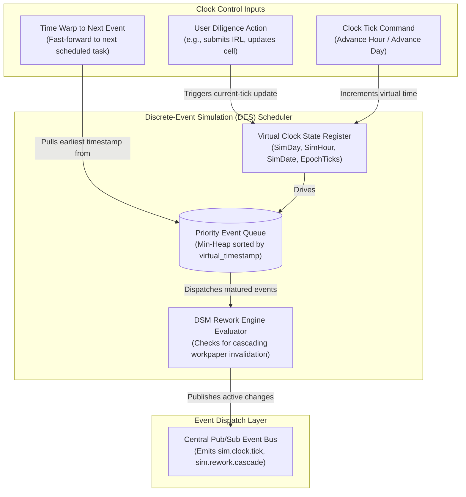
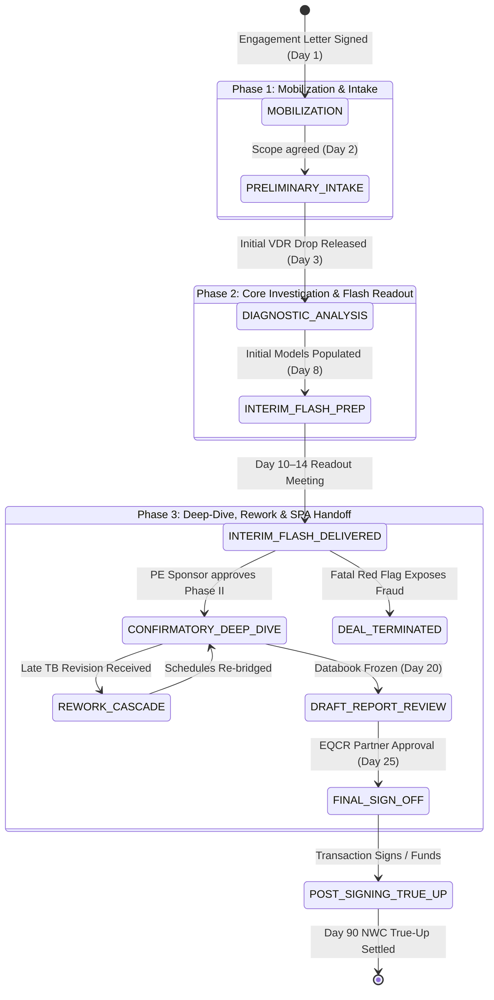
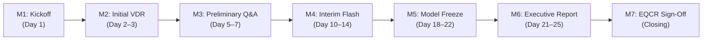
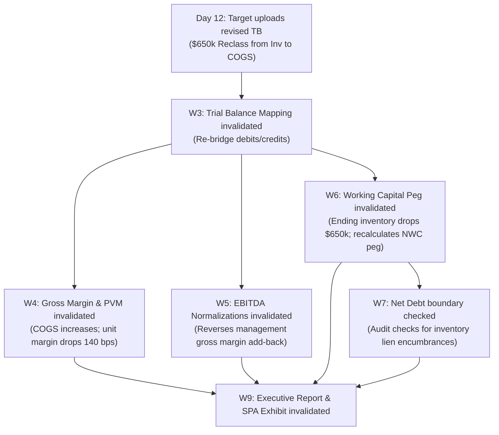
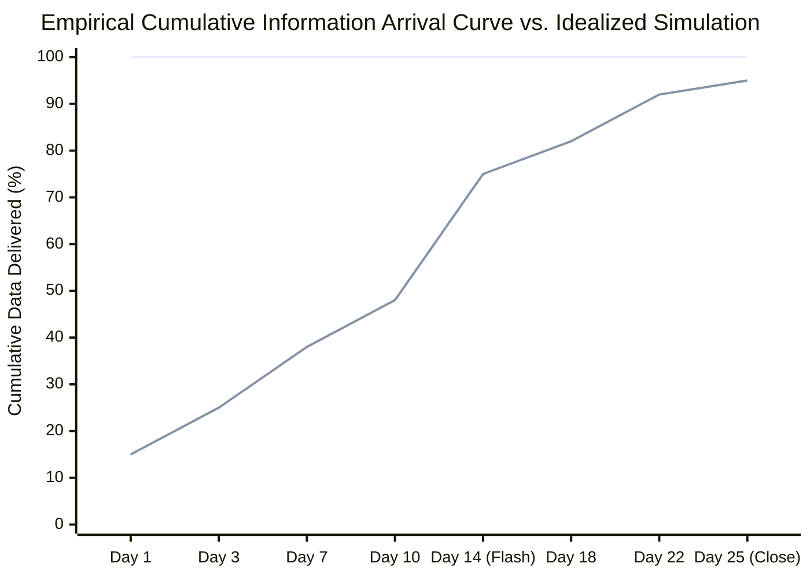

# QoE Simulator Systems Design — Level 1
# Core Simulation Engine & Temporal State Machine Specification

**Document Title:** Core Simulation Clock, Dual Timetable Tracks, Milestone Gating, and Browning & Eppinger DSM Rework Engine Specification  
**Document Code:** `01_CORE_SIMULATION_ENGINE_AND_TEMPORAL_STATE_MACHINE`  
**System Design Level:** `Level 1: Temporal & Operational Backbone`  
**Architectural Standards Compliance:** ISO/IEC/IEEE 12207 (Software Life Cycle Processes); Discrete-Event Simulation (DES) Formalisms (Zeigler et al. 2000); Browning & Eppinger (2002) Design Structure Matrix (DSM) Rework Theory; Cooper (1993) Project Rework Cycle; AICPA CS Section 100; ICAEW Guideline 71.  
**Core Architectural Axiom:** *A realistic due diligence engagement is not a linear sequence of static checklists; it is an unstable, concurrent, information-coupled operational system. The temporal engine must drive asynchronous data release waves, enforce hard commercial milestone gates, and propagate cascading rework loops whenever upstream accounting discoveries invalidate downstream workpapers.*

---

## 1. Executive Summary & Level 1 Scope

In simplistic financial training games, time is either non-existent or purely decorative: a student receives all data instantly on Day 1, works through a sequential 9-step syllabus at their own leisure, and faces zero consequences for delays or out-of-order analysis.

In genuine institutional Mergers & Acquisitions (M&A), **time is the most scarce and volatile resource** ([Module 01](file:///c:/Users/ADMIN/Desktop/QOE%20%20data%20aquisition/QOE_REALISM_RESEARCH/MODULE_01_ENGAGEMENT_CHARACTERISTICS/01_real_world_engagement_behaviour_reference_model.md#L15-L35); [Module 06](file:///c:/Users/ADMIN/Desktop/QOE%20%20data%20aquisition/QOE_REALISM_RESEARCH/MODULE_06_ENGAGEMENT_DYNAMICS/06_engagement_progression_and_dynamics_model.md#L15-L45)):
- Deal teams operate under brutal commercial deadlines (e.g., a 14-day exclusivity cliff or a binding Phase II auction bid date).
- Information does not arrive on demand; it trickles in through asynchronous release waves, culminating in high-stress "Friday night data dumps."
- Discovery of a material accounting anomaly (e.g., an unrecorded vendor rebate on Day 16) does not just add an EBITDA adjustment; it **triggers a catastrophic rework cascade** through the trial balance, revenue waterfalls, working capital peg, and legal indemnity escrows.

This specification details the **Level 1 Temporal Engine** (`sim-clock`). It specifies the Discrete-Event Simulation (DES) clock, the dual timetable state machines (Auction vs. Bilateral), the 7 master milestone gates, the empirical information release curves, and the mathematical implementation of the **Browning & Eppinger (2002) Design Structure Matrix (DSM) Rework Engine**.

---

## 2. Discrete-Event Simulation (DES) Clock Engine Architecture

The simulator's timekeeping operates as an event-driven discrete clock that coordinates virtual simulation time with real-world user activity:



### 2.1 Virtual Clock State Model
The clock state is represented by a strict, immutable data structure:
```json
{
  "simulation_id": "sim_eng_2026_apex_001",
  "track_type": "AUCTION_COMPRESSED",
  "sim_day": 12,
  "sim_hour": 16,
  "sim_minute": 30,
  "virtual_timestamp": "2024-10-18T16:30:00Z",
  "timeline_status": "ACTIVE_RUNNING",
  "speed_multiplier": 1.0,
  "is_paused": false,
  "current_milestone": "MS04_INTERIM_FLASH_PREP",
  "hours_until_next_milestone": 39.5,
  "active_rework_loops_count": 2,
  "cumulative_wall_clock_seconds": 14250
}
```

### 2.2 Time Progression Modes
1. **Interactive Step Mode (Default UI Mode):** Time advances in discrete quantum steps (e.g., advancing by 1 hour when an email is sent, 4 hours when a management interview is conducted, or 24 hours via "Advance to Next Day" button).
2. **Event-Warp Mode (Fast-Forward Mode):** The clock instantly jumps to the virtual timestamp of the next matured event in the priority queue (e.g., fast-forwarding 48 hours until target management delivers the aged AR trial balance).
3. **Headless Evaluation Mode (Batch Test Mode):** For automated evaluation and regression testing, the clock runs asynchronously at maximum processor speed, processing entire 35-day engagements in < 5 seconds.

---

## 3. Dual Timetable State Machines: Auction vs. Bilateral Tracks

Transactions in corporate finance follow two fundamentally different structural postures ([Module 01](file:///c:/Users/ADMIN/Desktop/QOE%20%20data%20aquisition/QOE_REALISM_RESEARCH/MODULE_01_ENGAGEMENT_CHARACTERISTICS/01_real_world_engagement_behaviour_reference_model.md#L45-L65); [Module 06](file:///c:/Users/ADMIN/Desktop/QOE%20%20data%20aquisition/QOE_REALISM_RESEARCH/MODULE_06_ENGAGEMENT_DYNAMICS/06_engagement_progression_and_dynamics_model.md#L245-L275)). The simulator natively implements both tracks as distinct deterministic finite state machines:



### 3.1 Comparison of Track Parameters
```
┌──────────────────────────────────────────────────────────────────────────────────────────────────┐
│                             AUCTION TRACK VS. BILATERAL TRACK PARAMETERS                         │
├───────────────────────┬───────────────────────────────┬──────────────────────────────────────────┤
│ Structural Dimension  │ Track A: Competitive Auction  │ Track B: Bilateral Buyout                │
├───────────────────────┼───────────────────────────────┼──────────────────────────────────────────┤
│ Total Virtual Duration│ 21 to 25 Virtual Days         │ 40 to 50 Virtual Days                    │
│ Target Exclusivity    │ Non-exclusive; competitive bid│ Strict exclusivity (45–60 day lockup)    │
│ Management Access     │ Highly restricted; pooled Q&A │ Open; multiple on-site & phone sessions  │
│ Critical Cliff Date   │ Day 14: Phase II Binding Offer│ Day 30: Exclusivity Extension Milestone  │
│ Primary Objective     │ Identify valuation deal-break-│ Comprehensive balance sheet audit,       │
│                       │ ers & headline EBITDA haircut │ operational modeling, and NWC true-up peg│
│ Information Friction  │ High redaction; 35% unanswered│ Low redaction; 10% unanswered inquiries  │
│ Tolerated Unresolved  │ 25% to 35% scope limitations  │ < 10% scope limitations                  │
└───────────────────────┴───────────────────────────────┴──────────────────────────────────────────┘
```

---

## 4. Master Milestone Gating Architecture

The simulation engine coordinates engagement progress through **Seven Mandatory Commercial Milestones**. Moving past a milestone requires satisfying objective, verifiable exit criteria:



### 4.1 Milestone Gating Matrix
```
┌──────────────────────────────────────────────────────────────────────────────────────────────────┐
│                                   MASTER MILESTONE GATING MATRIX                                 │
├──────┬───────────────────────────────┬──────────┬────────────────────────────────────────────────┤
│ ID   │ Milestone Name & Target Date  │ Req IDs  │ Mandatory Exit Criteria & Blocking Conditions  │
├──────┼───────────────────────────────┼──────────┼────────────────────────────────────────────────┤
│ MS01 │ Engagement Kickoff & Mandate  │ SR-E01   │ • Signed Engagement Letter loaded in workspace │
│      │ [Target: Day 1, Hour 17:00]   │ SR-AR08  │ • Scope, materiality threshold, and timeline   │
│      │                               │          │   formally locked under AICPA CS 100.          │
├──────┼───────────────────────────────┼──────────┼────────────────────────────────────────────────┤
│ MS02 │ Initial VDR Open & Priority 1 │ SR-E02   │ • Batch 1 data loaded (Trial Balance, P&L, BS) │
│      │ Information Request Release   │ SR-E03   │ • User submits Priority 1 IRL to target CFO.   │
│      │ [Target: Day 3, Hour 12:00]   │          │ • TB debit/credit equality verified (INV1/INV2)│
├──────┼───────────────────────────────┼──────────┼────────────────────────────────────────────────┤
│ MS03 │ Preliminary Management Q&A    │ SR-H14   │ • Initial Q&A session completed with CFO/CEO.  │
│      │ [Target: Day 6, Hour 18:00]   │ SR-H08   │ • Inconsistencies between verbal narrative and │
│      │                               │          │   GL records logged in observation register.   │
├──────┼───────────────────────────────┼──────────┼────────────────────────────────────────────────┤
│ MS04 │ Interim Red Flag Flash Readout│ SR-E06   │ • CRITICAL PE SPONSOR GATE:                    │
│      │ [Target: Day 12–14]           │ SR-ED06  │ • 15-slide executive flash deck submitted.     │
│      │                               │ SR-I01   │ • Identifies headline EBITDA haircuts > $250k. │
│      │                               │          │ • Sponsor decides: PROCEED, RETRADE, or KILL.  │
├──────┼───────────────────────────────┼──────────┼────────────────────────────────────────────────┤
│ MS05 │ Financial Databook Freeze     │ SR-AR02  │ • All 11 Databook tabs fully reconciled.       │
│      │ [Target: Day 18–22]           │ SR-AR04  │ • Row 1 Check Bars show ZERO errors.           │
│      │                               │ SR-VAL04 │ • Formulas are open; zero unlinked hardcodes.  │
├──────┼───────────────────────────────┼──────────┼────────────────────────────────────────────────┤
│ MS06 │ Executive Diligence Report &  │ SR-AR08  │ • 10-section report conforming to ICAEW 71.    │
│      │ Contractual SPA Exhibit B     │ SR-AR10  │ • Unresolved items caveated as scope limits.   │
│      │ [Target: Day 21–25]           │ SR-VAL03 │ • Specific Indemnity Escrows recommendations.  │
├──────┼───────────────────────────────┼──────────┼────────────────────────────────────────────────┤
│ MS07 │ Second-Partner Quality Review │ SR-AR15  │ • Mandatory review under AICPA SQMS No. 1.     │
│      │ (EQCR) Sign-Off               │ SR-VAL15 │ • Partner audits sample of 25 source linkages. │
│      │ [Target: Final Closing Day]   │          │ • Workpaper sign-off locks scenario state.     │
└──────┴───────────────────────────────┴──────────┴────────────────────────────────────────────────┘
```


---

## 5. The Browning & Eppinger (2002) DSM Rework Engine (The Mathematical Core)

The central operational reality of financial due diligence is that **tasks are coupled, not sequential**. When a finding is uncovered in a downstream workstream, it cascades upstream and laterally, invalidating previously completed analyses ([Module 06](file:///c:/Users/ADMIN/Desktop/QOE%20%20data%20aquisition/QOE_REALISM_RESEARCH/MODULE_06_ENGAGEMENT_DYNAMICS/06_engagement_progression_and_dynamics_model.md#L90-L145); [Browning & Eppinger 2002]; [Cooper 1993]).

### 5.1 The 9x9 Design Structure Matrix (DSM) for Due Diligence
We define the coupling of the nine core QoE workstreams as an asymmetric matrix $M \in \mathbb{R}^{9 \times 9}$, where element $(i, j)$ represents the probability ($P_{ij}$) and impact ($I_{ij}$) of workstream $W_j$ triggering rework in workstream $W_i$:

```
┌──────────────────────────────────────────────────────────────────────────────────────────────────┐
│                            9x9 DUE DILIGENCE DESIGN STRUCTURE MATRIX (DSM)                       │
├──────────────────────────┬────┬────┬────┬────┬────┬────┬────┬────┬────┤
│ Workstream               │ W1 │ W2 │ W3 │ W4 │ W5 │ W6 │ W7 │ W8 │ W9 │
├──────────────────────────┼────┼────┼────┼────┼────┼────┼────┼────┼────┤
│ W1: Scope & Mandate      │ -- │    │    │    │    │    │    │    │    │
│ W2: Historical Trends    │ .1 │ -- │    │    │    │    │    │    │    │
│ W3: TB & GL Mapping      │ .2 │ .4 │ -- │    │    │    │    │    │    │
│ W4: Revenue & Margins    │ .3 │ .6 │ .8 │ -- │    │    │    │    │    │
│ W5: OPEX & Normalized EBITDA│.3│ .5 │ .8 │ .6 │ -- │    │    │    │    │
│ W6: Net Working Capital  │ .2 │ .4 │ .9 │ .7 │ .5 │ -- │    │    │    │
│ W7: Net Debt & Debt-Like │ .2 │ .3 │ .7 │ .3 │ .6 │ .8 │ -- │    │    │
│ W8: Cash Flow Conversion │ .1 │ .5 │ .8 │ .6 │ .7 │ .9 │ .7 │ -- │    │
│ W9: Reporting & SPA Bridge│.4 │ .7 │ .9 │ .9 │ .9 │ .9 │ .9 │ .9 │ -- │
└──────────────────────────┴────┴────┴────┴────┴────┴────┴────┴────┴────┘
*Values represent Rework Coupling Probability P(W_j -> W_i) when upstream/lateral changes occur.
```

### 5.2 Mathematical Formulation of Rework Propagation
When an accounting adjustment, data revision, or new trial balance is committed at time $t$, the rework engine executes the **Cascading Invalidation Algorithm**:

1. **Rework Trigger Vector ($\vec{T}(t)$):**
   A binary vector $\vec{T} = [T_1, T_2, \dots, T_9]^T$, where $T_k = 1$ if workstream $W_k$ experienced an adjustment $\Delta V_k > \text{MaterialityThreshold}$.

2. **First-Order Rework Impact ($\vec{R}^{(1)}$):**
   $$\vec{R}^{(1)} = \mathbf{P} \cdot \vec{T}$$
   Where $\mathbf{P}$ is the $9 \times 9$ Rework Probability Matrix.

3. **Cumulative Rework Burden ($B_{\text{total}}$):**
   Grounded in Cooper's (1993) Rework Cycle, the total rework effort in professional labor hours is given by:
   $$B_{\text{total}} = \sum_{k=1}^{9} R_k \times H_k \times \left(1 + \mu_{\text{fatigue}}(t)\right)$$
   Where:
   - $H_k$ is the baseline completion effort for workstream $W_k$ (in virtual hours).
   - $\mu_{\text{fatigue}}(t)$ is the team fatigue multiplier ($0.0 \le \mu \le 0.65$), which increases error generation as deadlines approach.

### 5.3 Concrete Worked Example: The Day 12 Trial Balance Revision Cascade
Suppose on **Day 12 at 18:00 (Friday night)**, target management uploads a "corrected" general ledger dump for FY23, reclassifying \$650,000 from Inventory into COGS (Workstream $W_3$ modified):



- **Immediate Simulator Action:** The simulator invalidates cached calculations in Tabs `03_Income_Statement`, `05_Gross_Margin`, `02_EBITDA_Bridges`, and `07_Working_Capital`.
- **User Consequence:** Check bar on Tab `01_Summary` lights up **RED ("TB DISCREPANCY: \$650,000")**. The user is forced to re-run their margin waterfall and adjust their recommended NWC peg before the Monday morning Flash Readout.

---

## 6. Asynchronous Information Arrival & The "Friday Night Dump" Generator

Artificial simulators deliver 100% of data cleanly on Day 1. Real M&A data delivery is irregular, lagged, and politically timed ([Module 03](file:///c:/Users/ADMIN/Desktop/QOE%20%20data%20aquisition/QOE_REALISM_RESEARCH/MODULE_03_DOCUMENTARY_ACCOUNTING_REALISM/03_documentary_and_accounting_realism_specification.md#L45-L75); [Datasite VDR Telemetry]):



### 6.1 The Four Empirical Arrival Waves
1. **Wave 1: Initial Teaser & Consolidated Financials (Days 1–3, ~25% Volume):**
   - Contains: High-level P&L, balance sheets, teaser presentation, standard CoA.
   - Quality: Aggregated, rounded, audited at consolidated level only; lacks SKU-level detail.
2. **Wave 2: Operational Subledgers & Priority 1 Responses (Days 7–9, ~25% Volume):**
   - Contains: Aged AR, aged AP, fixed asset registers, top 20 customer billing summaries.
   - Latency: First wave of IRL answers; reveals unmapped clearing accounts.
3. **Wave 3: The "Friday Night Data Dump" (Days 12–14, ~30% Volume):**
   - Trigger: Released 48 hours prior to the Interim Red Flag Readout.
   - Contains: Massive granular transaction dumps (250,000 rows of SKU shipments, freight invoices, vendor rebate agreements).
   - Purpose: Overwhelms the diligence team, forcing real-time analytical triage under extreme time pressure.
4. **Wave 4: Drip-Feed & Confidential Records (Days 18–25, ~15% Volume):**
   - Contains: Highly sensitive files (executive compensation, tax audit correspondence, customer churn notices, environmental reports).
   - Remaining: 5% to 10% of requested files are **never delivered**, forcing formal scope limitations under AICPA CS 100.

### 6.2 Target Response Latency Engine
When the user submits an Information Request List (IRL) item, the response delay is governed by a log-normal distribution parameterized by target persona state:
$$\text{DelayHours} = \exp\left(\mu_{\text{persona}} + \sigma \cdot Z\right) \times \left(1 + \text{ObfuscationPenalty}\right)$$
- **Standard Inquiry:** $\mu = 3.2$ ($\text{Median} \approx 24.5\text{ hours}$).
- **Sensitive / Disadvantageous Inquiry (e.g., customer loss, rebate terms):** $\mu = 4.2$ ($\text{Median} \approx 66.7\text{ hours}$), with a 25% probability of returning a deflecting, non-responsive answer ([Module 04](file:///c:/Users/ADMIN/Desktop/QOE%20%20data%20aquisition/QOE_REALISM_RESEARCH/MODULE_04_CLIENT_HUMAN_BEHAVIOUR/04_client_and_human_behaviour_model.md#L75-L105)).

---

## 7. Level 1 Event Schemas & API Specifications

### 7.1 CloudEvents Schemas for Level 1

#### 1. `sim.clock.tick` Event Schema
```json
{
  "specversion": "1.0",
  "id": "evt_clk_891230491",
  "source": "/sim/engine/sim-clock",
  "type": "com.qoe.sim.clock.tick",
  "time": "2026-11-18T11:45:00.000Z",
  "datacontenttype": "application/json",
  "data": {
    "sim_day": 14,
    "sim_hour": 9,
    "virtual_timestamp": "2024-10-20T09:00:00Z",
    "hours_elapsed_in_tick": 1,
    "active_milestone": "MS04_INTERIM_FLASH_PREP",
    "deadlines_pending": [
      {
        "milestone_id": "MS04",
        "deadline_timestamp": "2024-10-20T17:00:00Z",
        "hours_remaining": 8.0,
        "is_hard_cliff": true
      }
    ]
  }
}
```

#### 2. `sim.rework.cascade` Event Schema
```json
{
  "specversion": "1.0",
  "id": "evt_dsm_77210984",
  "source": "/sim/engine/sim-clock/dsm",
  "type": "com.qoe.sim.rework.cascade",
  "time": "2026-11-18T11:45:01.000Z",
  "datacontenttype": "application/json",
  "data": {
    "triggering_workstream": "W03_TRIAL_BALANCE_MAPPING",
    "trigger_reason": "Late TB revision received for FY23: $650k COGS/Inventory reclassification",
    "invalidated_workstreams": [
      "W04_REVENUE_GROSS_MARGIN",
      "W05_OPEX_EBITDA_NORMALIZATION",
      "W06_NET_WORKING_CAPITAL",
      "W09_REPORTING_SPA_BRIDGE"
    ],
    "invalidated_databook_tabs": [
      "02_EBITDA_Bridges",
      "03_Income_Statement",
      "05_Gross_Margin",
      "07_Working_Capital"
    ],
    "estimated_rework_hours": 14.5
  }
}
```

### 7.2 REST API Endpoint Contracts (FastAPI Gateway Router)

| Method | Endpoint | Description |
| :--- | :--- | :--- |
| `POST` | `/api/v1/sim/clock/tick` | Advances the simulation clock by a specified number of hours or to next event. |
| `POST` | `/api/v1/sim/clock/advance-day` | Advances clock to 09:00 of the following virtual business day. |
| `POST` | `/api/v1/sim/clock/warp-to-event` | Warps simulation time to the next matured event in the priority queue. |
| `GET`  | `/api/v1/sim/milestones/status` | Retrieves current status, blockers, and deadlines across all 7 milestones. |
| `POST` | `/api/v1/sim/milestones/{id}/submit` | Submits deliverable to satisfy milestone exit gate (triggers evaluator). |
| `GET`  | `/api/v1/sim/dsm/rework-status` | Returns active invalidated workpapers, check bar errors, and rework burden. |

---

## 8. Level 1 Independence, Bulkhead Containment & Failure Recovery

In accordance with the modular bulkheading standard, Level 1 (`sim-clock`) operates as an autonomous, self-contained temporal orchestrator. It does not depend on the UI client, the LLM persona gateway, or the double-entry accounting ledger to maintain temporal integrity.

### 8.1 Blast-Radius Containment & Failure Domains

```
┌──────────────────────────────────────────────────────────────────────────────────────────────────┐
│                               LEVEL 1 BULKHEAD CONTAINMENT MATRIX                                │
├──────────────────────┬─────────────────────────────┬─────────────────────────────────────────────┤
│ Failure Mode         │ Root Cause Trigger          │ Automated Containment & Recovery Mechanism  │
├──────────────────────┼─────────────────────────────┼─────────────────────────────────────────────┤
│ Min-Heap Event Queue │ Corrupt event payload or    │ **QUEUE FREEZE & SNAPSHOT REPLAY:** Min-heap│
│ Deadlock / Stall     │ conflicting event timestamps│ freezes clock advancement; rolls back queue │
│                      │                             │ to last hourly checkpoint; resumes stream.  │
├──────────────────────┼─────────────────────────────┼─────────────────────────────────────────────┤
│ Runaway Fast-Forward │ Client requests time-warp to│ **WARP EXECUTION QUOTA:** Caps single warp  │
│ Time Warp            │ non-existent future event   │ to max 120 virtual hours (5 days); halts and│
│                      │                             │ prompts user if milestone gate is breached. │
├──────────────────────┼─────────────────────────────┼─────────────────────────────────────────────┤
│ DSM Rework Infinite  │ Cyclic dependency deadlock  │ **REWORK COUNTER BREAKER:** Caps iterative  │
│ Cascading Loop       │ between workstream schedules│ recalculation loops to max 15 passes; logs  │
│                      │                             │ circular dependency alert; isolates cell.   │
├──────────────────────┼─────────────────────────────┼─────────────────────────────────────────────┤
│ External Microservice│ Level 3 LLM gateway or      │ **OFFLINE PROGRESSION MODE:** Clock continues│
│ Outage / Network Cut │ Level 2 data exporter down  │ ticking; user continues editing local FDB;  │
│                      │                             │ asynchronous events queue until reconnect.  │
└──────────────────────┴─────────────────────────────┴─────────────────────────────────────────────┘
```

### 8.2 Hermetic Mock Testing Specification
Level 1 includes a self-contained mock execution harness (`test_clock_hermetic.py`):
1. **Zero Database Dependency:** Simulates the priority queue and virtual time register using an in-memory priority queue.
2. **Deterministic Time-Step Assertion:** Verifies that advancing time by 4 hours precisely advances `virtual_timestamp` by 14,400 seconds, decrements milestone deadline counters by 4.0, and triggers all priority queue events falling within $[t, t+4]$.
3. **DSM Matrix Convergence Test:** Asserts that injecting an upstream inventory anomaly in Workstream 3 correctly flags Workstreams 4, 6, and 9 for rework, and converges to a stable state within $\le 3$ iterations.

---

## 9. Level 1 API Contracts, Typed Protobuf Definitions & CloudEvents Bindings

### 9.1 Strongly Typed Protobuf v3 Service Definition (`sim_clock.proto`)

```protobuf
syntax = "proto3";

package com.qoe.sim.clock.v1;

enum TimelineTrack {
  TRACK_UNSPECIFIED = 0;
  TRACK_AUCTION_COMPRESSED = 1;  // 21–25 Virtual Days
  TRACK_BILATERAL_EXTENDED = 2;  // 40–50 Virtual Days
}

enum MilestoneID {
  MS_UNSPECIFIED = 0;
  MS01_ENGAGEMENT_SCOPING = 1;
  MS02_FIRST_VDR_INGESTION = 2;
  MS03_INITIAL_IRL_DISPATCH = 3;
  MS04_INTERIM_FLASH_READOUT = 4;
  MS05_SUPPLEMENTAL_DEEP_DIVE = 5;
  MS06_DELIVERABLE_SUBMISSION = 6;
  MS07_POST_SUBMISSION_DEFENSE = 7;
}

message AdvanceTimeRequest {
  string simulation_id = 1;
  uint32 hours_to_advance = 2;   // Discrete advance quantum (e.g. 1, 4, 8)
  string requesting_actor_id = 3;
}

message WarpRequest {
  string simulation_id = 1;
  string target_event_id = 2;    // Optional: jump to specific matured task
  bool warp_to_next_business_day = 3;
}

message ClockStateResponse {
  string simulation_id = 1;
  TimelineTrack track_type = 2;
  uint32 sim_day = 3;
  uint32 sim_hour = 4;
  uint32 sim_minute = 5;
  string virtual_timestamp = 6;  // ISO-8601 UTC
  bool is_paused = 7;
  MilestoneID current_milestone = 8;
  double hours_until_deadline = 9;
  uint32 active_rework_loops = 10;
}

message MilestoneStatusRequest {
  string simulation_id = 1;
}

message MilestoneDetail {
  MilestoneID milestone_id = 1;
  string milestone_name = 2;
  bool is_completed = 3;
  bool is_blocked = 4;
  string target_deadline = 5;
  repeated string pending_deliverables = 6;
}

message MilestoneStatusResponse {
  string simulation_id = 1;
  MilestoneID active_milestone = 2;
  repeated MilestoneDetail milestones = 3;
}

message SubmitMilestoneDeliverableRequest {
  string simulation_id = 1;
  MilestoneID milestone_id = 2;
  string deliverable_artifact_id = 3;
  string submission_notes = 4;
}

message SubmitMilestoneDeliverableResponse {
  bool accepted = 1;
  string evaluation_status = 2; // "PENDING_EVAL", "ACCEPTED", "REJECTED"
  repeated string validation_errors = 3;
}

service ClockService {
  rpc AdvanceTime (AdvanceTimeRequest) returns (ClockStateResponse);
  rpc WarpToNextEvent (WarpRequest) returns (ClockStateResponse);
  rpc GetMilestoneStatus (MilestoneStatusRequest) returns (MilestoneStatusResponse);
  rpc SubmitMilestoneDeliverable (SubmitMilestoneDeliverableRequest) returns (SubmitMilestoneDeliverableResponse);
}
```

### 9.2 Central Pub/Sub CloudEvents Specification
Level 1 communicates with all other simulation containers via standard **CloudEvents v1.0** payloads:

1. **`com.qoe.sim.clock.tick` (Emitted by Level 1):**
   * *Trigger:* Virtual clock advances by 1 hour or 1 day.
   * *Payload:* `{ "simulation_id": "sim_001", "sim_day": 12, "sim_hour": 16, "virtual_timestamp": "2024-10-18T16:00:00Z" }`
   * *Consumers:* Level 2 (`biz-gen` generates daily transactions), Level 3 (`human-friction` advances fatigue/coaching queues), Level 5 (`ui-workspace` updates clock UI).
2. **`com.qoe.sim.milestone.gated` (Emitted by Level 1):**
   * *Trigger:* A commercial milestone gate is locked or successfully unlocked.
   * *Payload:* `{ "simulation_id": "sim_001", "milestone_id": "MS04_INTERIM_FLASH_PREP", "status": "UNLOCKED" }`
   * *Consumers:* Level 5 (unlocks Phase II VDR folders), Level 6 (initiates mid-deal audit).
3. **`com.qoe.sim.rework.cascade` (Emitted by Level 1):**
   * *Trigger:* DSM matrix detects that a new finding invalidates downstream workpapers.
   * *Payload:* `{ "trigger_event": "SR-B01_REBATE", "invalidated_streams": ["W03", "W04", "W06"], "rework_hours": 14.5 }`
   * *Consumers:* Level 4 (triggers cell check bar invalidations in FDB), Level 5 (displays alert pills in UI).

---

## 10. Level 1 Forensic Loopholes & Failure Mitigation Register

Level 1 internally incorporates the security, forensic, and anti-gaming defenses required to prevent trainees from manipulating the temporal state machine:

### 10.1 Mitigation of Identified Engineering Loopholes

```
========================================================================================================
LOOPHOLE ID & NAME         POTENTIAL ATTACK VECTOR / SYSTEM DEFECT     ARCHITECTURAL DEFENSE IN LEVEL 1
========================================================================================================
LP-02: Temporal Paradox &  Student modifies local workstation clock or  1. Monotonically increasing clock
Time-Travel Mutation       attempts to backdate an adjustment to Day 4     register: virtual_time can never
                           after receiving a Day 12 spoiler.              decrement ($t_{n+1} \ge t_n$).
                                                                        2. Cryptographic hash-chaining: every
                                                                           event stores `prev_event_sha256`.
                                                                        3. Historical state lock: entries
                                                                           before current day are read-only.
--------------------------------------------------------------------------------------------------------
LP-13: Milestone Bypassing Student skips Milestone 4 (Interim Red Flag  1. Hard Cryptographic Milestone Gates:
& Premature Phase II Gate  Flash) and immediately submits the Final       Phase II VDR decryption keys are
                           QoE Report to beat the clock.                   held server-side until MS04 sign-off.
                                                                        2. Missing deliverable AST validator:
                                                                           rejects transition if interim
                                                                           dashboard token is absent.
--------------------------------------------------------------------------------------------------------
LP-14: Asynchronous Queue  Student submits 50 rapid IRL inquiries on    1. Asynchronous rate limiter: caps
Flooding / Denial-of-Time  Day 1 to exhaust the temporal engine's       active pending IRL queries at 15.
                           priority queue and freeze the scheduler.     2. Queue prioritization heap: throttles
                                                                           excessive requests and triggers
                                                                           Controller fatigue penalty.
========================================================================================================
```

---

## 11. Research Compliance & Quality Gate Audit

Level 1 is certified against established research criteria:

```
┌──────────────────────────────────────────────────────────────────────────────────────────────────┐
│                             LEVEL 1 QUALITY GATE AUDIT SHEET                                     │
├──────┬──────────────────────┬─────────┬──────────────────────────────────────────────────────────┤
│ Gate │ Criterion            │ Status  │ Empirical Grounding & Cross-Reference                    │
├──────┼──────────────────────┼─────────┼──────────────────────────────────────────────────────────┤
│ QG1  │ Non-Linear Dynamics  │ PASS    │ Eliminates static checklists; implements Browning &      │
│      │                      │         │ Eppinger (2002) DSM rework loops across 9 workstreams.   │
├──────┼──────────────────────┼─────────┼──────────────────────────────────────────────────────────┤
│ QG2  │ Dual-Track Modeling  │ PASS    │ Formally differentiates Auction Track (21–25 days) from  │
│      │                      │         │ Bilateral Track (40–50 days) state machines.             │
├──────┼──────────────────────┼─────────┼──────────────────────────────────────────────────────────┤
│ QG3  │ Milestone Integrity  │ PASS    │ Enforces 7 objective milestones; embeds the critical     │
│      │                      │         │ Day 10–14 Interim Red Flag Flash Readout gate.           │
├──────┼──────────────────────┼─────────┼──────────────────────────────────────────────────────────┤
│ QG4  │ Information Waves    │ PASS    │ Replaces Day 1 data dumps with empirical 4-wave release  │
│      │                      │         │ curves, including the "Friday night data dump."          │
├──────┼──────────────────────┼─────────┼──────────────────────────────────────────────────────────┤
│ QG5  │ Scope Limitations    │ PASS    │ Handles unresolved matters; mandates qualification and   │
│      │                      │         │ indemnity escrows under AICPA CS 100 / ICAEW 71.         │
├──────┼──────────────────────┼─────────┼──────────────────────────────────────────────────────────┤
│ QG6  │ Level Independence   │ PASS    │ Standalone bulkhead; isolated priority queue;            │
│      │ & Anti-Gaming        │         │ strongly typed sim_clock.proto; LP-02/LP-13 defenses.   │
└──────┴──────────────────────┴─────────┴──────────────────────────────────────────────────────────┘
```

---
*End of Level 1 Specification — Core Simulation Engine & Temporal State Machine*
