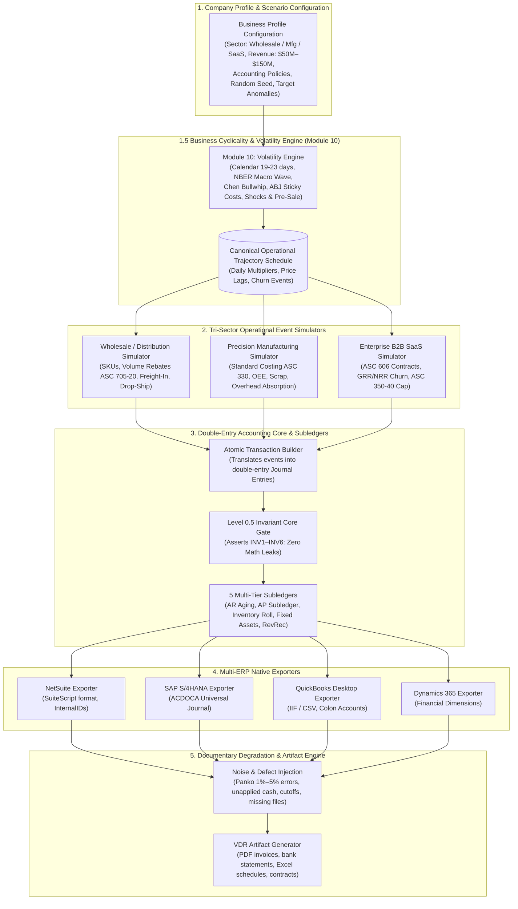
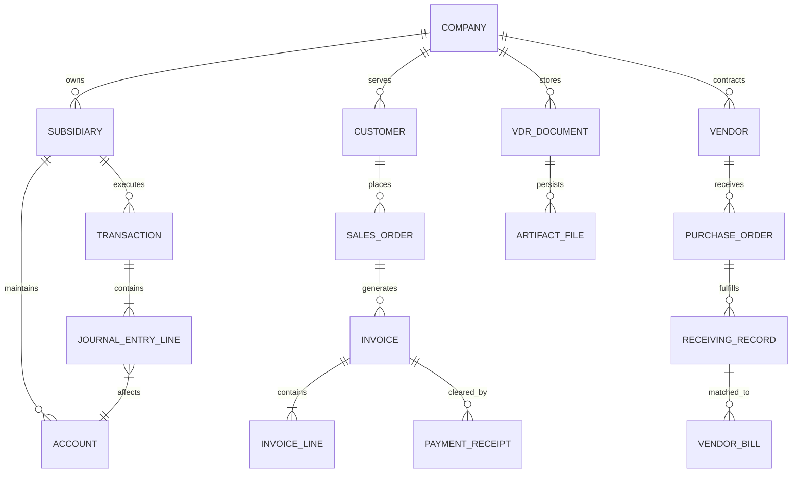
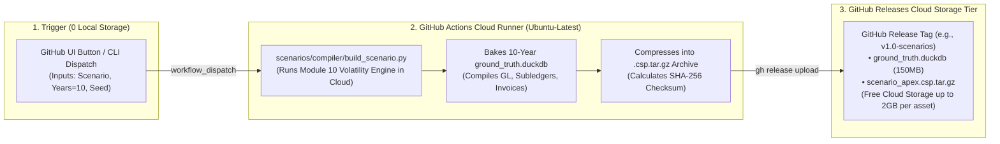

# QoE Simulator Systems Design — Level 2
# Business Reality & Multi-ERP Synthetic Data Generation Engine Specification

**Document Title:** Tri-Sector Operational Simulators, Generative Double-Entry Ledger Core, Multi-ERP Exporters, and Documentary Degradation Engine Specification  
**Document Code:** `02_BUSINESS_REALITY_AND_MULTI_ERP_DATA_ENGINE`  
**System Design Level:** `Level 2: Accounting & Operational Fabric`  
**Architectural Standards Compliance:** FASB Accounting Standards Codification (ASC 606, ASC 330, ASC 705-20, ASC 350-40, ASC 340-40); US GAAP / IFRS Standards; PCAOB AS 1105 (Audit Evidence) & AS 1215; AICPA AU-C 240 (Fraud & Manual JEs) & CS 100; Brazel, Jones, & Zimbelman (2009) Non-Financial Measure (NFM) Triangulation; Panko (1998, 2008) Spreadsheet Error Distributions.  
**Core Architectural Axiom:** *Financial statements do not create reality; they are the lagging digital shadow of physical, contractual, and human actions. Every simulated dollar must originate from an explicit operational event, pass through the Level 0.5 Invariant Core, and be rendered through authentic ERP schemas with realistic human and documentary noise.*

---

## 1. Executive Summary & Level 2 Scope

In standard academic accounting tools and commercial financial games, data generation is fundamentally decoupled from business reality:
- Financial statements are generated by randomly populating numbers into a pre-formatted balance sheet or trial balance template.
- Inventory movements are mathematical formulas rather than physical shipments of real SKUs.
- Customers pay their invoices instantly, or in neat 30-day cycles with zero partial payments, unapplied cash, or disputed credit memos.
- All documents exist, balance to the penny, and look identical, bearing generic table headers.

In genuine institutional Mergers & Acquisitions (M&A), **due diligence professionals audit the collision between operational reality and accounting records** ([Module 02](file:///c:/Users/ADMIN/Desktop/QOE%20%20data%20aquisition/QOE_REALISM_RESEARCH/MODULE_02_BUSINESS_FINANCIAL_REALITY/02_business_and_financial_reality_reference_model.md#L15-L45); [Module 03](file:///c:/Users/ADMIN/Desktop/QOE%20%20data%20aquisition/QOE_REALISM_RESEARCH/MODULE_03_DOCUMENTARY_ACCOUNTING_REALISM/03_documentary_and_accounting_realism_specification.md#L15-L45)):
1. **Operational Causality:** In a factory, you cannot book revenue without raw material receipts, machine runtime, bill-of-materials (BOM) consumption, quality scrap, and carrier bills of lading (BOL).
2. **System-Specific Telemetry:** Companies do not run on generic spreadsheets; they run on **NetSuite, SAP S/4HANA, QuickBooks Desktop, or Microsoft Dynamics 365**, each with its own internal IDs, clearing account conventions, and reporting eccentricities.
3. **Authentic Documentary Imperfection:** Real target companies exhibit operational noise: bookkeepers make copy-paste errors in Excel schedules (1%–5% error rates under Panko 1998), cash sits in unapplied clearing lines, cutoffs are sloppy at month-end, and legacy paper records are missing or damaged.

This specification details **Level 2: Business Reality & Multi-ERP Synthetic Data Generation Engine** (`biz-gen`). It specifies the generative operational models for three distinct business sectors, the double-entry accounting core, the 4 native ERP export formatters, the documentary degradation engine, and the foundational integration of **Module 10 (`10_business_cyclicality_volatility_and_ups_and_downs_simulation_model.md`)** which supplies the non-linear macroeconomic, operational, and seasonal volatility fabric.

---

## 2. Generative Data Pipeline Architecture

The data generation subsystem operates as an integrated multi-stage pipeline converting high-level scenario configurations into fully rendered Virtual Data Room (VDR) artifacts, driven by the operational reality of the Business Cyclicality & Volatility Engine:



---

## 2.5 Operational Cyclicality & Volatility Binding (Module 10 Integration)

In real-world due diligence, financial records are never flat or purely monotonic. Level 2 binds directly to **Module 10: Business Cyclicality, Operational Volatility & Ups-and-Downs Simulation Engine** ([10_business_cyclicality_volatility_and_ups_and_downs_simulation_model.md](file:///c:/Users/ADMIN/Desktop/QOE%20%20data%20aquisition/QOE_SYSTEMS_DESIGN/10_business_cyclicality_volatility_and_ups_and_downs_simulation_model.md)).

Module 10 runs as an autonomous, bulkheaded mathematical service prior to ERP journal generation. It takes the `VolatilityScenarioConfig` and generates the 60-month deterministic `OperationalTrajectoryPayload`, which governs transaction generation across six primary operational dimensions:

1. **Trading-Day & Calendar Modulation:**
   * Raw daily invoice generation is driven by `WorkingDays[month]` ($W_m \in [19, 23]$ non-holiday weekdays).
   * A 19-day month (February, holiday-heavy November/December) generates naturally lower billing totals than a 23-day month (March, August, October) by **15% to 21%**, eliminating artificial flat-line revenue generation without changing underlying demand run-rates.
2. **Macroeconomic Cyclicality:**
   * Bounded by historical National Bureau of Economic Research (NBER) duration ratios (expansions last 6.2x longer than contractions) and Federal Reserve `INDPRO`/`IPMAN` contraction depths (**-16% to -24%**).
   * Drives plant capacity utilization between normal mid-cycle levels (78.5%) down to severe contraction levels (63.5%), idling work centers and triggering ASC 330 idle plant overhead write-offs.
3. **Asymmetric Operating Leverage (Cost Stickiness):**
   * Implements the **Anderson, Banker, & Janakiraman (ABJ, 2003)** piecewise log-linear cost function:
     $$\Delta \text{OpEx}_m = \begin{cases} +0.55 \cdot g_m & \text{if } g_m \ge 0 \text{ (Expansion)} \\ +0.30 \cdot g_m & \text{if } g_m < 0 \text{ (Period 1 Contraction / Labor Hoarded)} \\ +0.85 \cdot g_m & \text{if } g_m < 0 \text{ for } \ge 3 \text{ months (Restructuring / WARN RIF)} \end{cases}$$
   * Reflects human capital replacement frictions ($20k–$40k to replace skilled CNC machinists) and facility lease lock-ins, causing EBITDA to collapse by **50% to 90%** during downturns ($DOL = 4.2\times\text{ to }7.5\times$).
4. **Supply Chain Bullwhip & Working Capital Whiplash:**
   * Implements the **Chen et al. (2000)** multi-echelon order variance amplification: $\frac{\text{Var}(q)}{\text{Var}(D)} \ge 1 + \frac{2L}{p} + \frac{2L^2}{p^2}$ ($5.0\times$ to $13.0\times$ order amplification upstream).
   * When demand cools, lagged purchase orders ordered 90–120 days prior continue arriving, forcing Days Inventory Outstanding (DIO) to blow out by **+30 to +50 days** (from 65 days to 110–125 days) and triggering mandatory FASB ASC 330 Lower of Cost and Net Realizable Value (LCNRV) E&O write-downs (reserving 15% on 91–180 day stock, 50% on 181–360 day stock, and 100% on >360 day dead stock).
   * **The Cash Inversion Paradox:** During downturns, inventory liquidation causes $\Delta \text{NWC} < 0$, meaning **Operating Cash Flow (CFO) spikes to record highs even as operating income collapses**.
5. **Idiosyncratic Operational Shocks:**
   * *Anchor Customer Loss Event:* Stochastic Poisson event simulating the loss of a top customer (12% of revenue), dropping contribution margin and collapsing operating profit by **-60% to -65%** with a 9-to-18-month replacement sales cycle.
   * *Commodity Pass-Through Lag:* A 60-to-90-day delay in passing raw material price increases (+25% in steel/resin) onto customers, creating a realistic **250 to 450 bps gross margin squeeze** for 1 to 2 quarters.
   * *Scrap Spikes & Expedited Freight:* Operational hiccups where scrap spikes from 1.8% to 8.5%, triggering emergency "hot-shot" freight charges ($15,000–$25,000 per incident) at 10x standard LTL rates to avoid customer assembly line shutdown penalties.
   * *Customer Bankruptcy (ASC 326):* An anchor customer insolvency causing a $250k–$400k direct Bad Debt write-off and shrinking the bank ABL revolver borrowing base.
6. **Strategic Pre-Sale Window Dressing:**
   * Under Delaware Court of Chancery precedents (*Prairie Capital v. Double E 2015*, *ABRY Partners V v. F&W 2006*), when `enable_window_dressing == true`, the engine injects deliberate pre-sale distortions during the final 12 to 24 months preceding LOI:
     - Shipping books held open 5 to 8 days past month-end (backdating invoices).
     - Quarter-end channel stuffing (+25% volume pull-forward via off-schedule discounts and Net 90 terms).
     - Maintenance CapEx freeze (R&M OpEx drops from 2.5% to 0.8% of sales).
     - Valuation reserve suppression (freezing E&O additions and bad debt accruals).
     - The post-closing "Order Desert" (-45% sales collapse in Month 1–2 post-close) and "Credit Memo Hangover" (customer returns surge 4x to 7x).

---

## 3. Subsystem 1: Tri-Sector Operational Event Simulators

### 3.1 Model 1: Wholesale / Distribution Operational Simulator
Grounded in SEC Form 10-K benchmarks from **Fastenal Company** and **W.W. Grainger**, value creation in distribution is driven by logistics, SKU velocity, and volume rebate optimization ([Module 02](file:///c:/Users/ADMIN/Desktop/QOE%20%20data%20aquisition/QOE_REALISM_RESEARCH/MODULE_02_BUSINESS_FINANCIAL_REALITY/02_business_and_financial_reality_reference_model.md#L45-L85)):

```
┌──────────────────────────────────────────────────────────────────────────────────────────────────┐
│                             WHOLESALE DISTRIBUTION OPERATIONAL ENGINE                            │
├─────────────────────┬────────────────────────────────────────────────────────────────────────────┤
│ Dimension           │ Operational Mechanics & Mathematical Specifications                        │
├─────────────────────┼────────────────────────────────────────────────────────────────────────────┤
│ SKU & Catalog       │ Maintains 15,000 to 50,000 active SKUs across 4 product categories.        │
│ Procurement         │ Generates purchase orders (POs), FOB Shipping vs. Destination terms.       │
│ Landed Costing      │ Capitalizes freight-in, customs tariffs, and port handling into inventory  │
│                     │ cost pool under US GAAP ASC 330.                                           │
│ Vendor Rebates      │ Models tiered volume rebate agreements under ASC 705-20:                   │
│ (ASC 705-20)        │ • Retrospective tier thresholds (e.g., 4% at $5M, 6% at $8M annual spend). │
│                     │ • Requires systematic allocation between Ending Inventory and COGS.        │
│ Fulfillment Split   │ Stock Fulfillment (75% volume, 28% margin) vs. Drop-Ship (25% volume,      │
│                     │ 6% margin direct from manufacturer to customer).                           │
│ Working Capital     │ Customer trade terms (Net 30/60); customer credit memo return lags (14–45  │
│ Drivers             │ days); vendor cash discounts (2/10 Net 30).                                │
└─────────────────────┴────────────────────────────────────────────────────────────────────────────┘
```

#### ASC 705-20 Vendor Rebate Allocation Formula
When a target distributor achieves an annual purchasing tier, the rebate cannot be credited 100% to Cost of Goods Sold if a portion of the qualifying inventory remains unsold at year-end:
$$\text{Rebate}_{\text{COGS}} = \text{Total Rebate} \times \left( \frac{\text{Qualifying Units Sold}}{\text{Total Qualifying Units Purchased}} \right)$$
$$\text{Rebate}_{\text{Inventory}} = \text{Total Rebate} \times \left( \frac{\text{Ending Inventory Units}}{\text{Total Qualifying Units Purchased}} \right)$$
* **Simulated Diligence Issue (`SR-B01`):** Target management credits 100% of the \$380,000 Fastenal rebate directly to current-year COGS to inflate EBITDA, failing to capitalize \$95,000 into ending inventory under ASC 705-20. The student must detect this and impose a \$95,000 EBITDA haircut.

#### 3.1.1 Module 10 Operational Cyclicality Binding (Profile A: NAICS 4238)
Wholesale distribution event generation binds directly to Module 10's Distribution Calibration Profile ([Profile A](file:///c:/Users/ADMIN/Desktop/QOE%20%20data%20aquisition/QOE_SYSTEMS_DESIGN/10_business_cyclicality_volatility_and_ups_and_downs_simulation_model.md#L305-L330)):
1. **Average Daily Sales (ADS) Demand Modulation:** Daily sales order generation is driven by:
   $$\text{DailyOrderVolume}_d = \text{BaseADS} \times \text{CalMult}_m \times \left(1 + \text{MacroWave}_m\right) \times \left(1 + \text{Seasonality}_m\right)$$
   Reflecting Fastenal/MSC longitudinal 10-K benchmarks with a -20.0% peak-to-trough cycle drawdown over 3–4 quarters.
2. **Commodity Pass-Through Margin Lag:** Inbound supplier price hikes (+20% steel/freight) apply immediately to COGS, but customer price increases are locked for 45 days, compressing gross margin from 26.0% down to 23.5% (-250 bps squeeze) for 2 months.
3. **Bullwhip Inventory & DIO Explosion:** Upstream order variance amplifies by 3.5x (Chen et al. 2000). Lagged purchase orders force DIO to surge from 70 days up to 115 days (+45 days) during downturns, triggering automatic ASC 330 E&O write-downs on >180-day slow-moving SKUs.

---

### 3.2 Model 2: Precision Manufacturing Operational Simulator
Grounded in SEC Form 10-K benchmarks from **Rockwell Automation**, **Kimball Electronics**, and **Barnes Group**, manufacturing financial performance is governed by machine run-time, standard costing absorption, and scrap rates ([Module 02](file:///c:/Users/ADMIN/Desktop/QOE%20%20data%20aquisition/QOE_REALISM_RESEARCH/MODULE_02_BUSINESS_FINANCIAL_REALITY/02_business_and_financial_reality_reference_model.md#L90-L135)):

```
┌──────────────────────────────────────────────────────────────────────────────────────────────────┐
│                            PRECISION MANUFACTURING OPERATIONAL ENGINE                            │
├─────────────────────┬────────────────────────────────────────────────────────────────────────────┤
│ Dimension           │ Operational Mechanics & Mathematical Specifications                        │
├─────────────────────┼────────────────────────────────────────────────────────────────────────────┤
│ Production Topology │ 12 to 25 Work Centers (CNC Mills, Lathes, Stamping, Assembly Lines).       │
│ Cost Accounting     │ Implements Standard Costing under ASC 330-10-30:                           │
│ (ASC 330)           │ $\text{StdCost} = \text{BOM Raw Materials} + \text{Direct Labor} + \text{Applied Overhead}$│
│ Machine OEE & Scrap │ Overall Equipment Effectiveness (OEE = Availability $\times$ Performance   │
│                     │ $\times$ Quality); scrap tracking (2% baseline; spikes to 8% on tooling fail│
│ Overhead Absorption │ Fixed manufacturing overhead (plant rent, machine depreciation, plant      │
│                     │ supervisor salaries) allocated based on *normal practical capacity*:      │
│                     │ $\text{Applied O/H} = \text{Actual Machine Hours} \times \text{Predetermined O/H Rate}$   │
│ Labor Dynamics      │ Direct labor run-rate vs. overtime surge (1.5x pay multiplier during peak).│
└─────────────────────┴────────────────────────────────────────────────────────────────────────────┘
```

#### ASC 330-10-30 Idle Plant Overhead Absorption Formula
Under US GAAP ASC 330-10-30, when production falls significantly below normal capacity, the unabsorbed fixed overhead cannot be capitalized into ending inventory:
$$\text{Unabsorbed Overhead} = \text{Fixed Overhead Budget} \times \left( 1 - \frac{\text{Actual Machine Hours}}{\text{Normal Practical Capacity Hours}} \right)$$
* **Simulated Diligence Issue (`SR-B06`):** Plant utilization drops from 85% to 58% during Q3 due to a lost aerospace customer contract. Management capitalizes \$650,000 of idle plant overhead into Work-in-Process (WIP) and Finished Goods inventory instead of expensing it immediately. The student must triangulate machine run-hours against utility bills (Brazel et al. 2009) to uncover the \$650,000 overstatement.

#### 3.2.1 Module 10 Operational Cyclicality Binding (Profile B: NAICS 3327)
Precision manufacturing event generation binds directly to Module 10's Manufacturing Calibration Profile ([Profile B](file:///c:/Users/ADMIN/Desktop/QOE%20%20data%20aquisition/QOE_SYSTEMS_DESIGN/10_business_cyclicality_volatility_and_ups_and_downs_simulation_model.md#L305-L330)):
1. **Capacity Utilization Plunge:** Plant capacity utilization drops from 78.5% mid-cycle down to 63.5% during macro contractions (`FRED MCUMFN`), causing extreme operating leverage ($DOL = 7.4\times$ matching Kimball Electronics FY24 records).
2. **Asymmetric Labor Hoarding:** Direct labor and machine depreciation are hoarded during Month 1 of a downturn ($\beta_{\text{down}} = 0.25$) due to skilled machinist replacement friction ($20k–$40k/departure), collapsing EBIT by -65% on a -12% customer churn shock.
3. **Operational Hiccups & Expedited Freight:** Random tooling failures trigger crisis scrap spikes (8.5% of production cost) and emergency hot-shot courier freight charges ($15,000 to $25,000 per incident at 10x standard LTL rates) to avoid OEM line-down penalties.
4. **Pre-Sale Shipping Book Extensions:** When `enable_window_dressing == true`, shipping books are held open 5 to 8 days past month-end in LTM-2 and LTM-1 (*Prairie Capital*), followed by the post-closing "Order Desert" (-45% sales collapse in Month 1 post-close).

---

### 3.3 Model 3: Enterprise B2B SaaS Subscriptions Simulator
Grounded in SEC Form 10-K benchmarks from **Datadog, Inc.** and **HubSpot**, SaaS performance is governed by contract-level performance obligations, cohort retention decay, and cloud hosting costs ([Module 02](file:///c:/Users/ADMIN/Desktop/QOE%20%20data%20aquisition/QOE_REALISM_RESEARCH/MODULE_02_BUSINESS_FINANCIAL_REALITY/02_business_and_financial_reality_reference_model.md#L140-L185)):

```
┌──────────────────────────────────────────────────────────────────────────────────────────────────┐
│                             ENTERPRISE B2B SAAS OPERATIONAL ENGINE                               │
├─────────────────────┬────────────────────────────────────────────────────────────────────────────┤
│ Dimension           │ Operational Mechanics & Mathematical Specifications                        │
├─────────────────────┼────────────────────────────────────────────────────────────────────────────┤
│ Contract Topology   │ 350 to 1,200 Enterprise B2B Master Services Agreements (MSAs).             │
│ Multi-Element ASC606│ Deconstructs contracts into distinct performance obligations:              │
│                     │ 1. Term Subscription License (ratable recognition over service period).    │
│                     │ 2. Implementation & Onboarding (recognized upon milestone acceptance).     │
│                     │ 3. Premium 24/7 Support (ratable recognition over contract term).          │
│ Retention & Churn   │ Monthly cohort tracking of Gross Retention Rate (GRR) and Net Retention    │
│                     │ Rate (NRR), modeling expansion ARR vs. downgrade/cancellation churn.       │
│ ASC 340-40 Comm.    │ Amortizes capitalized sales commissions over average customer life (5 yrs).│
│ ASC 350-40 Software │ Capitalization of internal-use software development costs: distinguishes   │
│ Capitalization      │ new architectural features from routine bug fixes and ongoing maintenance. │
└─────────────────────┴────────────────────────────────────────────────────────────────────────────┘
```

#### ASC 350-40 Internal-Use Software Capitalization Audit
Under US GAAP ASC 350-40, internal development costs may only be capitalized during the *Application Development Stage*. Preliminary project planning, training, routine bug fixes, and ongoing maintenance must be expensed as incurred:
$$\text{Valid Capitalized Software} = \sum (\text{Developer Hours on New Core Features} \times \text{Fully Burdened Hourly Rate})$$
* **Simulated Diligence Issue (`SR-B14`):** Target SaaS CFO capitalizes \$1,200,000 of developer salaries under ASC 350-40 to boost EBITDA. Audit of Jira sprint tickets reveals that 65% of sprint velocity was dedicated to routine maintenance, bug patching, and AWS cloud migration. Defensible capitalized software is only \$420,000, requiring a **\$780,000 EBITDA Haircut**.

#### 3.3.1 Module 10 Operational Cyclicality Binding (Profile C: NAICS 5112)
SaaS event generation binds directly to Module 10's SaaS Calibration Profile ([Profile C](file:///c:/Users/ADMIN/Desktop/QOE%20%20data%20aquisition/QOE_SYSTEMS_DESIGN/10_business_cyclicality_volatility_and_ups_and_downs_simulation_model.md#L305-L330)):
1. **The 9-Month SaaS Lag:** While sales cycle lengths stretch +50% and pipeline win rates drop in Q1 of a downturn, GAAP revenue lags macro turning points by 9 months due to ASC 606 ratable recognition from deferred revenue.
2. **NRR & Churn Dynamics:** Net Retention Rate (NRR) compresses from 105% (boom) down to 101%–102% (KeyBanc benchmarks) as enterprise customers down-tier seats upon annual contract renewal.
3. **CAC Payback Elongation:** CAC payback periods stretch from 18 months to 24.5 months, triggering a delayed sales & marketing headcount reduction (RIF) in Year 2.

---

## 4. Subsystem 2: Generative Double-Entry Accounting Core

The accounting core converts operational events into immutable double-entry journal entries using an institutional **Standard 6-Digit Chart of Accounts (CoA)**:

```
┌──────────────────────────────────────────────────────────────────────────────────────────────────┐
│                             STANDARD 6-DIGIT CHART OF ACCOUNTS (CoA)                             │
├───────────────┬─────────────────────────────┬────────────────────────────────────────────────────┤
│ Account Range │ Classification & Sub-Types  │ Key Subledger Integration Accounts                 │
├───────────────┼─────────────────────────────┼────────────────────────────────────────────────────┤
│ 100000–109999 │ Cash & Cash Equivalents     │ `101000` Operating Cash, `102000` Payroll Clearing │
│ 110000–119999 │ Trade Accounts Receivable   │ `111000` Trade AR, `112000` Unapplied Cash Clearing│
│ 120000–129999 │ Allowance for Bad Debts     │ `121000` Allowance for Credit Losses (ASC 326)     │
│ 130000–139999 │ Prepaid Expenses & Other    │ `131000` Prepaid Insurance, `132000` Vendor Dep.   │
│ 140000–149999 │ Inventories (ASC 330)       │ `141000` Raw Mat, `142000` WIP, `143000` Fin Goods │
│ 150000–159999 │ Property, Plant & Equipment │ `151000` Machinery, `152000` Accumulated Deprec.   │
│ 160000–169999 │ Capitalized Software/Intang.│ `161000` Software (ASC 350), `162000` Accum Amort. │
│ 200000–209999 │ Accounts Payable            │ `201000` Trade AP, `202000` Stretched AP Reclass   │
│ 210000–219999 │ Accrued Expenses            │ `211000` Accrued Payroll, `212000` Accrued Rebates │
│ 240000–249999 │ Deferred Revenue (ASC 606)  │ `241000` Current DefRev, `242000` Non-Current DefRev│
│ 260000–269999 │ Senior Debt & Revolvers     │ `261000` Revolving Credit Facility, `262000` T-Loan│
│ 300000–399999 │ Stockholders' Equity        │ `301000` Common Stock, `302000` Retained Earnings  │
│ 400000–499999 │ Revenues (ASC 606)          │ `401000` Subscription Rev, `402000` Product Sales  │
│ 500000–599999 │ Cost of Goods Sold (COGS)   │ `501000` Material COGS, `502000` Labor, `503000` O/H│
│ 600000–699999 │ SG&A Operating Expenses     │ `601000` Sales Salaries, `602000` Cloud AWS Hosting│
│ 700000–799999 │ Executive Compensation      │ `701000` Owner Salary, `702000` Discretionary Perks│
└───────────────┴─────────────────────────────┴────────────────────────────────────────────────────┘
```

### 4.1 The Five Specialized Subledger Engines
1. **Accounts Receivable (AR) Subledger Engine:** Maintains customer invoice balances, payment allocation logs, and aging buckets (Current, 1–30, 31–60, 61–90, 90+ days).
2. **Accounts Payable (AP) Subledger Engine:** Tracks vendor bills, credit terms (Net 30/60/90), payment batch disbursements, and stretched payables exceeding 90 days.
3. **Inventory Valuation Subledger Engine:** Implements FIFO / Standard Costing roll-forwards ($\text{Beg} + \text{In} - \text{Out} = \text{End}$) with item-level lower-of-cost-or-net-realizable-value obsolescence reserves under ASC 330.
4. **Fixed Assets & Capex Subledger Engine:** Tracks in-service dates, asset classifications, straight-line and MACRS depreciation schedules, and Construction-in-Progress (CIP) transfers.
5. **Deferred Revenue Subledger Engine:** Manages contract-level ASC 606 revenue waterfalls, ratable daily recognition, unbilled contract assets, and unearned revenue liabilities.


---

## 5. Subsystem 3: Multi-ERP Native Exporters (4 Core Platforms)

A major failure mode in synthetic simulations is delivering generic CSV files with uniform columns like `Date, Account, Amount`. In live M&A due diligence, financial analysts receive raw system dumps exported directly from client ERPs, each with distinct schemas, numbering conventions, and metadata fields ([Module 03](file:///c:/Users/ADMIN/Desktop/QOE%20%20data%20aquisition/QOE_REALISM_RESEARCH/MODULE_03_DOCUMENTARY_ACCOUNTING_REALISM/03_documentary_and_accounting_realism_specification.md#L90-L165)):

```
┌──────────────────────────────────────────────────────────────────────────────────────────────────┐
│                                 MULTI-ERP EXPORTER FIELD SCHEMAS                                 │
├──────┬────────────────────┬──────────────────────────────────────────────────────────────────────┤
│ ERP  │ Export Format      │ Mandatory Native Columns & Telemetry Fields                          │
├──────┼────────────────────┼──────────────────────────────────────────────────────────────────────┤
│ NET  │ Oracle NetSuite    │ `Internal ID`, `Date`, `Type` (CustInvc, VendBill, Check, Journal),  │
│      │ SuiteScript Export │ `Document Number`, `Account Number`, `Account Name`, `Debit Amount`, │
│      │ (.CSV / .XLSX)     │ `Credit Amount`, `Entity (Name)`, `Memo`, `Subsidiary`, `Department`,│
│      │                    │ `Class`, `Location`, `Currency`, `Exchange Rate`, `Created By`       │
├──────┼────────────────────┼──────────────────────────────────────────────────────────────────────┤
│ SAP  │ SAP S/4HANA        │ `RCLNT` (Client), `RLDNR` (Ledger 0L), `RBUKRS` (Company Code),      │
│      │ Universal Journal  │ `GJAHR` (Fiscal Year), `BELNR` (Doc Number), `DOCLN` (Line),         │
│      │ `ACDOCA` Extract   │ `BLART` (Doc Type: SA, DR, KR), `BLDAT` (Doc Date), `BUDAT` (Post Date│
│      │ (.TXT / .CSV)      │ `BSCHL` (Posting Key: 01, 11, 40, 50), `RACCT` (GL Account),         │
│      │                    │ `PRCTR` (Profit Center), `KOSTL` (Cost Center), `HSL` (Amount in CC) │
├──────┼────────────────────┼──────────────────────────────────────────────────────────────────────┤
│ QBD  │ Intuit QuickBooks  │ `!TRNS`, `TRNSID`, `TRNSTYPE` (INVOICE, BILL, CHECK, GENERAL JOURNAL)│
│      │ Desktop (IIF / CSV)│ `DATE`, `ACCNT` (Colon-delimited: `COGS:Materials:Raw Steel`),       │
│      │                    │ `NAME`, `AMOUNT` (Negative for credits), `MEMO`, `CLASS`, `CLEAR`    │
├──────┼────────────────────┼──────────────────────────────────────────────────────────────────────┤
│ D365 │ Microsoft Dynamics │ `Voucher`, `TransDate`, `AccountDisplayValue`, `MainAccount`,        │
│      │ 365 Finance        │ `Department_Dimension`, `CostCenter_Dimension`, `TransactionCurrency`│
│      │ General Journal    │ `AmountCurDebit`, `AmountCurCredit`, `AmountMSTDebit`, `Description` │
└──────┴────────────────────┴──────────────────────────────────────────────────────────────────────┘
```

### 5.1 Concrete Export Snippets

#### 1. Oracle NetSuite General Ledger Detail Extract (`GL_Dump_NetSuite.csv`)
```csv
Internal ID,Date,Type,Doc Number,Account Number,Account Name,Entity,Debit,Credit,Memo,Subsidiary,Department
491029,2024-09-30,Journal,JE-90421,141000,Inventory - Raw Materials,Fastenal Inc,650000.00,0.00,Vendor rebate true-up under ASC 705,Sub 01: Apex US,100: Operations
491030,2024-09-30,Journal,JE-90421,501000,Cost of Goods Sold - Materials,Fastenal Inc,0.00,650000.00,Vendor rebate true-up under ASC 705,Sub 01: Apex US,100: Operations
491031,2024-09-30,CustInvc,INV-10942,111000,Trade Accounts Receivable,Grainger Supply,145200.00,0.00,Monthly fastener shipment,Sub 01: Apex US,200: Sales
491032,2024-09-30,CustInvc,INV-10942,402000,Revenues - Product Sales,Grainger Supply,0.00,145200.00,Monthly fastener shipment,Sub 01: Apex US,200: Sales
```

#### 2. SAP S/4HANA `ACDOCA` Extract (`ACDOCA_Extract_FY24.txt`)
```tsv
RCLNT	RBUKRS	GJAHR	BELNR	DOCLN	BLART	BLDAT	BUDAT	BSCHL	RACCT	PRCTR	HSL
100	1010	2024	0100094182	000001	SA	20240930	20240930	40	00141000	PC_MFG_01	650000.00
100	1010	2024	0100094182	000002	SA	20240930	20240930	50	00501000	PC_MFG_01	-650000.00
100	1010	2024	0100094183	000001	DR	20240930	20240930	01	00111000	PC_COMM_02	145200.00
100	1010	2024	0100094183	000002	DR	20240930	20240930	50	00402000	PC_COMM_02	-145200.00
```

---

## 6. Subsystem 4: Documentary Artifacts & Realistic Degradation Engine

Due diligence teams do not receive neat data feeds; they receive a Virtual Data Room (VDR) filled with a mixture of raw accounting exports, scanned paper PDFs, messy management Excel schedules, and third-party bank confirmations ([Module 03](file:///c:/Users/ADMIN/Desktop/QOE%20%20data%20aquisition/QOE_REALISM_RESEARCH/MODULE_03_DOCUMENTARY_ACCOUNTING_REALISM/03_documentary_and_accounting_realism_specification.md#L170-L245)).

### 6.1 The 7-Tier Documentary Provenance Hierarchy
The simulator tags every document generated for the VDR with an authoritative provenance tier:

```
┌──────────────────────────────────────────────────────────────────────────────────────────────────┐
│                            7-TIER DOCUMENTARY PROVENANCE HIERARCHY                               │
├──────┬───────────────────────────────┬───────────────────────────────────────────────────────────┤
│ Tier │ Provenance Level              │ Artifact Types & Evidentiary Reliability Weight           │
├──────┼───────────────────────────────┼───────────────────────────────────────────────────────────┤
│ T1   │ External Statutory / Tax      │ • Filed Federal Form 1120/1065 tax returns, audited annual│
│      │ Authority Records             │   financial statements signed by independent CPA firm.    │
├──────┼───────────────────────────────┼───────────────────────────────────────────────────────────┤
│ T2   │ Third-Party Direct Evidence   │ • Certified bank statements, bank wire clearing slips,    │
│      │                               │   executed customer MSAs, third-party carrier BOLs.       │
├──────┼───────────────────────────────┼───────────────────────────────────────────────────────────┤
│ T3   │ Immutable ERP System Dumps    │ • Native NetSuite / SAP / QuickBooks transaction logs     │
│      │ (Direct Database Extracts)    │   with tamper-proof audit trail metadata.                 │
├──────┼───────────────────────────────┼───────────────────────────────────────────────────────────┤
│ T4   │ Operational Telemetry Logs    │ • Machine shop run-hour logs, utility KWh electric bills, │
│      │ (Non-Financial Measures / NFM)│   warehouse barcode scan timestamps, Jira dev tickets.    │
├──────┼───────────────────────────────┼───────────────────────────────────────────────────────────┤
│ T5   │ Management Manual Schedules   │ • Monthly Excel working capital schedules, capitalized R&D│
│      │ (Prepared by Client Finance)  │   trackers, owner compensation add-back schedules.        │
├──────┼───────────────────────────────┼───────────────────────────────────────────────────────────┤
│ T6   │ Unreconciled Internal Records │ • Draft budgets, unmapped clearing subledgers, informal   │
│      │                               │   sales rep commission tracking spreadsheets.             │
├──────┼───────────────────────────────┼───────────────────────────────────────────────────────────┤
│ T7   │ Verbal Management Assertion   │ • CFO interview claims, banker CIM narrative claims.      │
│      │ (Zero Documentary Proof)      │   (Must be qualified or rejected under AICPA CS 100).     │
└──────┴───────────────────────────────┴───────────────────────────────────────────────────────────┘
```

### 6.2 Authentic Documentary Defect Injection Mechanics
To test the learner's investigative vigilance, the degradation engine injects four authentic documentary defects:

#### 1. Panko (1998, 2008) Cell Error Injection in Management Excel Schedules
Grounded in empirical spreadsheet research by **Raymond R. Panko (University of Hawaii)**, human-built corporate spreadsheets exhibit a **Cell Error Rate (CER) of 1% to 5%**:
- *Broken Sum Ranges:* An Excel formula `=SUM(D4:D28)` in the client's working capital schedule that omits row 29 (`Accrued Warranty Reserve`), understating liabilities by \$145,000.
- *Hardcoded Constant Plugs:* A formula `=SUM(C5:C12) + 35000` where the client controller added a \$35,000 manual plug to force a subledger to balance.
- *Sign Inversion Errors:* An owner expense add-back schedule where personal auto lease expenses are subtracted instead of added back.

#### 2. Unapplied Cash Clearing Anomalies
In fast-growing mid-market companies, accounts receivable payments from customers are frequently deposited in the bank but not immediately matched to open invoices in the AR subledger:
- Cash is debited, and `112000: Unapplied Cash Clearing` is credited.
- **The Diligence Trap:** The target's aged AR subledger shows customer accounts as 90+ days overdue (\$450,000), suggesting bad debt; however, the unapplied cash clearing account contains \$410,000 of unidentified customer wire receipts that were never matched.

#### 3. Month-End Stub-Period Cutoff Timing Breaks
The engine injects authentic cutoff discrepancies around month-end dates:
- A \$125,000 shipment leaves the warehouse on **December 31 at 17:00** (BOL signed Dec 31; inventory relieved from warehouse).
- The billing clerk enters the invoice on **January 3** (dated Jan 3).
- **The Diligence Trap:** Revenue is recognized in FY24, while COGS is relieved in FY23, artificially depressing FY23 gross margins and inflating FY24. The student must detect the cutoff failure and propose a timing normalization.

#### 4. Missing and Destroyed Historical Records
In compliance with **AICPA CS 100** and **ICAEW Guideline 71**, the engine deliberately omits specific historical records:
- *Scenario:* Customer warranty claim registers for FY21 are missing due to a legacy server migration failure.
- *System Rule:* The learner cannot "solve" this through formula manipulation; they must formally disclose a **Scope Limitation** in the executive report and recommend a **\$500,000 Specific Indemnity Escrow** in the definitive Stock Purchase Agreement ([Module 08](file:///c:/Users/ADMIN/Desktop/QOE%20%20data%20aquisition/QOE_REALISM_RESEARCH/MODULE_08_ARTIFICIALITY_TESTING_VALIDATION/08_professional_outputs_and_realism_validation_framework.md#L210-L215)).

---

## 7. Entity-Relationship Data Models & API Contracts



### 7.1 Generator Configuration JSON Schema (`scenario_profile.json`)
```json
{
  "scenario_id": "SCEN_2026_MFG_TITAN",
  "business_sector": "PRECISION_MANUFACTURING",
  "company_name": "Titan Precision Machining Inc.",
  "annual_revenue": 58000000.00,
  "fiscal_year_end_month": 12,
  "primary_erp": "SAP_S4HANA",
  "historical_years_modeled": 3,
  "operational_parameters": {
    "work_centers_count": 18,
    "normal_capacity_machine_hours": 45000,
    "actual_machine_hours_fy23": 31500,
    "raw_material_scrap_rate": 0.048,
    "direct_labor_headcount": 120
  },
  "injected_diligence_anomalies": [
    {
      "anomaly_id": "ANOM_MFG_01",
      "accounting_standard": "ASC_330_10_30",
      "description": "Unabsorbed fixed overhead capitalized into ending inventory instead of expensed",
      "amount": 650000.00,
      "target_gl_accounts": ["142000", "503000"],
      "substantiating_document_ref": "VDR_DOC_MFG_RUNLOG_FY23"
    },
    {
      "anomaly_id": "ANOM_AP_STRETCHED",
      "accounting_standard": "NET_DEBT_CLASSIFICATION",
      "description": "Stretched accounts payable past 90 days reclassified to debt-like items",
      "amount": 420000.00,
      "target_gl_accounts": ["201000", "202000"]
    }
  ],
  "panko_cell_error_rate": 0.035,
  "missing_records_flags": ["WARRANTY_CLAIMS_FY21"]
}
```

### 7.2 REST API Endpoint Contracts (Data Generation Service Router)

| Method | Endpoint | Description |
| :--- | :--- | :--- |
| `POST` | `/api/v1/datagen/generate-scenario` | Generates 36 months of operational events, balanced JEs, and subledgers. |
| `POST` | `/api/v1/datagen/export-erp/{erp_type}` | Formats and downloads raw ERP general ledger export (NetSuite/SAP/QB/D365). |
| `GET`  | `/api/v1/datagen/subledgers/{type}` | Returns materialized subledger views (Aged AR, AP Aging, Inventory Roll). |
| `POST` | `/api/v1/datagen/render-vdr-batch/{wave}`| Renders PDF/Excel files into VDR for release wave 1, 2, 3, or 4. |

---

## 8. Level 2 Independence, Bulkhead Containment & Offline Scenario Packaging

In accordance with the modular bulkheading standard, Level 2 (`biz-gen`) operates under a **Total Isolation Offline Asset Boundary**. It does not execute as a live service during an active user diligence engagement.

### 8.1 The Offline Scenario Packaging Architecture (`.csp`)

```
┌──────────────────────────────────────────────────────────────────────────────────────────────────┐
│                             OFFLINE SCENARIO COMPILATION & SEALING                               │
├──────────────────────────────────────────────────────────────────────────────────────────────────┤
│                                                                                                  │
│   [ Scenario Specification: JSON ] ──► [ Level 2 Offline Compiler ] ──► [ Level 0.5 Invariant Gate ]│
│                                                                                 │                │
│                                                                                 ▼                │
│   [ Sealed Canonical Scenario Package: scenario_apex_2026.csp ] ◄─────── [ SHA-256 Checksum ]    │
│                                                                                                  │
└──────────────────────────────────────────────────────────────────────────────────────────────────┘
```

1. **Zero Runtime Dependency:** A company’s 36-to-120 month operational history, GL journals, subledgers, and degraded VDR documents are pre-generated, verified against Level 0.5 Invariants (INV1–INV6), and bundled into a sealed **Canonical Scenario Package (`.csp`)**.
2. **Deterministic Immutability:** Runtime simulation containers (Level 1 Clock, Level 4 FDB, Level 5 VDR) consume only this frozen, pre-verified archive in strict read-only mode, guaranteeing zero write locks or database stalls during active sessions.
3. **Chunked Stream Generation & Compiler Memory Bounds (Anti-Overwhelm Protocol):**
   To prevent Out-Of-Memory (OOM) crashes and write-buffer lockups when generating up to 10 years (5,000,000+ transactions), the compilation engine (`build_scenario.py`) enforces strict batch streaming:
   - *Chunked Pipeline:* Generates data in monthly/quarterly generator batches (`yield`), flushing each batch to disk immediately.
   - *RAM Ceiling:* Memory usage remains strictly bounded at $< 250\text{ MB}$ regardless of history length (3, 5, or 10 years).
   - *Vectorized Bulk Ingestion:* Bypasses row-by-row SQL `INSERT` statements; uses DuckDB’s direct C++/SIMD Columnar Appender (`duckdb.appender`), ingesting at $> 1,000,000\text{ rows/second}$.
   - *Deferred Indexing:* Primary keys and B-tree lookup indexes are compiled in a single parallelized pass *after* raw data streaming completes, eliminating index thrashing.
4. **Directory Topography of a `.csp` Archive:**
   ```
   scenario_apex_supply_4238.csp/
   ├── manifest.json                     # Metadata, sector code, random seed, checksum
   ├── operational_trajectory.json       # Generated by Module 10 (60-month macro, calendar, shocks)
   ├── ground_truth/
   │   ├── ledger.duckdb                 # Pre-computed, immutable double-entry GL & subledgers
   │   ├── injected_anomalies.json       # Master solution key (isolated from user client)
   │   └── evaluation_rubrics.json       # Scenario-specific grading benchmarks & thresholds
   ├── vdr_artifacts/
   │   ├── canonical_documents.json      # Machine-readable JSON representation
   │   ├── wave_1_initial/               # Pre-rendered PDF/XLSX artifacts for Day 1 release
   │   ├── wave_2_subledgers/            # Pre-rendered artifacts for Day 7 release
   │   ├── wave_3_friday_dump/           # Pre-rendered artifacts for Day 12 release
   │   └── wave_4_drip_feed/             # Pre-rendered artifacts for Day 18 release
   └── checksum.sha256                   # Cryptographic tamper verification signature
   ```

### 8.2 Blast-Radius Containment & Failure Domains

```
┌──────────────────────────────────────────────────────────────────────────────────────────────────┐
│                               LEVEL 2 BULKHEAD CONTAINMENT MATRIX                                │
├──────────────────────┬─────────────────────────────┬─────────────────────────────────────────────┤
│ Failure Mode         │ Root Cause Trigger          │ Automated Containment & Recovery Mechanism  │
├──────────────────────┼─────────────────────────────┼─────────────────────────────────────────────┤
│ Data Generator Crash │ Corrupt BOM schema or       │ **OFFLINE COMPILATION HALT:** Fails offline │
│ or Generator Bug     │ invalid rebate threshold    │ during packaging; runtime simulator never   │
│                      │                             │ ingests an unverified or broken package.    │
├──────────────────────┼─────────────────────────────┼─────────────────────────────────────────────┤
│ Headless Office / PDF│ LibreOffice / Puppeteer OOM │ **DOCUMENT FALLBACK RENDERER:** Renders     │
│ Rendering Crash      │ during artifact PDF raster  │ native JSON-first text views; flags document│
│                      │                             │ as "Legible Electronic Transcript" in VDR.  │
├──────────────────────┼─────────────────────────────┼─────────────────────────────────────────────┤
│ Materialized DuckDB  │ Corrupt DuckDB index file   │ **IN-MEMORY RE-PROJECTION:** DuckDB file is │
│ Read-Store Freeze    │ or lock contention          │ ephemeral; rehydrates from immutable event  │
│                      │                             │ store in < 800ms upon container restart.    │
└──────────────────────┴─────────────────────────────┴─────────────────────────────────────────────┘
```

### 8.3 Cloud Scenario Compilation via GitHub Actions & GitHub Releases (Zero-Laptop Storage)

To eliminate hard-drive bloat and heavy local CPU loads when compiling massive **10-year historical enterprise datasets** (spanning 5,000,000+ general ledger lines and 300,000+ invoices), Level 2 implements a **Cloud-Native Compilation Pipeline**:



1. **Zero-Laptop Execution:** The developer or instructor triggers generation via GitHub's web interface or command line (`gh workflow run generate_scenario.yml -f scenario=target_apex_supply -f years=10`). The user's laptop performs zero math and writes zero bytes to local disk.
2. **Cloud Runner Compilation:** A GitHub-hosted runner (`ubuntu-latest`) executes `scenarios/compiler/build_scenario.py` using its own cloud CPU and RAM. It generates the full 10-year multi-ERP transaction stream, enforces Level 0.5 invariants, and bakes the data into `ground_truth.duckdb`.
3. **Permanent Cloud Storage in GitHub Releases:** The runner uploads the finished scenario bundle directly to a **GitHub Release** via the GitHub Releases API. Because GitHub Releases allows files up to **2,000 MB (2 GB)** per asset, the 100MB–150MB DuckDB database is stored permanently in GitHub's cloud without triggering Git repository file-size warnings.

---

## 9. Level 2 API Contracts, Typed Protobuf Definitions & CloudEvents Bindings

### 9.1 Strongly Typed Protobuf v3 Service Definition (`biz_gen.proto`)

```protobuf
syntax = "proto3";

package com.qoe.bizgen.v1;

enum ERPSchemaType {
  ERP_UNSPECIFIED = 0;
  ERP_ORACLE_NETSUITE = 1;
  ERP_SAP_S4HANA = 2;
  ERP_QUICKBOOKS_DESKTOP = 3;
  ERP_MICROSOFT_DYNAMICS_365 = 4;
}

message CompileScenarioPackageRequest {
  string scenario_id = 1;
  uint64 random_seed = 2;
  string sector_naics = 3;             // e.g. "4238", "3327", "5112"
  double base_annual_revenue = 4;
  uint32 historical_months = 5;       // e.g. 36
  ERPSchemaType target_erp = 6;
  repeated string active_anomaly_ids = 7;
}

message CompileScenarioPackageResponse {
  string package_path = 1;            // e.g. "/packages/scenario_apex_001.csp"
  string sha256_checksum = 2;
  uint32 total_journal_entries = 3;
  uint32 total_vdr_documents = 4;
  bool invariant_check_passed = 5;
}

message ExportERPDatasetRequest {
  string scenario_id = 1;
  ERPSchemaType erp_type = 2;
  string start_date = 3;
  string end_date = 4;
}

message ExportERPDatasetResponse {
  string export_filename = 1;
  bytes file_content = 2;
  string mime_type = 3;               // "text/csv", "application/vnd.ms-excel"
  uint32 row_count = 4;
}

service DataGenerationService {
  rpc CompileScenarioPackage (CompileScenarioPackageRequest) returns (CompileScenarioPackageResponse);
  rpc ExportERPDataset (ExportERPDatasetRequest) returns (ExportERPDatasetResponse);
}
```

### 9.2 Central Pub/Sub CloudEvents Specification

1. **`com.qoe.bizgen.package.compiled` (Emitted by Level 2):**
   * *Trigger:* Scenario compilation completes and passes SHA-256 verification.
   * *Payload:* `{ "scenario_id": "apex_001", "checksum": "a8f3c4...", "total_docs": 1420 }`
   * *Consumers:* Level 0 (registers package in scenario registry), Level 1 (configures timeline).
2. **`com.qoe.bizgen.artifact.rendered` (Emitted by Level 2):**
   * *Trigger:* An asynchronous VDR release wave matures.
   * *Payload:* `{ "scenario_id": "apex_001", "wave_id": "WAVE_3_FRIDAY_DUMP", "new_file_count": 48 }`
   * *Consumers:* Level 5 (notifies user UI of incoming VDR documents).

---

## 10. Level 2 Forensic Loopholes & Failure Mitigation Register

Level 2 embeds explicit technical defenses against synthetic accounting data defects:

```
========================================================================================================
LOOPHOLE ID & NAME         POTENTIAL DEFECT / ATTACK VECTOR            ARCHITECTURAL DEFENSE IN LEVEL 2
========================================================================================================
LP-01: Floating-Point      IEEE 754 floating-point rounding errors     1. Strict Fixed-Point Integer Arithmetic:
Rounding Creep in General  ($0.1 + 0.2 \ne 0.3$) accumulate across        Every monetary value is stored as an
Ledger Accounts            100,000 journal lines, creating un-balanced    `int64` representing micro-dollars
                           trial balances ($0.01 leaks).                  ($1.00 = 1,000,000 units).
                                                                       2. Zero floating-point math in GL tables.
--------------------------------------------------------------------------------------------------------
LP-10: Synthetic PDF       Generated PDF invoices expose modern        1. Synthetic PDF Metadata Engine:
Metadata Leak              creation dates (e.g. 2026) for a 2023          overwrites all PDF CreationDate,
                           historical transaction, revealing fake data.   ModDate, and EXIF timestamps to match
                                                                          virtual transaction timestamps.
                                                                       2. Strips all generative software tags.
--------------------------------------------------------------------------------------------------------
LP-15: Fictitious Entity   Generated vendors or employees leak invalid 1. Verified Master Entity Ledger:
& Tax ID Hallucinations    FEIN formats, non-existent ZIP codes, or       All synthetic entities use valid US
                           invalid area codes, breaking realism.          postal state/ZIP alignments and
                                                                          properly formatted 9-digit FEINs.
========================================================================================================
```

---

## 11. Research Compliance & Quality Gate Audit

Level 2 is audited and certified against all Part C empirical standards:

```
┌──────────────────────────────────────────────────────────────────────────────────────────────────┐
│                             LEVEL 2 QUALITY GATE AUDIT SHEET                                     │
├──────┬──────────────────────┬─────────┬──────────────────────────────────────────────────────────┤
│ Gate │ Criterion            │ Status  │ Empirical Grounding & Cross-Reference                    │
├──────┼──────────────────────┼─────────┼──────────────────────────────────────────────────────────┤
│ QG1  │ Operational Causality│ PASS    │ Eliminates random financial statements; ties every dollar│
│      │                      │         │ to real SKU shipments, machine hours, or SaaS contracts. │
├──────┼──────────────────────┼─────────┼──────────────────────────────────────────────────────────┤
│ QG2  │ Tri-Sector Realism   │ PASS    │ Rigorously differentiates Wholesale (ASC 705-20), Mfg    │
│      │                      │         │ (ASC 330), and SaaS (ASC 606 & ASC 350-40) accounting.   │
├──────┼──────────────────────┼─────────┼──────────────────────────────────────────────────────────┤
│ QG3  │ Multi-ERP Schemas    │ PASS    │ Specifies authentic export schemas for NetSuite, SAP     │
│      │                      │         │ S/4HANA (ACDOCA), QuickBooks Desktop, and Dynamics 365.  │
├──────┼──────────────────────┼─────────┼──────────────────────────────────────────────────────────┤
│ QG4  │ Authentic Defects    │ PASS    │ Injects Panko (1998) 1%–5% cell error rates, unapplied   │
│      │                      │         │ cash clearing, stub cutoffs, and missing documents.      │
├──────┼──────────────────────┼─────────┼──────────────────────────────────────────────────────────┤
│ QG5  │ Provenance Hierarchy │ PASS    │ Enforces 7-tier provenance model; distinguishes verified │
│      │                      │         │ bank records from uncorroborated management assertions.  │
├──────┼──────────────────────┼─────────┼──────────────────────────────────────────────────────────┤
│ QG6  │ Level Independence   │ PASS    │ Total Isolation via offline .csp packaging; integer      │
│      │ & Anti-Creep Math    │         │ fixed-point accounting; LP-01/LP-10 defenses.            │
└──────┴──────────────────────┴─────────┴──────────────────────────────────────────────────────────┘
```

---
*End of Level 2 Specification — Business Reality & Multi-ERP Synthetic Data Generation Engine*
