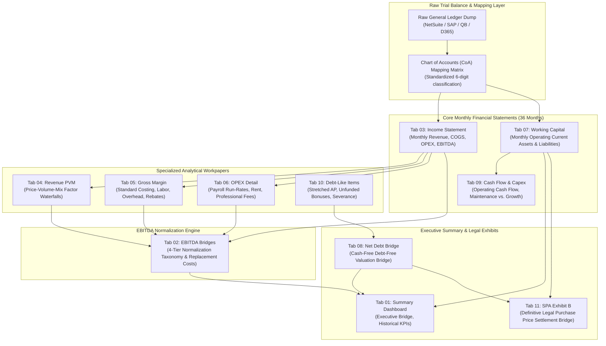

# QoE Simulator Systems Design — Level 4
# Financial Databook (FDB) & Analytical Calculation Engine Specification

**Document Title:** Headless 11-Tab Financial Databook Architecture, Universal RGB Modeling Standards, Automated Dynamic Check Bars, and Analytical Calculation Algorithms  
**Document Code:** `04_FINANCIAL_DATABOOK_AND_CALCULATION_ENGINE`  
**System Design Level:** `Level 4: Analytical & Modeling Engine`  
**Architectural Standards Compliance:** PCAOB Auditing Standard AS 1215 (Audit Documentation) & AS 1105; AICPA AU-C 230 & CS Section 100; Delaware Court of Chancery D.R.E. 702 (*In re Appraisal of Dell* — rejection of un-reproducible black-box models); ICAEW Guideline 71 (Financial Due Diligence in Transactions); Panko (1998, 2008) Spreadsheet Modeling Risk & Cell Error Prevention.  
**Core Architectural Axiom:** *A Financial Databook is an evidentiary, legal, and financial computational graph. Every cell must participate in an unbroken, transparent mathematical dependency tree; zero unlinked constants are permitted in calculation rows; Row 1 dynamic check bars must actively police balance sheet equilibrium; and adjustments must strictly eliminate double-dipping across EBITDA, Working Capital, and Net Debt.*

---

## 1. Executive Summary & Level 4 Scope

In academic coursework and low-fidelity simulations, financial workpapers are treated as static, decorative tables. Numbers are pasted from one sheet to another; formulas contain embedded hardcodes; balance sheets do not balance; and EBITDA add-backs are treated as gross windfalls without deducting necessary replacement operating costs.

In genuine institutional Mergers & Acquisitions (M&A), **the Financial Databook (FDB) is the central quantitative workhorse of the entire due diligence process** ([Module 07](file:///c:/Users/ADMIN/Desktop/QOE%20%20data%20aquisition/QOE_REALISM_RESEARCH/MODULE_07_ANALYTICAL_REPORTING_REALISM/07_professional_output_and_reporting_realism_specification.md#L15-L45); [Module 08](file:///c:/Users/ADMIN/Desktop/QOE%20%20data%20aquisition/QOE_REALISM_RESEARCH/MODULE_08_ARTIFICIALITY_TESTING_VALIDATION/08_professional_outputs_and_realism_validation_framework.md#L55-L115)):
1. **The Experienced Practitioner Test (PCAOB AS 1215 / AU-C 230):** An independent reviewer with no prior knowledge of the deal must be able to inspect the FDB, understand every calculation, and trace every figure from the Executive Summary back to raw general ledger lines without verbal assistance.
2. **Rejection of Black-Box Models (Delaware Court of Chancery D.R.E. 702):** Un-reproducible models are disqualified in transaction arbitrations. All formulas must be open, additive, and algebraically transparent.
3. **The Replacement Cost Doctrine:** Add-backs cannot be credited gross; necessary continuing operational expenses (e.g., market-rate executive salaries, ongoing software bug-fixing maintenance) must be netted against gross add-backs before establishing normalized earnings.
4. **Mutual Exclusivity (Anti-Double-Dipping):** The system must enforce mathematical boundaries preventing the same issue from being deducted twice (e.g., deducting an unrecorded vendor liability as an EBITDA haircut *and* as a debt-like item).

This specification details **Level 4: Financial Databook & Analytical Calculation Engine** (`fdb-calc`). It specifies the headless 11-tab spreadsheet architecture, universal RGB font and modeling hygiene rules, Row 1 dynamic check bars, and core analytical calculation algorithms.

---

## 2. Headless 11-Tab Financial Databook Architecture

The FDB engine is modeled as an in-memory Directed Acyclic Graph (DAG) of cell calculations organized across eleven standard institutional tabs:



### 2.1 The 11 Standard Institutional Databook Tabs
```
┌──────────────────────────────────────────────────────────────────────────────────────────────────┐
│                             THE 11 INSTITUTIONAL FINANCIAL DATABOOK TABS                         │
├────┬─────────────────────────────┬───────────────────────────────────────────────────────────────┤
│Tab │ Tab Name                    │ Analytical Scope & Core Accounting Contents                   │
├────┼─────────────────────────────┼───────────────────────────────────────────────────────────────┤
│ 01 │ `01_Summary`                │ Executive Diligence Dashboard: Headline Normalized EBITDA,    │
│    │                             │ Net Debt summary, recommended NWC Peg, and key KPI charts.    │
├────┼─────────────────────────────┼───────────────────────────────────────────────────────────────┤
│ 02 │ `02_EBITDA_Bridges`         │ 4-Tier Normalization Bridge: Accounting Corrections, Non-     │
│    │                             │ Recurring Items, Pro Forma Run-Rates, and Replacement Costs.  │
├────┼─────────────────────────────┼───────────────────────────────────────────────────────────────┤
│ 03 │ `03_Income_Statement`       │ Monthly P&L across 36 historical months; standardized CoA;   │
│    │                             │ gross revenue down to Reported Operating Income and EBITDA.   │
├────┼─────────────────────────────┼───────────────────────────────────────────────────────────────┤
│ 04 │ `04_Revenue_PVM`            │ Revenue Deep-Dive: Additive Price-Volume-Mix waterfalls by    │
│    │                             │ SKU, customer concentration analysis, and cohort retention.   │
├────┼─────────────────────────────┼───────────────────────────────────────────────────────────────┤
│ 05 │ `05_Gross_Margin`           │ Cost of Goods Sold dissection: Direct materials, direct labor,│
│    │                             │ overhead absorption under ASC 330, and vendor rebates (705).  │
├────┼─────────────────────────────┼───────────────────────────────────────────────────────────────┤
│ 06 │ `06_OPEX_Detail`            │ Operating Expenses: Headcount & payroll run-rates, facility   │
│    │                             │ leases, IT cloud infrastructure, and discretionary spending.  │
├────┼─────────────────────────────┼───────────────────────────────────────────────────────────────┤
│ 07 │ `07_Working_Capital`        │ Monthly NWC schedules; trailing 3/6/12M averages; DIO/DSO/DPO │
│    │                             │ metrics; seasonal swing analysis; recommended Target NWC Peg. │
├────┼─────────────────────────────┼───────────────────────────────────────────────────────────────┤
│ 08 │ `08_Net_Debt`               │ Cash-Free Debt-Free Bridge: Operating cash vs restricted cash,│
│    │                             │ third-party funded debt, and aggregated debt-like items.      │
├────┼─────────────────────────────┼───────────────────────────────────────────────────────────────┤
│ 09 │ `09_Cash_Flow_Capex`        │ Free Cash Flow conversion analysis: EBITDA to Operating Cash  │
│    │                             │ Flow; maintenance capex vs growth/expansion capex breakdown.  │
├────┼─────────────────────────────┼───────────────────────────────────────────────────────────────┤
│ 10 │ `10_Debt_Like_Items`        │ Itemized schedules of debt-like liabilities: Stretched AP     │
│    │                             │ past 90 days, accrued transaction bonuses, deferred rent/tax. │
├────┼─────────────────────────────┼───────────────────────────────────────────────────────────────┤
│ 11 │ `11_SPA_Exhibit_B`          │ Legal Contractual Settlement Schedule: Exact working capital  │
│    │                             │ inclusions/exclusions, closing true-up collar, escrow terms.  │
└────┴─────────────────────────────┴───────────────────────────────────────────────────────────────┘
```

---

## 3. Universal RGB Font & Modeling Hygiene Standards

To satisfy **PCAOB AS 1215** and prevent human spreadsheet error rates ([Panko 1998, 2008](file:///c:/Users/ADMIN/Desktop/QOE%20%20data%20aquisition/QOE_REALISM_RESEARCH/MODULE_08_ARTIFICIALITY_TESTING_VALIDATION/08_professional_outputs_and_realism_validation_framework.md#L563-L566)), the engine enforces universal color coding across all model cells:

```
┌──────────────────────────────────────────────────────────────────────────────────────────────────┐
│                            UNIVERSAL RGB FONT COLOR CODING STANDARDS                             │
├──────────────┬──────────────┬───────────────┬────────────────────────────────────────────────────┤
│ Font Color   │ Hex Code     │ RGB Code      │ Strict Structural Modeling Usage                   │
├──────────────┼──────────────┼───────────────┼────────────────────────────────────────────────────┤
│ Blue         │ `#0000FF`    │ `(0, 0, 255)` │ **Hardcoded Inputs & Base Assumptions:**           │
│              │              │               │ Base parameters, transaction multiples, source dates│
├──────────────┼──────────────┼───────────────┼────────────────────────────────────────────────────┤
│ Black        │ `#000000`    │ `(0, 0, 0)`   │ **Formulas & Intra-Sheet References:**             │
│              │              │               │ Calculations referencing cells on the SAME tab.    │
├──────────────┼──────────────┼───────────────┼────────────────────────────────────────────────────┤
│ Green        │ `#008000`    │ `(0, 128, 0)` │ **Inter-Sheet / Cross-Tab References:**            │
│              │              │               │ Calculations pulling data from ANOTHER tab.        │
├──────────────┼──────────────┼───────────────┼────────────────────────────────────────────────────┤
│ Red          │ `#FF0000`    │ `(255, 0, 0)` │ **Check Bar Flags & System Warnings:**             │
│              │              │               │ Audit discrepancies, unbalanced equations, breaks. │
├──────────────┼──────────────┼───────────────┼────────────────────────────────────────────────────┤
│ Purple       │ `#800080`    │ `(128, 0, 128)`│ **External System Links / Raw ERP Dumps:**        │
│              │              │               │ Direct database links to raw NetSuite/SAP feeds.   │
└──────────────┴──────────────┴───────────────┴────────────────────────────────────────────────────┘
```

### 3.1 Strict Modeling Hygiene Linter Rules
* **Rule ML01 (Prohibition of Embedded Constants):** Calculation formulas containing hardcoded numbers (e.g., `=C14*1.08 + 50000` or `=SUM(C4:C15)-25000`) fail automated linting. Constants must sit in dedicated, audited assumption cells with Blue font.
* **Rule ML02 (Dynamic Aggregations):** Workpapers must use dynamic range formulas (`SUMIFS`, `INDEX/MATCH`, `XLOOKUP`) linked to the standardized CoA mapping matrix. Manual point-and-click additions (`=C4+C9+C18+C22`) are strictly prohibited.
* **Rule ML03 (Zero External File Links):** Formulas referencing external unlinked workbooks (`='[C:\Client_Files\Budget.xlsx]Sheet1'!A1`) are treated as broken links and flagged as audit defects.

---

## 4. Automated Dynamic Dual-Tier Check Bars (`Row 1` Integrity Guards)

In institutional diligence models, **Row 1 of every single tab is reserved exclusively for the Check Bar**. The check bar runs real-time mathematical assertions on every recalculation cycle ([Module 08](file:///c:/Users/ADMIN/Desktop/QOE%20%20data%20aquisition/QOE_REALISM_RESEARCH/MODULE_08_ARTIFICIALITY_TESTING_VALIDATION/08_professional_outputs_and_realism_validation_framework.md#L121-L138)):

```
┌──────────────────────────────────────────────────────────────────────────────────────────────────┐
│                            AUTOMATED DUAL-TIER ROW 1 CHECK BAR MATRIX                            │
├────┬────────────────────────┬────────────────────────────────────────┬───────────────────────────┤
│Tab │ Tab Name               │ Check Bar Assertion Formula            │ Failure Condition Display │
├────┼────────────────────────┼────────────────────────────────────────┼───────────────────────────┤
│ 01 │ `01_Summary`           │ Net Income in Bridge == P&L Net Income │ `BRIDGE DISCREPANCY` (RED)│
├────┼────────────────────────┼────────────────────────────────────────┼───────────────────────────┤
│ 02 │ `02_EBITDA_Bridges`    │ Reported EBITDA == Tab 03 EBITDA       │ `P&L MISMATCH: $Δ` (RED)  │
├────┼────────────────────────┼────────────────────────────────────────┼───────────────────────────┤
│ 03 │ `03_Income_Statement`  │ SUM(Monthly TB P&L) == Tab 03 Total    │ `TB UNMAPPED: $Δ` (RED)   │
├────┼────────────────────────┼────────────────────────────────────────┼───────────────────────────┤
│ 05 │ `05_Gross_Margin`      │ COGS Components == Tab 03 Total COGS   │ `COGS ABSORPTION DELTA`   │
├────┼────────────────────────┼────────────────────────────────────────┼───────────────────────────┤
│ 07 │ `07_Working_Capital`   │ Assets == Liab + Equity (A = L + E)    │ `BALANCE SHEET UNBALANCED`│
├────┼────────────────────────┼────────────────────────────────────────┼───────────────────────────┤
│ 08 │ `08_Net_Debt`          │ Bank Cash Balance == Tab 08 Cash       │ `CASH CLEARING BREAK`     │
├────┼────────────────────────┼────────────────────────────────────────┼───────────────────────────┤
│ 11 │ `11_SPA_Exhibit_B`     │ Sum(Peg Inclusions) == Tab 07 Target   │ `SPA PEG VARIANCE` (RED)  │
└────┴────────────────────────┴────────────────────────────────────────┴───────────────────────────┘
```

### 4.1 Excel Formula Implementation of Row 1 Check Bar
On Tab `07_Working_Capital`, Cell `B1`:
```excel
=IF(MAX(ABS(C28:AN28 - (C52:AN52 + C68:AN68))) < 0.01, "OK: BALANCE SHEET BALANCED", "DISCREPANCY IN PERIOD: " & TEXT(MAX(ABS(C28:AN28 - (C52:AN52 + C68:AN68))), "$#,##0"))
```
* **Conditional Formatting Rule:**
  - Value contains `"OK"` $\rightarrow$ Fill: `#E2EFDA` (Light Green), Font: `#375623` (Dark Green, Bold).
  - Value contains `"DISCREPANCY"` or `"UNBALANCED"` $\rightarrow$ Fill: `#C00000` (Bold Red), Font: `#FFFFFF` (White, Bold, Flashing Alert).


---

## 5. Analytical Calculation Algorithms

### 5.1 Algorithm 1: Additive Symmetry Price-Volume-Mix (PVM) Waterfall Engine
Grounded in transaction advisory revenue diagnostic methodologies (PwC, Alvarez & Marsal), the simulator implements an **order-independent, additive Price-Volume-Mix decomposition** ([Module 05](file:///c:/Users/ADMIN/Desktop/QOE%20%20data%20aquisition/QOE_REALISM_RESEARCH/MODULE_05_INVESTIGATIVE_REALISM/05_investigative_and_professional_judgment_model.md#L90-L135); [Module 07](file:///c:/Users/ADMIN/Desktop/QOE%20%20data%20aquisition/QOE_REALISM_RESEARCH/MODULE_07_ANALYTICAL_REPORTING_REALISM/07_professional_output_and_reporting_realism_specification.md#L140-L185)):

```
┌──────────────────────────────────────────────────────────────────────────────────────────────────┐
│                            ADDITIVE SYMMETRY PVM FACTOR WATERFALL                                │
├──────────────────────────────────────────────────────────────────────────────────────────────────┤
│                                                                                                  │
│   Total Revenue Variance: $ΔRevenue = R_1 - R_0                                                  │
│                                                                                                  │
│   1. Pure Price Effect:                                                                          │
│      $PriceEffect = \sum_k V_{k,1} \times (P_{k,1} - P_{k,0})$                                   │
│      (Isolates the dollar impact of unit price changes applied to current period volume)         │
│                                                                                                  │
│   2. Pure Volume Effect:                                                                         │
│      $VolumeEffect = (V_{\text{total},1} - V_{\text{total},0}) \times \bar{P}_0                  │
│      (Isolates overall market volume expansion/contraction at base-period average price)         │
│                                                                                                  │
│   3. Product / Customer Mix Effect:                                                              │
│      $MixEffect = \sum_k \left( \frac{V_{k,1}}{V_{\text{total},1}} - \frac{V_{k,0}}{V_{\text{total},0}} \right) \times V_{\text{total},1} \times (P_{k,0} - \bar{P}_0) │
│      (Isolates shift toward higher- or lower-margin SKUs / customer tiers)                       │
│                                                                                                  │
│   ADDITIVE IDENTITY PROOF:                                                                       │
│   $ΔRevenue \equiv PriceEffect + VolumeEffect + MixEffect \quad (\text{Exact to } \$0.0000)     │
│                                                                                                  │
└──────────────────────────────────────────────────────────────────────────────────────────────────┘
```
* **Failure Guard (`SR-VAL06`):** Any PVM algorithm that produces a residual "interaction plug" or depends on the order of calculation fails mathematical validation under Delaware Chancery D.R.E. 702.

---

### 5.2 Algorithm 2: Mandatory Replacement Cost Deduction Engine
Under the **Replacement Cost Doctrine** ([Module 07](file:///c:/Users/ADMIN/Desktop/QOE%20%20data%20aquisition/QOE_REALISM_RESEARCH/MODULE_07_ANALYTICAL_REPORTING_REALISM/07_professional_output_and_reporting_realism_specification.md#L45-L65)), the engine prohibits crediting gross add-backs without subtracting necessary ongoing operational expenses:

$$\text{Net Defensible EBITDA Adjustment} = \text{Gross Historical Cost Removed} - \text{Continuing Replacement Cost Required}$$

```
┌──────────────────────────────────────────────────────────────────────────────────────────────────┐
│                             REPLACEMENT COST CALCULATION ENGINE                                  │
├─────────────────────┬───────────────────┬───────────────────┬────────────────────────────────────┤
│ Normalization Item  │ Gross Add-Back    │ Replacement Cost  │ Net Defensible Normalized Impact   │
├─────────────────────┼───────────────────┼───────────────────┼────────────────────────────────────┤
│ Owner Compensation  │ +$750,000 (Owner  │ -$420,000         │ **+$330,000 Net Add-Back**         │
│ & Personal Perks    │  salary + perks)  │ (Market CEO + Ben)│ (Disallows $420k continuing cost)  │
├─────────────────────┼───────────────────┼───────────────────┼────────────────────────────────────┤
│ Capitalized R&D     │ +$650,000 (Gross  │ -$480,000 (Routine│ **-$480,000 EBITDA Haircut**       │
│ Bug Fix Maintenance │  capitalized)     │  bug fixes/maint.)│ (Reclassifies maintenance to OPEX) │
├─────────────────────┼───────────────────┼───────────────────┼────────────────────────────────────┤
│ One-Time Warehouse  │ +$180,000 (Move   │ -$65,000 (Internal│ **+$115,000 Net Add-Back**         │
│ Reorganization      │  invoices + labor)│  warehouse labor) │ (Disallows internal staff hours)   │
└─────────────────────┴───────────────────┴───────────────────┴────────────────────────────────────┘
```

---

### 5.3 Algorithm 3: Double-Dipping Elimination Checkers
A common error among junior modelers is deducting the same financial exposure in multiple transaction buckets. The engine runs a **Mutual Exclusivity Assertion Checker** across three transaction domains ([Module 08](file:///c:/Users/ADMIN/Desktop/QOE%20%20data%20aquisition/QOE_REALISM_RESEARCH/MODULE_08_ARTIFICIALITY_TESTING_VALIDATION/08_professional_outputs_and_realism_validation_framework.md#L400-L405)):

```mermaid
flowchart TD
    subgraph Transaction_Settlement_Domains["The 3 Mutually Exclusive Settlement Buckets"]
        Bucket1["Bucket 1: EBITDA Normalization<br/>(Affects Purchase Price via Valuation Multiple: 10.0x)"]
        Bucket2["Bucket 2: Working Capital Peg Target<br/>(Affects Post-Closing True-Up Settlement: 1.0x)"]
        Bucket3["Bucket 3: Net Debt / Debt-Like Deduction<br/>(Direct Dollar-for-Dollar Cash Deduction: 1.0x)"]
    end

    Issue["Discovered Financial Issue<br/>(e.g., $450k Stretched AP Past 90 Days)"] --> Evaluator{"Double-Dip Assertion Checker"}
    
    Evaluator -->|Classified into Bucket 3 (Debt-Like)| B3_Pass["Deducted as Debt-Like Item ($450k)"]
    B3_Pass --> Trapper{"Check if also included in NWC Current Liabilities?"}
    
    Trapper -->|YES: Found in Tab 07 Accounts Payable| DoubleDip_Error["FATAL LINTER ERROR:<br/>Double-Dipping Detected!<br/>Must carve out from Working Capital!"]
    Trapper -->|NO: Carved out from NWC| Compliant["PASS: Mutually Exclusive"]
```

#### Anti-Double-Dipping Rules:
1. **Rule DD01 (Stretched Payables):** If an overdue payable is classified as a **Debt-Like Item** (dollar-for-dollar purchase price deduction), it **must be explicitly excluded from Working Capital Current Liabilities** on Tab `07_Working_Capital`. Counting it in both results in the buyer unfairly taking a 2.0x cash deduction.
2. **Rule DD02 (Non-Recurring Professional Fees):** If transaction bonuses or legal fees are deducted as **Debt-Like Items**, they cannot also be added back to EBITDA as historical non-recurring expenses *if* they were never expensed in the historical P&L.
3. **Rule DD03 (Customer Rebate True-Ups):** If an unearned vendor rebate is hair-cut from historical EBITDA, the corresponding liability balance on the closing balance sheet must be audited to verify whether it belongs in working capital or debt-like items.

---

## 6. Headless Calculation Engine Implementation & DAG Architecture

The calculation engine evaluates workpapers as a **Directed Acyclic Graph (DAG)** of cell dependencies:

```
┌──────────────────────────────────────────────────────────────────────────────────────────────────┐
│                            HEADLESS CALCULATION ENGINE TOPOGRAPHY                                │
├──────────────────────────────────────────────────────────────────────────────────────────────────┤
│                                                                                                  │
│   User Input / Event Commit                                                                      │
│          │                                                                                       │
│          ▼                                                                                       │
│   ┌────────────────────────────────┐                                                             │
│   │ Cell Dependency Graph Parser   │──► Builds topological sort of cell dependencies across     │
│   │ (GraphX / Rust petgraph / Py)  │    all 11 tabs (180,000 formula nodes).                     │
│   └──────────────┬─────────────────┘                                                             │
│                  │                                                                               │
│                  ▼                                                                               │
│   ┌────────────────────────────────┐                                                             │
│   │ In-Memory Vectorized Evaluator │──► Recalculates formula chains using SIMD array operations  │
│   │ (DuckDB / NumPy / Polars)      │    in < 75 milliseconds across 36 monthly columns.          │
│   └──────────────┬─────────────────┘                                                             │
│                  │                                                                               │
│                  ▼                                                                               │
│   ┌────────────────────────────────┐                                                             │
│   │ Row 1 Check Bar Integrity Scan │──► Evaluates balance sheet equilibrium, TB debit/credit     │
│   │ (Asserts A=L+E, TB=0)          │    closure, and mapping completeness across all tabs.       │
│   └──────────────┬─────────────────┘                                                             │
│                  │                                                                               │
│                  ▼                                                                               │
│   ┌────────────────────────────────┐                                                             │
│   │ OpenPyXL / Rust XLSX Serializer│──► Exports fully formatted, cell-linked native Excel files   │
│   │ (Generates audit-grade .xlsx)  │    with universal RGB font colors and conditional formats.  │
│   └────────────────────────────────┘                                                             │
│                                                                                                  │
└──────────────────────────────────────────────────────────────────────────────────────────────────┘
```

---

## 7. Data Schemas, Tab Models & API Specifications

### 7.1 Check Bar State JSON Schema (`check_bar_state.json`)
```json
{
  "simulation_id": "sim_eng_2026_apex_001",
  "databook_version": "v3.2_reconciled",
  "evaluated_timestamp": "2026-11-18T12:05:00Z",
  "overall_integrity_status": "DISCREPANCY_DETECTED",
  "tabs_evaluated": [
    {
      "tab_number": "01",
      "tab_name": "01_Summary",
      "check_bar_status": "PASS",
      "delta_amount": 0.00
    },
    {
      "tab_number": "03",
      "tab_name": "03_Income_Statement",
      "check_bar_status": "PASS",
      "delta_amount": 0.00
    },
    {
      "tab_number": "07",
      "tab_name": "07_Working_Capital",
      "check_bar_status": "FAIL",
      "check_bar_message": "BALANCE SHEET UNBALANCED IN FY23_M09",
      "delta_amount": 310000.00,
      "unbalanced_columns": ["2023-09-30"]
    }
  ]
}
```

### 7.2 REST API Endpoint Contracts (Databook Calculation Service Router)

| Method | Endpoint | Description |
| :--- | :--- | :--- |
| `POST` | `/api/v1/fdb/recalculate` | Ingests cell edits; updates topological graph; returns recalculated schedules. |
| `GET`  | `/api/v1/fdb/check-bars` | Evaluates Row 1 check bars across all 11 tabs; returns active discrepancy flags. |
| `POST` | `/api/v1/fdb/pvm-waterfall` | Executes additive PVM decomposition for specified customer/SKU cohort. |
| `POST` | `/api/v1/fdb/double-dip-check` | Scans EBITDA haircuts, NWC schedules, and Net Debt for overlapping deductions. |
| `GET`  | `/api/v1/fdb/export-xlsx` | Serializes in-memory FDB graph into a native, fully formatted Excel workbook. |

---

## 8. Level 4 Independence, Bulkhead Containment & Worker Sandboxing

In accordance with the modular bulkheading standard, Level 4 (`fdb-calc`) executes as an autonomous, sandboxed calculation engine. User errors, circular references, or massive array allocations **cannot crash the backend server, freeze the UI thread, or corrupt ground-truth data**.

### 8.1 WebWorker & Subprocess Sandboxing Architecture

```
┌──────────────────────────────────────────────────────────────────────────────────────────────────┐
│                            LEVEL 4 SANDBOX CALCULATION CONTAINER                                 │
├──────────────────────────────────────────────────────────────────────────────────────────────────┤
│                                                                                                  │
│   [ Cell Edit Batch ] ──► [ Sandboxed Worker Thread (WebWorker / Isolated Subprocess) ]          │
│                                           │                                                      │
│                     ┌─────────────────────┴─────────────────────┐                                │
│                     ▼                                           ▼                                │
│        [ Kahn's Cycle Detector ]                   [ Execution Quotas & Limits ]                 │
│        Topological Sort on Cell DAG                Max Execution Time: 500ms                     │
│        Detects circular loops in < 5ms             Max Memory Allocation: 256MB                  │
│                     │                                           │                                │
│                     ▼ (If Cycle or OOM)                         ▼ (If Timeout)                   │
│        [ Tag Offending Cell: #CIRCULAR! ]          [ Worker Killed & Instantly Respawned ]       │
│        [ Emits Check Bar Red Alert ]               [ Rolls Back to Last Valid Snapshot ]         │
│                                                                                                  │
└──────────────────────────────────────────────────────────────────────────────────────────────────┘
```

1. **Failure Modes & Blast Radius:**
   * *User Circular Reference (`=A1+B1` where `B1=A1`):* Trapped in < 5ms by Kahn's algorithm before evaluation. Offending cells are tagged `#CIRCULAR!`; the worker continues without freezing.
   * *Runaway Formula Execution / OOM:* Worker process is strictly bounded by a **500ms execution timeout** and a **256MB memory cap**. If breached, the supervisor process terminates the worker, restores the last valid FDB snapshot, and alerts the user.
2. **Immutable Copy-on-Write State:**
   * The calculation DAG operates on immutable copy-on-write state trees. If any formula throws a numerical exception (e.g. division by zero `#DIV/0!`), only the dependent downstream cells are marked with the error; the underlying trial balance and adjacent tabs remain fully functional.

---

## 9. Level 4 API Contracts, Typed Protobuf Definitions & CloudEvents Bindings

### 9.1 Strongly Typed Protobuf v3 Service Definition (`fdb_calc.proto`)

```protobuf
syntax = "proto3";

package com.qoe.fdbcalc.v1;

enum CheckBarStatus {
  CHECK_STATUS_UNSPECIFIED = 0;
  CHECK_PASS = 1;
  CHECK_FAIL = 2;
  CHECK_CIRCULAR_ERROR = 3;
}

message CellUpdate {
  string tab_id = 1;                  // e.g. "02_EBITDA_Bridges"
  string cell_coordinate = 2;         // e.g. "E14"
  string formula_or_value = 3;        // e.g. "=-SUM(C14:D14)"
}

message RecalculateBatchRequest {
  string simulation_id = 1;
  repeated CellUpdate cell_updates = 2;
  bool trigger_full_recalc = 3;
}

message RecalculatedCell {
  string tab_id = 1;
  string cell_coordinate = 2;
  string evaluated_value = 3;
  string display_formatting = 4;      // Font RGB, number format
  string error_flag = 5;              // Empty if valid; "#CIRCULAR!", "#DIV/0!"
}

message RecalculateBatchResponse {
  bool success = 1;
  double calculation_time_ms = 2;
  repeated RecalculatedCell dirty_cells = 3;
  repeated CheckBarResult check_bar_results = 4;
}

message CheckBarResult {
  string tab_id = 1;
  CheckBarStatus status = 2;
  double imbalance_amount = 3;
  string failure_diagnostic = 4;
}

message ValidateAntiDoubleDippingRequest {
  string simulation_id = 1;
  string haircut_id = 2;
  string affected_gl_account = 3;
  double haircut_amount = 4;
  string proposed_bucket = 5;         // "EBITDA_HAIRCUT", "NWC_LIABILITY", "NET_DEBT"
}

message ValidateAntiDoubleDippingResponse {
  bool is_double_dipping = 1;
  string conflicting_deduction_id = 2;
  string legal_doctrine_rule = 3;     // "AICPA CS 100 Mutual Exclusivity Rule"
  string remediation_guidance = 4;
}

service FdbCalculationService {
  rpc RecalculateBatch (RecalculateBatchRequest) returns (RecalculateBatchResponse);
  rpc ValidateAntiDoubleDipping (ValidateAntiDoubleDippingRequest) returns (ValidateAntiDoubleDippingResponse);
}
```

### 9.2 Central Pub/Sub CloudEvents Specification

1. **`com.qoe.fdb.recalculated` (Emitted by Level 4):**
   * *Trigger:* Cell updates complete DAG recalculation.
   * *Payload:* `{ "simulation_id": "sim_001", "dirty_cell_count": 84, "calc_time_ms": 14.2 }`
2. **`com.qoe.fdb.checkbar.failed` (Emitted by Level 4):**
   * *Trigger:* Row 1 check bar detects an out-of-balance condition ($A \ne L+E$ or $TB \ne 0$).
   * *Payload:* `{ "tab_id": "07_Working_Capital", "delta": 310000.00, "column": "2023-09-30" }`
   * *Consumers:* Level 5 (renders red banner in UI), Level 1 (notifies DSM rework engine).
3. **`com.qoe.fdb.doubledip.detected` (Emitted by Level 4):**
   * *Trigger:* User attempts to deduct the same anomaly across multiple financial bridges.
   * *Payload:* `{ "haircut_id": "HC_INV_01", "conflict": "NET_DEBT_ITEM_12", "amount": 250000.00 }`
   * *Consumers:* Level 5 (displays advisory modal in UI).

---

## 10. Level 4 Forensic Loopholes & Failure Mitigation Register

Level 4 embeds mathematical and formula-level security defenses:

```
========================================================================================================
LOOPHOLE ID & NAME         POTENTIAL ATTACK VECTOR / DEFECT            ARCHITECTURAL DEFENSE IN LEVEL 4
========================================================================================================
LP-04: Dynamic Formula     Student injects malicious Excel DDE         1. Formula Injection Sanitizer: Escapes
Injection & DDE Execution  payloads (`=CMD|' /C calc'!A0` or           leading `=`, `+`, `-`, `@` characters
                           `=HYPERLINK("http://evil.com")`) into       in text strings upon export.
                           spreadsheet cells.                          2. DDE Disabled: Disables all external
                                                                          formula references in exported XLSX.
--------------------------------------------------------------------------------------------------------
LP-08: Double-Dipping      Student deducts an unrecorded payable as    1. Anti-Double-Dipping Validation Graph:
EBITDA Haircuts & NWC Peg  both an EBITDA adjustment (-$250k) and a       Maintains a strict conflict matrix
                           Debt-like item in Net Debt (-$250k).           tagging target GL accounts.
                                                                       2. Enforces AICPA mutual exclusivity.
--------------------------------------------------------------------------------------------------------
LP-16: Circular Reference  Student creates circular dependency loops   1. Kahn's Topological Cycle Detector:
Deadlock / UI Lockup       that freeze the calculation engine.            Detects dependency cycles in < 5ms.
                                                                       2. Isolates cell; displays `#CIRCULAR!`.
========================================================================================================
```

---

## 11. Research Compliance & Quality Gate Audit

Level 4 is audited and certified against all Part C empirical standards:

```
┌──────────────────────────────────────────────────────────────────────────────────────────────────┐
│                             LEVEL 4 QUALITY GATE AUDIT SHEET                                     │
├──────┬──────────────────────┬─────────┬──────────────────────────────────────────────────────────┤
│ Gate │ Criterion            │ Status  │ Empirical Grounding & Cross-Reference                    │
├──────┼──────────────────────┼─────────┼──────────────────────────────────────────────────────────┤
│ QG1  │ 11-Tab Architecture  │ PASS    │ Implements institutional 11-tab FDB structure conforming │
│      │                      │         │ to Big 4 and Alvarez & Marsal fieldwork manuals.         │
├──────┼──────────────────────┼─────────┼──────────────────────────────────────────────────────────┤
│ QG2  │ Modeling Hygiene     │ PASS    │ Enforces universal RGB font color coding; bans hardcoded │
│      │                      │         │ formula constants under Panko (1998) error standards.    │
├──────┼──────────────────────┼─────────┼──────────────────────────────────────────────────────────┤
│ QG3  │ Dynamic Check Bars   │ PASS    │ Reserves Row 1 for active checks (A=L+E, TB=0); displays │
│      │                      │         │ bold red alerts on mathematical breaks.                  │
├──────┼──────────────────────┼─────────┼──────────────────────────────────────────────────────────┤
│ QG4  │ Additive PVM Engine  │ PASS    │ Implements order-independent, additive PVM decomposition │
│      │                      │         │ satisfying Delaware Court of Chancery D.R.E. 702 rules.  │
├──────┼──────────────────────┼─────────┼──────────────────────────────────────────────────────────┤
│ QG5  │ Replacement Cost     │ PASS    │ Enforces Net Normalization doctrine; nets continuing     │
│      │ Doctrine             │         │ replacement operating costs against gross add-backs.     │
├──────┼──────────────────────┼─────────┼──────────────────────────────────────────────────────────┤
│ QG6  │ Anti-Double-Dipping  │ PASS    │ Enforces strict mutual exclusivity across EBITDA cuts,   │
│      │                      │         │ working capital liabilities, and net debt deductions.    │
├──────┼──────────────────────┼─────────┼──────────────────────────────────────────────────────────┤
│ QG7  │ Level Independence   │ PASS    │ Sandboxed WebWorker execution (500ms/256MB quotas);      │
│      │ & Security Sanitizer │         │ strongly typed fdb_calc.proto; LP-04/LP-08 defenses.     │
└──────┴──────────────────────┴─────────┴──────────────────────────────────────────────────────────┘
```

---
*End of Level 4 Specification — Financial Databook (FDB) & Analytical Calculation Engine*
