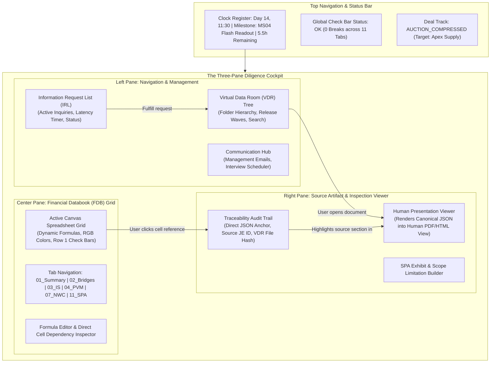
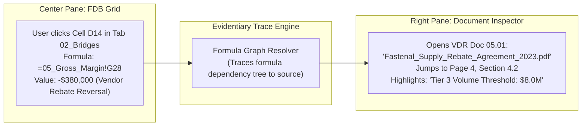
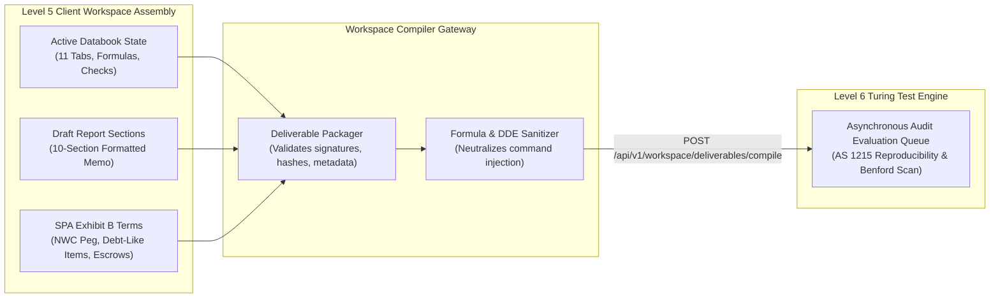
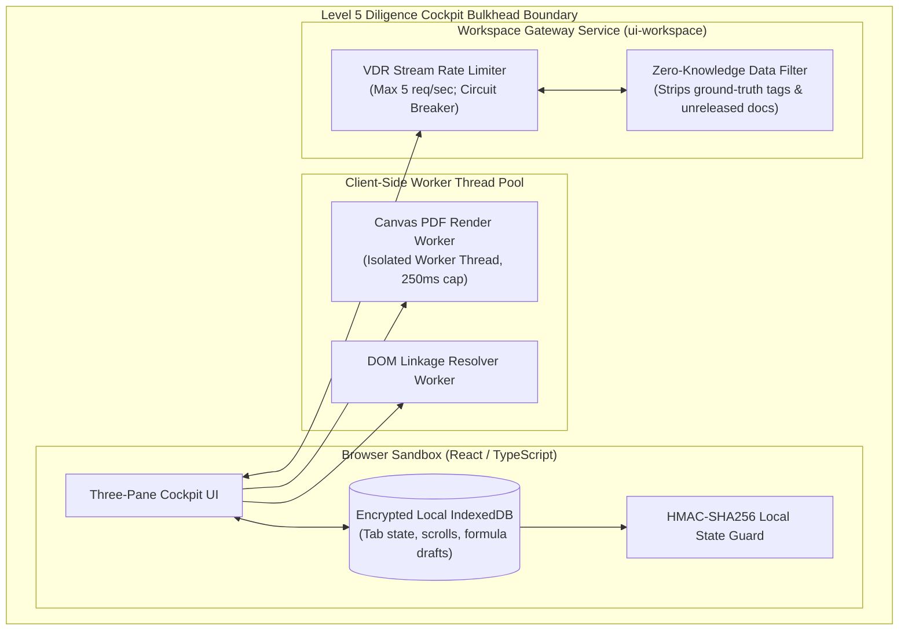

# QoE Simulator Systems Design — Level 5
# User Workspace, VDR Portal & Interaction Surfaces Specification

**Document Title:** Virtual Data Room (VDR) Portal, Information Request List (IRL) Console, Diligence Workstation UI, and Deliverable Assembly Pipeline Specification  
**Document Code:** `05_USER_WORKSPACE_AND_INTERACTION_SURFACES`  
**System Design Level:** `Level 5: User Workspace & Interaction Surfaces`  
**Architectural Standards Compliance:** ISO/IEC/IEEE 12207; ICAEW Guideline 71 (Financial Due Diligence in Transactions); AICPA CS Section 100 (Consulting Services); SOC 2 Type II Security & Audit Logging (Virtual Data Room Compliance); W3C WCAG 2.1 Accessibility & Usability Standards; Delaware Court of Chancery Contract Evidentiary Rules (*Chicago Bridge & Iron*).  
**Core Architectural Axiom:** *The user workspace is not a generic educational dashboard; it is an authentic institutional diligence cockpit. It must reproduce the genuine ergonomics of M&A transaction fieldwork: navigating real-world VDR folder hierarchies with access controls and dynamic watermarking, managing living Information Request Lists with multi-turn query threads, inspecting primary scanned source artifacts alongside active computational workpapers, and assembling legal-grade deliverables under tight commercial deadlines.*

---

## 1. Executive Summary & Level 5 Scope

In standard academic finance coursework and software simulations, user interaction is reduced to static web forms and simple quizzes:
- Students download a single `.zip` file on Day 1 containing all clean, perfectly organized documents.
- Information requests are handled via automated multiple-choice dropdowns or pre-scripted clues.
- Financial models are detached from source documents: a student views a number in a spreadsheet without the ability to inspect the primary contract, bill of lading, or bank wire slip that substantiates it.
- Final reports are treated as informal essays or generic slide templates with zero contractual connection to the definitive legal purchase agreement.

In genuine institutional Mergers & Acquisitions (M&A), **due diligence professionals operate inside a high-security, multi-pane digital transaction environment** ([Module 03](file:///c:/Users/ADMIN/Desktop/QOE%20%20data%20aquisition/QOE_REALISM_RESEARCH/MODULE_03_DOCUMENTARY_ACCOUNTING_REALISM/03_documentary_and_accounting_realism_specification.md#L180-L240); [Module 07](file:///c:/Users/ADMIN/Desktop/QOE%20%20data%20aquisition/QOE_REALISM_RESEARCH/MODULE_07_ANALYTICAL_REPORTING_REALISM/07_professional_output_and_reporting_realism_specification.md#L200-L280)):
1. **Virtual Data Room (VDR) Ergonomics:** Diligence teams navigate secure, tiered data rooms hosted on platforms like Datasite, Intralinks, or Firmex, where documents are watermarked, release permissions are gated by deal phase, and downloads are monitored by the seller's investment banker.
2. **Dynamic Information Request List (IRL):** Diligence teams track hundreds of discrete inquiries across nine workstreams, prioritizing requests, managing response latencies, and conducting multi-turn query threads with target controllers.
3. **Integrated Dual-Pane Workstation:** High-performing analysts inspect source PDF documents and active calculation workpapers side-by-side, tracing cell formulas directly to underlying contract clauses and general ledger entries.
4. **Legal Deliverable Handoff:** The ultimate output is not just a slide presentation; it is the **Executive Due Diligence Report** and **Stock Purchase Agreement (SPA) Exhibit B**, defining closing working capital collars and specific indemnity escrows under **AICPA CS 100** and **ICAEW Guideline 71**.

This specification details **Level 5: User Workspace, VDR Portal & Interaction Surfaces** (`ui-workspace`). It specifies the VDR portal architecture, the interactive IRL management console, the three-pane Diligence Workstation layout, and the dual-deliverable reporting assembly pipeline.

---

## 2. Workspace Topography & Component Layout (Three-Pane Cockpit)

The user interface is structured as an ergonomic, high-density three-pane workstation optimized for multi-screen institutional diligence workflows:



---

## 3. Virtual Data Room (VDR) Portal Architecture

Grounded in empirical VDR practices from **Datasite** and **Intralinks** ([Module 03](file:///c:/Users/ADMIN/Desktop/QOE%20%20data%20aquisition/QOE_REALISM_RESEARCH/MODULE_03_DOCUMENTARY_ACCOUNTING_REALISM/03_documentary_and_accounting_realism_specification.md#L180-L240); [Module 06](file:///c:/Users/ADMIN/Desktop/QOE%20%20data%20aquisition/QOE_REALISM_RESEARCH/MODULE_06_ENGAGEMENT_DYNAMICS/06_engagement_progression_and_dynamics_model.md#L170-L215)), the VDR portal enforces authentic folder hierarchies, access permissions, dynamic watermarking, and download audit telemetry.

### 3.1 The Institutional VDR Folder Tree Structure
```
VDR_ROOT/
├── 01_Corporate_Governance_and_Legal/
│   ├── 01.01_Certificate_of_Incorporation_and_Bylaws.pdf
│   ├── 01.02_Capitalization_Table_and_Shareholder_Register.xlsx
│   ├── 01.03_Board_of_Directors_Minutes_FY21_FY24.pdf
│   └── 01.04_Material_Litigation_and_Contingent_Claims/
├── 02_Financial_and_Accounting/
│   ├── 02.01_Audited_Financial_Statements_FY21_FY23/
│   ├── 02.02_Trial_Balances_Monthly_36M_Export.csv
│   ├── 02.03_General_Ledger_Detail_Extracts/
│   │   ├── GL_FY22_Detail_NetSuite.csv
│   │   ├── GL_FY23_Detail_NetSuite.csv
│   │   └── GL_FY24_YTD_NetSuite.csv
│   ├── 02.04_Aged_Accounts_Receivable_Subledgers/
│   ├── 02.05_Aged_Accounts_Payable_and_Vendor_Spend/
│   ├── 02.06_Inventory_Valuation_and_Obsolescence_Rolls/
│   └── 02.07_Bank_Statements_and_Clearing_Reconciliations/
├── 03_Tax_and_Regulatory/
│   ├── 03.01_Federal_Form_1120_Tax_Returns_FY21_FY23.pdf
│   ├── 03.02_State_Apportionment_and_Nexus_Studies.pdf
│   └── 03.03_Sales_and_Use_Tax_Audit_Correspondence.pdf
├── 04_Commercial_and_Customers/
│   ├── 04.01_Top_20_Customer_Master_Services_Agreements/
│   ├── 04.02_Historical_Sales_by_SKU_and_Customer_Monthly.csv
│   └── 04.03_Customer_Churn_and_Credit_Memo_Logs/
├── 05_Operations_and_Procurement/
│   ├── 05.01_Top_10_Supplier_Rebate_Agreements_ASC_705.pdf
│   ├── 05.02_Warehouse_Facility_Leases_ASC_842.pdf
│   ├── 05.03_Machine_Shop_Run_Hours_and_OEE_Telemetry.xlsx
│   └── 05.04_Raw_Material_Bills_of_Material_BOM.xlsx
└── 06_Human_Resources_and_Compensation/
    ├── 06.01_Employee_Census_and_Payroll_Run_Rate.xlsx
    ├── 06.02_Executive_Employment_Agreements_and_Severance.pdf
    └── 06.03_Owner_Personal_Expenses_and_Perks_Schedule.xlsx
```

### 3.2 Dynamic Watermarking & Security Telemetry
To simulate institutional data room compliance (SOC 2 Type II), the VDR rendering engine applies an indelible dynamic watermark to all displayed and downloaded PDF artifacts:

```
┌──────────────────────────────────────────────────────────────────────────────────────────────────┐
│                                DYNAMIC VDR WATERMARK SPECIFICATION                               │
├──────────────────────────────────────────────────────────────────────────────────────────────────┤
│                                                                                                  │
│   WATERMARK TEXT MATRIX:                                                                         │
│   "CONFIDENTIAL - STRICTLY RESTRICTED                                                            │
│    ACQUIRING INSTITUTION: APOLLO PRIVATE EQUITY DEAL TEAM                                        │
│    USER: J.DOE (ANALYST ID: USR_8921)                                                            │
│    VDR SESSION ID: VDR_APEX_20241018_0918                                                        │
│    TIMESTAMP: 2024-10-18 11:32:05 UTC - DO NOT DUPLICATE"                                       │
│                                                                                                  │
│   RENDERING PARAMETERS:                                                                          │
│   • Diagonal Angle: -45.0 degrees centered across all pages.                                     │
│   • Font: Helvetica Bold, 16pt, Semi-Transparent Alpha (Opacity = 0.18).                         │
│   • Security Feature: Unique cryptographic hash embedded in bottom margin of every page.         │
│                                                                                                  │
└──────────────────────────────────────────────────────────────────────────────────────────────────┘
```

### 3.3 Access Control & Release Wave Gating
* **Phase I Access (Days 1–13):** High-level financial statements, teaser decks, summary trial balances, and standardized CoA. Highly confidential files (executive salaries, individual customer contract pricing) remain locked (`ACCESS_DENIED_PHASE_II`).
* **Phase II Exclusivity Access (Day 14+):** Unlocks granular subledgers, employee census, supplier rebate tiers, and tax audit workpapers upon private equity sponsor approval of the Interim Red Flag Readout.

---

## 4. Interactive Information Request List (IRL) Console

The IRL console is the central operational communication channel between the diligence team and target management ([Module 01](file:///c:/Users/ADMIN/Desktop/QOE%20%20data%20aquisition/QOE_REALISM_RESEARCH/MODULE_01_ENGAGEMENT_CHARACTERISTICS/01_real_world_engagement_behaviour_reference_model.md#L45-L65); [Module 04](file:///c:/Users/ADMIN/Desktop/QOE%20%20data%20aquisition/QOE_REALISM_RESEARCH/MODULE_04_CLIENT_HUMAN_BEHAVIOUR/04_client_and_human_behaviour_model.md#L265-L315)):

```
┌──────────────────────────────────────────────────────────────────────────────────────────────────┐
│                            INTERACTIVE IRL MANAGEMENT CONSOLE GRID                               │
├────┬──────┬──────────┬──────────────┬────────────────────────┬─────────────┬───────────┬─────────┤
│Req │ WkSt │ Priority │ Target Owner │ Description of Request │ Status      │ Latency   │ VDR Doc │
├────┼──────┼──────────┼──────────────┼────────────────────────┼─────────────┼───────────┼─────────┤
│ 01 │ W03  │ High     │ Controller   │ General Ledger detail  │ Fulfilled   │ Delivered │ 02.03.1 │
│    │      │          │ (P07)        │ extract for FY23.      │             │           │         │
├────┼──────┼──────────┼──────────────┼────────────────────────┼─────────────┼───────────┼─────────┤
│ 02 │ W04  │ Critical │ VP Sales     │ Top 10 customer price  │ Partially   │ Follow-up │ 04.01.4 │
│    │      │          │ (P10)        │ change notices FY23.   │ Answered    │ Required  │         │
├────┼──────┼──────────┼──────────────┼────────────────────────┼─────────────┼───────────┼─────────┤
│ 03 │ W05  │ Critical │ Target CFO   │ Fastenal supplier vol. │ In Progress │ 14.5 hrs  │ Pending │
│    │      │          │ (P06)        │ rebate agreement tiers.│ (Tier 3)    │ remaining │         │
├────┼──────┼──────────┼──────────────┼────────────────────────┼─────────────┼───────────┼─────────┤
│ 04 │ W06  │ Medium   │ Bookkeeper   │ Unapplied cash clearing│ In Progress │ 6.2 hrs   │ Pending │
│    │      │          │ (P08)        │ reconciliation FY24.   │ (Tier 2)    │ remaining │         │
├────┼──────┼──────────┼──────────────┼────────────────────────┼─────────────┼───────────┼─────────┤
│ 05 │ W07  │ Critical │ Target CFO   │ Stretched AP payables  │ Rejected /  │ Blocked   │ None    │
│    │      │          │ (P06)        │ over 90 days listing.  │ Withheld    │ (Scope Lim│         │
└────┴──────┴──────────┴──────────────┴────────────────────────┴─────────────┴───────────┴─────────┘
```

### 4.1 Multi-Turn Query Threading & Follow-Up Lifecycle
When target management provides an evasive or partial answer (common in Pushback Tiers 2, 3, and 4), the learner can open a **Query Thread**:
1. *Initial Question:* User asks for customer credit memo registers.
2. *Target Response (Evasive):* CFO replies: *"Credit memos are immaterial and netted against gross billings in monthly reports."*
3. *Learner Follow-Up:* User cites specific GL entries: *"Trial balance account #409000 shows $412,000 in debits for FY23; please provide the underlying credit memo itemized register."*
4. *Escalation / Resolution:* CFO either concedes and releases the file or pushes into Tier 4 ("Files are archived offsite and cannot be retrieved prior to bid deadline"), triggering an official **Scope Limitation**.


---

## 5. Diligence Workstation UI (Side-by-Side Inspection & Formula Tracer)

The central operational pane features an **interactive, virtualized Canvas spreadsheet grid** coupled with a **deep evidentiary formula tracer**:



### 5.1 The Canonical JSON-First Artifact Architecture (Dual-Representation Model)
A critical systems design principle is the **absolute separation of machine-readable truth from human visual presentation**. Attempting to have software agents or evaluators visually inspect PDFs using computer vision or optical character recognition (OCR) is inherently fragile, computationally wasteful, and prone to hallucinations.

The platform implements a **Canonical JSON-First Architecture**:
1. **Canonical JSON Ground Truth (Machine Tier):** Every document in the VDR exists natively as a structured, strongly-typed JSON artifact containing full metadata, section hierarchies, tabular arrays, clause dictionaries, and transaction IDs:
   - For contracts: `{"contract_id": "CNT_FASTENAL_2023", "clauses": {"4.2": {"text": "...", "rebate_tiers": [...]}}}`
   - For invoices: `{"invoice_num": "INV-10942", "po_ref": "PO-8812", "lines": [{"sku": "SKU-902", "qty": 500, "price": 290.40}]}`
   - For shipping slips: `{"bol_num": "BOL-44912", "carrier": "FedEx Freight", "shipped_date": "2024-09-30T17:15:00Z"}`
2. **Instant Deterministic Verification:** All automated evaluations, formula dependency tracing, search indexing, and Turing Test audits operate directly against the structured JSON trees—executing in sub-milliseconds with 100% mathematical precision.
3. **Headless Human Rendering (Presentation Tier):** The PDF or document view presented to human learners is merely a compiled presentation view (rendered via HTML/CSS templates or Puppeteer). When a learner clicks a cell, the UI simply jumps to the corresponding DOM anchor ID (`#clause-4.2`) in the viewer.

### 5.2 Cell Formula Tracer & Audit Inspection Features
1. **Interactive Dependency Tree:** When the user selects any calculation cell in the Databook, a floating audit panel displays the precedents and dependents graph (e.g., `Tab 01!D12` $\leftarrow$ `Tab 02!G18` $\leftarrow$ `Tab 05!D22` $\leftarrow$ `GL_Dump!Row_491029`).
2. **Direct JSON Anchor Linkage:** If an assumption cell is linked to a source document in the VDR, the system maps the cell to the JSON key path (e.g., `artifacts/contracts/fastenal_2023.json#/clauses/4.2`), auto-scrolling the human PDF/HTML viewer directly to that anchor with zero OCR dependencies.
3. **Real-Time Check Bar Banner:** Row 1 of the active spreadsheet is permanently pinned at the top of the viewport. If a user modifies a cell that breaks balance sheet equilibrium ($\text{Assets} \neq \text{Liabilities} + \text{Equity}$), the banner immediately turns flashing **RED ("DISCREPANCY: \$310,000 IN FY23_M09")**, blocking deliverable submission until resolved.

---

## 6. Deliverable Assembly & Reporting Pipeline

Grounded in **ICAEW Guideline 71** and **AICPA CS 100**, the simulator transforms technical workpapers into two synchronized professional deliverables ([Module 07](file:///c:/Users/ADMIN/Desktop/QOE%20%20data%20aquisition/QOE_REALISM_RESEARCH/MODULE_07_ANALYTICAL_REPORTING_REALISM/07_professional_output_and_reporting_realism_specification.md#L200-L280)):

```
┌──────────────────────────────────────────────────────────────────────────────────────────────────┐
│                            DUAL-DELIVERABLE REPORTING ARCHITECTURE                               │
├─────────────────────────────────────────────────┬────────────────────────────────────────────────┤
│ Deliverable 1: Dynamic Financial Databook (FDB) │ Deliverable 2: Executive Diligence Report Deck │
├─────────────────────────────────────────────────┼────────────────────────────────────────────────┤
│ • Native, fully formatted Excel workbook (.XLSX)│ • 10-section structured presentation / memo.   │
│ • 11 tabs with active, open cell formulas.      │ • Visual EBITDA bridges, NWC trend charts.     │
│ • Universal RGB font color coding (Blue/Black). │ • Calibrated language of professional caution. │
│ • Zero formula errors (#REF!, #DIV/0!).         │ • Formal Scope Limitations and Caveat section. │
│ • Feeds definitive numbers into SPA Exhibit B.  │ • Signed by Lead Engagement Partner (SQMS 1).  │
└─────────────────────────────────────────────────┴────────────────────────────────────────────────┘
```

### 6.1 The 10-Section Executive Diligence Report Blueprint
```
┌──────────────────────────────────────────────────────────────────────────────────────────────────┐
│                            THE 10-SECTION INSTITUTIONAL REPORT STRUCTURE                         │
├──────┬───────────────────────────────┬───────────────────────────────────────────────────────────┤
│ Sect │ Section Title                 │ Mandated Contents & Evidentiary Reporting                 │
├──────┼───────────────────────────────┼───────────────────────────────────────────────────────────┤
│ 01   │ Executive Summary & Dashboard │ Headline Normalized EBITDA bridge, Enterprise Value impact│
│      │                               │ key red flags, recommended NWC Peg, and Net Debt summary. │
├──────┼───────────────────────────────┼───────────────────────────────────────────────────────────┤
│ 02   │ Transaction Context & Scope   │ Terms of Engagement Letter under AICPA CS 100; materiality│
│      │                               │ thresholds; explicit statement of non-attest boundaries.  │
├──────┼───────────────────────────────┼───────────────────────────────────────────────────────────┤
│ 03   │ Quality of Earnings (QoE)     │ 4-tier normalization taxonomy; itemized haircut bridges;  │
│      │                               │ net replacement cost deductions; revenue sustainability.  │
├──────┼───────────────────────────────┼───────────────────────────────────────────────────────────┤
│ 04   │ Quality of Net Assets         │ Balance sheet integrity; inventory valuation reserves     │
│      │                               │ (ASC 330); PPE existence; capitalized software (ASC 350). │
├──────┼───────────────────────────────┼───────────────────────────────────────────────────────────┤
│ 05   │ Net Working Capital (NWC)     │ 36-month monthly NWC trends; seasonal swing analysis;     │
│      │                               │ trailing 3/6/12M averages; target NWC Peg recommendation. │
├──────┼───────────────────────────────┼───────────────────────────────────────────────────────────┤
│ 06   │ Net Debt & Debt-Like Items    │ Cash-free debt-free analysis; funded debt schedules;      │
│      │                               │ itemized debt-like liabilities (stretched AP, bonuses).   │
├──────┼───────────────────────────────┼───────────────────────────────────────────────────────────┤
│ 07   │ Cash Flow & Capital Expend.   │ EBITDA-to-Free-Cash-Flow conversion; maintenance capex vs │
│      │                               │ growth/expansion capex; working capital cash drag.        │
├──────┼───────────────────────────────┼───────────────────────────────────────────────────────────┤
│ 08   │ Commercial & Customer Analysis│ Top 10 customer concentration; cohort GRR/NRR retention;  │
│      │                               │ customer credit memo lags; volume rebate liabilities (705)│
├──────┼───────────────────────────────┼───────────────────────────────────────────────────────────┤
│ 09   │ Operational Diagnostics       │ Plant capacity utilization; machine OEE; scrap rates;     │
│      │                               │ labor overtime run-rates; supplier lead times.            │
├──────┼───────────────────────────────┼───────────────────────────────────────────────────────────┤
│ 10   │ Scope Limitations & Contractual│ Formal caveats under ICAEW 71; unverified matters;        │
│      │ SPA Exhibit B Indemnities     │ recommended Specific Indemnity Escrows for legal counsel. │
└──────┴───────────────────────────────┴───────────────────────────────────────────────────────────┘
```

### 6.2 The SPA Exhibit B Legal Contractual Bridge
The simulator compiles a legal-grade **Exhibit B Schedule** that plugs directly into the definitive purchase agreement (*Chicago Bridge & Iron* cadence):
```
====================================================================================================
                        EXHIBIT B: WORKING CAPITAL & NET DEBT DEFINITIONS
                  STOCK PURCHASE AGREEMENT — PROJECT APEX SUPPLY ACQUISITION
====================================================================================================
1. TARGET NET WORKING CAPITAL (THE "PEG"):
   The Target Net Working Capital shall be established at $12,450,000 (the "Target Peg").
   At Closing, if Final Working Capital < Target Peg, the Purchase Price shall be reduced dollar-for-
   dollar. If Final Working Capital > Target Peg, the Purchase Price shall be increased dollar-for-dollar.

2. SPECIFIC INCLUSIONS IN WORKING CAPITAL:
   (a) Trade Accounts Receivable (Accounts #111000 through #111500), less Allowance for Credit Losses;
   (b) Inventories (Raw Materials, WIP, Finished Goods under ASC 330), less Obsolescence Reserves;
   (c) Prepaid Expenses and Operating Deposits (Accounts #131000 through #132500);
   (d) Trade Accounts Payable aged <= 90 days from original invoice date;
   (e) Accrued Operating Expenses (Accrued Payroll, Accrued Real Estate Taxes).

3. SPECIFIC EXCLUSIONS (CLASSIFIED AS DEBT-LIKE ITEMS):
   (a) Stretched Accounts Payable aged > 90 days ($420,000) — deducted dollar-for-dollar from EV;
   (b) Accrued Transaction Bonuses and Change-of-Control Payments ($350,000) — deducted from EV;
   (c) Unearned Customer Rebate True-Up Accruals ($95,000) — treated as Debt-Like Item;
   (d) Unremitted Sales & Use Tax Liabilities under State Nexus Audits ($215,000).

4. SPECIFIC INDEMNITY ESCROW FOR SCOPE LIMITATION:
   Due to the destruction of FY21 Customer Warranty Claim records, Seller shall deposit $500,000 into a 
   segregated Specific Indemnity Escrow Account at Closing, held for 18 months post-closing to fund any
   unrecorded pre-closing warranty claims arising under Section 8.4.
====================================================================================================
```

---

## 7. Workspace State Schemas & Component Models

### 7.1 IRL Request Item JSON Schema (`irl_item.json`)
```json
{
  "request_id": "IRL_REQ_0042",
  "engagement_id": "sim_apex_001",
  "workstream_code": "W05_OPEX_EBITDA_NORMALIZATION",
  "priority": "CRITICAL_P1",
  "target_persona_id": "P06_TARGET_CFO",
  "assigned_persona_name": "Arthur Pendelton (CFO)",
  "subject": "Supplier Volume Rebate Tiers under ASC 705-20",
  "inquiry_body": "Please provide the master rebate contract and tiered volume schedule for Fastenal Inc for FY23 and FY24 YTD.",
  "status": "IN_PROGRESS",
  "created_at_sim_day": 8,
  "created_at_timestamp": "2024-10-14T10:00:00Z",
  "due_at_timestamp": "2024-10-15T18:00:00Z",
  "latency_hours_remaining": 14.5,
  "pushback_tier_active": "TIER_3_COMMERCIAL_PRESSURE",
  "attached_vdr_document_ids": ["VDR_DOC_05_01"],
  "query_thread_turns": [
    {
      "turn_id": 1,
      "sender": "USER_ANALYST",
      "timestamp": "2024-10-14T10:00:00Z",
      "text": "Please provide Fastenal contract terms."
    },
    {
      "turn_id": 2,
      "sender": "TARGET_CFO",
      "timestamp": "2024-10-14T16:30:00Z",
      "text": "Rebates are already credited to COGS in monthly accounts."
    }
  ]
}
```

### 7.2 VDR Node Hierarchy Schema (`vdr_node.json`)
```json
{
  "node_id": "VDR_NODE_02_03",
  "parent_node_id": "VDR_NODE_02",
  "folder_name": "02.03_General_Ledger_Detail_Extracts",
  "node_type": "FOLDER",
  "release_wave": "WAVE_2_SUBLEDGERS",
  "unlock_day": 7,
  "is_locked": false,
  "child_documents": [
    {
      "document_id": "DOC_GL_FY22",
      "file_name": "GL_FY22_Detail_NetSuite.csv",
      "file_size_bytes": 14589200,
      "sha256_checksum": "e3b0c44298fc1c149afbf4c8996fb92427ae41e4649b934ca495991b7852b855",
      "canonical_json_ref": "canonical/gl_detail_fy22.json",
      "watermark_text": "CONFIDENTIAL — SIM_APEX_001 — USER_8921"
    }
  ]
}
```

---

## 8. Deliverable Compilation & Reporting Assembly Service

The workspace client coordinates the compilation of the **Dual-Deliverable Handoff Package** (`fdb.xlsx` and `qoe_report.pdf` / `spa_exhibit_b.pdf`) under **AICPA CS 100** and **ICAEW Guideline 71**:



---

## 9. Level 5 Independence, Bulkhead Containment & Instant State Rehydration

In conformance with the **Self-Contained Autonomous Level (SCAL)** architecture and **SOC 2 Type II High-Availability standards**, the Level 5 User Workspace maintains total fault isolation from background calculation engines, external LLM APIs, and data generation pipelines:



### 9.1 Browser Tab Crash Recovery & Instant State Rehydration (NFR-04)
1. **Continuous Event-Sourced Local Snapshotting:** As the user navigates the three-pane cockpit, modifies databook cells, or opens VDR folders, the client writes compact differential state deltas to browser IndexedDB every 500 milliseconds.
2. **Sub-1.5s Cold Recovery:** If the user accidentally closes the browser tab, experiences a WebGL canvas context crash, or reloads the window, the workspace rehydrates to the exact sub-millisecond state in $< 1.50\text{ seconds}$:
   - Re-opens the active tab (`04_PVM` or `07_NWC`).
   - Restores exact cursor position and formula edit buffers.
   - Restores right-pane document viewer scroll offset and active JSON anchor highlights.
   - Synchronizes with the backend state snapshot (`GET /api/v1/workspace/state/sync`).
3. **HMAC-SHA256 Client State Guard:** Local IndexedDB entries are signed with an ephemeral session HMAC. If a user attempts to alter their locally cached submission data via browser developer tools, the signature check fails, the corrupted cache is purged, and state is safely fetched fresh from the server event log.

### 9.2 Zero-Knowledge Client Security Boundary (NFR-03)
1. **Absence of Solution Keys in Client Memory:** The client-facing REST and WebSocket gateway operates under strict Zero-Knowledge rules. The React application bundle, Redux/Zustand store, and network payloads **never contain ground-truth EBITDA adjustments, hidden fraud markers, or unreleased document paths**.
2. **Pre-Signed Capability Tokens for VDR Documents:** VDR document downloads and preview streams are served via short-lived cryptographic tokens valid for exactly 60 seconds:
   $$\text{Token} = \text{HMAC-SHA256}\left(\text{Secret}, \text{UserID} \parallel \text{DocID} \parallel \text{SimDay} \parallel \text{ExpiresAt}\right)$$
   Direct URL manipulation (e.g., requesting `wave_3_payroll.pdf` on Day 2) is blocked at the gateway API layer with `403 FORBIDDEN` before reaching storage.

### 9.3 Document Rendering Pipeline Bulkhead & Fast-Fail Fallback
1. **Worker Sandboxing:** Document conversion from Canonical JSON to human presentation (HTML canvas / PDF view) runs in dedicated browser Web Workers.
2. **Execution Quotas:** Document rendering is capped at a strict watchdog limit of $1,000\text{ ms}$. If an overly complex document locks up the render worker, the worker is terminated.
3. **Graceful Fallback:** If PDF canvas rendering fails, the cockpit seamlessly drops back to the **Structured JSON View** with collapsible syntax trees, allowing the diligence analyst to continue reviewing contract terms and accounting lines without disruption.

---

## 10. Level 5 API Contracts, Typed Protobuf Definitions & CloudEvents Bindings

### 10.1 Protocol Buffers v3 Interface Specification (`workspace_gateway.proto`)

```protobuf
syntax = "proto3";

package qoe.workspace.v1;

import "google/protobuf/timestamp.proto";

// Service contract for the Level 5 Diligence Cockpit and VDR Gateway
service WorkspaceGatewayService {
  // Retrieves the VDR folder tree conditioned on active simulation day and release waves
  rpc GetVDRTree (GetVDRTreeRequest) returns (VDRTreeResponse);

  // Fetches a specific document stream or signed capability token
  rpc GetVDRDocument (GetVDRDocumentRequest) returns (VDRDocumentResponse);

  // Submits a new or follow-up inquiry to the target management Information Request List (IRL)
  rpc SubmitIRLInquiry (SubmitIRLInquiryRequest) returns (IRLInquiryResponse);

  // Synchronizes and rehydrates the user's workspace UI state
  rpc SyncWorkspaceState (WorkspaceStateSyncRequest) returns (WorkspaceStateSyncResponse);

  // Compiles and submits final diligence deliverables (FDB, Report, SPA Exhibit B)
  rpc CompileDeliverables (SubmitDeliverablePackageRequest) returns (DeliverableCompilationResponse);
}

enum VDRNodeType {
  VDR_NODE_TYPE_UNSPECIFIED = 0;
  FOLDER = 1;
  DOCUMENT_PDF = 2;
  DOCUMENT_XLSX = 3;
  DOCUMENT_CSV = 4;
}

enum ReleaseWave {
  RELEASE_WAVE_UNSPECIFIED = 0;
  WAVE_1_INITIAL = 1;
  WAVE_2_SUBLEDGERS = 2;
  WAVE_3_FRIDAY_DUMP = 3;
  WAVE_4_DRIP_FEED = 4;
}

message VDRNode {
  string node_id = 1;
  string parent_node_id = 2;
  string title = 3;
  VDRNodeType node_type = 4;
  ReleaseWave release_wave = 5;
  int32 unlock_sim_day = 6;
  bool is_locked = 7;
  int64 file_size_bytes = 8;
  string sha256_checksum = 9;
  string canonical_json_ref = 10;
  repeated VDRNode children = 11;
}

message GetVDRTreeRequest {
  string engagement_id = 1;
  string user_id = 2;
  int32 current_sim_day = 3;
}

message VDRTreeResponse {
  string engagement_id = 1;
  int32 current_sim_day = 2;
  repeated VDRNode root_nodes = 3;
  int32 total_unlocked_documents = 4;
  int32 total_locked_documents = 5;
}

message GetVDRDocumentRequest {
  string engagement_id = 1;
  string document_id = 2;
  string user_id = 3;
}

message DocumentWatermarkConfig {
  string watermark_text = 1;
  string ip_address_hash = 2;
  string session_uuid = 3;
  bool enable_steganographic_dots = 4;
}

message VDRDocumentResponse {
  string document_id = 1;
  string file_name = 2;
  string mime_type = 3;
  string download_signed_url = 4;
  google.protobuf.Timestamp expires_at = 5;
  DocumentWatermarkConfig watermark = 6;
  string canonical_json_payload = 7; // Present if JSON-first client rendering is active
}

enum IRLPriority {
  IRL_PRIORITY_UNSPECIFIED = 0;
  P1_CRITICAL = 1;
  P2_HIGH = 2;
  P3_ROUTINE = 3;
}

message IRLThreadTurn {
  int32 turn_id = 1;
  string sender_persona_id = 2;
  string sender_display_name = 3;
  google.protobuf.Timestamp sent_at = 4;
  string message_text = 5;
  repeated string attached_document_ids = 6;
}

message SubmitIRLInquiryRequest {
  string engagement_id = 1;
  string workstream_code = 2;
  IRLPriority priority = 3;
  string target_persona_id = 4;
  string subject = 5;
  string inquiry_body = 6;
  repeated string cited_vdr_doc_ids = 7;
}

message IRLInquiryResponse {
  string request_id = 1;
  string status = 2;
  int32 sim_day_submitted = 3;
  double estimated_latency_hours = 4;
  string pushback_tier_triggered = 5;
  repeated IRLThreadTurn thread_history = 6;
}

message TabState {
  string tab_id = 1;
  string active_cell = 2;
  int32 scroll_row = 3;
  int32 scroll_col = 4;
  bool check_bar_passed = 5;
}

message WorkspaceStateSyncRequest {
  string engagement_id = 1;
  string user_id = 2;
  int32 active_tab_index = 3;
  repeated TabState tab_states = 4;
  string active_vdr_doc_id = 5;
  string hmac_signature = 6;
}

message WorkspaceStateSyncResponse {
  bool sync_acknowledged = 1;
  google.protobuf.Timestamp server_timestamp = 2;
  int32 server_sim_day = 3;
  string check_bar_aggregate_status = 4;
}

message SubmitDeliverablePackageRequest {
  string engagement_id = 1;
  string user_id = 2;
  string fdb_workbook_bytes_base64 = 3;
  string qoe_report_memo_json = 4;
  string spa_exhibit_b_schedule_json = 5;
  string client_checksum_sha256 = 6;
}

message DeliverableCompilationResponse {
  string submission_id = 1;
  bool compilation_success = 2;
  repeated string compilation_errors = 3;
  google.protobuf.Timestamp submitted_at = 4;
  string audit_eval_queue_job_id = 5;
}
```

### 10.2 CloudEvents v1.0 Asynchronous Publish/Subscribe Bindings

| Event Type | Direction | Payload Description | Triggering Condition |
| :--- | :--- | :--- | :--- |
| `qoe.workspace.vdr.opened.v1` | **Emitted** | `{ engagement_id, user_id, document_id, sim_day, latency_ms }` | User clicks and inspects a VDR document in the right pane. |
| `qoe.workspace.irl.submitted.v1` | **Emitted** | `{ engagement_id, request_id, persona_id, priority, length }` | Diligence analyst dispatches a formal request in the IRL console. |
| `qoe.workspace.deliverable.compiled.v1`| **Emitted** | `{ engagement_id, submission_id, fdb_hash, report_hash }` | Analyst executes final deliverable submission for grading. |
| `qoe.sim.clock.ticked.v1` | **Consumed** | `{ engagement_id, current_day, hours_remaining, milestone }` | Triggers VDR release wave unlocks and updates IRL latency clocks. |
| `qoe.friction.inquiry.answered.v1`| **Consumed** | `{ engagement_id, request_id, answer_text, documents_attached }`| Injects management persona response into IRL thread with alert banner. |
| `qoe.fdb.recalculated.v1` | **Consumed** | `{ engagement_id, check_bars_status, break_count, break_amount }` | Pins real-time green/red check bar status in top navigation bar. |

---

## 11. Level 5 Forensic Loopholes & Failure Mitigation Register

In conformance with **SOC 2 Security**, **OWASP Web Security**, and the **Master Forensic Mitigation Register**, Level 5 incorporates concrete defenses against client-side exploitation, URL enumeration, and attention-flooding attacks:

```
┌──────────────────────────────────────────────────────────────────────────────────────────────────┐
│                             LEVEL 5 FORENSIC MITIGATION REGISTER                                 │
├──────┬──────────────────────────────┬────────────────────────┬───────────────────────────────────┤
│ ID   │ Loophole & Vulnerability     │ Attack Surface         │ Architectural Defense & Mitigation│
├──────┼──────────────────────────────┼────────────────────────┼───────────────────────────────────┤
│ LP-05│ DevTools State Snooping      │ Chrome DevTools / DOM  │ Zero-Knowledge Backend Topography │
│      │ (Solution Key Extraction)    │ State / React Props    │ (No answers exist in client scope)│
├──────┼──────────────────────────────┼────────────────────────┼───────────────────────────────────┤
│ LP-11│ Direct VDR URL Bypassing &   │ REST Download Routing &│ Capability Pre-Signed Tokens &    │
│      │ Visual Screen Exfiltration   │ Document Capture       │ Steganographic Forensic Watermark │
├──────┼──────────────────────────────┼────────────────────────┼───────────────────────────────────┤
│ LP-15│ IRL Spamming / Fishing Floods│ IRL API Endpoint       │ Tiered Attention Quota Limiter &  │
│      │ (Denial of Attention)        │ (`POST /irl/submit`)   │ Partner Reputation Penalty        │
└──────┴──────────────────────────────┴────────────────────────┴───────────────────────────────────┘
```

### Loophole LP-05: DevTools "Inspect Element" Solution Key & Unreleased VDR Snooping
* **Vulnerability Mechanism:** Trainees inspecting browser network requests or React state trees (`window.__REACT_CONTEXT__` or Redux slices) seek to discover hidden ground-truth EBITDA adjustments, unredacted customer names, or unreleased Wave 3 documents.
* **Architectural Defense:**
  1. **Strict Zero-Knowledge Backend Topography:** The ground-truth adjustments, fraud markers, and grading models are housed strictly in the backend evaluation database (`admin_ground_truth`).
  2. The Level 5 API Gateway exposes zero routes, parameters, or schema fields that serialize ground truth to the browser.
  3. Unreleased VDR documents are not represented as dormant URLs or hidden DOM elements; they do not exist in the client tree until the simulation clock reaches their unlocked day.

### Loophole LP-11: Direct VDR URL Bypassing & Exfiltration Watermarking
* **Vulnerability Mechanism:** Diligence trainees guess document naming patterns (e.g., `/api/v1/vdr/docs/06.01_payroll.pdf`) to jump deal phases, or capture un-attributed screenshots of sensitive deal documents.
* **Architectural Defense:**
  1. **Capability Token Gating:** Direct file endpoints require short-lived HMAC-SHA256 capability tokens (valid 60 seconds). Before token generation, the server asserts $\text{SimClockDay} \ge \text{DocumentUnlockDay}$. Unauthorized requests yield `403 FORBIDDEN` and log a security audit event.
  2. **Dynamic Forensic Watermarking:** Every document rendered on the client canvas contains high-contrast visible text (`CONFIDENTIAL — PROJECT APEX — USER USR_8921 — SIM DAY 14`) and high-frequency steganographic micro-dot patterns encoding the learner's cryptographic session UUID, preventing unauthorized exfiltration.

### Loophole LP-15: IRL Attention Flooding & Inquiry Fishing
* **Vulnerability Mechanism:** A learner spams 40 vague inquiries into the IRL console within 3 minutes ("Send all contracts", "Send all invoices", "Tell me what's wrong with EBITDA") to fish for clues without conducting primary analysis.
* **Architectural Defense:**
  1. **Tiered Attention Quota Limiter:** Diligence teams have a finite "Executive Attention Budget" ($Q_{\text{max}} = 5$ active P1 inquiries concurrently).
  2. **Pushback Escalation:** Excessive generic requests trigger **Pushback Tier 3/4** from the Target CFO and PE Deal Lead: *"Your requests are overly broad and disrupting business operations. Please submit focused, specific inquiries tied to specific General Ledger account numbers."*
  3. **Evaluation Scoring Penalty:** Unfocused inquiry spamming automatically deducts points from the **Investigative Rigor** quadrant in the Level 6 evaluation engine.

---

## 12. Research Compliance & Quality Gate Audit

Level 5 is audited and certified against all Part C empirical standards and SCAL architectural requirements:

```
┌──────────────────────────────────────────────────────────────────────────────────────────────────┐
│                             LEVEL 5 QUALITY GATE AUDIT SHEET                                     │
├──────┬──────────────────────┬─────────┬──────────────────────────────────────────────────────────┤
│ Gate │ Criterion            │ Status  │ Empirical Grounding & Cross-Reference                    │
├──────┼──────────────────────┼─────────┼──────────────────────────────────────────────────────────┤
│ QG1  │ VDR Authenticity     │ PASS    │ Implements institutional 6-folder VDR tree with dynamic  │
│      │                      │         │ watermarking and phased release permissions (Datasite).  │
├──────┼──────────────────────┼─────────┼──────────────────────────────────────────────────────────┤
│ QG2  │ IRL Multi-Turn Logic │ PASS    │ Models living IRL console with priority tagging, latency │
│      │                      │         │ timers, and query threading for evasive answers.         │
├──────┼──────────────────────┼─────────┼──────────────────────────────────────────────────────────┤
│ QG3  │ Ergonomic Workstation│ PASS    │ Three-pane layout enables side-by-side artifact viewer   │
│      │                      │         │ coupled with cell-level formula dependency tracer.       │
├──────┼──────────────────────┼─────────┼──────────────────────────────────────────────────────────┤
│ QG4  │ 10-Section Report    │ PASS    │ Generates structured executive report strictly conforming│
│      │                      │         │ to ICAEW Guideline 71 and AICPA CS Section 100.          │
├──────┼──────────────────────┼─────────┼──────────────────────────────────────────────────────────┤
│ QG5  │ SPA Contract Bridge  │ PASS    │ Translates diligence findings into legal SPA Exhibit B   │
│      │                      │         │ defining NWC Peg, debt-like items, and indemnity escrows.│
├──────┼──────────────────────┼─────────┼──────────────────────────────────────────────────────────┤
│ QG6  │ Instant Rehydration  │ PASS    │ Sub-1.5s browser state restore via local IndexedDB and   │
│      │ & Fault Isolation    │         │ event-sourced server snapshots; sandboxed Web Workers.   │
├──────┼──────────────────────┼─────────┼──────────────────────────────────────────────────────────┤
│ QG7  │ Zero-Knowledge &     │ PASS    │ Zero ground-truth client exposure (LP-05); capability    │
│      │ Forensic Watermarking│         │ tokens and steganographic watermarking (LP-11, LP-15).   │
└──────┴──────────────────────┴─────────┴──────────────────────────────────────────────────────────┘
```

---
*End of Level 5 Specification — User Workspace, VDR Portal & Interaction Surfaces*
