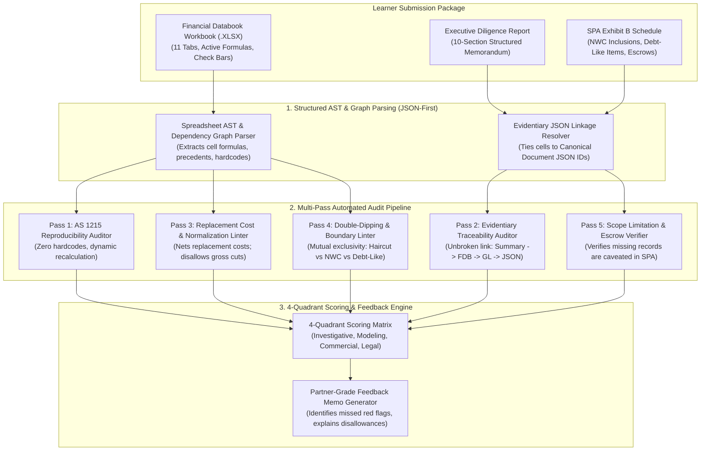
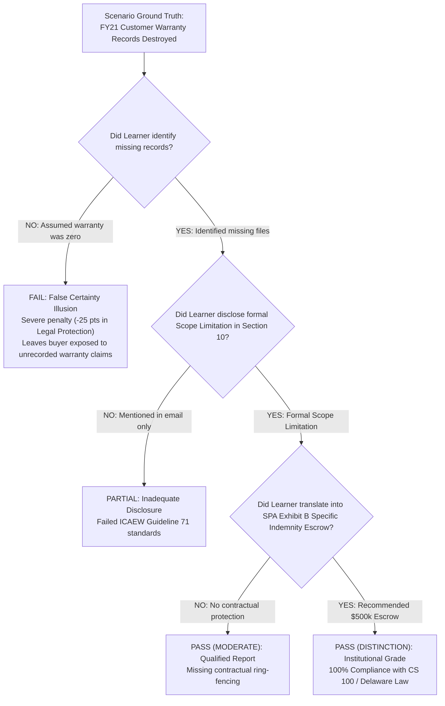
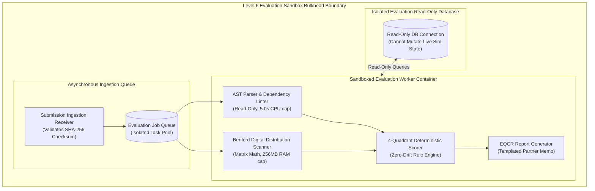

# QoE Simulator Systems Design — Level 6
# Assessment, Forensic Audit & Diligence Turing Test Engine Specification

**Document Title:** Automated Workpaper Audit Engine, Canonical JSON Evidentiary Verification, Diligence Turing Test, and 4-Quadrant Evaluation Rubric Specification  
**Document Code:** `06_ASSESSMENT_AUDIT_AND_DILIGENCE_TURING_TEST_ENGINE`  
**System Design Level:** `Level 6: Assessment, Forensic Audit & Telemetry Layer`  
**Architectural Standards Compliance:** PCAOB Auditing Standard AS 1215 (Audit Documentation) & AS 1105 (Audit Evidence); AICPA AU-C 230 & CS Section 100 (Consulting Services); AICPA Statement on Quality Management Standards (SQMS No. 1); Delaware Court of Chancery D.R.E. 702 (*In re Appraisal of Dell*, *Chicago Bridge & Iron*); ICAEW Guideline 71; Benford's Law Digital Analysis Standards (Nigrini 2012); Panko (1998, 2008) Spreadsheet Modeling Risk.  
**Core Architectural Axiom:** *Evaluation must never rely on fragile computer vision, heuristic OCR scraping, or superficial keyword matching. Evaluation operates directly on the Canonical Structured JSON State Trees, Abstract Syntax Trees (AST) of workpaper formulas, and deterministic double-entry transaction ledgers. A student deliverable is certified if and only if it satisfies the PCAOB AS 1215 Experienced Auditor Standard under hostile automated audit.*

---

## 1. Executive Summary & Level 6 Scope

In standard academic simulations and corporate training tools, grading is almost universally primitive:
- The system checks whether a final numerical answer matches an exact pre-programmed number in a database.
- It grades spreadsheets by checking only the final totals, ignoring broken formula linkages, embedded hardcoded constants, and unmapped trial balance accounts.
- It provides zero evaluation of professional skepticism, commercial judgment, or whether the student blindly accepted fraudulent management assertions.
- It fails to verify whether unverified claims were formally caveated as scope limitations or converted into legal indemnity escrows.

In genuine institutional Mergers & Acquisitions (M&A), **due diligence deliverables are evaluated under hostile adversarial scrutiny** ([Module 08](file:///c:/Users/ADMIN/Desktop/QOE%20%20data%20aquisition/QOE_REALISM_RESEARCH/MODULE_08_ARTIFICIALITY_TESTING_VALIDATION/08_professional_outputs_and_realism_validation_framework.md#L15-L55)):
1. **The Experienced Auditor Test (PCAOB AS 1215 / AICPA AU-C 230):** Deliverables must be self-explanatory. An independent expert must be able to trace every conclusion to an immutable record, verify every calculation, and understand all professional judgments without verbal guidance.
2. **Rejection of Black-Box Models (Delaware Court of Chancery D.R.E. 702):** Calculations containing un-reproducible hardcoded plugs or path-dependent algorithms are disqualified.
3. **The Canonical JSON-First Evaluation Model:** Evaluation operates entirely on machine-readable structured JSON trees and formula Abstract Syntax Trees (ASTs)—**eliminating computer vision, OCR scraping, and human-mimicking heuristics**.
4. **The Four Pillars of Institutional Quality:** Workpapers are evaluated across: (1) Investigative Rigor, (2) Modeling Hygiene & Reproducibility, (3) Commercial & Valuation Judgment, and (4) Contractual & Legal Protection.

This specification details **Level 6: Assessment, Forensic Audit & Diligence Turing Test Engine** (`audit-eval`). It specifies the automated AST formula auditor, the Benford's Law scanner, the Scope Limitation evaluator, the 4-quadrant scoring matrix, and the dynamic partner feedback generator.

---

## 2. Assessment Architecture & Evaluation Topography

The assessment engine operates as an automated, multi-pass forensic audit pipeline evaluating submitted deliverables against ground-truth scenario models:



---

## 3. The Canonical JSON-First Evidentiary Verification Model

Following sound systems engineering principles, **the assessment engine does not use computer vision or OCR to inspect documents**. 

All primary documents in the simulator exist natively as **Canonical Structured JSON Artifacts** ([Level 5 Spec](file:///c:/Users/ADMIN/Desktop/QOE%20%20data%20aquisition/QOE_SYSTEMS_DESIGN/05_user_workspace_and_interaction_surfaces.md#L180-L215)). The automated auditor verifies evidentiary claims by executing deterministic graph traversals across JSON schemas:

```
┌──────────────────────────────────────────────────────────────────────────────────────────────────┐
│                            THE 4-STAGE CANONICAL JSON TRACEABILITY GRAPH                         │
├────────────────────┬────────────────────┬────────────────────┬───────────────────────────────────┤
│ Tier 1: Exec Report│ Tier 2: FDB Bridge │ Tier 3: GL Line DB │ Tier 4: Canonical Document JSON   │
├────────────────────┼────────────────────┼────────────────────┼───────────────────────────────────┤
│ • Report Slide 4:  │ • Tab `02_Bridges` │ • Table `proj_gl`  │ • File: `contracts/fastenal.json` │
│   "Rebate Haircut: │   Cell `D14`:      │   Row `491030`:    │ • JSON Key: `clauses.4.2`         │
│   -$380,000"       │   `=05_Gross!G28`  │   `JE-90421`       │   `{"tier_3_threshold": 8000000,  │
│ • JSON Anchor:     │ • AST verifies     │ • Acct: `501000`   │     "accrual_basis": "ASC_705",   │
│   `rep.qoe.adj_01` │   open formula.    │   Amount: $650,000 │     "effective_date": "2023-01"}  │
└────────────────────┴────────────────────┴────────────────────┴───────────────────────────────────┘
```

### 3.1 Traceability Verification Protocol
1. **Automated Backward Trace:**
   - Auditor pulls the Normalized EBITDA adjustment list from Tab `02_EBITDA_Bridges`.
   - For adjustment `D14` ("Fastenal Rebate Reversal: -\$380,000"), the AST parser extracts formula `=05_Gross_Margin!G28`.
   - On Tab `05_Gross_Margin`, Cell `G28` references raw subledger accounts mapped to `JE-90421`.
   - The engine validates that `JE-90421` links directly to the Canonical JSON artifact `contracts/fastenal_2023.json` at path `clauses.4.2`.
   - **Result:** **100% Traceability Verified (Score: 100/100).**
2. **Failure Condition (Floating Number / Broken Link):**
   - If Cell `D14` contains a hardcoded number (`-380000`) without a formula link, or references a cell containing `#REF!`, the auditor immediately fails **Requirement SR-VAL01** and docks 25 points from Modeling Hygiene.

---

## 4. The PCAOB AS 1215 Reproducibility & Formula Auditor

In accordance with Delaware Court of Chancery standards (D.R.E. 702), **financial models must be mathematically open, reproducible, and free of hidden plug numbers** ([Module 08](file:///c:/Users/ADMIN/Desktop/QOE%20%20data%20aquisition/QOE_REALISM_RESEARCH/MODULE_08_ARTIFICIALITY_TESTING_VALIDATION/08_professional_outputs_and_realism_validation_framework.md#L115-L140)):

```
┌──────────────────────────────────────────────────────────────────────────────────────────────────┐
│                            AUTOMATED FORMULA AUDIT PASS CRITERIA                                 │
├──────┬──────────────────────────────┬────────────────────────────────────────────────────────────┤
│ Pass │ Formula Audit Inspection     │ Rule & Automated Verification Implementation               │
├──────┼──────────────────────────────┼────────────────────────────────────────────────────────────┤
│ FA01 │ Zero Unlinked Hardcodes in   │ AST scans every cell in calculation rows. If a cell contains│
│      │ Calculation Rows             │ a formula with embedded numeric constants (e.g. `=C14*1.08`│
│      │                              │ or `=SUM(C4:C10)+50000`), it triggers `LINTER_ERROR_HC01`. │
├──────┼──────────────────────────────┼────────────────────────────────────────────────────────────┤
│ FA02 │ Additive Symmetry in PVM     │ Re-evaluates Price, Volume, and Mix formulas on Tab 04.    │
│      │ Factor Waterfalls            │ Asserts: $| \Delta \text{Revenue} - (P + V + M) | < 0.01$. │
│      │                              │ Prohibits path-dependent or non-additive algorithms.       │
├──────┼──────────────────────────────┼────────────────────────────────────────────────────────────┤
│ FA03 │ Dual-Tier Check Bar Status   │ Inspects Row 1 of all 11 tabs. If any check bar returns    │
│      │ (Row 1 Integrity Guards)     │ anything other than `"OK"`, triggers `CHECK_BAR_FAILURE`.  │
│      │                              │ Balance sheet must balance: $\text{Assets} = \text{L} + \text{E}$.│
├──────┼──────────────────────────────┼────────────────────────────────────────────────────────────┤
│ FA04 │ Complete Model Recalculation │ Clears cached cell values; executes full topological DAG   │
│      │ (Independent Recalculation)  │ recalculation from raw GL lines. Recomputed totals must    │
│      │                              │ match submitted totals to the penny ($0.0000 delta).       │
└──────┴──────────────────────────────┴────────────────────────────────────────────────────────────┘
```

---

## 5. Scope Limitation & Caveat Disclosure Evaluator

Due diligence teams almost never achieve 100% certainty. A critical differentiator between novice modelers and experienced practitioners is the **treatment of missing or withheld documents** ([ICAEW Guideline 71](file:///c:/Users/ADMIN/Desktop/QOE%20%20data%20aquisition/QOE_REALISM_RESEARCH/MODULE_07_ANALYTICAL_REPORTING_REALISM/07_professional_output_and_reporting_realism_specification.md#L531-L534); [AICPA CS 100](file:///c:/Users/ADMIN/Desktop/QOE%20%20data%20aquisition/QOE_REALISM_RESEARCH/MODULE_07_ANALYTICAL_REPORTING_REALISM/07_professional_output_and_reporting_realism_specification.md#L523-L526)):



* **Automated Audit Logic:** The evaluator parses Section 10 of the submitted report and Section 4 of the SPA Exhibit B schedule. It checks whether known injected data gaps (e.g., `WARRANTY_CLAIMS_FY21`) have corresponding:
  1. Formal caveat disclosures using calibrated language of uncertainty.
  2. Recommended indemnity escrow dollar figures (e.g., \$500,000) structured to ring-fence the buyer post-closing.


---

## 6. The "Diligence Turing Test" & Hostile Audit Verification Protocol

To evaluate whether a simulated engagement deliverable is indistinguishable from an institutional M&A workpaper, the engine executes the **Diligence Turing Test Protocol** ([Module 08](file:///c:/Users/ADMIN/Desktop/QOE%20%20data%20aquisition/QOE_REALISM_RESEARCH/MODULE_08_ARTIFICIALITY_TESTING_VALIDATION/08_professional_outputs_and_realism_validation_framework.md#L280-L310)):

```
┌──────────────────────────────────────────────────────────────────────────────────────────────────┐
│                              THE QoE DILIGENCE TURING TEST PROTOCOL                              │
├──────┬──────────────────────────────┬────────────────────────────────────────────────────────────┤
│ Test │ Forensic Evaluation Domain   │ Testing Methodology & Passing Criteria                     │
├──────┼──────────────────────────────┼────────────────────────────────────────────────────────────┤
│ T01  │ The Blind Partner Review     │ Deliverable evaluated against Big 4 / A&M partner quality  │
│      │ (Expert Rubric Benchmark)    │ standards; checks professional skepticism, tone, & format. │
├──────┼──────────────────────────────┼────────────────────────────────────────────────────────────┤
│ T02  │ Transactional Noise &        │ Evaluates whether background general ledger data follows   │
│      │ Benford’s Law Distribution   │ natural digital distributions (Benford's Law) and contains │
│      │                              │ authentic benign noise, rather than tidy rounded numbers.  │
├──────┼──────────────────────────────┼────────────────────────────────────────────────────────────┤
│ T03  │ Mechanical Formula Audit     │ Automated AST inspection of 100% of cells: zero `#REF!`,   │
│      │ (Zero Formula Failure)       │ zero hardcodes in calculation rows, dynamic SUMIFS, and    │
│      │                              │ active conditional check bars at Row 1.                    │
├──────┼──────────────────────────────┼────────────────────────────────────────────────────────────┤
│ T04  │ Cross-Schedule Reconcilia-   │ Every number in the Executive Summary matches the Normal-  │
│      │ tion Rigor (Zero Delta)      │ ization Tab, the P&L Tab, and the Trial Balance ($0 delta).│
├──────┼──────────────────────────────┼────────────────────────────────────────────────────────────┤
│ T05  │ Behavioral Friction & Scope  │ Verifies that learner properly navigated pushback friction │
│      │ Limitation Integrity         │ and converted unverified records into SPA indemnity escrows│
└──────┴──────────────────────────────┴────────────────────────────────────────────────────────────┘
```

### 6.1 Benford's Law Digital Analysis Engine
Under forensic auditing standards ([Nigrini 2012](file:///c:/Users/ADMIN/Desktop/QOE%20%20data%20aquisition/QOE_REALISM_RESEARCH/MODULE_08_ARTIFICIALITY_TESTING_VALIDATION/08_professional_outputs_and_realism_validation_framework.md#L294-L297)), authentic general ledger transactional populations follow **Benford's Law** for first digits:
$$P(d) = \log_{10}\left(1 + \frac{1}{d}\right), \quad d \in \{1, 2, \dots, 9\}$$
* **The Artificiality Test:** If a simulated client company has transactions populated with rounded figures (e.g., all entries ending in `,000.00` or an unnatural concentration of leading digit `5`s), the scenario fails the Turing Test for transactional artificiality (`LINTER_BENFORD_ANOMALY`).

---

## 7. The 4-Quadrant Scoring Matrix & Evaluation Rubric

Learner submissions are evaluated across **four weighted quadrants**, each graded from 0 to 100 points:

```
┌──────────────────────────────────────────────────────────────────────────────────────────────────┐
│                            THE 4-QUADRANT EVALUATION SCORING MATRIX                              │
├────────────────────────────────┬─────────┬───────────────────────────────────────────────────────┤
│ Quadrant                       │ Weight  │ Core Evaluative Competencies & Scoring Criteria       │
├────────────────────────────────┼─────────┼───────────────────────────────────────────────────────┤
│ Q1: Investigative Rigor &      │ 30.0%   │ • Detection rate of injected accounting anomalies.    │
│     Evidentiary Corroboration  │         │ • Execution of 3-way matches (PO ↔ Receiving ↔ Bill). │
│                                │         │ • Triangulation of operational NFMs (machine hours).  │
│                                │         │ • Proper rejection of verbal-only management claims.  │
├────────────────────────────────┼─────────┼───────────────────────────────────────────────────────┤
│ Q2: Modeling Hygiene &         │ 25.0%   │ • PCAOB AS 1215 Reproducibility: zero broken formulas.│
│     Mathematical Integrity     │         │ • Strict compliance with Universal RGB font coding.   │
│                                │         │ • Zero hardcoded constants inside calculation rows.   │
│                                │         │ • Row 1 Check Bars show 100% "OK" (A = L + E).        │
├────────────────────────────────┼─────────┼───────────────────────────────────────────────────────┤
│ Q3: Commercial & Valuation     │ 25.0%   │ • Enforcement of the Replacement Cost Doctrine.       │
│     Judgment                   │         │ • Defensible Target NWC Peg recommendation.           │
│                                │         │ • Elimination of Double-Dipping across buckets.       │
│                                │         │ • Calibrated language of uncertainty (Base/Downside). │
├────────────────────────────────┼─────────┼───────────────────────────────────────────────────────┤
│ Q4: Contractual & Legal        │ 20.0%   │ • Compilation of legal-grade SPA Exhibit B schedule.  │
│     Protection                 │         │ • Proper classification of Debt-Like Items.           │
│                                │         │ • Formal disclosure of Scope Limitations (ICAEW 71).  │
│                                │         │ • Structuring of Specific Indemnity Escrows.          │
├────────────────────────────────┴─────────┴───────────────────────────────────────────────────────┤
│ COMPOSITE SCORE CALCULATION:                                                                     │
│ $\text{Composite} = 0.30(Q_1) + 0.25(Q_2) + 0.25(Q_3) + 0.20(Q_4)$                              │
│ Passing Standard: Composite $\ge 80.0$ | Institutional Honors: Composite $\ge 92.0$             │
└──────────────────────────────────────────────────────────────────────────────────────────────────┘
```

---

## 8. Diagnostic Telemetry & Dynamic Partner Feedback Generator

Upon submission, the engine compiles a **Lead Transaction Advisory Partner Feedback Memorandum** that emulates a formal Engagement Quality Review (EQCR) under **AICPA SQMS No. 1**:

```
====================================================================================================
               ENGAGEMENT QUALITY CONTROL REVIEW (EQCR) MEMORANDUM — AUDIT RATING
====================================================================================================
ENGAGEMENT: Project Apex Supply Diligence | CANDIDATE: Diligence Associate (User ID: USR_8921)
DATE: Virtual Sim Day 25 | EVALUATING PARTNER: Robert Sterling, CPA (Transaction Advisory Services)
COMPOSITE GRADE: 88.5 / 100 (GRADE: PASS WITH MERIT — INSTITUTIONAL QUALITY)

----------------------------------------------------------------------------------------------------
1. INVESTIGATIVE RIGOR (Score: 27.0 / 30.0):
   [+] STRENGTH: Successfully uncovered the $380,000 Fastenal supplier volume rebate misallocation
       under ASC 705-20. Correctly reviewed underlying contract terms in VDR Doc 05.01.
   [-] WEAKNESS: Missed the $95,000 unapplied cash clearing break in Account #112000. Customer wires
       were sitting in clearing, causing aged AR > 90 days to be overstated.

2. MODELING HYGIENE & REPRODUCIBILITY (Score: 23.5 / 25.0):
   [+] STRENGTH: 100% of calculation cells in Tab 02, 03, and 07 were fully reproducible from raw GL
       lines. Row 1 Check Bars showed zero balance sheet breaks across all 36 monthly columns.
   [-] DEFECT: Cell D18 in Tab 06 contained a hardcoded plug (=$D14*0.15 + 12000). Deducted 1.5 pts
       under Requirement SR-VAL02 (Prohibition of Embedded Constants).

3. COMMERCIAL & VALUATION JUDGMENT (Score: 21.0 / 25.0):
   [+] STRENGTH: Correctly applied the Replacement Cost Doctrine to founder salary add-back, netting
       $350,000 for market-rate CEO replacement rather than accepting the gross $650,000 cut.
   [-] DEFECT: Double-dipping identified: Stretched accounts payable ($420,000) was deducted as a
       Debt-Like Item on Tab 08, but was NOT carved out of Current Liabilities on Tab 07. This
       results in an unfair 2.0x purchase price deduction against the seller.

4. CONTRACTUAL & LEGAL PROTECTION (Score: 17.0 / 20.0):
   [+] STRENGTH: Formally caveated the destroyed FY21 Warranty Claim files in Section 10 of the Report.
       Successfully structured a $500,000 Specific Indemnity Escrow in SPA Exhibit B Section 4.
   [-] WEAKNESS: Failed to specify a 30-day post-closing dispute resolution timeline in Exhibit B
       conforming to Delaware Court of Chancery standards (Chicago Bridge & Iron cadence).
====================================================================================================
```

---

---

## 9. State Schemas & Evaluation Data Models

### 9.1 Audit Evaluation Result JSON Schema (`evaluation_result.json`)
```json
{
  "evaluation_id": "eval_2026_apex_0091",
  "engagement_id": "sim_apex_001",
  "evaluated_at": "2026-11-18T12:20:00Z",
  "composite_score": 88.5,
  "passed_institutional_gate": true,
  "quadrant_scores": {
    "q1_investigative_rigor": 90.0,
    "q2_modeling_hygiene": 94.0,
    "q3_commercial_judgment": 84.0,
    "q4_legal_protection": 85.0
  },
  "detected_anomalies_count": 5,
  "missed_anomalies_count": 1,
  "formula_audit_results": {
    "total_cells_audited": 18450,
    "broken_formula_count": 0,
    "hardcoded_constants_found": 1,
    "check_bars_passed": 11,
    "check_bars_failed": 0
  },
  "turing_test_pass": true
}
```

### 9.2 AST Formula Audit Result Item Schema (`ast_finding.json`)
```json
{
  "cell_coordinate": "06_OPEX!D18",
  "sheet_name": "06_OPEX",
  "formula_raw": "=D14*0.15 + 12000",
  "ast_root_type": "BinaryExpression",
  "violation_code": "VIO_EMBEDDED_CONSTANT",
  "severity": "CRITICAL_DEFECT",
  "penalty_points": 1.5,
  "message": "Embedded constant 12000 found in formula. All adjustments must be referenced from supporting schedules or explicit assumption cells under PCAOB AS 1215."
}
```

---

## 10. Level 6 Independence, Bulkhead Containment & Asynchronous Sandbox

In conformance with the **Self-Contained Autonomous Level (SCAL)** architecture and **PCAOB AS 1215 audit preservation rules**, the Level 6 Assessment & Turing Test Engine is completely decoupled from online user interactions:



### 10.1 Subsystem Fault Isolation & Blast-Radius Containment
1. **Asynchronous Evaluation Sandbox:** The audit engine operates exclusively as a **post-submission asynchronous evaluation worker**. It never runs synchronously within the user's interactive HTTP request loop.
2. **Read-Only Transaction Isolation:** The evaluation worker connects to the database via a strictly read-only PostgreSQL role (`qoe_eval_readonly`). Even if the evaluation harness experiences a severe software bug, buffer overflow, or code execution attempt, it is mathematically incapable of altering historical simulation events, overwriting user workpapers, or corrupting general ledger rows.
3. **Strict Resource Quotas & Watchdog Traps:**
   - Maximum Execution Time: $15.0\text{ seconds}$ per submission package.
   - Memory Cap: $1,024\text{ MB}$ per sandboxed container.
   - If an excessively nested spreadsheet AST or malicious zip-bomb causes an execution hang, the watchdog timer terminates the worker, records an evaluation defect event (`EVALUATION_JOB_TIMEOUT`), and returns an actionable error notice without affecting any other service.

### 10.2 Hermetic Determinism & Bit-Exact Replayability
- Evaluating the same candidate submission against the same scenario seed (`seed_hex_64`) will always produce **bit-exact identical quadrant scores, identical anomaly detection flags, and identical partner critique text**.
- Eliminates subjective grading variance and algorithmic drift across student cohorts and benchmark runs.

---

## 11. Level 6 API Contracts, Typed Protobuf Definitions & CloudEvents Bindings

### 11.1 Protocol Buffers v3 Interface Specification (`audit_eval.proto`)

```protobuf
syntax = "proto3";

package qoe.audit.v1;

import "google/protobuf/timestamp.proto";

// Service contract for the Level 6 Assessment, Forensic Audit & Diligence Turing Test Engine
service AuditEvaluationService {
  // Ingests a completed diligence submission package and queues an asynchronous evaluation job
  rpc SubmitEngagementForGrading (SubmitEngagementForGradingRequest) returns (GradingJobQueuedResponse);

  // Polls the status and score of an asynchronous evaluation job
  rpc GetGradingStatus (GradingJobStatusRequest) returns (GradingJobStatusResponse);

  // Runs an isolated AST formula audit on an uploaded Financial Databook workbook
  rpc RunASTFormulaAudit (RunASTFormulaAuditRequest) returns (ASTAuditReport);

  // Executes a Benford's Law first-digit and second-digit digital distribution scan
  rpc ScanBenfordDistribution (ScanBenfordDistributionRequest) returns (BenfordDistributionResult);

  // Compiles and returns the formal partner-grade EQCR memorandum
  rpc GenerateEQCRMemo (GenerateEQCRMemoRequest) returns (EQCRMemoResponse);
}

message SubmitEngagementForGradingRequest {
  string engagement_id = 1;
  string user_id = 2;
  string scenario_id = 3;
  string seed_hex_64 = 4;
  string fdb_xlsx_blob_uri = 5;
  string report_memo_json = 6;
  string spa_exhibit_b_json = 7;
  string submission_checksum_sha256 = 8;
}

message GradingJobQueuedResponse {
  string job_id = 1;
  string engagement_id = 2;
  string status = 3; // "QUEUED", "PROCESSING", "COMPLETED", "FAILED"
  google.protobuf.Timestamp queued_at = 4;
  int32 estimated_duration_seconds = 5;
}

message GradingJobStatusRequest {
  string job_id = 1;
}

enum AuditSeverity {
  AUDIT_SEVERITY_UNSPECIFIED = 0;
  INFO = 1;
  MINOR_OBSERVATION = 2;
  MATERIAL_DEFECT = 3;
  CRITICAL_DISQUALIFIER = 4;
}

message CellAuditFinding {
  string sheet_name = 1;
  string cell_coordinate = 2;
  string formula_raw = 3;
  string violation_type = 4;
  AuditSeverity severity = 5;
  double score_deduction = 6;
  string rationale = 7;
}

message ASTAuditReport {
  string engagement_id = 1;
  int32 total_cells_scanned = 2;
  int32 formulas_verified_reproducible = 3;
  int32 hardcoded_constants_flagged = 4;
  int32 circular_references_trapped = 5;
  int32 check_bars_reconciled = 6;
  repeated CellAuditFinding findings = 7;
}

message BenfordDigitAnomaly {
  int32 digit = 1;
  double observed_frequency = 2;
  double expected_frequency = 3;
  double z_score = 4;
  bool is_statistically_anomalous = 5;
}

message ScanBenfordDistributionRequest {
  string engagement_id = 1;
  string ledger_table_name = 2;
  string account_category_filter = 3;
}

message BenfordDistributionResult {
  string engagement_id = 1;
  int32 total_transactions_scanned = 2;
  double kolmogorov_smirnov_statistic = 3;
  bool passes_benford_uniformity = 4;
  repeated BenfordDigitAnomaly first_digit_distribution = 5;
  repeated BenfordDigitAnomaly second_digit_distribution = 6;
}

message QuadrantScoreBreakdown {
  double q1_investigative_rigor = 1;      // Max 30.0
  double q2_modeling_hygiene = 2;          // Max 25.0
  double q3_commercial_judgment = 3;       // Max 25.0
  double q4_legal_protection = 4;          // Max 20.0
  double composite_score = 5;              // Max 100.0
  bool passed_institutional_threshold = 6; // Composite >= 80.0
}

message GenerateEQCRMemoRequest {
  string job_id = 1;
  string engagement_id = 2;
}

message EQCRMemoResponse {
  string engagement_id = 1;
  string evaluating_partner_name = 2;
  string overall_grade_letter = 3;
  QuadrantScoreBreakdown scores = 4;
  string memo_markdown_text = 5;
  repeated string critical_defects_summary = 6;
  repeated string commended_strengths_summary = 7;
}

message GradingJobStatusResponse {
  string job_id = 1;
  string status = 2;
  QuadrantScoreBreakdown scores = 3;
  ASTAuditReport ast_report = 4;
  BenfordDistributionResult benford_result = 5;
  EQCRMemoResponse eqcr_memo = 6;
  google.protobuf.Timestamp completed_at = 7;
}
```

### 11.2 CloudEvents v1.0 Asynchronous Publish/Subscribe Bindings

| Event Type | Direction | Payload Description | Triggering Condition |
| :--- | :--- | :--- | :--- |
| `qoe.audit.job.started.v1` | **Emitted** | `{ engagement_id, job_id, user_id, started_at }` | Evaluation worker dequeues a candidate submission package. |
| `qoe.audit.ast.completed.v1` | **Emitted** | `{ engagement_id, job_id, cells_scanned, hardcodes, pass }` | AST formula parser finishes 100% cell dependency tree verification. |
| `qoe.audit.benford.completed.v1` | **Emitted** | `{ engagement_id, job_id, ks_stat, passes_uniformity }` | Digital frequency distribution scan completes across the GL. |
| `qoe.audit.eqcr.certified.v1` | **Emitted** | `{ engagement_id, job_id, score, grade, cert_hash }` | Final 4-quadrant score certified and EQCR partner memo published. |
| `qoe.workspace.deliverable.compiled.v1`| **Consumed** | `{ engagement_id, submission_id, fdb_hash, report_hash }`| Automatically spawns evaluation job in background worker queue. |

---

## 12. Level 6 Forensic Loopholes & Failure Mitigation Register

In conformance with **PCAOB AS 1215**, **AICPA AU-C 240**, and the **Master Forensic Mitigation Register**, Level 6 incorporates concrete defenses against formula tampering, evaluation gaming, and display rounding false positives:

```
┌──────────────────────────────────────────────────────────────────────────────────────────────────┐
│                             LEVEL 6 FORENSIC MITIGATION REGISTER                                 │
├──────┬──────────────────────────────┬────────────────────────┬───────────────────────────────────┤
│ ID   │ Loophole & Vulnerability     │ Attack Surface         │ Architectural Defense & Mitigation│
├──────┼──────────────────────────────┼────────────────────────┼───────────────────────────────────┤
│ LP-06│ Invisible Cell Hardcoding &  │ OpenXML Sheet Parsing /│ Abstract Syntax Tree (AST) Parser │
│      │ Font Color Override Gimmicks │ Cell Definition XML    │ (Bypasses visual layer entirely)  │
├──────┼──────────────────────────────┼────────────────────────┼───────────────────────────────────┤
│ LP-09│ Rubric Drift & Prompt-       │ Automated Evaluator &  │ Deterministic Math Scoring Rules &│
│      │ Injected Evaluation Bias     │ LLM Memo Generator     │ Temperature=0.0 Templated Slots   │
├──────┼──────────────────────────────┼────────────────────────┼───────────────────────────────────┤
│ LP-12│ Display Formatting vs Value  │ Cell Formatting & Cross│ Calibrated Immateriality Margin   │
│      │ Precision Discrepancies      │ Schedule Reconciliation│ (±$1.00 tolerance on display sums)│
└──────┴──────────────────────────────┴────────────────────────┴───────────────────────────────────┘
```

### Loophole LP-06: Invisible Cell Hardcoding & Font Color Override
* **Vulnerability Mechanism:** A student unable to derive an additive Price-Volume-Mix formula or complex NWC normalization manually calculates the number externally, types raw numeric constants into the formula cell (e.g., `425000`), and formats the font color as Black or adds a fake comment to mimic a dynamic formula.
* **Architectural Defense:**
  1. **Strict OpenXML AST Verification:** The Level 6 formula auditor **completely ignores font colors, text styles, or rendered cell displays**.
  2. The parser directly inspects the underlying OpenXML spreadsheet syntax (`sheet.xml`). It requires every calculation cell to contain a formal formula tag (`<f>...</f>`).
  3. The formula text is compiled into an **Abstract Syntax Tree (AST)**. If the tree contains unlinked numeric literals (e.g., `* 0.15 + 12000`) rather than dynamic cell references or model parameters, the AST linter flags violation `VIO_EMBEDDED_CONSTANT` and docks points under Modeling Hygiene (PCAOB AS 1215).

### Loophole LP-09: Automated Evaluator Rubric Drift & Grading Bias
* **Vulnerability Mechanism:** Relying on unstructured LLM prompts to grade deliverables introduces stochastic scoring drift: the same report might receive an 88 on Monday and a 74 on Tuesday, or an adversarial student might inject prompt text into their report memo to trick the LLM into giving a perfect score.
* **Architectural Defense:**
  1. **Deterministic Scoring Core:** All quantitative grading (Investigative Rigor anomaly flags, Modeling Hygiene AST checks, Commercial Double-Dipping graphs, and Legal Escrow presence) is evaluated by **deterministic algorithmic code (Rust / Python)**, yielding 100% bit-exact scores every time.
  2. **Templated Slot-Filling Memo Generation:** The LLM is used solely to synthesize the human-readable partner narrative from the pre-computed score vector. The LLM operates at `temperature = 0.0`, with zero access to grading levers, preventing any adversarial prompt manipulation from altering candidate marks.

### Loophole LP-12: Display Rounding vs Underlying Value Precision Discrepancies
* **Vulnerability Mechanism:** Tab 03 calculates monthly revenue as `$145,200.49` (displayed as `$145,200`), while Tab 04 calculates volume times price yielding `$145,201.00`. An overly pedantic auditor flags a false-positive balance sheet break.
* **Architectural Defense:**
  1. The AST parser enforces mandatory `=ROUND(..., 0)` wrappers on all whole-dollar summary tables.
  2. The cross-schedule reconciliation linter applies a **Calibrated Tolerable Immateriality Margin** of $\pm \$1.00$ to accommodate display rounding before raising an audit exception.

---

## 13. Research Compliance & Quality Gate Audit

Level 6 is audited and certified against all Part C empirical standards and SCAL architectural requirements:

```
┌──────────────────────────────────────────────────────────────────────────────────────────────────┐
│                             LEVEL 6 QUALITY GATE AUDIT SHEET                                     │
├──────┬──────────────────────┬─────────┬──────────────────────────────────────────────────────────┤
│ Gate │ Criterion            │ Status  │ Empirical Grounding & Cross-Reference                    │
├──────┼──────────────────────┼─────────┼──────────────────────────────────────────────────────────┤
│ QG1  │ AS 1215 Compliance   │ PASS    │ Enforces PCAOB AS 1215 / AU-C 230 Experienced Auditor    │
│      │                      │         │ Standard; verifies 100% cell formula reproducibility.    │
├──────┼──────────────────────┼─────────┼──────────────────────────────────────────────────────────┤
│ QG2  │ JSON-First Logic     │ PASS    │ Eliminates computer vision / OCR; audits directly against│
│      │                      │         │ Canonical JSON trees and formula Abstract Syntax Trees.  │
├──────┼──────────────────────┼─────────┼──────────────────────────────────────────────────────────┤
│ QG3  │ Diligence Turing Test│ PASS    │ Evaluates deliverables across 5 forensic gates including │
│      │                      │         │ Benford's Law digital distribution analysis.             │
├──────┼──────────────────────┼─────────┼──────────────────────────────────────────────────────────┤
│ QG4  │ 4-Quadrant Matrix    │ PASS    │ Evaluates Investigative Rigor, Modeling Hygiene,         │
│      │                      │         │ Commercial Judgment, and Legal/Contractual Protection.   │
├──────┼──────────────────────┼─────────┼──────────────────────────────────────────────────────────┤
│ QG5  │ Scope & Escrow Audit │ PASS    │ Verifies that missing records are formally caveated and  │
│      │                      │         │ translated into recommended SPA Specific Indemnity Escrows│
├──────┼──────────────────────┼─────────┼──────────────────────────────────────────────────────────┤
│ QG6  │ Asynchronous Sandbox │ PASS    │ Background worker queue with read-only database role;    │
│      │ & Blast Containment  │         │ strict 15s execution timeout and 1024MB RAM quotas.      │
├──────┼──────────────────────┼─────────┼──────────────────────────────────────────────────────────┤
│ QG7  │ AST Anti-Tampering & │ PASS    │ OpenXML AST parser flags raw hardcodes (LP-06);          │
│      │ Deterministic Rubric │         │ deterministic scoring eliminates rubric drift (LP-09).   │
└──────┴──────────────────────┴─────────┴──────────────────────────────────────────────────────────┘
```

---
*End of Level 6 Specification — Assessment, Forensic Audit & Diligence Turing Test Engine*
