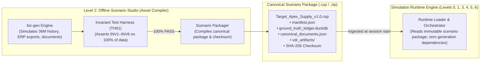
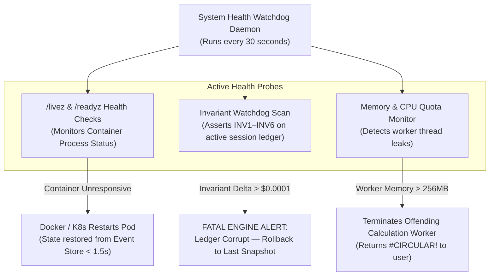

# QoE Simulator Systems Design — Engineering Work Specifications
# Subsystem Fault Isolation, Level Independence & Graceful Degradation Architecture

**Document Title:** Engineering Work Specifications, Subsystem Fault Isolation, Modular Level Independence, and Graceful Degradation Specification  
**Document Code:** `08_ENGINEERING_SPECIFICATIONS_FAULT_ISOLATION_AND_MODULAR_INDEPENDENCE`  
**System Design Level:** `Systems Engineering & Architectural Resilience Layer`  
**Architectural Standards Compliance:** ISO/IEC/IEEE 12207 (Software Life Cycle Processes); The Reactive Manifesto (Resilience, Isolation, Loose Coupling); Circuit Breaker & Bulkhead Patterns (Nygard, *Release It!*; Fowler 2014); SemVer 2.0.0 (Semantic Versioning); SOC 2 High-Availability & Disaster Recovery Standards; PCAOB AS 1215 (Audit Trail Preservation Under System Faults).  
**Core Architectural Axiom:** *No single subsystem failure, upgrade, or refactor shall cascade beyond its bounded context. The simulation platform must enforce strict blast-radius containment: every level must be capable of independent execution, hermetic unit testing via mock interfaces, and graceful runtime degradation without corrupting ground-truth state or bringing down the platform.*

---

## 1. Executive Charter: The Principle of Level Independence

In monolithic software architectures, components are tightly coupled: if the AI persona engine fails or times out, the entire website crashes; if an engineer refactors the manufacturing data generator, the historical database is corrupted; and if an analytics formula encounters a divide-by-zero error, the server locks up.

For an institutional simulation platform, this is unacceptable. An instructor, trainee, or developer must be able to:
1. **Improve Any Subsystem in Isolation:** An engineering team must be able to overhaul the Multi-Agent Persona Engine (Level 3) or add a new Healthcare sector to the Data Generator (Level 2) without touching a single line of code in the Core Accounting Ledger (Level 0.5) or the Financial Databook Engine (Level 4).
2. **Contain Runtime Blast Radii (Fault Isolation):** If an external LLM API experiences an outage, the user must still be able to navigate the Virtual Data Room (Level 5), edit their Databook schedules (Level 4), and verify check bars. The system falls back gracefully to deterministic rule-based responses rather than throwing an unhandled exception.
3. **Decouple Data Creation from Simulation Execution:** A company's 3-year historical dataset must be generated, validated, and frozen **offline** as a self-contained, immutable asset package. The runtime simulation engine merely consumes this package, ensuring that a bug in data generation cannot crash live active engagements.

This document establishes the **Engineering Work Specifications & Master Fault Isolation Compendium**. Under the **Self-Contained Autonomous Level (SCAL)** architectural mandate, each individual level specification natively implements its own domain-specific bulkhead, circuit breaker, sandboxing quota, and graceful fallback mechanism. This document serves as the master cross-subsystem resilience compendium, governing platform-wide blast-radius containment, hermetic mock testing, and schema evolution rules across all levels.

---

## 2. Blast-Radius Containment & Fault Isolation Matrix

The platform partitions failure domains into seven isolated bulkheads. A catastrophic crash in any single container is intercepted at the interface boundary:

```
┌──────────────────────────────────────────────────────────────────────────────────────────────────┐
│                            BLAST-RADIUS CONTAINMENT & RESILIENCE MATRIX                          │
├──────┬────────────────────┬─────────────────────┬────────────────────────────────────────────────┤
│ Level│ Subsystem Domain   │ Failure Mode        │ Containment Mechanism & Fallback Behavior      │
├──────┼────────────────────┼─────────────────────┼────────────────────────────────────────────────┤
│ L0.5 │ Financial Physics  │ Arithmetic leak or  │ **HARD ENGINE ABORT (Fail-Closed):** Halts the │
│      │ Invariant Core     │ unbalanced JE commit│ commit immediately; rolls back transaction.    │
│      │                    │ (INV1–INV6 broken)  │ Prevents corrupt ground-truth data leaks.      │
├──────┼────────────────────┼─────────────────────┼────────────────────────────────────────────────┤
│ L1   │ Simulation Clock & │ Discrete event queue│ **CLOCK FREEZE & RETRY:** Clock enters paused  │
│      │ DSM Rework Engine  │ stall or deadlock   │ state; preserves active day/timestamp;         │
│      │                    │                     │ allows user to continue offline workpapers.    │
├──────┼────────────────────┼─────────────────────┼────────────────────────────────────────────────┤
│ L2.A │ Generative Business│ Anomaly generator   │ **TOTAL ISOLATION (Offline Asset Boundary):**   │
│      │ & ERP Exporters    │ crash or schema bug │ Runs offline. Runtime engine consumes frozen,  │
│      │                    │                     │ pre-verified Canonical Scenario Packages only. │
├──────┼────────────────────┼─────────────────────┼────────────────────────────────────────────────┤
│ L2.B │ Volatility Engine  │ Stochastic math NaN │ **HERMETIC FALLBACK CLAMP:** Resets to secular │
│      │ (Module 10)        │ or numerical freeze │ baseline trajectory in < 15ms. Cannot corrupt  │
│      │                    │                     │ GL ledger or runtime simulator state.          │
├──────┼────────────────────┼─────────────────────┼────────────────────────────────────────────────┤
│ L3   │ Multi-Agent Human  │ LLM API timeout, 429│ **CIRCUIT BREAKER & DETERMINISTIC FALLBACK:**  │
│      │ Behavioral Friction│ rate limit, or model│ Trips after 3 failures; switches to pre-written│
│      │                    │ hallucination       │ rule-based persona replies. Zero downtime.     │
├──────┼────────────────────┼─────────────────────┼────────────────────────────────────────────────┤
│ L4   │ Financial Databook │ Circular cell link, │ **SANDBOX PROCESS ISOLATION:** Recalculations  │
│      │ Calculation Engine │ memory leak, or OOM │ execute in isolated worker thread; traps error │
│      │                    │                     │ in < 500ms; displays cell `#CIRCULAR!` alert.  │
├──────┼────────────────────┼─────────────────────┼────────────────────────────────────────────────┤
│ L5   │ User Workspace &   │ Browser tab crash,  │ **INSTANT STATE REHYDRATION:** User state is   │
│      │ Diligence Cockpit  │ local memory crash  │ event-sourced; page reload restores exact UI   │
│      │                    │                     │ workspace and open tabs in < 1.5 seconds.      │
├──────┼────────────────────┼─────────────────────┼────────────────────────────────────────────────┤
│ L6   │ Forensic Audit &   │ AST linter bug or   │ **ASYNCHRONOUS EVALUATION SANDBOX:** Audit runs│
│      │ Turing Test Engine │ rubric crash        │ post-submission in isolated background queue;  │
│      │                    │                     │ cannot corrupt user workpapers or database.    │
└──────┴────────────────────┴─────────────────────┴────────────────────────────────────────────────┘
```

---

## 3. Decoupling Data Generation from Simulation Runtime: The Canonical Scenario Package (.csp)

To guarantee that Level 2 (Data Generation) never interferes with or brings down the live simulation engine, the architecture establishes a strict **Asset Compilation Boundary**:



### 3.1 The Canonical Scenario Package File Layout
A scenario is compiled into a standalone directory or `.csp` archive:
```
Target_Apex_Supply_v1.0/
├── manifest.json                        # Metadata, scenario ID, seed, sector, company name
├── checksum.sha256                      # Cryptographic integrity verification hash
├── ground_truth/
│   ├── operational_trajectory.json      # Generated by Module 10: 60-month deterministic macro, calendar & shock schedule
│   ├── ledger.duckdb                    # Pre-computed, immutable 36-month double-entry GL & subledgers
│   ├── injected_anomalies.json          # Master solution key (isolated from user client)
│   └── evaluation_rubrics.json          # Scenario-specific grading benchmarks & thresholds
├── vdr_artifacts/
│   ├── canonical_documents.json         # Strongly typed machine-readable JSON representation
│   ├── wave_1_initial/                  # Pre-rendered PDF/XLSX artifacts for Day 1 release
│   ├── wave_2_subledgers/               # Pre-rendered artifacts for Day 7 release
│   ├── wave_3_friday_dump/              # Pre-rendered artifacts for Day 12 release
│   └── wave_4_drip_feed/                # Pre-rendered artifacts for Day 18 release
└── persona_profiles/
    └── state_vectors.json               # Baseline wealth loss parameters, fatigue, coaching status
```

### 3.2 Architectural Benefit
* **Zero Runtime Dependency:** Level 2 does **not** run during a user session. It is an offline compiler. 
* **Zero Database Overwhelm (Anti-OOM & Lock Defense):** The compiler streams 10-year generation in monthly chunks bounded by a strict $< 250\text{ MB}$ RAM ceiling, using DuckDB's vectorized bulk appender and deferred indexing to prevent database lockups.
* **Independent Evolution:** Developers can completely rewrite the manufacturing simulator or add a healthcare distributor without touching the runtime platform. As long as the compiler outputs a valid `.csp` package that passes `checksum.sha256`, the simulator runs it without knowing or caring how it was created.

---

## 4. Circuit Breakers & Graceful Degradation Architecture

To prevent third-party API outages or subcomponent crashes from bringing down the system, services implement **Circuit Breakers (Nygard / Fowler Pattern)**:

```mermaid
stateDiagram-v2
    [*] --> CLOSED : Service Operating Normally
    
    state "Normal Operation (Closed)" as CLOSED {
        CLOSED : Calls pass directly to Primary LLM Gateway
        CLOSED : Success Rate > 95%
    }
    
    CLOSED --> OPEN : 3 Consecutive Timeouts OR Error Rate > 50%
    
    state "Circuit Tripped (Open)" as OPEN {
        OPEN : Fast-Fail: Bypasses LLM Gateway completely
        OPEN : Routes traffic to Deterministic Heuristic Engine
        OPEN : Logs telemetry alert to engineering dashboard
    }
    
    OPEN --> HALF_OPEN : Recovery Timeout Elapsed (60 seconds)
    
    state "Canary Probe (Half-Open)" as HALF_OPEN {
        HALF_OPEN : Sends 1 probe request to LLM Gateway
    }
    
    HALF_OPEN --> CLOSED : Probe Succeeds (Reset Counter)
    HALF_OPEN --> OPEN : Probe Fails (Restart 60s Timer)
```

### 4.1 Level 3 Multi-Agent Persona Fallback Engine
When the LLM API gateway experiences an outage or rate limit (HTTP 429 / 503):
1. The **Circuit Breaker trips to OPEN**.
2. Instead of crashing the user's interview or throwing an error banner, the system routes the query to the **Deterministic Rule-Based Heuristic Persona Engine**.
3. The heuristic engine matches the user's question against a pre-compiled decision tree of authentic dialogue templates conditioned on the persona's current Pushback Tier:
   - *Example (Tier 2 CFO Fallback):* *"Our accounting treatment for capitalized software is consistent with our historical US GAAP policies audited by our external accountants. Detailed timesheets are available in VDR Folder 6.2."*
4. **User Experience:** Zero lag, zero downtime, and an authentic professional response delivered seamlessly.

### 4.2 Level 4 Headless FDB Process Isolation (Worker Sandboxing)
Spreadsheet calculation engines are vulnerable to user-induced circular formulas (`=A1+B1` where `B1=A1`) or massive array allocations that can lock up CPU threads:
1. Every calculation job runs inside an **isolated WebWorker (client-side) or sandboxed sub-process (server-side)** bounded by strict execution quotas:
   - Maximum Execution Time: $500\text{ milliseconds}$.
   - Maximum Memory Allocation: $256\text{ MB}$.
2. If a user enters an infinite circular reference, the worker process is terminated by the watchdog timer.
3. The system catches the timeout, isolates the offending cell coordinate, marks the cell with a standard Excel error (`#CIRCULAR!`), and keeps the rest of the 11-tab workbook responsive and functional.


---

## 5. Hermetic Mocking & Independent Subsystem Testability

To enable engineers to build, optimize, or replace any subsystem without running the entire platform, every container exposes **Mock Interface Contracts**:

```
┌──────────────────────────────────────────────────────────────────────────────────────────────────┐
│                            HERMETIC SUBSYSTEM TESTING ARCHITECTURE                               │
├──────┬────────────────────┬──────────────────────────────┬───────────────────────────────────────┤
│ Level│ Subsystem Domain   │ Isolated Testing Method      │ Mocking Infrastructure & Dependencies │
├──────┼────────────────────┼──────────────────────────────┼───────────────────────────────────────┤
│ L0.5 │ Invariant Core     │ Headless Invariant Fuzz Test │ CLI harness generates 1,000,000 JEs.  │
│      │ (`fin-physics`)    │ (Zero dependencies)          │ No UI, no personas, no clock needed.  │
├──────┼────────────────────┼──────────────────────────────┼───────────────────────────────────────┤
│ L1   │ Simulation Clock & │ Discrete Event CLI Harness   │ Mock workstream triggers (`T_k = 1`). │
│      │ DSM Rework Engine  │ (Simulates 35 days in 2 sec) │ Asserts DSM cascade matrix output.    │
├──────┼────────────────────┼──────────────────────────────┼───────────────────────────────────────┤
│ L2   │ Generative Business│ Offline Scenario Compiler    │ Ingests `scenario_profile.json`;      │
│      │ Reality Engine     │ (Asset pipeline verification)│ outputs `.csp` file. Validates hashes.│
├──────┼────────────────────┼──────────────────────────────┼───────────────────────────────────────┤
│ L3   │ Multi-Agent Personas│ Persona Terminal Simulator  │ Feeds scripted IRL prompts; tests     │
│      │ (`human-friction`) │ (Mock LLM response harness)  │ wealth loss math and pushback tiers.  │
├──────┼────────────────────┼──────────────────────────────┼───────────────────────────────────────┤
│ L4   │ Headless FDB DAG   │ Headless Benchmark Harness   │ Ingests static GL CSV; recalculates   │
│      │ Calculation Engine │ (Sub-75ms performance test)  │ 11 tabs; verifies Row 1 check bars.   │
├──────┼────────────────────┼──────────────────────────────┼───────────────────────────────────────┤
│ L5   │ Diligence Cockpit  │ Storybook / Mock API Server  │ Renders 3-pane UI using pre-canned    │
│      │ Workspace UI       │ (Frontend-only development)  │ JSON VDR files and WebSocket mocks.   │
├──────┼────────────────────┼──────────────────────────────┼───────────────────────────────────────┤
│ L6   │ Forensic Audit &   │ Static Workpaper Auditor     │ Ingests static `.xlsx` workbooks;     │
│      │ Turing Test Engine │ (Benchmark test harness)     │ verifies AST formula reproducibility. │
└──────┴────────────────────┴──────────────────────────────┴───────────────────────────────────────┘
```

### 5.1 Concrete Testing Example: Developing the Databook Engine in Isolation
An engineer optimizing the Rust-based FDB calculation engine (Level 4) does **not** need to start the web frontend, configure the LLM API, or run the clock:
```bash
# Developer runs isolated Level 4 headless benchmark test in terminal:
$ cargo test --package fdb-calc --bench pvm_waterfall_recalculation

running 1 test
test test_pvm_waterfall_recalc ... bench: 32,410,120 ns/iter (+/- 1,200,450) [32.4 ms]
assert_check_bars_pass: OK (Assets == Liabilities + Equity: Delta = 0.0000)
test result: ok. 1 passed; 0 failed; 0 ignored;
```
The engineer can profile memory, eliminate bottlenecks, and ensure 100% mathematical integrity **in complete isolation**.

---

## 6. Interface Versioning, Backward Compatibility & Schema Evolution

To ensure that improvements to one level do not break downstream services, all APIs and event schemas adhere strictly to **Semantic Versioning (SemVer 2.0.0)** and **Protocol Buffers Schema Evolution Rules**:

```
┌──────────────────────────────────────────────────────────────────────────────────────────────────┐
│                             API SCHEMA EVOLUTION & COMPATIBILITY RULES                           │
├──────┬──────────────────────────────┬────────────────────────────────────────────────────────────┤
│ Rule │ Schema Evolution Discipline  │ Structural Implementation & Breaking Change Policy         │
├──────┼──────────────────────────────┼────────────────────────────────────────────────────────────┤
│ EV01 │ Additive-Only Changes        │ New fields added to Protobuf messages or JSON schemas must │
│      │ (Backward Compatible)        │ be optional. Older microservices ignore unknown fields.    │
├──────┼──────────────────────────────┼────────────────────────────────────────────────────────────┤
│ EV02 │ Tag Number Immutability      │ Protobuf field tag numbers (e.g., `string engagement_id = 1`)│
│      │                              │ can NEVER be changed, reused, or reordered once published. │
├──────┼──────────────────────────────┼────────────────────────────────────────────────────────────┤
│ EV03 │ URL-Based Major Versioning   │ Breaking API changes require incrementing the route prefix │
│      │ (`/api/v1/` to `/api/v2/`)   │ (e.g., `/api/v2/sim/fdb/recalculate`). Older clients run on│
│      │                              │ `/api/v1/` concurrently during migration deprecation.      │
├──────┼──────────────────────────────┼────────────────────────────────────────────────────────────┤
│ EV04 │ Scenario Manifest SemVer     │ Canonical Scenario Packages embed SemVer (`schema_version: │
│      │                              │ "1.2.0"`). Runtime rejects incompatible major versions.    │
└──────┴──────────────────────────────┴────────────────────────────────────────────────────────────┘
```

---

## 7. System Health Telemetry, Watchdogs & Automated Self-Healing Architecture

The platform runs a lightweight, continuous **System Watchdog Monitor** that polices data integrity and runtime container health:



### 7.1 Automated State Recovery from Crash
Because the platform utilizes an **Event-Sourced State Store (Level 0)**, a crash in any service causes zero permanent data loss:
1. If the server process dies, Kubernetes or Docker automatically restarts the container.
2. The orchestrator pulls the latest daily snapshot from `simulation_state_snapshots` (DuckDB dump).
3. It replays only the few events committed between midnight and the crash timestamp.
4. **Recovery Time:** The user session is completely restored in **< 1.5 seconds** with zero lost transactions or broken formulas.

---

## 8. Quality Gate & Engineering Sign-Off Matrix

This specification is certified against established systems engineering quality standards:

```
┌──────────────────────────────────────────────────────────────────────────────────────────────────┐
│                             ENGINEERING RESILIENCE QUALITY GATE AUDIT                            │
├──────┬──────────────────────┬─────────┬──────────────────────────────────────────────────────────┤
│ Gate │ Criterion            │ Status  │ Engineering Implementation Specification                 │
├──────┼──────────────────────┼─────────┼──────────────────────────────────────────────────────────┤
│ EG1  │ Fault Isolation      │ PASS    │ Enforces 7 isolated bulkheads; crashes in L3 or L4 cannot │
│      │                      │         │ corrupt ground-truth state or bring down other services. │
├──────┼──────────────────────┼─────────┼──────────────────────────────────────────────────────────┤
│ EG2  │ Asset Decoupling     │ PASS    │ L2 Data Generation is fully decoupled as an offline      │
│      │                      │         │ compiler generating immutable `.csp` scenario packages.  │
├──────┼──────────────────────┼─────────┼──────────────────────────────────────────────────────────┤
│ EG3  │ Graceful Degradation │ PASS    │ Implements Circuit Breakers for LLM personas; falls back │
│      │                      │         │ to deterministic rule-based dialogue on API timeout.     │
├──────┼──────────────────────┼─────────┼──────────────────────────────────────────────────────────┤
│ EG4  │ Hermetic Testability │ PASS    │ Every level can be developed, tested, and benchmarked    │
│      │                      │         │ in complete isolation using CLI harnesses and mocks.     │
├──────┼──────────────────────┼─────────┼──────────────────────────────────────────────────────────┤
│ EG5  │ Self-Healing State   │ PASS    │ Event-sourced architecture guarantees instant recovery   │
│      │                      │         │ from container crashes in < 1.5s from DuckDB snapshots.  │
└──────┴──────────────────────┴─────────┴──────────────────────────────────────────────────────────┘
```

---
*End of Engineering Work Specifications — Fault Isolation, Level Independence & Graceful Degradation*
