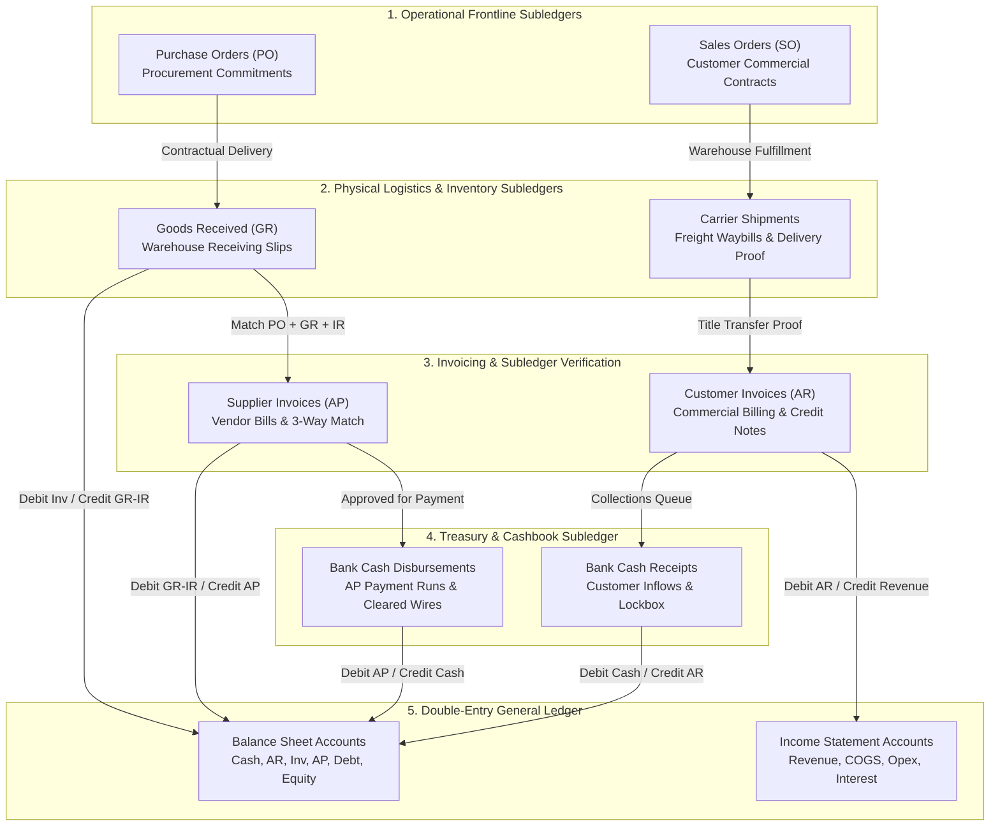
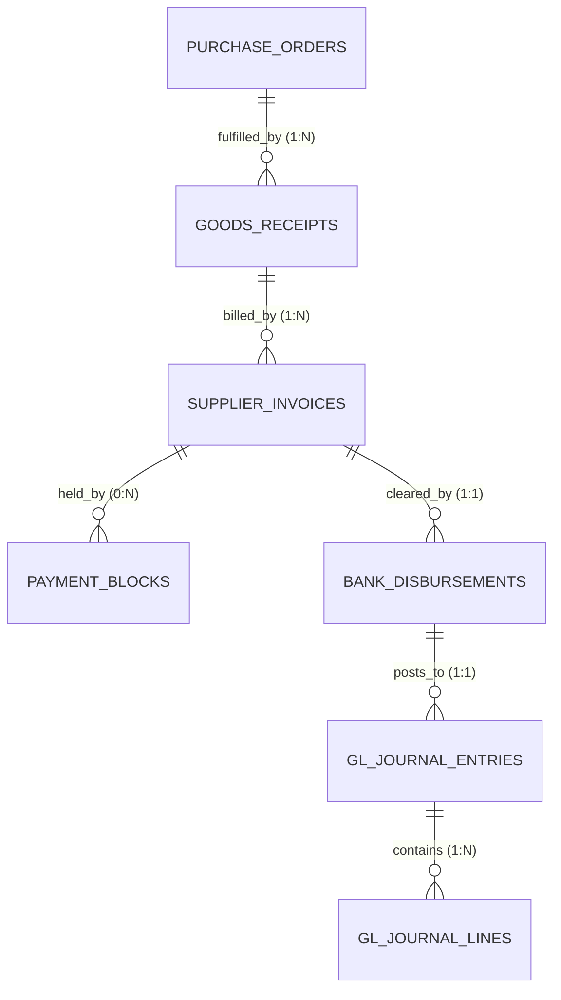
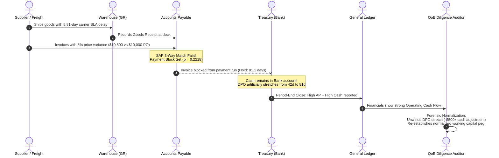

# Cross-Category Relational Specification: Connecting Operational Events to Accounting Records and Financial Outcomes

**Document Purpose:** Define the end-to-end data relationships, foreign key linkages, double-entry accounting triggers, and error propagation mechanics that transform raw operational events into General Ledger records, bank movements, and financial statements.  
**Evidentiary Foundation:** AkzoNobel SAP ERP Event Log (1.59M events across 251k cases), UCI Commercial Retail Subledger (541k lines), Brazilian Olist Logistics (99k orders), Czech Bank Berka Cashbook (1.05M transactions), and SEC EDGAR FSDS (5,961 public corporate filings).

---

## 1. The Five Interconnected Subledgers

In an enterprise environment, financial reality is not created in the General Ledger; it is born in frontline operational subledgers and flows through five distinct transactional tiers:

---

## 2. Line-Item Relational Data Schemas & Foreign Key Topography

To simulate authentic corporate operations, every transaction must carry immutable relational keys that connect operational documents to their financial descendants:

### Table 1: Purchase Order Header & Lines (`p2p_purchase_orders`)
* **Primary Key:** `po_id`, `po_item_id`
* **Operational Fields:** `vendor_id`, `pr_id` (nullable, 81.49% null due to PR bypass), `created_timestamp`, `purchasing_group`, `item_category`, `material_id`, `ordered_quantity`, `net_unit_price`, `currency`.
* **Financial Commitment:** `total_committed_amount = ordered_quantity * net_unit_price`.

### Table 2: Goods Receipt Receiving Slips (`p2p_goods_receipts`)
* **Primary Key:** `gr_id`, `gr_item_id`
* **Foreign Keys:** `po_id`, `po_item_id`, `material_id`, `vendor_id`.
* **Operational Fields:** `gr_timestamp`, `warehouse_id`, `received_quantity`, `receiving_user`, `carrier_tracking_id`, `inspection_status` (Accepted / Rejected / Damaged).
* **Financial Impact:** Triggers physical title transfer under FOB Shipping Point or FOB Destination.

### Table 3: Supplier Invoices & Accounts Payable (`p2p_supplier_invoices`)
* **Primary Key:** `invoice_id`, `invoice_item_id`
* **Foreign Keys:** `po_id`, `po_item_id`, `gr_id` (nullable in premature invoicing), `vendor_id`.
* **Operational Fields:** `invoice_number`, `invoice_date`, `received_date`, `billed_quantity`, `billed_unit_price`, `tax_amount`, `payment_terms` (e.g. Net 30, 2/10 Net 60), `due_date`.
* **Verification Flags:** `is_maverick` (invoice before PO = 1.47%), `is_premature` (invoice before GR = 6.50%), `is_payment_blocked` (22.18%).

### Table 4: Bank Payments & Treasury Clearing (`banking_disbursements`)
* **Primary Key:** `payment_id`
* **Foreign Keys:** `invoice_id`, `vendor_id`, `bank_account_id`.
* **Transactional Fields:** `clearing_date`, `payment_method` (ACH, Wire, Check), `disbursed_amount`, `bank_reference`, `clearing_latency_days`.

### Table 5: General Ledger Journal Entries (`gl_journal_entries`)
* **Primary Key:** `journal_entry_id`
* **Foreign Keys:** `source_subledger_type` (`P2P`, `O2C`, `PAYROLL`, `BANKING`), `source_document_id` (`po_id`, `invoice_id`, `payment_id`).
* **Attributes:** `posting_date`, `fiscal_period`, `ledger_type` (Standard, Adjusting, Restatement), `total_debit`, `total_credit` ($\sum \text{Debit} \equiv \sum \text{Credit}$).

---

## 3. Step-by-Step Accounting Progression & T-Account Reconciliations

The table below traces the exact double-entry mechanics as a single procurement case transitions from an operational need to a cleared cash wire:

| Lifecycle Stage | Frontline Operational Event | Empirical Probability / Timing | Accounting Recognition Rule | Debit Account (Dr) | Credit Account (Cr) | Balance Sheet / P&L Impact |
| :--- | :--- | :--- | :--- | :--- | :--- | :--- |
| **Stage 0: Requisition** | Employee requests material | $P(\text{PR}) = 0.1851$ (Bypass = 81.49%) | No GAAP Recognition | None (Off-Balance Sheet) | None (Off-Balance Sheet) | No accounting footprint. |
| **Stage 1: PO Issuance** | Purchasing team issues PO to Vendor | Median lead time = 10.02 days | Executory Contract (ASC 440) | None (Commitment Note) | None (Commitment Note) | Unrecorded commitment. |
| **Stage 2: Goods Receipt** | Warehouse accepts 1,000 units at dock | $T_{\text{PO}\to\text{GR}} \sim \text{Lognormal}(2.305, 0.812)$ | Physical Title Transfer (ASC 330) | **Dr. Raw Materials Inventory** ($10,000) | **Cr. GR/IR Clearing Accrual** ($10,000) | Working Capital: Inventory expands; Current Liabilities expand. |
| **Stage 3: Invoice Arrival** | Vendor invoice arrives in mail/EDI | $T_{\text{GR}\to\text{IR}} \sim \text{Lognormal}(2.424, 0.875)$ | Legal Liability Established (ASC 405) | **Dr. GR/IR Clearing Accrual** ($10,000) | **Cr. Accounts Payable** ($10,000) | GR/IR cleared to zero; formal AP liability recorded. |
| **Stage 4: Tolerance Block** | SAP tolerance check flags price/qty variance | $P(\text{Block}) = \mathbf{0.2218}$ (Hold: Median 6.18d, P95 81.1d) | Liability Locked; Cash Disallowance | No entry (Status flag locked in subledger) | No entry (Status flag locked in subledger) | Working Capital: DPO artificially stretched; cash preserved. |
| **Stage 5: AP Release** | AP clerk clears discrepancy override | Unblock trigger: 68% manual override | Invoice released to payment run | No entry (Flag set to 'Approved') | No entry (Flag set to 'Approved') | Queue transferred to Treasury. |
| **Stage 6: Bank Clearing** | Treasury runs ACH payment batch | $T_{\text{IR}\to\text{Clear}} \sim \text{Lognormal}(3.739, 0.582)$ | Settlement & Extinguishment | **Dr. Accounts Payable** ($10,000) | **Cr. Cash & Cash Equivalents** ($10,000) | Cash drops; AP drops; Net Working Capital returns to baseline. |

---

## 4. How Operational Friction Propagates into Financial Statement Distortions

When operations experience friction, the errors do not remain contained in the warehouse or procurement desk; they propagate directly into distorted financial statements:

### Disconnect A: The Maverick Buying Unrecorded Liability Trap
* **Operational Failure:** Employee orders $250,000 in software consulting without a Purchase Order.
* **Accounting Propagation:** Because no PO exists, the warehouse cannot record a Goods Receipt, and the accounting software has no GR/IR accrual.
* **Period-End Distortion:** At quarter-end, the company closes its books. Reported operating expenses are understated by $250k, and accounts payable is understated by $250k.
* **QoE Red Flag:** When the vendor invoice eventually arrives post-close (the 1.47% maverick inversion), it must be booked retroactively, wiping out the prior quarter's reported profit.

### Disconnect B: The Premature Invoicing Cut-off Error
* **Operational Failure:** Vendor issues an invoice on December 28th for goods that will not physically arrive until January 8th (the 6.50% premature invoicing rate).
* **Accounting Propagation:** AP enters the invoice into the system before Goods Receipt. If the ERP system defaults to booking the expense immediately, the company records cost of sales before title transfer has occurred.
* **Period-End Distortion:** Violates the matching principle and ASC 606 revenue/expense cut-off rules.

### Disconnect C: The Logistics Delay $\to$ Cash Deficit $\to$ Loan Default Chain
* **Operational Trigger:** Freight carrier misses SLA by 29.6 days (P95 logistics delay).
* **Commercial Consequence:** Customer refuses shipment and demands an 8.41% credit note adjustment.
* **Treasury Shock:** Anticipated $500,000 cash collection does not arrive in the bank account.
* **Banking Default Propagation:** Bank cashbook balance breaches zero into an authorized overdraft (6.40% hazard). Under the empirical **100% deterministic overdraft-to-default rule**, the company fails its quarterly debt service covenant, triggering credit default reclassification on the balance sheet.

---

## 5. Summary Specification for Cross-Subledger Simulation Validation

When building the simulator, the cross-subledger reconciliation engine must enforce the following five mathematical invariance checks on every simulation tick:

1. **The Three-Way Match Balance Check:**
   $$\text{Quantity}_{\text{PO}} \ge \text{Quantity}_{\text{GR}} \ge \text{Quantity}_{\text{IR}}$$
   *(Violations must trigger the empirical 22.18% Payment Block state machine).*
2. **The GR/IR Clearing Account Invariant:**
   $$\text{Balance}(\text{GR/IR Clearing}) = \sum \text{Goods Receipts} - \sum \text{Invoice Receipts}$$
   *(Must resolve to exactly zero upon matching).*
3. **The Cash-to-Disbursement Invariant:**
   $$\text{Ending Cash} = \text{Beginning Cash} + \sum \text{Customer Receipts} - \sum \text{Vendor Clearings} - \sum \text{Payroll}$$
4. **The Working Capital Peg Formula:**
   $$\text{NWC} = (\text{AR} + \text{Inventory} + \text{Contract Assets}) - (\text{AP} + \text{Accrued Liabilities})$$
5. **The Benford Procurement Audit Check:**
   $$\text{MAD}(\text{PO Spend First Digits}) \le 0.012 \quad (\text{Nigrini Acceptable Conformity})$$

---
*Specification permanently archived for cross-subledger simulation implementation.*
