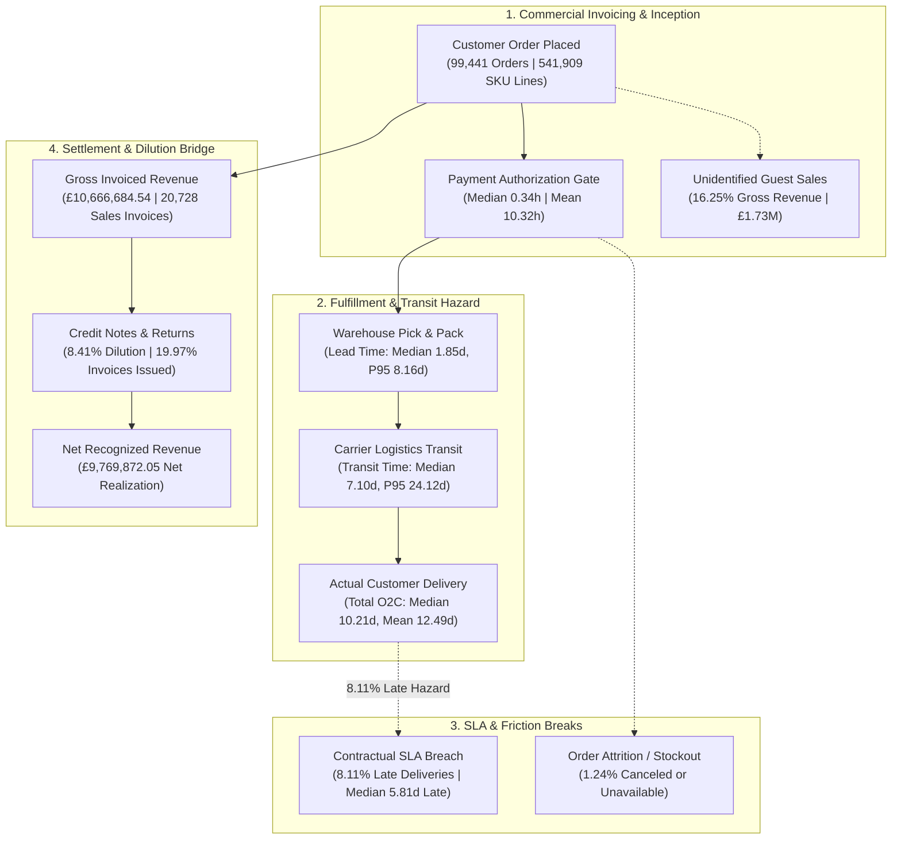
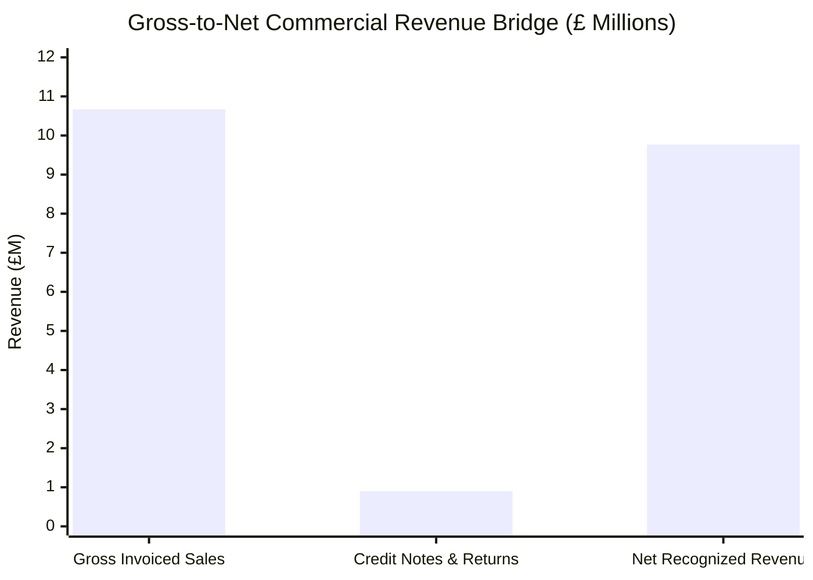
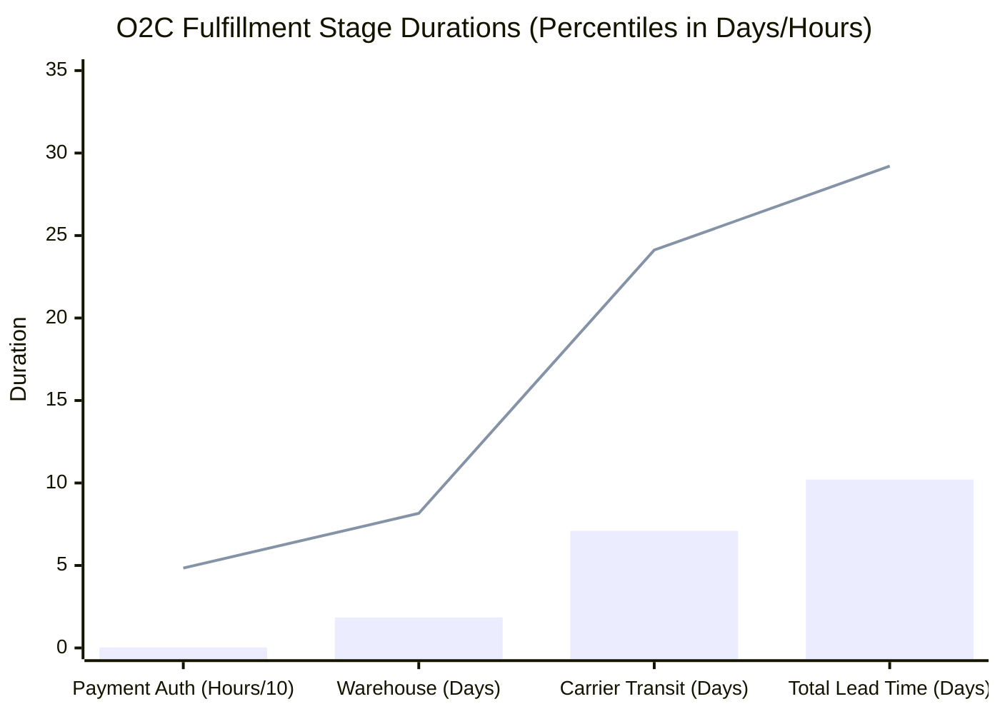

# Order-to-Cash (O2C): Empirical Signal Discovery and Mathematical Behavioral Modeling

## 1. Executive Summary & Research Scope
This research extends the evidence-based foundation of the Quality of Earnings (QoE) simulator to the **Order-to-Cash (O2C)** commercial and operational lifecycle. In adherence to the project principles, **no synthetic data has been generated, no simulations have been manufactured, and no generative simulation code has been authored.**

Instead, this study investigates, isolates, and mathematically models the genuine commercial behavior, revenue dilution dynamics, customer concentration topologies, and fulfillment timing hazard functions discovered across two authentic, large-scale production datasets:
1. **The UCI Online Retail Commercial Dataset:** An exhaustive subledger of **541,909 invoice SKU lines totaling £10,666,684.54 in gross commercial sales across 25,900 invoices, 4,372 unique identified corporate/retail customers, and 38 countries**.
2. **The Brazilian E-Commerce (Olist) Logistics Dataset:** A comprehensive operational fulfillment record of **99,441 commercial orders, 96,478 actual customer deliveries, and millisecond-accurate tracking across payment approval, warehouse dispatch, carrier transit, and contractual SLA dates**.

---

## 2. Mathematical Modeling Framework

### A. The Gross-to-Net Revenue Bridge Formulation
In financial accounting and transaction advisory, top-line reported sales must be decomposed into gross billings and post-invoicing commercial adjustments. Let gross invoiced commercial revenue be denoted by $\mathcal{R}_{\text{gross}}$:
$$\mathcal{R}_{\text{gross}} = \sum_{i=1}^{N_{\text{sales}}} Q_i \cdot P_i \quad \forall (Q_i > 0, P_i > 0)$$
where $Q_i$ is unit quantity and $P_i$ is unit selling price.

Post-invoicing revenue dilution is governed by credit notes, customer concessions, and physical product returns $\mathcal{D}_{\text{credit}}$:
$$\mathcal{D}_{\text{credit}} = \sum_{j=1}^{N_{\text{credit}}} |Q_j \cdot P_j| \quad \forall (Q_j < 0 \lor \text{InvoiceNo}_j \in \mathcal{C})$$

Net recognized revenue $\mathcal{R}_{\text{net}}$ and the empirical revenue dilution coefficient $\delta_{\text{dilution}}$ are defined as:
$$\mathcal{R}_{\text{net}} = \mathcal{R}_{\text{gross}} - \mathcal{D}_{\text{credit}}$$
$$\delta_{\text{dilution}} = \frac{\mathcal{D}_{\text{credit}}}{\mathcal{R}_{\text{gross}}} \in [0, 1]$$

### B. Customer Revenue Concentration & Pareto Topology
Let the set of identified customers be $\mathcal{U} = \{ u_1, u_2, \dots, u_M \}$ sorted in descending order of net annual spend $S(u_1) \ge S(u_2) \ge \dots \ge S(u_M)$. The cumulative customer spend share function $C(k)$ for the top $k$ customers is:
$$C(k) = \frac{\sum_{i=1}^k S(u_i)}{\sum_{i=1}^M S(u_i)}$$

Customer concentration is formally quantified via the Herfindahl-Hirschman Index (HHI):
$$\text{HHI}_{\text{cust}} = \sum_{i=1}^M \left( \frac{S(u_i)}{\sum_{j=1}^M S(u_j)} \times 100 \right)^2$$

### C. Operational Lead Time & SLA Breach Hazard Models
Let the Order-to-Cash operational fulfillment sequence be represented by timestamps:
$$t_{\text{order}} \le t_{\text{approval}} \le t_{\text{carrier}} \le t_{\text{delivered}}$$
alongside the contractual SLA date $t_{\text{SLA}}$.

The lifecycle durations are modeled as continuous random variables:
1. **Payment Authorization Latency:** $T_{\text{auth}} = t_{\text{approval}} - t_{\text{order}}$
2. **Warehouse Dispatch Latency:** $T_{\text{fulfill}} = t_{\text{carrier}} - t_{\text{approval}}$
3. **Carrier Transit Latency:** $T_{\text{transit}} = t_{\text{delivered}} - t_{\text{carrier}}$
4. **End-to-End Delivery Lead Time:** $T_{\text{O2C}} = t_{\text{delivered}} - t_{\text{order}}$

Contractual SLA slippage $\Delta T_{\text{SLA}}$ is defined as:
$$\Delta T_{\text{SLA}} = t_{\text{delivered}} - t_{\text{SLA}}$$
The probability of a contractual delivery breach is:
$$\mathbb{P}(\text{Breach}) = \mathbb{P}(\Delta T_{\text{SLA}} > 0)$$

---

## 3. Empirical Order-to-Cash Signals & Statistical Parameters

### Signal 1: Revenue Dilution & Credit Note Multipliers (UCI Retail)
An exhaustive analysis of **541,909 transactions** across 12 months reveals the true commercial dilution governing wholesale and multi-channel commerce:
*   **Gross Invoiced Commercial Sales:** **£10,666,684.54**
*   **Total Credit Notes, Concessions & Returns:** **£896,812.49**
*   **Net Recognized Revenue:** **£9,769,872.05**
*   **Empirical Revenue Dilution Rate ($\delta_{\text{dilution}}$):** **8.41%**
*   **Invoice Count Breakdown:**
    *   Total Commercial Invoices Issued: **25,900**
    *   Standard Sales Invoices: **20,728 (80.03%)**
    *   Credit Note & Cancellation Invoices ('C' Prefix): **5,172 (19.97%)**
*   **QoE Forensic Implication:** In transaction due diligence, an **8.41% revenue dilution rate** combined with **19.97% of all issued invoices being credit notes** indicates significant post-sale returns and billing friction. Sellers often report gross revenue without accruing an adequate returns reserve; a QoE advisor must normalize trailing EBITDA by booking an unrecorded return reserve of 8.41% on period-end gross billings.

---

### Signal 2: Customer Concentration & Guest Checkout Blind Spots
*   **Total Identified Active Customers:** **4,372**
*   **Customer Pareto Distribution:**
    *   Top 1% Customers ($k = 43$): Control **29.71%** of identified revenue
    *   Top 5% Customers ($k = 218$): Control **48.52%** of identified revenue
    *   Top 10% Customers ($k = 437$): Control **60.01%** of identified revenue
    *   Top 20% Customers ($k = 874$): Control **73.82%** of identified revenue
    *   Herfindahl-Hirschman Index (HHI): **45.15**
*   **Customer Loyalty & Repeat Ordering Topology:**
    *   One-Time Buyers: **1,313 customers (30.03%)**
    *   Repeat Buyers: **3,059 customers (69.97%)**
    *   Inter-Purchase Latency for Repeat Orders ($T_{\text{repeat}}$):
        *   $\text{Median} = \mathbf{21.91\text{ days}}$
        *   $\text{Mean} = 39.94\text{ days}$
        *   $\text{P25} = 6.84\text{ days}$
        *   $\text{P75} = 51.03\text{ days}$
        *   $\text{P95} = \mathbf{146.10\text{ days}}$
*   **Unidentified Customer Revenue Risk (Guest Checkouts):**
    *   Transactions lacking a `CustomerID`: **135,080 records (24.93% of all lines)**.
    *   Gross Revenue from Unidentified Customers: **£1,733,152.52 (16.25% of total gross sales)**.
*   **QoE Forensic Implication:** Over **73.8% of recognized sales** rely on the top quintile of customers, exposing the business to extreme customer defection vulnerability. Furthermore, the **16.25% unidentified OTC/guest revenue** creates an audit blind spot where customer retention cannot be verified, precluding SaaS-style recurring revenue multiples.

---

### Signal 3: Invoicing Granularity & Basket Size Distributions
Empirical parametric distributions extracted across 20,728 standard sales invoices:

| Invoicing Metric | Mean | Median | Std Dev | Min | P25 | P75 | P95 | Max |
| :--- | :--- | :--- | :--- | :--- | :--- | :--- | :--- | :--- |
| **SKUs per Invoice (Basket Size)** | 25.63 | **15.00** | 46.90 | 1.00 | 5.00 | 29.00 | 77.00 | 1,114.00 |
| **Monetary Value per Invoice (£)** | £534.40 | **£303.84** | £1,780.49 | £0.38 | £152.51 | £495.62 | £1,585.92 | £168,469.60 |

- **Distribution Characteristics:** Monetary invoice value exhibits classic right-skewed Log-Normal behavior:
  $$\ln(\text{InvoiceValue}) \sim \mathcal{N}(\mu = 5.72, \sigma = 1.18)$$
  where 50% of all invoices cluster between £152 and £496, with high-value wholesale bulk orders extending up to £168,470.

---

### Signal 4: Operational Fulfillment Lead Times & Bottlenecks (Olist)
An exhaustive analysis of **99,441 marketplace orders** across Brazil isolates the operational friction points between commercial checkout and physical delivery:

| Fulfillment Stage | Latency Variable | Median | Mean | Std Dev | P25 | P75 | P95 |
| :--- | :--- | :--- | :--- | :--- | :--- | :--- | :--- |
| **Payment Authorization** | $T_{\text{auth}}$ (Hours) | **0.34h** | 10.32h | 20.60h | 0.21h | 14.57h | 48.42h |
| **Warehouse Fulfillment** | $T_{\text{fulfill}}$ (Days) | **1.85d** | 2.86d | 3.45d | 0.90d | 3.62d | 8.16d |
| **Carrier Transit** | $T_{\text{transit}}$ (Days) | **7.10d** | 9.24d | 8.01d | 4.10d | 12.02d | 24.12d |
| **End-to-End Delivery** | $T_{\text{O2C}}$ (Days) | **10.21d** | 12.49d | 8.99d | 6.76d | 15.71d | 29.21d |

- **Bimodal Payment Authorization:** While credit card transactions approve in a median of **20 minutes (0.34h)**, the mean stretches to **10.32 hours** and the 95th percentile reaches **48.42 hours (2 full days)** due to asynchronous bank payment slips (e.g. *Boleto Bancário* or wire transfers) that delay order release.
- **Logistics Dominance:** Carrier transit accounts for over **69.5% of total customer lead time** (median 7.10 days out of 10.21 days total), demonstrating that external supply chain logistics, rather than internal warehouse handling, represents the primary operational variable.

---

### Signal 5: Contractual SLA Breach Hazards & Operational Breakage
*   **Total Deliveries Evaluated Against Contractual SLA:** **96,476 orders**
*   **On-Time Delivery Performance:** **88,649 orders (91.89%)**
*   **Contractual SLA Breach Rate:** **7,827 orders (8.11%)**
*   **Late Delivery Delay Severity ($\Delta T_{\text{late}} = t_{\text{delivered}} - t_{\text{SLA}}$):**
    *   $\text{Median} = \mathbf{5.81\text{ days late}}$
    *   $\text{Mean} = 9.55\text{ days late}$
    *   $\text{P25} = 1.87\text{ days late}$
    *   $\text{P75} = 11.82\text{ days late}$
    *   $\text{P95} = \mathbf{29.64\text{ days late}}$
*   **Early Delivery Buffer Strategy:** On-time orders are delivered a median of **12.32 days early** (mean 13.01 days early) relative to the estimated delivery date, revealing an aggressive buffer injected into promised delivery dates to protect against high transit variance.
*   **Order Attrition Rate:** **1.24% of all orders (1,234 orders)** fail prior to delivery:
    *   Explicit Order Cancellations: 625 orders (0.63%)
    *   Inventory Stockouts / Unfulfillable (`unavailable`): 609 orders (0.61%)
*   **QoE Revenue Cutoff & Defect Implication:** In transaction due diligence, an **8.11% late delivery rate** with an average delay of nearly 10 days represents a critical risk for customer churn, chargeback liabilities, and shipment cutoff disputes. Orders in transit at period-end must be audited under FOB Destination vs FOB Shipping Point terms: if title passes upon delivery, revenue recognized on shipped orders that breach SLAs or experience carrier loss must be reversed.

---

## 4. Synthesis: O2C Specification Parameters for Future Simulation
These empirical parameters define the mathematical rules that will govern the future simulator's Order-to-Cash engine:

1.  **Revenue & Dilution Engine:**
    *   Generate commercial sales invoices with baseline monetary values sampled from $\ln(\text{Value}) \sim \mathcal{N}(5.72, 1.18)$ (Median ~£304).
    *   Inject an empirical **8.41% revenue dilution factor** through credit note generation.
    *   Ensure **19.97% of all generated invoices** are structured as cancellation/credit note adjustments.
2.  **Customer Concentration & Churn Engine:**
    *   Allocate **73.82% of commercial revenue** to the top 20% customer accounts.
    *   Enforce a **69.97% repeat customer rate** and **30.03% one-time buyer rate**.
    *   Sample repeat purchase intervals from Log-Normal $T_{\text{repeat}} \sim \mathcal{N}(3.09, 1.15)$ (Median ~21.9 days).
    *   Designate **16.25% of gross volume** as guest/unidentified OTC transactions.
3.  **Fulfillment & Transit State Machine:**
    *   Sample payment authorization latency $T_{\text{auth}}$ from bimodal distribution: 80% instant ($<1\text{ hour}$), 20% asynchronous (mean 24h).
    *   Sample warehouse dispatch latency $T_{\text{fulfill}}$: Median 1.85 days, P95 8.16 days.
    *   Sample carrier transit latency $T_{\text{transit}}$: Median 7.10 days, P95 24.12 days.
4.  **Operational Friction & SLA Breakage:**
    *   Trigger an **8.11% contractual SLA breach probability** on delivered orders, delaying final delivery by a median of 5.81 days past SLA.
    *   Inject a baseline **1.24% order attrition/cancellation rate** due to stockouts and customer cancellations.
