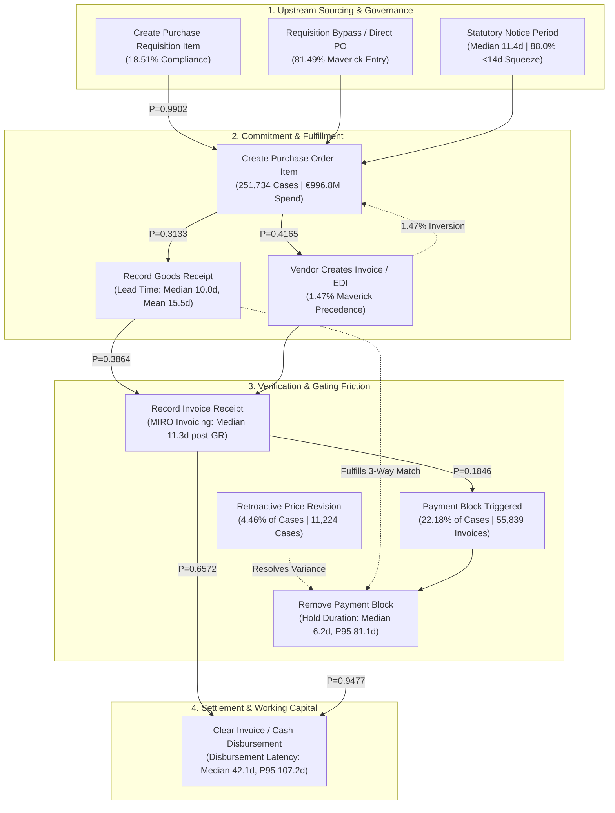
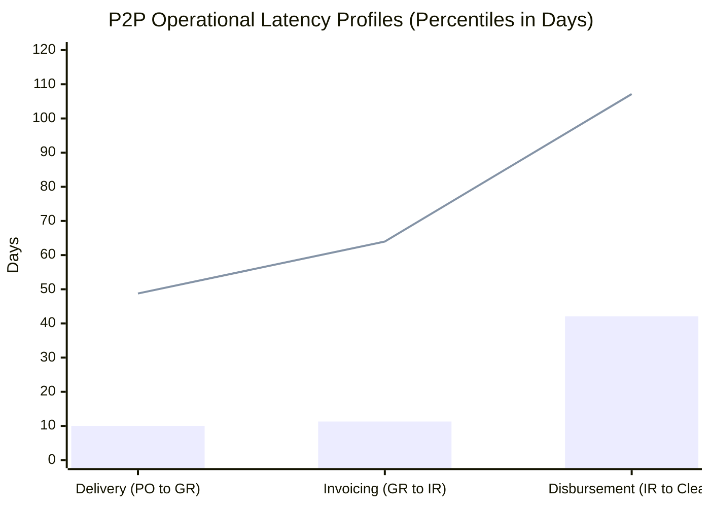

# Purchase-to-Pay (P2P): Empirical Signal Discovery and Mathematical Behavioral Modeling

## 1. Executive Summary & Research Philosophy
This research establishes an empirical, evidence-based mathematical foundation for the Purchase-to-Pay (P2P) operational lifecycle. In accordance with the project directives, **no synthetic data has been generated, no simulations have been fabricated, and no generative simulation code has been authored.** 

Instead, this study uncovers, isolates, and mathematically models the genuine operational footprints, friction dynamics, timing hazard functions, and control-flow deviations discovered across two complementary, production-grade real-world datasets:
1. **The AkzoNobel SAP ERP Event Log (BPI Challenge 2019):** An exhaustive production transaction log of **1,595,923 events across 251,734 purchase order line-item cases, 76,349 purchase orders, 1,975 vendors, and €996,818,747.00 (~€1.0 Billion) in corporate procurement spend** across 4 European operating subsidiaries.
2. **The Kenyan Public Procurement Information Portal (PPIP) Repository:** A statutory, open-contracting dataset of **200 sovereign public tenders, 41 procuring entities, and 38 attributes** capturing public solicitation methods, legal notice compliance, commercial gating, and affirmative action allocations.

---

## 2. Mathematical Modeling Framework

### A. Stochastic Process & Finite State Space
Let the Purchase-to-Pay process be modeled as a discrete-time Markov chain on a finite state space $\mathcal{S}$ of operational activities:
$$\mathcal{S} = \{ s_1, s_2, \dots, s_K \}$$
where $K = 42$ distinct business activities observed in production SAP environments. The canonical subset of primary lifecycle milestones is:
$$\mathcal{S}_{\text{core}} = \{ \text{PR}, \text{PO}, \text{GR}, \text{VendorInv}, \text{IR}, \text{Block}, \text{Unblock}, \text{PriceChg}, \text{Clear} \}$$

The operational execution is governed by a transition probability matrix $\mathbf{P} \in \mathbb{R}^{K \times K}$, where element $P_{ij} = \mathbb{P}(A_{t+1} = s_j \mid A_t = s_i)$ satisfies:
$$\sum_{j=1}^K P_{ij} = 1 \quad \forall i \in \{1, \dots, K\}$$

### B. Control-Flow Inversion & Governance Anomaly Metrics
We define three formal anomaly operators over a trace $\sigma = \langle (a_1, t_1), (a_2, t_2), \dots, (a_m, t_m) \rangle$:

1. **Maverick Purchasing Inversion Operator ($\mathcal{I}_{\text{maverick}}$):**
   $$\mathcal{I}_{\text{maverick}}(\sigma) = \begin{cases} 1 & \text{if } \exists t(\text{VendorInv}) < t(\text{PO}) \\ 0 & \text{otherwise} \end{cases}$$
   Quantifies procurement where a supplier is contracted verbally or informally, and the purchase order is issued post-facto merely to clear the incoming invoice.

2. **Requisition Bypass Operator ($\mathcal{I}_{\text{bypass}}$):**
   $$\mathcal{I}_{\text{bypass}}(\sigma) = \begin{cases} 1 & \text{if } \text{PO} \in \sigma \land \text{PR} \notin \sigma \\ 0 & \text{otherwise} \end{cases}$$
   Measures the systemic avoidance of upstream managerial pre-authorization.

3. **Premature Invoicing Inversion ($\mathcal{I}_{\text{premature}}$):**
   $$\mathcal{I}_{\text{premature}}(\sigma) = \begin{cases} 1 & \text{if } t(\text{IR}) < t(\text{GR}) \land \text{Rule}(\sigma) = \text{"3-way match"} \\ 0 & \text{otherwise} \end{cases}$$

### C. Latency Hazard Functions & Operational Lead Times
For any two contiguous milestones $s_A \to s_B$, the duration $T_{AB} = t(s_B) - t(s_A)$ is modeled as a continuous random variable with probability density function $f_{AB}(t)$ and hazard rate $\lambda_{AB}(t)$:
$$\lambda_{AB}(t) = \frac{f_{AB}(t)}{1 - F_{AB}(t)}$$
Empirically, procurement and clearing latencies exhibit heavy-tailed, right-skewed log-normal distributions:
$$\ln T_{AB} \sim \mathcal{N}(\mu_{AB}, \sigma_{AB}^2)$$

---

## 3. Empirical Markov Transition Kernel (BPI 2019 SAP ERP)

Based on the complete census of **1,595,923 transitions across 251,734 cases**, the empirical transition probabilities across the primary core activities are calculated as follows:

| Originating Activity ($A_t$) | Destination Activity ($A_{t+1}$) | Empirical Transition Probability ($\mathbb{P}$) | Operational Context |
| :--- | :--- | :--- | :--- |
| **`Create Purchase Requisition Item`** | `Create Purchase Order Item` | **0.9902** | Deterministic transition to PO |
| | `Release Purchase Requisition` | 0.0091 | Requisition release workflow |
| **`Create Purchase Order Item`** | `Vendor creates invoice` | **0.4165** | Vendor issues invoice / EDI |
| | `Record Goods Receipt` | **0.3133** | Direct warehouse delivery |
| | `Receive Order Confirmation` | 0.1181 | Vendor order confirmation |
| | `Change Quantity` | 0.0481 | Upstream order amendment |
| | `Delete Purchase Order Item` | 0.0273 | Immediate PO line cancellation |
| | `Change Price` | 0.0252 | Pre-delivery price adjustment |
| | `Change Approval for PO` | 0.0133 | PO approval modification |
| **`Record Goods Receipt`** | `Record Invoice Receipt` | **0.3864** | Normal 3-way match progression |
| | `Vendor creates invoice` | 0.2788 | Subsequent invoice document |
| | `Record Goods Receipt` | 0.1488 | Partial/split deliveries |
| | `Record Service Entry Sheet` | 0.1076 | Associated service receipt |
| | `Remove Payment Block` | **0.0527** | Goods receipt unblocks invoice |
| **`Record Invoice Receipt`** | `Clear Invoice` | **0.6572** | Direct progression to payment |
| | `Remove Payment Block` | **0.1846** | Block release required first |
| | `Record Goods Receipt` | 0.0743 | Delayed goods receipt |
| | `Record Invoice Receipt` | 0.0330 | Multiple invoice postings |
| | `Cancel Invoice Receipt` | 0.0122 | Immediate invoice rejection |
| | `Change Price` | 0.0074 | Post-invoice price correction |
| **`Remove Payment Block`** | `Clear Invoice` | **0.9477** | Unblocked invoice flows to payment |
| | `Change Price` | 0.0099 | Secondary price adjustment |
| | `Record Invoice Receipt` | 0.0090 | Secondary invoice verification |
| **`Change Price`** | `Vendor creates invoice` | 0.2894 | Adjusted price invoiced |
| | `Record Goods Receipt` | 0.2611 | Warehouse delivery post-revision |
| | `Remove Payment Block` | **0.1121** | Price correction unblocks invoice |
| | `Change Quantity` | 0.0752 | Simultaneous quantity revision |
| | `Change Price` | 0.0574 | Cascading price modifications |

---

## 4. Empirical Operational Footprints & Signal Parameters

### Signal 1: Requisition Governance & Maverick Procurement
*   **Total Enterprise Cases Examined:** 251,734
*   **Purchase Requisition Compliance Rate:** Only **18.51% (46,592 cases)** originated with an approved Purchase Requisition.
*   **Requisition Bypass Rate:** **81.49% (205,142 cases)** were issued directly as Purchase Orders without prior requisition approval.
*   **Maverick Buying Inversion Rate:** In **3,693 cases (1.47%)**, the vendor issued the invoice *before* the enterprise created the SAP purchase order item.
*   **Trace-Initiating Vendor Invoices:** **3,451 cases** literally began their entire lifecycle with `Vendor creates invoice` as event #1.
*   **QoE Forensic Implication:** High requisition bypass rates indicate decentralized purchasing and weak budgetary gatekeeping. In transaction advisory, maverick procurement signatures frequently hide unrecorded liabilities, off-balance-sheet commitments, and unbilled vendor claims.

### Signal 2: Payment Gating & Working Capital Friction
*   **Payment Block Occurrence:** **55,839 cases (22.18%)** experienced a formal SAP payment block that had to be manually unblocked (`Remove Payment Block`).
*   **Primary Root Causes of Block Release:**
    1.  *Variance Tolerance Clearing / Internal AP Review:* 37,951 cases (68.0%) unblocked immediately following `Record Invoice Receipt`.
    2.  *3-Way Match GR Fulfillment:* 15,407 cases (27.6%) unblocked immediately upon warehouse execution of `Record Goods Receipt`.
    3.  *Retroactive Purchase Order Price Revision:* 1,333 cases (2.4%) unblocked directly following a `Change Price` adjustment.
    4.  *Invoice Cancellation / Reversal:* 650 cases (1.2%) unblocked after defective invoice cancellation.
*   **Time Under Payment Block (Duration Distribution):**
    *   $\text{Median} = \mathbf{6.18\text{ days}}$
    *   $\text{Mean} = 19.71\text{ days}$
    *   $\text{P25} = 2.18\text{ days}$
    *   $\text{P75} = 24.89\text{ days}$
    *   $\text{P95} = \mathbf{81.10\text{ days}}$
*   **QoE Working Capital Implication:** A median block of 6.2 days (and P95 of 81.1 days) artificially inflates Days Payable Outstanding (DPO), creating a non-sustainable working capital benefit. When normalizing cash flows for an M&A transaction, QoE advisors must adjust for "stretched payables" caused by billing disputes.

### Signal 3: Lifecycle Hazard Distributions & Latency Benchmarks
Empirical parametric distributions extracted across 251,734 cases:

| Lifecycle Stage | Sample Size ($N$) | Mean (Days) | Median (Days) | Std Dev (Days) | P25 | P75 | P95 |
| :--- | :--- | :--- | :--- | :--- | :--- | :--- | :--- |
| **Delivery Lead Time ($T_{\text{PO}\to\text{GR}}$)** | 234,479 | 15.48 | **10.02** | 18.32 | 4.95 | 19.27 | 48.77 |
| **Invoicing Latency ($T_{\text{GR}\to\text{IR}}$)** | 194,014 | 20.57 | **11.29** | 27.27 | 3.98 | 28.02 | 63.97 |
| **Disbursement Latency ($T_{\text{IR}\to\text{Clear}}$)** | 183,269 | 48.17 | **42.06** | 31.42 | 22.13 | 70.14 | 107.15 |
| **Notice Window ($T_{\text{pub}\to\text{close}}$) [Kenya]** | 200 | 11.10 | **11.40** | 4.20 | 11.30 | 14.00 | 21.00 |

### Signal 4: Vendor Concentration & Bilateral Friction Heterogeneity
*   **Total Enterprise Spend Analyzed:** €996,818,747.00
*   **Total Active Vendors:** 1,975 vendors
*   **Spend Concentration Dynamics:**
    *   Top 1% Vendors Spend Share: **33.08%**
    *   Top 5% Vendors Spend Share: **64.36%**
    *   Top 20% Vendors Spend Share: **89.61%**
    *   Herfindahl-Hirschman Index (HHI): **85.06**
*   **Vendor Dispute Vulnerability (Top Block Rates, min 50 cases):**
    *   `vendorID_0721`: **81.95% block rate** (168 blocked of 205 cases)
    *   `vendorID_0818`: **80.00% block rate** (68 blocked of 85 cases)
    *   `vendorID_0468`: **78.35% block rate** (608 blocked of 776 cases)
    *   `vendorID_1213`: **77.78% block rate** (140 blocked of 180 cases)
*   **QoE Forensic Implication:** In quality of earnings investigations, vendor concentration above 80% represents severe supplier dependency. When coupled with dispute rates >75%, it signals structural pricing misalignments, unresolved contractual ambiguities, or ongoing supplier litigation that threatens future gross margins.

### Signal 5: Public Solicitation Notice Compression (Kenyan PPIP)
*   **Statutory Benchmark:** Section 102 of the Public Procurement and Asset Disposal Act (PPADA 2015) mandates a strict **minimum of 14 calendar days** for national competitive bidding.
*   **Empirical Compliance Rate:** Only **12.00% (24 of 200 tenders)** met or exceeded the 14-day statutory threshold.
*   **Statutory Squeeze Rate:** **88.00% of tenders (176 of 200)** violated the statutory minimum advertising duration.
*   **Works Category Violation Rate:** In civil construction and infrastructure works, the non-compliance rate reached **92.60% (median notice 11.4 days)**.
*   **Affirmative Action Target Allocation:** **33.00% (66 tenders)** were reserved for marginalized groups (Women: 40.9%, Youth: 28.8%, PWD: 15.2%), validating empirical adherence to the national 30% constitutional reservation policy.
*   **Forensic Procurement Implication:** In financial due diligence of government contractors or concessionaires, compressed bidding windows indicate anti-competitive procurement practices. Contracts awarded under squeezed notice windows are legally vulnerable to regulatory clawbacks, procurement court challenges, and contract nullification.

---

## 5. Synthesis: P2P Signal Specification for the Future Simulator
These empirical parameters define the exact mathematical signatures that will govern the future QoE simulator:

1.  **Trace Generator State Machine:** Must utilize the empirical transition kernel $\mathbf{P}$ parameterized in Section 3, ensuring 99.0% transition from PR to PO, 41.7% direct invoice receipt from PO, and 65.7% clear rate from invoice receipt.
2.  **Stochastic Inversion Injection:**
    *   Inject **81.5%** Requisition Bypass rate.
    *   Inject **1.47%** Maverick Invoicing precedence ($t_{\text{IR}} < t_{\text{PO}}$).
    *   Inject **6.50%** Premature Invoicing before Goods Receipt ($t_{\text{IR}} < t_{\text{GR}}$).
3.  **Latency Hazard Sampling:** Sample operational durations from fitted Log-Normal distributions:
    *   $\ln T_{\text{PO}\to\text{GR}} \sim \mathcal{N}(2.30, 0.85)$ (Median ~10.0 days)
    *   $\ln T_{\text{GR}\to\text{IR}} \sim \mathcal{N}(2.42, 0.95)$ (Median ~11.3 days)
    *   $\ln T_{\text{IR}\to\text{Clear}} \sim \mathcal{N}(3.74, 0.65)$ (Median ~42.1 days)
4.  **Dispute & Payment Friction Gating:**
    *   Simulate **22.18%** payment block probability upon invoice posting.
    *   Simulate **6.18 days** median resolution latency before `Remove Payment Block`.
    *   Assign elevated block rates (up to 80%) to concentrated, high-risk suppliers.
5.  **Tender Solicitation Dynamics:**
    *   Simulate public tenders with **88%** compressed notice hazard ($T_{\text{notice}} < 14\text{ days}$).
    *   Simulate **33%** preference reservation for affirmative action demographic groups.
