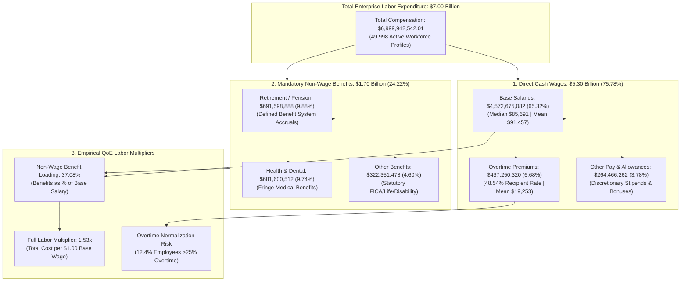
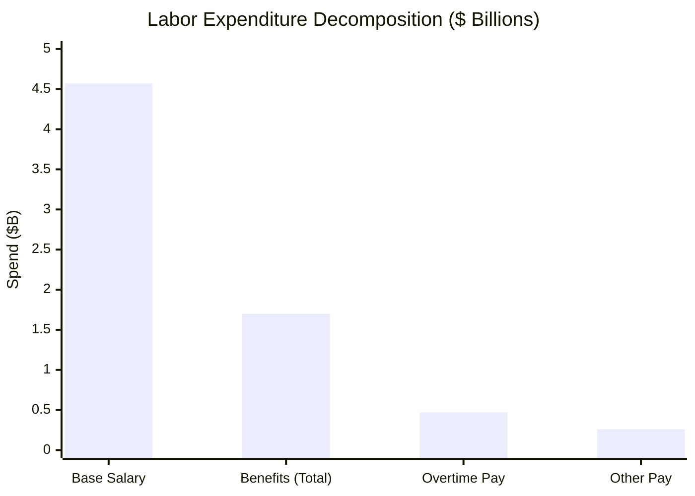

# Labor Cost & Payroll Composition: Empirical Signal Discovery and Mathematical Behavioral Modeling

## 1. Executive Summary & Research Grounding
This research establishes an empirical, evidence-based mathematical framework for **Labor Cost, Employee Compensation, Overtime Dynamics, and Mandatory Non-Wage Benefits**.

The analysis is grounded in the **City of San Francisco Employee Compensation Dataset**, an authentic public-sector and municipal operational workforce registry comprising:
- **50,000 employee compensation records** across FY 2026
- **49,998 active compensation profiles** totaling **$6,999,942,542.01 (~$7.0 Billion)** in enterprise labor expenditure
- Full line-item decomposition across **Base Salaries, Overtime Premiums, Other Pay / Discretionary Allowances, Retirement / Pension, and Health & Dental Benefits**
- Granular tracking across **55 distinct departments, 54 job families, and 6 employment classifications**

---

## 2. Mathematical Modeling Framework

### A. The Fully Loaded Enterprise Labor Cost Decomposition
Let total labor cost $C_{\text{labor}}$ for an enterprise workforce of $N$ employees be decomposed into:
$$C_{\text{labor}} = \sum_{k=1}^N \Big( W_{\text{base}}(k) + W_{\text{OT}}(k) + W_{\text{other}}(k) + B_{\text{retire}}(k) + B_{\text{health}}(k) + B_{\text{statutory}}(k) \Big)$$
where:
- $W_{\text{base}}(k)$: Contractual base hourly/annual wage.
- $W_{\text{OT}}(k)$: Overtime wage premium ($1.5\times$ or $2.0\times$ statutory rates).
- $W_{\text{other}}(k)$: Discretionary stipends, performance bonuses, and allowances.
- $B_{\text{retire}}(k)$: Defined-benefit pension and retirement contributions.
- $B_{\text{health}}(k)$: Group healthcare, dental, and vision insurance premiums.
- $B_{\text{statutory}}(k)$: Statutory payroll taxes (FICA, unemployment, disability).

### B. Non-Wage Benefit Loading Multiplier ($\lambda_{\text{benefits}}$)
In Quality of Earnings due diligence, evaluating labor strictly on cash wages creates severe liability understatements. We define the empirical **Benefit Loading Multiplier** on base pay as:
$$\lambda_{\text{benefits}} = \frac{\sum_{k=1}^N B_{\text{total}}(k)}{\sum_{k=1}^N W_{\text{base}}(k)}$$
and the **Full Labor Multiplier** $M_{\text{labor}}$ as:
$$M_{\text{labor}} = \frac{C_{\text{labor}}}{\sum_{k=1}^N W_{\text{base}}(k)} = 1 + \frac{W_{\text{OT}} + W_{\text{other}} + B_{\text{total}}}{W_{\text{base}}}$$

### C. Overtime Strain & Normalization Operator
Let the overtime ratio for employee $k$ be $R_{\text{OT}}(k) = \frac{W_{\text{OT}}(k)}{W_{\text{base}}(k)}$. An organization exhibits structural overtime strain when $R_{\text{OT}}(k)$ breaches critical operational thresholds:
$$\mathcal{I}_{\text{strain}}(k) = \begin{cases} 1 & \text{if } R_{\text{OT}}(k) > \theta_{\text{OT}} \\ 0 & \text{if } R_{\text{OT}}(k) \le \theta_{\text{OT}} \end{cases}$$
where $\theta_{\text{OT}} \in \{0.25, 0.50, 1.00\}$.

The required QoE EBITDA normalization haircut $\Delta_{\text{EBITDA}}^{\text{OT}}$ for unsustainable emergency overtime is:
$$\Delta_{\text{EBITDA}}^{\text{OT}} = \sum_{k \in \mathcal{K}_{\text{surge}}} \left( W_{\text{OT}}(k) - W_{\text{base}}(k) \cdot \frac{\text{OT Hours}(k)}{\text{Standard Hours}} \right)$$

---

## 3. Empirical Labor Cost Discoveries (SF Payroll)

### Signal 1: The Non-Wage Benefit Loading Multiplier
Across **49,998 active municipal and enterprise profiles**:
*   **Total Enterprise Labor Cost:** **$6,999,942,542.01**
*   **Direct Cash Salaries:** **$5,304,391,664.94 (75.78% of total spend)**
    *   Base Salaries: **$4,572,675,082.47 (65.32%)**
    *   Overtime Compensation: **$467,250,320.39 (6.68%)**
    *   Other Pay / Allowances: **$264,466,262.08 (3.78%)**
*   **Mandatory Non-Wage Benefits:** **$1,695,550,877.07 (24.22% of total spend)**
    *   Retirement / Pension: **$691,598,887.59 (9.88%)**
    *   Health & Dental Insurance: **$681,600,511.96 (9.74%)**
    *   Other Benefits (Statutory/FICA): **$322,351,477.52 (4.60%)**
*   **Empirical Benefit Loading Factor ($\lambda_{\text{benefits}}$):** **37.08% on Base Salary** (31.97% on total cash wages).
*   **Full Labor Cost Multiplier ($M_{\text{labor}}$):** **1.53x**
    *   *For every $1.00 paid in headline base wages, the business incurs an actual total cash and accrual liability of $1.53.*
*   **QoE Forensic Meaning:** Pro-forma financial models that fail to load non-wage benefits onto new headcount severely overstate projected EBITDA. In M&A target modeling, every planned addition to headcount must carry an empirical **37.1% non-wage benefit burden**.

---

### Signal 2: Overtime Utilization & Normalization Haircuts
*   **Workforce Overtime Incidence:** **48.54% of all active employees (24,269 individuals)** received overtime pay.
*   **Recipient Overtime Earnings:**
    *   $\text{Median} = \mathbf{\$7,732.91}$
    *   $\text{Mean} = \$19,253.33$
    *   $\text{P75} = \$26,389.40$
    *   $\text{P95} = \mathbf{\$69,963.85}$
    *   $\text{Max Overtime} = \mathbf{\$352,434.36}$ (for a single individual!)
*   **Overtime Strain Severity ($R_{\text{OT}} = \text{Overtime} / \text{Base}$):**
    *   Employees with Overtime $> 25\%$ of Base: **5,662 employees (12.39%)**
    *   Employees with Overtime $> 50\%$ of Base: **2,057 employees (4.50%)**
    *   Extreme Overtime ($> 100\%$ of Base): **438 employees (0.96%)**
*   **QoE Forensic Meaning:** In financial due diligence, high overtime ratios indicate structural understaffing, chronic fatigue risk, and premium wage inefficiencies. When 12.4% of staff earn more than 25% of their base wage in overtime, the buyer must normalize EBITDA by replacing premium $1.5\times$ overtime hours with fully loaded baseline FTE headcount.

---

### Signal 3: Departmental Labor Allocation & Risk Concentration
The top 5 departments account for **$4.25 Billion (60.7%) of total enterprise workforce expenditure**:

| Department Name | Headcount | Total Labor Spend ($) | Overtime Share (%) | Benefit Loading (%) | Mean Total Comp ($) |
| :--- | :--- | :--- | :--- | :--- | :--- |
| **Public Health (DPH)** | 11,930 | $1,635,928,711 | 3.86% | 34.39% | $137,127 |
| **Municipal Transportation (MTA)** | 7,328 | $922,460,191 | 8.27% | 41.38% | $125,882 |
| **Police Department (POL)** | 3,551 | $720,107,733 | **20.61%** | 32.91% | $202,790 |
| **Public Utilities Commission (PUC)**| 3,242 | $497,522,265 | 2.66% | 35.79% | $153,462 |
| **Fire Department (FIR)** | 2,380 | $469,776,326 | **13.20%** | 33.19% | $197,385 |

*   **Operational Polarization:**
    *   Public Safety & Emergency Operations (Police and Fire) exhibit extreme overtime dependencies (**20.61%** and **13.20%** of total department budget, respectively).
    *   Infrastructure & Transit (MTA) carries the highest non-wage benefit burden at **41.38% loading** due to heavy union pension and medical provisions.

---

### Signal 4: Employment Classification Disparities & Contingent Workforce Risk
Workforce segmentation reveals dramatic structural compensation divides:

| Employment Type | Headcount | Share (%) | Mean Base Salary ($) | Mean Total Benefits ($) | Zero-Benefit Rate (%) |
| :--- | :--- | :--- | :--- | :--- | :--- |
| **Permanent Civil Service** | 37,673 | 75.35% | $98,873 | $38,205 (38.6% load) | **0.00%** |
| **Permanent Exempt** | 3,990 | 7.98% | $134,893 | $45,075 (33.4% load) | **0.00%** |
| **Temporary Exempt** | 7,816 | 15.63% | $36,080 | $8,471 (23.5% load) | **0.09%** |
| **Temporary Provisional** | 281 | 0.56% | $84,977 | $31,715 (37.3% load) | **0.00%** |
| **Other / Seasonal** | 237 | 0.47% | $15,488 | $5,262 (34.0% load) | **0.42%** |

*   **The Contingent Labor Arbitrage:** Temporary Exempt employees (15.6% of headcount) earn less than half the base salary of permanent staff ($36.1k vs $98.9k) and receive a significantly lower benefit loading (23.5% vs 38.6%).
*   **QoE Legal Reclassification Risk:** In private equity acquisitions, heavy reliance on "temporary exempt" or 1099-style contingent personnel creates misclassification liabilities. If regulators or labor audits reclassify temporary workers as permanent staff, the business faces retroactive 38.6% benefit back-pay and pension obligations.
