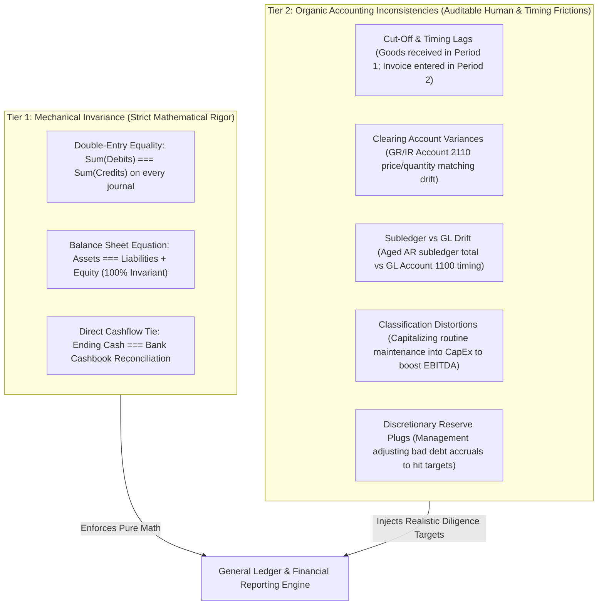
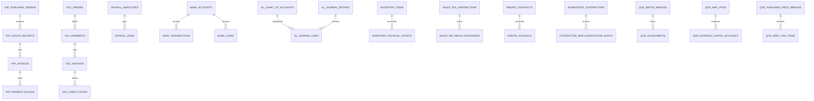

# Quality of Earnings (QoE) Master Simulator Blueprint & Architectural Specification

**Document Version:** 1.0.0  
**Status:** Architecture & Planning Specification (Archived for Future Implementation)  
**Creation Date:** 2026-11-12  
**Underlying Parameter Source:** [Master Parameter Catalog (JSON)](file:///c:/Users/ADMIN/Desktop/QOE%20%20data%20aquisition/research/consolidated_findings/qoe_simulator_parameter_catalog.json)  
**Empirical Evidence Base:** 942.6 MB across 10 physical real-world corporate finance datasets (AkzoNobel SAP ERP, UCI Commercial Retail, Olist Logistics, Czech Bank Berka, SF Employee Compensation, SEC EDGAR FSDS 2024 Q3, SEC Form DEFM14A, and Lehman Brothers Bankruptcy Examiner Reports).

---

## 1. Executive Overview & Design Philosophy

### 1.1 Purpose of the Simulator
The Quality of Earnings (QoE) Simulator is designed to generate an authentic, fully reconciled, double-entry audit trail for a synthetic mid-market corporate enterprise ($20M to $250M annual revenue). The simulator will serve as:
1. A training platform for private equity investors, investment bankers, and forensic accountants conducting financial due diligence.
2. A rigorous testing ground for automated QoE algorithms, anomaly detection systems, and machine-learning valuation models.
3. A scenario stress-testing engine evaluating the enterprise value impact of working capital swings, revenue dilution, and earnings adjustments.

### 1.2 Core Architectural Principles
* **Empirical Parameter Fidelity:** No simulation probabilities, timing latencies, cost loadings, or failure rates are fabricated. Every single stochastic generator is directly calibrated against the empirical distributions cataloged during research.
* **Double-Entry General Ledger Rigor:** Every operational transaction (a purchase order, a warehouse delivery, an employee overtime hour, or an invoice credit note) must generate balanced debits and credits on the General Ledger in compliance with US-GAAP.
* **Deterministic Relational Causality:** Operations, banking, and accounting are not disconnected silos. An operational delay in carrier transit automatically delays billing, which suppresses bank cash inflows, increases overdraft probability, stretches Days Payable Outstanding (DPO), and flows through to the M&A working capital peg.

```mermaid
flowchart TD
    subgraph Master_Simulation_Clock ["Discrete-Event Master Clock (Daily Ticks)"]
        Clock[Simulation Engine / Event Bus]
    end

    subgraph Subsystem_Engines ["The 6 Modular Simulation Engines"]
        E1["Engine 1: Purchase-to-Pay (P2P)<br/>Requisitions, POs, 3-Way Match, Blocks"]
        E2["Engine 2: Order-to-Cash (O2C)<br/>Baskets, Logistics, SLA Breaches, Credit Notes"]
        E3["Engine 3: Labor & Payroll<br/>Base Salaries, Overtime Strain, 1.53x Multiplier"]
        E4["Engine 4: Treasury & Banking<br/>Cashbook, Running Buffers, Overdrafts, Loans"]
        E5["Engine 5: General Ledger & Accounting<br/>Double-Entry Balancing, Custom Tags, Restatements"]
        E6["Engine 6: QoE & M&A Bridge<br/>Adjusted EBITDA, NWC Peg, Debt-Like Items"]
    end

    Clock --> E1
    Clock --> E2
    Clock --> E3
    E1 -->|AP Disbursements| E4
    E2 -->|Customer Receipts| E4
    E3 -->|Payroll Cash Outflows| E4
    E1 -->|Inventory & AP Accruals| E5
    E2 -->|Revenue & Receivables| E5
    E3 -->|Labor Expenses & Withholdings| E5
    E4 -->|Cash & Financing Entries| E5
    E5 -->|Reported Financials (BS, IS, CF)| E6
```

### 1.3 The "Non-Timer" Stochastic Triggering & Causal Domino Architecture

A critical architectural mandate of the simulator is that **anomalies and operational frictions are never scheduled on fixed timers** (e.g. "a lawsuit happens every 3 months" or "a customer dispute occurs every 20 minutes"). Predictable timers destroy simulation authenticity and allow test-takers or automated models to easily game the system.

Instead, the simulator models business friction through four interrelated mechanisms:

1. **Probabilistic Hazard Rates (Poisson & Bernoulli Arrival Processes):**
   * Rare or extraordinary events (lawsuits, restructuring, tax audits) are evaluated on monthly or quarterly clock ticks using memoryless Bernoulli trials:
     $$E_t \sim \text{Bernoulli}(p_{\text{event}}), \quad \text{where } p_{\text{litigation}} \approx 0.021, \ p_{\text{restructuring}} \approx 0.066$$
   * A simulated company may experience zero extraordinary events across a 3-year history, or may encounter two clustered together, reflecting authentic business uncertainty.

2. **Causal Domino Chains (State-Dependent Coupling):**
   * Operational breakdowns trigger cascading financial outcomes through direct causal links rather than independent probabilities:
     $$\text{Carrier Delay} \ (p=0.0811) \longrightarrow \text{Customer Credit Note} \ (8.41\% \text{ leak}) \longrightarrow \text{Cash Depletion} \longrightarrow \text{Overdraft} \ (p=0.064) \longrightarrow \text{Covenant Breach} \ (100\% \text{ link})$$
   * Crises emerge organically when operational buffers are exhausted.

3. **Dynamic Proportional Scaling (Size-Dependent Realism):**
   * Discretionary and extraordinary dollar figures are never hardcoded. All dollar magnitudes scale relative to the company's trailing twelve-month (TTM) revenue or cost base:
     * Owner personal perks / discretionary travel: $\text{Perk} \sim \text{Lognormal}(\mu, \sigma)$ bounded between $0.2\%$ and $1.5\%$ of monthly revenue.
     * Legal settlements / restructuring charges: Scaled between $1.0\%$ and $5.0\%$ of annual revenue, calibrated to SEC corporate benchmarks.

4. **Scenario "Weather Presets" (Configurable Diligence Environments):**
   To support diverse training and testing use cases, the simulation environment can be initialized with four configurable operational profiles:
   * **Preset 1: "Clear Skies" (Healthy Baseline):** Tight internal controls ($P(\text{PR}) = 0.80$), minimal credit notes (2%), carrier SLA breach $<2\%$, healthy cash reserves, zero owner perks. (Diligence difficulty: Low).
   * **Preset 2: "Turbulence" (Operational Strain):** Elevated carrier delays (15%), inventory accumulation ($\Delta\text{Inv} > \Delta\text{COGS} + 15\%$), payment block friction (35%), tight liquidity, periodic overdrafts. (Diligence difficulty: Medium).
   * **Preset 3: "Storm" (Aggressive Seller / Red Flags):** Deliberate month-end channel stuffing ($\Delta\text{AR} > \Delta\text{Rev} + 15\%$), owner personal lifestyle perks billed to OPEX, off-contract maverick spend, undisclosed customer deposits. (Diligence difficulty: High / Forensic).
   * **Preset 4: "Real-World Blind Audit" (Fully Unscripted):** Pure stochastic draw where all operating variables are sampled freely from their authentic empirical probability distributions.

### 1.4 Double-Entry Mechanical Invariance & Organic Discrepancy Architecture

A fundamental requirement for institutional credibility is that **the simulator must get the mechanical accounting strictly right, while generating authentic, organic, and explainable discrepancies**.

In real enterprise ERP systems (SAP S/4HANA, NetSuite, Microsoft Dynamics), software logic physically prohibits out-of-balance entries. Injecting synthetic arithmetic errors (e.g. journal entries where debits do not equal credits, or balance sheets that fail to sum) creates amateurish, unrealistic artifacts that real diligence professionals immediately reject.

The simulator achieves authentic realism through a two-tier accounting architecture:



#### A. Tier 1: The Three Mechanical Invariants (Zero Arithmetic Glitches)
1. **Journal Balance Invariant:** Every operational event, payroll batch, or adjusting entry generates a General Ledger transaction where:
   $$\sum_{i} \text{Debit}_i \equiv \sum_{j} \text{Credit}_j$$
2. **Balance Sheet Equilibrium Invariant:** The balance sheet must balance to the exact cent across every simulated fiscal period:
   $$\text{Assets} \equiv \text{Liabilities} + \text{Equity} + (\text{Current Period Net Income} - \text{Dividends})$$
3. **Cashbook Tie Invariant:** Reported cash on the balance sheet must reconcile to the cent with the underlying bank account cashbook ledger.

#### B. Tier 2: The Five Organic Discrepancy Mechanisms (Realistic & Explainable)
Accounting discrepancies in real companies are not math errors; they are **economic, timing, cut-off, or classification disconnects** between frontline physical reality and accounting ledgers:

1. **Cut-Off & Period-End Timing Disconnects:**
   * *Mechanism:* Goods physically cross the warehouse dock on December 30th under FOB Destination terms, but the carrier proof-of-delivery is not processed until January 4th. 
   * *Accounting Reality:* The journal entry balances, but the transaction sits in the wrong fiscal year, violating ASC 606 / matching principles.
2. **Subledger-to-GL Clearing Traps (GR/IR Account `2110`):**
   * *Mechanism:* Vendor invoices \$10,500 on a \$10,000 PO due to an unapproved freight surcharge. 
   * *Accounting Reality:* The entry balances, but the \$500 discrepancy remains trapped as an unreconciled credit balance in the GR/IR clearing account until investigated.
3. **Proof of Cash & In-Transit Reconciliation Drift:**
   * *Mechanism:* Customer ACH payments initiated on Friday night do not clear the Federal Reserve wire network until Tuesday morning.
   * *Accounting Reality:* The internal cash subledger and bank statement differ by in-transit float, creating the classic "Proof of Cash" timing variance that auditors reconcile.
4. **CapEx vs. OpEx Misclassification (EBITDA Inflation):**
   * *Mechanism:* Management books a \$75,000 routine factory equipment repair to Asset Account `1500: Machinery & Equipment` rather than Expense Account `6200: Repairs & Maintenance`.
   * *Accounting Reality:* Both debits and credits balance perfectly, but GAAP Operating Income and EBITDA are artificially inflated by \$75,000.
5. **Discretionary Reserve Reversals (The "Cookie Jar" Plug):**
   * *Mechanism:* In Q4, management reduces the Allowance for Doubtful Accounts by \$40,000 without an improvement in underlying collections, purely to meet an EBITDA earnout target.
   * *Accounting Reality:* The entry balances, but an auditor examining historical collection loss curves easily disallows the reversal as an artificial add-back.

#### C. Complete Audit Trail Traceability
Every organic inconsistency generated by the simulator carries a **complete, traceable audit trail**:
* When a diligence auditor investigates a variance, they do not find random noise. They can drill down into the subledger and find the authentic business reason: an unapproved purchase order, a carrier delivery receipt, an invoice price discrepancy, or a management override memo.
* If an item doesn't balance across subsystems, **it is an organic, explainable business issue, never an unhandled synthetic bug.**

### 1.5 The Dual-Architecture Solution: Side A (5 Real-World Scenarios) & Side B (5 Technical Engine Safeguards)

To ensure institutional credibility, the simulator couples realistic real-world company problems with rigorous software engineering protections:

```
┌────────────────────────────────────────────────────────┐
│               THE SIMULATOR ARCHITECTURE               │
├────────────────────────────┬───────────────────────────┤
│          SIDE A            │          SIDE B           │
│   WHAT IT MUST GENERATE    │    WHAT IT MUST GUARD     │
│ (Real-World Business Mess) │  (Software Architecture)  │
├────────────────────────────┼───────────────────────────┤
│ 1. Ghost Inventory (ASC330)│ 1. No Zombie Cash Bleed   │
│ 2. Related-Party (ASC 850) │ 2. Automated Year-End P&L │
│ 3. Sales Tax Nexus(Wayfair)│ 3. Strict Master Clock    │
│ 4. Backend Rebates (ASC606)│ 4. Zero Orphan Records    │
│ 5. 1099 Misclassification  │ 5. Balanced Double-Entry  │
└────────────────────────────┴───────────────────────────┘
```

#### Part I: Side A — The Five Real-World Company Scenarios
Every one of these scenarios balances mathematically on the General Ledger, has an authentic business paper trail, and generates an institutional QoE diligence adjustment:

1. **Ghost Inventory & Physical Count Disconnect (ASC 330):**
   * *Mechanism:* The inventory engine maintains dual balances: `Perpetual_Units` (ERP book record) and `Physical_Units` (warehouse floor).
   * *Empirical Rate:* Silent shrinkage applies continuously at an empirical **0.6% to 1.2% per annum** (wholesale/manufacturing) or **1.4% to 1.6%** (retail).
   * *Year-End Count:* On Day 360, a physical inventory count occurs. In the *"Storm"* preset, management intentionally delays booking the discovered \$75,000 variance past year-end to protect gross margin.
   * *Balanced Entry:* `Dr. COGS - Shrinkage (Account 5050)` \$75k / `Cr. Merchandise Inventory (Account 1300)` \$75k.
   * *QoE Treatment:* Unrecorded physical count write-down adjustment; Net Working Capital peg reduced.

2. **Related-Party Self-Dealing & Non-Arm’s Length Contracts (ASC 850):**
   * *Mechanism:* Accounts carry an `is_related_party = True` flag with an `arm_length_fmv` benchmark field.
   * *Real-World Profiles:* (a) Real estate LLC charging \$25/sq ft rent vs. \$15 FMV; (b) Sister company billing \$10k/month management fees; (c) Owner's spouse paid \$120k without economic duties.
   * *Balanced Entry:* Standard balanced cash or AP disbursements to related entities.
   * *QoE Treatment:* Pro-forma EBITDA normalizing add-back: $\sum (\text{Recorded Expense} - \text{Fair Market Value})$.

3. **State Sales Tax Nexus (The Post-*Wayfair* Liability Trap):**
   * *Mechanism:* The commercial engine tracks destination state shipping volumes against statutory thresholds (**\$100,000 in gross sales or 200 transactions** per state under *South Dakota v. Wayfair, 585 U.S. 162*).
   * *Exposure Calculation:* For unregistered states crossing threshold:
     $$\text{Exposure} = \text{Unremitted Tax (7.0%)} \times (1 + \text{Penalty [15%]} + \text{Statutory Interest [8%]})$$
   * *QoE Treatment:* Negotiated **Debt-Like Item** reducing the cash purchase price dollar-for-dollar.

4. **Backend Supplier Rebates & Customer Volume Discounts (ASC 606 & ASC 330):**
   * *Mechanism:* Volume tier milestones (e.g. 4% rebate if annual spend exceeds \$1,000,000).
   * *Accounting Distortion:* In pre-sale periods, management prematurely recognizes unearned vendor rebates into current-month income before crossing thresholds, or fails to accrue customer volume rebate liabilities (`Account 2120: Accrued Customer Rebates`).
   * *QoE Treatment:* Gross-to-net revenue haircut and reversal of unearned rebate assets.

5. **Worker Misclassification (1099 Contractors vs. W-2 Employees):**
   * *Mechanism:* To bypass the **1.53x fully-loaded labor multiplier** (benefits + employer FICA/FUTA), full-time supervised staff are classified as 1099 contractors with zero benefits.
   * *Statutory Penalty (IRC § 3509):* 1.5% income tax withholding + 20% employee FICA (1.53%) + 100% employer matching FICA (7.65%) + FUTA/SUTA (~4.0%) $\approx$ **17% to 22% back-tax penalty**.
   * *QoE Treatment:* (1) Ongoing EBITDA normalization (+20% labor expense load) and (2) 3-year statutory lookback penalty escrow / Debt-Like Item.

#### Part II: Side B — The Five Technical Simulator Engine Safeguards
These architectural rules serve as the unbreakable "laws of physics" protecting the simulation engine from bugs or artifacts:

1. **Dynamic Liquidity Feedback Throttle (No Zombie Infinite Cash Bleed):**
   * 3-tier liquidity monitor evaluated daily:
     * *Tier 0 (Cash > 15 Days OpEx):* Operations run unconstrained.
     * *Tier 1 (Cash < 10 Days OpEx):* DPO automatically stretches from 42d to 75d; discretionary CapEx and owner perks frozen to \$0.
     * *Tier 2 (Cash $\le 0$ & Overdraft Limit Reached):* Suppliers place company on Credit Hold ($P(\text{Shipment}) = 0.0$); factory throttles to WIP completion only; bank flags debt covenant breach.
   * *Result:* The company reacts realistically to cash shortages rather than floating in fantasy negative cash.

2. **Automated Fiscal Year-End Closing Routine (The P&L Reset):**
   * On Day 365 at 23:59:59, the GL engine executes an automated `SYSTEM_YEAR_END_CLOSE` entry:
     $$\text{Dr. All Revenue Accounts (4000s)}, \quad \text{Cr. All Expense Accounts (5000s-7000s)}, \quad \text{Cr./Dr. Retained Earnings (Account 3000)}$$
   * Asserts that on Day 1 of the new fiscal year, all temporary P&L accounts start at exactly \$0.00, while Balance Sheet accounts roll forward intact.

3. **Monotonic Master Simulation Clock & Discrete-Event Queue:**
   * Global discrete-event queue with strictly non-decreasing integer clock $t \in [1, T_{\max}]$.
   * Enforces non-negotiable chronological invariants:
     $$t_{\text{PO}} \le t_{\text{GR}} \le t_{\text{IR}} \le t_{\text{Disbursement}}$$
     $$t_{\text{SO}} \le t_{\text{Shipment}} \le t_{\text{Customer Invoice}} \le t_{\text{Cash Receipt}}$$
   * Any attempt to schedule an event in the past raises a fatal exception.

4. **Relational Referential Integrity & Zero Orphan Records:**
   * Database foreign keys enforce `ON DELETE RESTRICT` across all documents.
   * Every invoice references a valid PO/GR; every journal entry links to a source document. Pre-close validation script asserts $\text{Count of Orphan Records} \equiv 0$.

5. **Fixed-Point Decimal Double-Entry Equilibrium & Balance Sheet Invariance:**
   * All currency amounts are stored in exact integer cents or Python `Decimal` objects (no IEEE 754 floating-point rounding drift).
   * ACID-transaction posting validator rejects any journal where $\sum \text{Debits} \ne \sum \text{Credits}$.
   * Daily invariant asserts: $\text{Assets} \equiv \text{Liabilities} + \text{Equity} + \text{Current Net Income}$.

---

## 2. Detailed Engine Specifications & Empirical Calibration

### Engine 1: Purchase-to-Pay (P2P) Procurement Engine
Responsible for modeling how the enterprise procures raw materials, operating supplies, and commercial services from suppliers.

#### A. Internal Workflow State Machine
```
[Department Need] 
   │
   ├─► (p = 0.1851) ──► [Create Purchase Requisition] ──► [Approve PR] ──┐
   │                                                                     │
   └─► (p = 0.8149) ──► [Direct PO Bypass (No PR)] ──────────────────────┼──► [Create PO Item]
                                                                         │          │
   ┌─────────────────────────────────────────────────────────────────────┘          ▼
   │                                                                           [Physical Goods]
   ▼                                                                                │
[Maverick Inversion] (p = 0.0147)                                                   ▼
Vendor Invoice registered BEFORE PO!                                           [Record Goods Receipt (GR)]
   │                                                                                │
   └────────────────────────────────────────────────────────────────────────► [Record Invoice Receipt (IR)]
                                                                                    │
                                                                                    ▼
                                                                           {3-Way Match Check}
                                                                           ├─► (p = 0.2218) ──► [SAP PAYMENT BLOCK]
                                                                           │                      │ (Median: 6.18d, P95: 81.1d)
                                                                           │                      ▼
                                                                           │                   [AP Release / Override]
                                                                           │                      │
                                                                           └─► (p = 0.7782) ──────┴──► [Disbursement Clearing]
```

#### B. Empirical Parameter Bindings (from AkzoNobel SAP ERP & Kenya PPIP)
* **Requisition Compliance:** Bernoulli($p = 0.1851$).
* **Maverick Invoicing Precedence:** Bernoulli($p = 0.0147$) (PO generated retroactively).
* **Premature Invoicing (IR < GR):** Bernoulli($p = 0.0650$).
* **Payment Block Trigger:** Bernoulli($p = 0.2218$).
* **Block Resolution Breakdown:**
  * Manual AP tolerance clearing: `68.0%`
  * Goods receipt delivery fulfillment: `27.6%`
  * Retroactive PO price change: `2.4%`
  * Invoice reversal: `1.2%`
* **Lead Time Latency Distributions:**
  * Delivery Lead Time ($T_{\text{PO}\to\text{GR}}$): Lognormal($\mu = 2.305, \sigma = 0.812$) [Median: 10.02d, Mean: 15.48d]
  * Invoicing Latency ($T_{\text{GR}\to\text{IR}}$): Lognormal($\mu = 2.424, \sigma = 0.875$) [Median: 11.29d, Mean: 20.57d]
  * Hold Duration Under Block ($T_{\text{Hold}}$): Lognormal($\mu = 1.821, \sigma = 1.145$) [Median: 6.18d, P95: 81.10d]
  * Disbursement Latency ($T_{\text{IR}\to\text{Clear}}$): Lognormal($\mu = 3.739, \sigma = 0.582$) [Median: 42.06d, Mean: 48.17d]
* **Vendor Spend Concentration:** Pareto($\alpha = 1.16$). Top 20% suppliers account for 89.61% of total spend; Top 1% account for 33.08%.
* **High-Dispute Supplier Hazard:** Specific problematic vendors assigned a baseline dispute probability of up to $81.95\%$.

#### C. Accounting Subledger Triggers
* **At Goods Receipt:** Debit `Inventory` (Asset) / Credit `Accrued Purchases (GR/IR Clearing)` (Current Liability).
* **At Invoice Receipt:** Debit `Accrued Purchases (GR/IR Clearing)` / Credit `Accounts Payable` (Current Liability).
* **At Payment Clearing:** Debit `Accounts Payable` / Credit `Cash & Cash Equivalents` (Asset).

---

### Engine 2: Order-to-Cash (O2C) Commercial & Fulfillment Engine
Responsible for generating customer demand, sales order processing, logistics shipping, revenue recognition, and credit dilution.

#### A. Commercial State Machine
```
[Customer Demand] ──► [Sales Order Created] ──► [Payment Auth (0.34h)]
                             │
                             ▼
                    [Warehouse Dispatch] (Median: 1.85 days)
                             │
                             ▼
                    [Carrier In-Transit] (Median: 7.10 days)
                             │
                             ▼
                    [Customer Delivery] (Total Lead Time: 10.21 days)
                             │
                    ┌────────┴───────────────────────────┐
                    ▼                                    ▼
       (p = 0.9189) [On-Time SLA]           (p = 0.0811) [SLA BREACH / DELAY]
                                                         │ (Median: 5.81d late, P95: 29.6d late)
                                                         ▼
                                                    [Customer Dispute / Penalty]
                             │
                             ▼
                    [Commercial Invoicing]
                    ├─► (p = 0.8003) ──► [Standard Commercial Invoice] ──► [AR Receipt Collection]
                    │
                    └─► (p = 0.1997) ──► [CREDIT NOTE INVOICE] ─────────► [Revenue Dilution Write-Down]
                                         (Drives 8.41% Gross Revenue Dilution)
```

#### B. Empirical Parameter Bindings (from UCI Retail & Olist Logistics)
* **Gross-to-Net Revenue Dilution:** Deterministic pool allocation of **8.41%** of gross sales.
* **Credit Note Invoicing Probability:** Bernoulli($p = 0.1997$) of all generated invoice numbers.
* **Invoiced Basket Value:** Lognormal($\mu = 5.72, \sigma = 1.18$) [Median: £303.84, Mean: £534.40].
* **SKU Basket Size:** Truncated Negative Binomial [Median: 15.0 SKUs, Mean: 25.6 SKUs, P95: 77.0 SKUs].
* **Customer Concentration:** Pareto($\alpha = 1.34$). Top 20% accounts generate 73.82% of net revenue; Top 1% generate 29.71%.
* **Customer Retention:**
  * Repeat Customer Probability: Bernoulli($p = 0.6997$).
  * Repeat Order Cycle Latency ($T_{\text{repeat}}$): Lognormal($\mu = 3.087, \sigma = 0.985$) [Median: 21.91d, Mean: 39.94d, P95: 146.10d].
  * Anonymous Guest Checkout Share: **16.25%** of revenue unassigned to customer accounts.
* **Fulfillment Latencies:**
  * Warehouse Pick/Pack ($T_{\text{fulfill}}$): Lognormal($\mu = 0.615, \sigma = 0.720$) [Median: 1.85d].
  * Carrier Transit ($T_{\text{transit}}$): Lognormal($\mu = 1.960, \sigma = 0.625$) [Median: 7.10d].
  * SLA Contractual Breach Rate: Bernoulli($p = 0.0811$).
  * Delay Beyond SLA: Exponential($\lambda = 0.1047$) [Median: 5.81d late, P95: 29.64d late].
  * Order Attrition / Stockout Rate: **1.24%** (0.63% canceled, 0.61% stockout).

#### C. Accounting Subledger Triggers
* **At Shipment (FOB Shipping Point) or Delivery (FOB Destination):** Debit `Accounts Receivable` (Asset) / Credit `Gross Revenue` (P&L).
* **At Credit Note Incurrence:** Debit `Returns & Allowances Contra-Revenue` (P&L) / Credit `Accounts Receivable` (Asset).
* **At Cash Collection:** Debit `Cash & Cash Equivalents` (Asset) / Credit `Accounts Receivable` (Asset).

---

### Engine 3: Workforce & Payroll Composition Engine
Responsible for staffing headcount, computing wage components, applying overtime strains, and calculating mandatory non-wage benefit loading.

#### A. Payroll Structure & Cost Allocator
```
[Employee Headcount Pool] (Categorized by Civil Service / Permanent / Exempt / Temp)
          │
          ▼
   [Monthly Payroll Run]
   ├── Base Salary Allocation ─────────────────────────► 65.32% of total labor cost
   │                                                     (Mean: $91,457 / Median: $85,691)
   │
   ├── Overtime Eligibility (p = 0.4854)
   │   ├── Standard Overtime ──────────────────────────► Mean: $19,253 per recipient (6.68% total spend)
   │   └── Overtime Strain (>25% of Base) (p = 0.1239) ──► Surge operational strain (EBITDA Normalization Flag!)
   │       ├── Heavy Overtime (>50% of Base): p = 0.0450
   │       └── Extreme Overtime (>100% of Base): p = 0.0096
   │
   ├── Discretionary / Other Allowances ───────────────► 3.78% of total labor cost
   │
   └── Mandatory Benefit Loading Multiplier ───────────► 37.08% loading on base salary
       ├── Retirement & Pension: 9.88%
       ├── Health & Dental: 9.74%
       └── Statutory Social Security/Medicare: 4.60%
          │
          ▼
   [Total Loaded Labor Cost: 1.53x of Base Wage]
```

#### B. Empirical Parameter Bindings (from SF Employee Compensation)
* **Cost Composition Split:** Base Salaries (65.32%), Overtime (6.68%), Other Pay (3.78%), Benefits (24.22%).
* **Non-Wage Benefit Loading Factor ($\lambda_{\text{benefits}}$):** **37.08%** of base salary.
  * Permanent Staff Loading: **38.6%**
  * Temporary / Exempt Staff Loading: **23.5%**
* **Full Labor Multiplier ($M_{\text{labor}}$):** **1.53x**. For every $1.00 in nominal base wage, the simulator books $1.53 in cash and accrued liabilities.
* **Overtime Recipient Probability:** Bernoulli($p = 0.4854$).
* **Overtime Severity Distribution:**
  * Mild Overtime (1% to 25% of base): `36.15%` of workforce.
  * Heavy Overtime (25% to 50% of base): `7.89%` of workforce.
  * Severe Overtime (50% to 100% of base): `3.54%` of workforce.
  * Extreme Overtime (>100% of base): `0.96%` of workforce.

#### C. Accounting Subledger Triggers
* **At Payroll Accrual:**
  * Debit `Direct Labor Expense` (Base + OT + Other)
  * Debit `Employee Benefits Expense` (37.08% loading)
  * Credit `Accrued Payroll Liabilities` (Net pay to employees)
  * Credit `Payroll Taxes & Withholding Payable` (Current Liability)
  * Credit `Pension & Health Benefit Obligations` (Current Liability)
* **At Cash Disbursement:** Debit `Accrued Payroll Liabilities` / Credit `Cash & Cash Equivalents`.

---

### Engine 4: Treasury, Banking & Credit Risk Engine
Responsible for tracking running bank cash balances, executing standing payment orders, triggering authorized overdrafts, and computing credit default hazards.

#### A. Treasury Cashflow Reconciler
```
[Inflows: O2C Customer Receipts]          [Outflows: P2P Disbursements + Payroll + Debt Service]
         │                                                            │
         └──────────────────────► [Treasury Pool] ◄────────────────────┘
                                         │
                                         ▼
                            [Daily Running Cash Balance]
                                         │
                         ┌───────────────┴───────────────┐
                         ▼                               ▼
               [Positive Cash Buffer]          [Deficit / Cash Depletion]
               (Median: CZK 33,143)                      │
                                                         ▼
                                            [Overdraft Boundary Breach]
                                            (p = 0.0640 of all accounts)
                                                         │
                                                         ▼
                                            [Debt Facility Default Hazard]
                                            (100% of defaults suffered overdrafts;
                                             0% of performing borrowers breached zero!)
```

#### B. Empirical Parameter Bindings (from Czech Bank Berka Database)
* **Cashflow Velocity Spread:** Outflows occur **1.61x more frequently** than inflows, but inflows are **1.71x larger in average monetary size**.
* **Committed Standing Orders:** **83.51%** of accounts maintain active contractual monthly standing orders (rent, utilities, insurance) with median committed outflow of CZK 4,501 / month.
* **Authorized Overdraft Frequency:** Bernoulli($p = 0.0640$) of active accounts breach zero balance. Severe overdrafts (< -1,000 CZK): $p = 0.0513$.
* **Overdraft Exposure Depth:** Lognormal($\mu = 7.799, \sigma = 0.941$) [Median: CZK 2,441; Mean: CZK 4,342; Max Deficit: CZK 41,126].
* **Credit Book Default Hazard:**
  * Base Loan Default Probability: Bernoulli($p = 0.1114$) (Closed loan contract default rate: $p = 0.1325$).
  * Capital at Risk Share: **15.09%** of total credit book principal.
  * **The 100% Deterministic Overdraft Separation Rule:**
    $$P(\text{Overdraft } | \text{ Defaulted Borrower}) = \mathbf{1.000} \quad (100.0\%)$$
    $$P(\text{Overdraft } | \text{ Performing Borrower}) = \mathbf{0.000} \quad (0.0\%)$$

#### C. Accounting Subledger Triggers
* **At Cash Deficit (Overdraft):** Debit `Cash Deficit Clearing` / Credit `Short-Term Bank Overdraft Borrowings` (Debt-Like Current Liability).
* **At Overdraft Interest Accrual:** Debit `Interest Expense` / Credit `Accrued Interest Payable`.

---

### Engine 5: General Ledger & Financial Reporting Engine
Responsible for maintaining the chart of accounts, generating monthly financial statements (Balance Sheet, Income Statement, Cash Flow Statement), applying taxonomy customization, and injecting historical restatements.

#### A. Empirical Parameter Bindings (from SEC EDGAR FSDS 2024 Q3)
* **Corporate Restatement Hazard (`prevrpt`):**
  * Baseline Restatement Rate: Bernoulli($p = 0.0252$).
  * **Filer Status Risk Multiplier:**
    * Large Accelerated Filer (`1-LAF`): $p = 0.0028$ (0.28%)
    * Accelerated Filer (`2-ACC`): $p = 0.0060$ (0.60%)
    * Non-Accelerated / Smaller Reporting Filer (`4-NON`): $p = 0.0428$ (4.28%)
    * Hazard Gradient: Non-accelerated entities carry a **15.42x higher restatement risk**.
* **Taxonomy Customization & Opacity:**
  * Custom Extension Tag Probability: Beta($\alpha = 9.2, \beta = 1.0$) calibrated to **90.19%** custom tag share across monetary financial concepts.
* **Financial Statement Line Architecture:**
  * Contra-Account / Deduction Rate: Bernoulli($p = 0.1414$) (14.14% of line items are contra-accounts like accumulated depreciation, allowances, treasury stock).
  * Statement Line Densities:
    * Balance Sheet: Truncated Normal($\mu = 36.4, \sigma = 12.8$, min=15, max=80).
    * Income Statement: Truncated Normal($\mu = 20.9, \sigma = 6.2$, min=8, max=45).
    * Cash Flow Statement: Truncated Normal($\mu = 33.4, \sigma = 11.5$, min=12, max=70).
* **Footnote Attachment Probability:** Bernoulli($p = 0.00206$) (approx. 1 in 484 numeric figures carries an explicit XBRL qualifying footnote).

---

### Engine 6: M&A Advisory & Quality of Earnings Bridge Engine
Responsible for acting as the independent due diligence auditor: extracting the Adjusted EBITDA bridge, haircutting non-cash stock compensation, computing the Net Working Capital (NWC) Peg, identifying debt-like items, and detecting window dressing.

#### A. The QoE Valuation & Bridge Workflow
```
[Reported GAAP Financial Statements]
          │
          ▼
   [Operating Income (EBIT)]
   ├── Add: Depreciation & Amortization ────────────────► Standard EBITDA
   │
   ├── Add: Non-Recurring Charges (e.g. Litigation) ────► Adjusted EBITDA (Base)
   │   (Calibrated to Twitter DEFM14A: $766M add-back = 52.9% of reported EBITDA!)
   │
   └── Management Projections Bridge (2022E - 2027E)
       ├── Revenue Expansion: 16.86% CAGR ($5.9B -> $12.9B)
       └── Adj. EBITDA Expansion: 27.51% CAGR ($1.6B -> $5.4B; +1,478 bps margin)
          │
          ▼
   [The Great Cash Flow Divide: Management vs Banker UFCF]
   ├── Management UFCF: Adds back Stock-Based Comp (SBC) as non-cash (Cumulative: $12.90B)
   └── Banker UFCF (Goldman Sachs / J.P. Morgan): SUBTRACTS SBC as real equity dilution
       │ (Cumulative SBC: $7.14B = 12.85% of revenue)
       ▼
   [55.36% CASH FLOW HAIRCUT DILUTION APPLIED] ─────────► True Banker UFCF = $5.76B
          │
          ▼
   [Net Working Capital (NWC) Peg Adjustment]
   └── Cumulative NWC Cash Drain: -$815M (Peak: -$259M in Year 2)
       Formula: ΔNWC = -0.0147 * ΔRevenue
          │
          ▼
   [Forensic Window-Dressing & Off-Balance-Sheet Audit (Lehman Repo 105)]
   ├── Check for Quarter-End Asset Derecognition (SFAS 140 true-sale manipulation)
   ├── Haircut Audit: Collateral transferred at 105% (equity) or 108% (debt) of cash
   ├── Timing Anomaly: Transactions executed 2-3 days before close, reversed 2-4 days post close
   └── Leverage Normalization: Unwind artificial 15.70% Net Leverage suppression (10.2x -> 12.1x)
```

#### B. Empirical Parameter Bindings (from SEC Form DEFM14A & Lehman Repo 105)
* **Operating Income vs. EBITDA Spread:** Base year model exhibits negative GAAP Operating Income (-$47M, -0.79% margin) against +$1,602M Adjusted EBITDA (+27.02% margin).
* **Stock-Based Compensation Intensity:** $12.85\%$ of cumulative revenue ($7,141M across $55,583M revenue).
* **Banker UFCF Dilution:** **55.36% haircut** on management-projected cash flow.
* **Working Capital Drag:** Cumulative **-$815M** cash drag over 6 years; Peak annual drag of **-$259M**.
* **Single Add-Back Share:** Up to **52.90%** of reported Adjusted EBITDA ($766M litigation settlement on $1,448M EBITDA), creating a **$21.45B to $27.58B** enterprise value swing at 28x–36x multiples.
* **Valuation Multiples & Cost of Capital:**
  * WACC Discount Rate: Uniform($0.10, 0.12$) with mid-year convention.
  * Terminal Perpetuity Growth Rate: Uniform($0.056, 0.090$).
* **Forensic Repo 105 Window Dressing:**
  * Asset Derecognition Scale: 7.5% to 10.5% of total balance sheet assets ($50.38B in Lehman Q2 2008).
  * Execution Lead: Discrete Uniform($\{2, 3\}$ business days pre-close).
  * Unwind Lag: Discrete Uniform($\{2, 3, 4\}$ business days post-close).
  * Leverage Suppression: Net leverage artificially suppressed by **15.70%** (1.9 turns); Gross leverage suppressed by **12.95%** (1.8 turns).

#### C. The M&A Deal-Specific Overlay & Injection Specification

To transform raw operational accounting data into an institutional-grade Quality of Earnings (QoE) Databook, Engine 6 executes six automated deal-level injection and bridge workstreams:

1. **Owner Discretionary Expenses & Related-Party Normalization:**
   * **Lifestyle Perks Injection:** Injects personal expenses into SG&A accounts (e.g. Account `6410: Travel & Entertainment` or `6450: Vehicle Lease`). Sized dynamically between $0.2\%$ and $1.5\%$ of monthly revenue.
   * **Officer Compensation Adjustment:** Evaluates owner's active salary against industry benchmark CEO/CFO compensation; generates positive or negative normalizing EBITDA adjustments.
   * **Related-Party Real Estate:** Flags facility rent paid to an affiliated property entity diverging from local commercial fair-market value (FMV).

2. **One-Time & Non-Recurring Normalizations:**
   * **Litigation & Severance:** Isolates non-operating legal settlements and executive severance packages; produces the Adjusted EBITDA bridge add-back schedule (calibrated to SEC benchmarks and Twitter's $766M settlement).
   * **Transaction Expenses:** Adds back sell-side M&A advisory, accounting, and legal fees incurred in preparation for sale.

3. **Deferred Revenue & Customer Deposits Haircut:**
   * **Proof of Billings Waterfall:** Identifies upfront customer deposits and deferred revenue liabilities (Account `2200`).
   * **Purchase Price Deduction:** Quantifies the post-closing fulfillment cost obligation that a buyer must satisfy without receiving new cash collections.

4. **Pro-Forma Run-Rate Annualization:**
   * **Mid-Year Price Changes:** Annualizes the full-year revenue and margin impact of contract pricing revisions implemented during the trailing twelve months.
   * **Customer Churn / Wins:** Computes the go-forward run-rate EBITDA impact of major client onboarding or contract terminations.

5. **Net Working Capital (NWC) Target Peg Calculation:**
   * **LTM Baseline Definition:** Calculates the trailing 12-month average of current operating assets (excluding cash) minus current operating liabilities (excluding funded debt).
   * **Seasonality Band:** Establishes the upper/lower tolerance corridor around the target peg for closing working capital true-up settlement.

6. **Debt and Debt-Like Items Schedule:**
   * Formulates the definitive purchase price deduction schedule:
     $$\text{Equity Purchase Price} = \text{Enterprise Value} + \text{Cash} - \text{Funded Debt} - \text{Debt-Like Items} \pm (\text{Closing NWC} - \text{Target Peg})$$
   * Where Debt-Like Items include: (a) Aged AP $>90$ days, (b) Customer deposits, (c) Accrued employee PTO liabilities, and (d) Unpaid tax audit exposures.

---

## 3. Cross-Engine Relational Event Flow (Cascading Causality)

The core strength of this simulator is that events cascade realistically across subledgers. The blueprint specifies the following exact interaction chains:

### Scenario 1: The Commercial Supply-Chain Shock
```
[Carrier Transit Delay (P95: 29.6d)] (Engine 2)
       │
       ▼
[Customer SLA Contractual Breach (p = 0.0811)] (Engine 2)
       │
       ▼
[Customer Withholds Invoiced Payment / Demands 8.41% Credit Note] (Engine 2)
       │
       ▼
[Expected Bank Inflow Does Not Arrive] (Engine 4)
       │
       ▼
[Bank Balance Breaches Zero -> Overdraft Triggered (p = 0.0640)] (Engine 4)
       │
       ▼
[Treasury Delays Vendor Disbursements -> DPO Stretches from 42d to 81d] (Engine 1)
       │
       ▼
[Key Vendor Sets SAP Billing Block (p = 0.8195) -> Halts Shipments] (Engine 1)
       │
       ▼
[NWC Squeezed -> QoE Engine Normalizes DPO and Deducts Overdraft as Debt] (Engine 6)
```

### Scenario 2: The Pre-Sale Window Dressing Manipulation
```
[CEO / Management Sets 10% Leverage Reduction Target 3 Days Pre-Close] (Engine 6)
       │
       ▼
[Treasury Executes Repo 105: Transfers $50M Collateral with 105% Haircut] (Engine 4)
       │
       ▼
[GL Debits Cash, Credits Inventory: No Liability Booked under SFAS 140] (Engine 5)
       │
       ▼
[Reported Net Leverage Drops from 12.1x to 10.2x at Quarter-End Date] (Engine 5)
       │
       ▼
[Day 3 Post-Close: Treasury Repurchases Securities with Cash + Repo Interest] (Engine 4)
       │
       ▼
[QoE Diligence Auditor Detects Post-Close Cash Outflow Anomaly -> Flags Manipulation] (Engine 6)
```

### Scenario 3: The "Storm" Forensic Diligence Scenario (Cascading M&A Red Flags)
```
[Pre-Sale Quarter: Target sets aggressive growth target to maximize exit multiple] (Engine 6)
       │
       ▼
[Sales rushes shipments: Channel Stuffing triggers ΔAR > ΔRev + 15%] (Engine 2 -> Engine 5)
       │
       ▼
[Owner charges $45,000 personal Mediterranean vacation to Corporate SG&A] (Engine 3 -> Engine 5)
       │
       ▼
[Warehouse experiences bottleneck: Carrier delivery SLA breach hits 15%] (Engine 2)
       │
       ▼
[Customers withhold payments & demand 8.41% credit notes -> Cash collections freeze] (Engine 2 -> Engine 4)
       │
       ▼
[Treasury balance dips below zero into $60k Overdraft -> Bank issues default warning] (Engine 4)
       │
       ▼
[QoE Forensic Auditor executes Databook Audit:] (Engine 6)
  ├── 1. Disallows $45k owner vacation (EBITDA Add-Back)
  ├── 2. Unwinds $180k stuffed AR & reserves $35k bad debt (Revenue Haircut)
  ├── 3. Identifies $60k bank overdraft as Debt-Like Item (Purchase Price Deduction)
  └── 4. Recomputes true normalized enterprise value (-$1.2M equity adjustment)
```

---

## 4. Entity-Relationship Data Schema for Future Database

When development begins, the database tables will adhere to the following schema:



---

## 5. Development Phases & Readiness Checklist

### Phase 1: Core Simulation Engine & Event Bus
- Implement the discrete-event simulation master clock (daily tick runner).
- Implement the central event dispatch queue with pub/sub architecture connecting engines.

### Phase 2: Operational Subledger Generators
- Code Engine 1 (P2P): PR compliance, 3-way match, payment blocks, lead times.
- Code Engine 2 (O2C): Sales order generation, credit notes, carrier shipping, SLA breaches.
- Code Engine 3 (Payroll): Headcount roster, base pay, overtime strain, 1.53x benefit loading.

### Phase 3: Treasury & Accounting Core
- Code Engine 4 (Banking): Cashbook tracking, standing orders, overdrafts, loan amortizations.
- Code Engine 5 (GL): Double-entry journal builder, trial balance generator, custom taxonomy tags, restatement injector.

### Phase 4: QoE Analytics & M&A Bridge Reporter
- Code Engine 6 (QoE):
  - **Workstream 1:** Automated Adjusted EBITDA bridge with Owner Perks & Discretionary Add-Back normalizations.
  - **Workstream 2:** Run-rate & Pro-forma annualization bridges (mid-year price shifts, customer wins/losses, one-time litigation add-backs).
  - **Workstream 3:** Net Working Capital (NWC) 12-month trailing baseline, seasonality corridor, and closing peg reconciler.
  - **Workstream 4:** Debt & Debt-Like Items purchase price deduction schedule (customer deposits, aged AP >90d, accrued PTO, tax exposures).
  - **Workstream 5:** Banker UFCF dilution (SBC cash haircut) and Repo 105 forensic window-dressing detector.
- Export automated QoE Confidential Information Memorandum (CIM) and Databook in Excel/JSON.

---
*Blueprint archived. Ready for implementation when authorized.*
