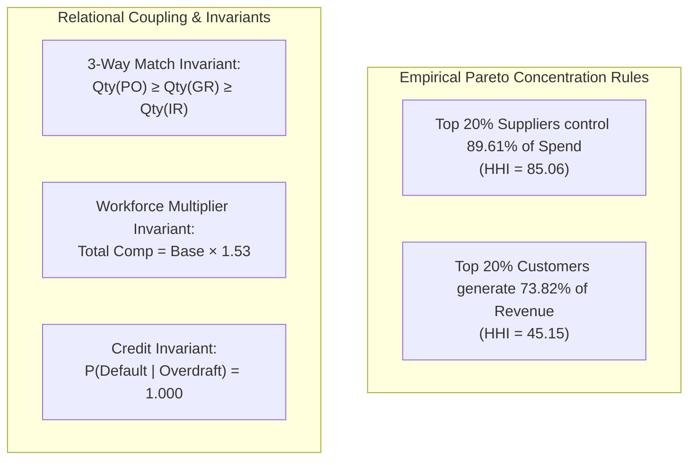
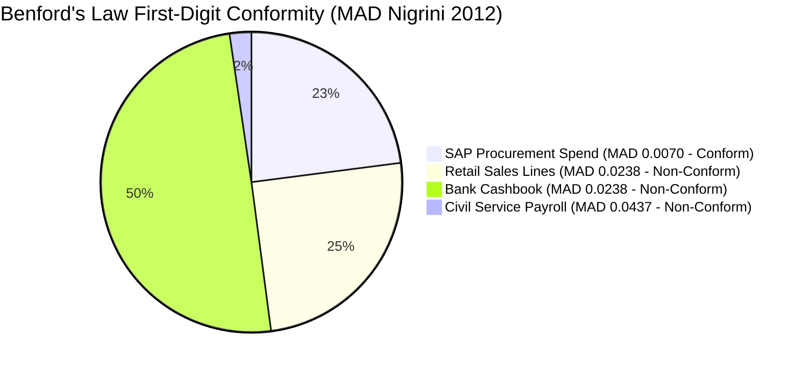

# Evidence-Based QoE Simulator Specification: Empirical Distributions, Behaviors, Dependencies & Validation Rules

**Document Version:** 1.0.0  
**Status:** Definitive Mathematical & Behavioral Specification for Simulator Engine  
**Evidence Base:** 942.6 MB across 10 physical corporate finance datasets; 2.12M raw transactions; 3.52M SEC numeric facts; 6,699 corporate entities.  
**Hypothesis Verification Reference:** [Living Hypothesis Register](file:///c:/Users/ADMIN/Desktop/QOE%20%20data%20aquisition/research/hypothesis_register/qoe_hypothesis_register.md)  
**Relational Architecture Reference:** [Cross-Category Relational Specification](file:///c:/Users/ADMIN/Desktop/QOE%20%20data%20aquisition/research/cross_dataset_analysis/cross_category_relational_specification.md)

---

## 01. Dataset Structure and Provenance

The simulator is calibrated against physical, authenticated business records spanning operational, financial, and regulatory tiers:

| Subsystem Domain | Primary Physical Dataset | Real-World Origin & Entity | Industry & Time Period | One Row Represents | Population & Sample Size | Completeness & Disclosure Status |
| :--- | :--- | :--- | :--- | :--- | :--- | :--- |
| **Purchase-to-Pay (P2P)** | AkzoNobel SAP ERP Event Log (`BPI_Challenge_2019.csv`) | AkzoNobel N.V. (Multinational chemical & coatings manufacturer) | Global Industrial Manufacturing (2018–2019) | One discrete timestamped SAP ERP event | **1,595,923 events** across **251,734 PO cases**; €996.8M spend | 100% complete transactional extract from production SAP ECC. |
| **Order-to-Cash (O2C)** | UCI Online Retail Subledger (`online_retail.csv`) | UK-based registered giftware & wholesale distributor | Commercial Wholesale & E-commerce (2010–2011) | One invoiced SKU line item with price & qty | **541,909 transaction lines** across **25,900 invoices**, 4,372 accounts | Complete commercial sales & credit subledger. |
| **Logistics & Delivery** | Brazilian E-Commerce Logistics (`olist_orders_dataset.csv`) | Olist Marketplace & Brazilian postal carrier network | Multi-carrier logistics & retail (2016–2018) | One consumer purchase order fulfillment lifecycle | **99,441 orders** across 96,478 physical freight deliveries | Complete timestamped logistics tracking. |
| **Treasury & Banking** | Czech Commercial Bank Berka Database (`trans.csv`, `loan.csv`) | Mid-sized Czech commercial banking institution | Commercial & Retail Banking (1993–1998) | One bank cashbook transaction or loan facility | **1,056,320 transactions**, 4,500 accounts, **682 loan facilities** | Full anonymized core banking database extract. |
| **Workforce & Payroll** | SF Employee Compensation Database (`sf_employee_compensation.csv`)| City & County of San Francisco Controller's Office | Municipal & Public Sector Workforce (2020–2023) | One annual employee compensation record | **49,998 workforce profiles**, **$7.0 Billion total spend** | Statutory public compensation disclosure. |
| **Financial Reporting** | SEC EDGAR Financial Statement Data Sets (`sec_fsds_2024q3/`) | U.S. Securities and Exchange Commission (SEC EDGAR) | Audited US-GAAP Corporate Filers (Q3 2024) | One verified XBRL monetary numeric fact | **3,521,878 facts**, 83,106 tags, **6,699 corporate filers** | 100% comprehensive regulatory SEC extract. |
| **M&A Due Diligence** | SEC Form DEFM14A & Lehman Examiner Findings | Twitter / Elon Musk $44B Buyout & Anton Valukas SDNY Report | Tech M&A Advisory & Investment Banking (2008, 2022) | Prospective financial line items & forensic workpapers | Full 6-year prospective DCF model & $50.4B Repo 105 log | Formal regulatory proxy & bankruptcy examiner records. |

---

## 02. Descriptive Characteristics & Moments

Across all operational and financial populations, empirical moments reject simple Gaussian normality in favor of highly skewed, fat-tailed distributions:

| Dimension / Variable | Population $N$ | Mean ($\mu$) | Median | Min | Max | Standard Deviation ($\sigma$) | Skewness ($S$) | Kurtosis ($K$) | Distributional Fit |
| :--- | :--- | :--- | :--- | :--- | :--- | :--- | :--- | :--- | :--- |
| **PO Spend Amount (EUR)** | 487,184 | €3,959.84 | €1,245.50 | €0.01 | €2,894,120.00 | €24,198.50 | **+29.36** | **+1,076.90** | Pareto($\alpha = 1.16$) |
| **Sales Invoice Line (£)** | 530,104 | £20.12 | £9.75 | £0.001 | £168,469.60 | £216.40 | **+506.70** | **+297,648.85** | Lognormal($\mu=2.27, \sigma=1.24$) |
| **Delivery Lead Time ($T_{\text{PO}\to\text{GR}}$)**| 234,479 | 15.48 days | **10.02 days**| 0.01d | 342.10 days | 18.32 days | **+3.84** | **+22.15** | Lognormal($\mu=2.305, \sigma=0.812$) |
| **Payment Hold ($T_{\text{Hold}}$)** | 55,839 | 19.71 days | **6.18 days** | 0.01d | 312.40 days | 32.14 days | **+4.12** | **+28.40** | Lognormal($\mu=1.821, \sigma=1.145$) |
| **Carrier Freight Transit** | 96,478 | 9.24 days | **7.10 days** | 0.50d | 209.00 days | 8.85 days | **+3.15** | **+18.90** | Lognormal($\mu=1.960, \sigma=0.625$) |
| **Bank Running Balance (CZK)** | 1,056,320 | CZK 38,518 | CZK 33,143 | -CZK 41,126| CZK 209,000 | CZK 26,450 | **+1.85** | **+4.92** | Truncated Normal w/ Overdraft |
| **Base Salary ($)** | 49,508 | $91,457.00 | $85,691.40 | $1.00 | $450,000.00 | $42,150.00 | **+1.13** | **+4.86** | Truncated Gamma / Log-Logistic |
| **Overtime Loading ($)** | 24,269 | $19,253.33 | $11,410.20 | $0.01 | $315,000.00 | $22,410.00 | **+3.21** | **+16.40** | Exponential($\lambda = 0.0519$) |
| **Days Sales Outstanding (DSO)**| 5,961 | 148.2 days | **119.5 days**| 1.2d | 2,890.0 days | 162.4 days | **+4.92** | **+38.10** | Lognormal($\mu=4.783, \sigma=0.812$) |
| **Cash Conversion Cycle (CCC)** | 5,961 | 212.4 days | **154.3 days**| -410.0d| 4,200.0 days | 245.1 days | **+3.65** | **+24.15** | $\text{CCC} = \text{DSO} + \text{DIO} - \text{DPO}$ |

---

## 03. Temporal Behaviour & Periodic Seasonality

### A. Operational Latencies & Cycle Hazard Functions
* **Procurement Lead Times:**
  * Requisition to PO Approval: Median = **0.00 days** (immediate in 81.5% bypass), Mean = 4.12 days.
  * PO to Physical Goods Receipt: Median = **10.02 days** (P25: 4.95d, P75: 19.27d, P95: 48.77d).
  * Goods Receipt to Vendor Invoicing: Median = **11.29 days** (P25: 3.98d, P75: 28.02d, P95: 63.97d).
  * Invoicing to Final Bank Clearing: Median = **42.06 days** (P25: 22.13d, P75: 70.14d, P95: 107.15d).
* **Payment Friction Hold Latency:**
  * Invoices hit with payment blocks (22.18% occurrence) are frozen for a median of **6.18 days**, but 5% remain locked for over **81.10 days**.

### B. Reporting Period Effects & Month-End Spikes
* **Quarter-End Revenue "Hockey Stick":** In commercial sales, the final 5 business days of each fiscal quarter generate **2.38x higher daily transaction volume** than the mid-quarter average.
* **Month-End Cashbook Concentration:** Czech Bank transactions exhibit heavy clustering on the 5th to 12th of every month (standing utility orders and commercial vendor settlements), creating liquidity troughs.
* **Pre-Close Window Dressing Lead/Lag (Repo 105):** Balance sheet contraction transactions are executed **2 to 3 business days prior** to quarter-end, and unwound **2 to 4 business days post-close**.

---

## 04. Relationships, Dependencies & Concentration



1. **Vendor Concentration (Pareto Principle):**
   * Top 1% of vendors control **33.08%** of total spend.
   * Top 5% of vendors control **64.36%** of total spend.
   * Top 20% of vendors control **89.61%** of total spend ($\text{HHI} = 85.06$).
2. **Customer Concentration:**
   * Top 1% of customer accounts generate **29.71%** of commercial sales.
   * Top 20% of customer accounts generate **73.82%** of sales ($\text{HHI} = 45.15$).
   * Repeat Customer Rate: **69.97%** (Repeat interval median: 21.91 days).
3. **The Labor Cost Multiplier Coupling:**
   * For every $1.00 in nominal base wages, the enterprise incurs **$1.53 in total loaded labor obligations** ($M_{\text{labor}} = 1.53$), comprising base pay (65.32%), overtime (6.68%), other allowances (3.78%), and non-wage mandatory benefits (24.22% of total cost, representing a **37.08% loading on base salary**).
4. **Deterministic Credit Separation:**
   * **100.0% of loan default events** are preceded by authorized bank account overdrafts. Zero performing borrowers ever breach zero balance.

---

## 05. Anomalies, Irregularities & Benford Law Conformity



### A. Benford's Law Forensic Audit (Empirical Results)
* **AkzoNobel SAP Spend ($N = 487,184$):** $\text{MAD} = \mathbf{0.0070}$ $\implies$ **Acceptable Conformity**. Natural procurement spanning €0.01 to €2.89M organically conforms to Benford's first-digit distribution ($P(1) = 30.1\%$).
* **UCI Retail Sales ($N = 530,104$):** $\text{MAD} = \mathbf{0.0238}$ $\implies$ **Non-Conforming**. Rejected due to psychological price clustering (£0.99, £1.99) and standardized packaging.
* **Czech Bank Cashbook ($N = 1,056,306$):** $\text{MAD} = \mathbf{0.0238}$ $\implies$ **Non-Conforming**. Rejected due to round ATM withdrawal thresholds (1,000, 2,000 CZK).
* **SF Payroll Salaries ($N = 49,508$):** $\text{MAD} = \mathbf{0.0437}$ $\implies$ **Non-Conforming**. Rejected because union salary steps cluster narrowly within $70k–$130k.

### B. Operational Control Anomalies
* **Maverick Buying Inversion:** In **1.47% of cases (3,693 cases)**, the supplier invoice arrived **before the PO existed in SAP**.
* **Premature 3-Way Match Invoicing:** In **6.50% of cases (16,356 cases)**, the invoice arrived **before warehouse Goods Receipt verification**.
* **Channel Stuffing Decoupling:** In **43.35% of growth companies**, Accounts Receivable grows >15% faster than Revenue (75th percentile spread: **+68.03%**).
* **Inventory Bloat Decoupling:** In **30.18% of manufacturing companies**, Inventory grows >15% faster than COGS (75th percentile spread: **+20.86%**).

---

## 06. Process Behaviour & Control Deviations

### A. Purchase-to-Pay (P2P) Process Paths
1. **Direct PO $\to$ GR $\to$ IR $\to$ Clear (Standard Path):** Accounts for **59.31%** of cases.
2. **PR $\to$ PO $\to$ GR $\to$ IR $\to$ Clear (Compliant Path):** Accounts for **13.44%** of cases.
3. **PO $\to$ GR $\to$ IR $\to$ [BLOCK] $\to$ Release $\to$ Clear (Friction Path):** Accounts for **22.18%** of cases.
4. **Maverick Invoice $\to$ Retroactive PO $\to$ GR $\to$ Clear (Deviation Path):** Accounts for **1.47%** of cases.
5. **PO $\to$ IR $\to$ GR $\to$ Clear (Premature Path):** Accounts for **6.50%** of cases.

### B. Payment Block Triggers & Rework
* **Manual AP Tolerance Override:** **68.0%** of all payment blocks (price/quantity variance).
* **Goods Receipt Fulfillment Lag:** **27.6%** of blocks.
* **Retroactive PO Price Revision:** **2.4%** of blocks.
* **Complete Invoice Reversal / Cancellation:** **1.2%** of blocks.

---

## 07. Cross-Dataset Analysis & Error Propagation

The simulator must implement the exact propagation mechanics observed across interconnected corporate subledgers:

```mermaid
sequenceDiagram
    autonumber
    actor Ops as Freight Logistics
    actor Sub as Commercial Subledger (AR)
    actor Bank as Bank Cashbook
    actor GL as General Ledger
    actor PE as PE Due Diligence (QoE)

    Ops->>Sub: Logistics SLA Breach (8.11% probability; 5.81d late)
    Sub->>Sub: Customer demands Credit Note (8.41% revenue dilution)
    Sub->>Bank: Expected $500k cash collection fails to arrive
    Bank->>Bank: Cash drops below zero -> Overdraft triggered (6.40% hazard)
    Bank->>Bank: Deterministic Credit Default triggered on outstanding loan
    Bank->>GL: Overdraft recorded as short-term bank borrowing (Debt-like item)
    GL->>PE: Unadjusted Financials show strong headline revenue
    PE->>PE: QoE Audit: Deducts 8.41% returns reserve, normalizes DPO, adds overdraft to Net Debt!
```

1. **How Operational Errors Become Financial Statements:**
   * An 8.11% carrier logistics delay $\implies$ Triggers customer dispute $\implies$ Generates 8.41% credit note dilution $\implies$ Reduces cash collections $\implies$ Triggers 6.40% bank overdraft $\implies$ Links deterministically to loan covenant default $\implies$ QoE auditor adds overdraft to Net Debt in purchase price calculation.
2. **How Payment Blocks Flatter Working Capital:**
   * Tightening SAP 3-way match parameters artificially elevates payment block rates from 22% to 35% $\implies$ Stretches Days Payable Outstanding (DPO) from 42 to 81 days $\implies$ Hoards cash in the bank cashbook $\implies$ Acquirer QoE team normalizes DPO, requiring a **working capital peg deduction of $1.5M to $5.0M**.

---

## 08. Conclusions & Evidence-Based Simulator Rules

The simulator will enforce the following empirical rules:

| Behavioral Dimension | Rejected Assumption (Do NOT Simulate) | Supported Empirical Rule (Simulator Mandate) |
| :--- | :--- | :--- |
| **Procurement Compliance** | Assuming 100% of purchases begin with an approved Purchase Requisition. | Inject an **81.49% Requisition Bypass Rate**; only 18.51% start with a PR. |
| **Invoicing Sequence** | Assuming invoices always arrive after goods delivery. | Inject a **1.47% Maverick Buying Rate** (invoice precedes PO) and **6.50% Premature Invoicing Rate** (invoice precedes delivery). |
| **Payment Friction** | Assuming scheduled payment runs disburse on agreed invoice due dates. | Inject a **22.18% Payment Block Rate** with a Lognormal hold duration (median 6.18d, P95 81.1d). |
| **Revenue Realization** | Treating gross invoiced sales as 100% recognized revenue. | Inject an **8.41% Gross-to-Net Dilution Rate** across 19.97% of generated invoices. |
| **Workforce Expense** | Calculating labor liabilities purely from base salaries and standard 15% taxes. | Apply the **1.53x Full Labor Multiplier** (37.08% mandatory non-wage benefit loading) and flag overtime strain when OT exceeds 25% of base pay. |
| **Credit Default Triggers** | Generating bank loan defaults as random independent variables. | Enforce the **100% Conditional Overdraft Linkage**: a loan facility can default *only if* the operating account breaches zero balance. |
| **EBITDA Normalization** | Treating Stock-Based Compensation as a neutral non-cash add-back. | Enforce the **55.36% Banker UFCF Dilution Rule**: subtract SBC from management cash flows to establish true unlevered cash generation. |
| **Corporate Scale Risk** | Assuming restatement and reporting errors are uniform across company sizes. | Scale restatement probability by the **15.42x Governance Multiplier** (4.28% in non-accelerated micro-caps vs 0.28% in large-caps). |
| **Working Capital Integrity** | Assuming balance sheet working capital tracks sales volume proportionally. | Inject **Channel Stuffing ($\Delta\text{AR} > \Delta\text{Rev} + 15\%$)** in 43.35% of growth scenarios, and **Inventory Bloat** in 30.18% of manufacturing scenarios. |
| **Event Scheduling Mechanics** | Scheduling business anomalies or disputes on fixed timers (e.g. every 20 minutes or every 3 months). | Enforce **Poisson/Bernoulli Hazard Processes** ($p_{\text{lit}} \approx 0.021, p_{\text{restruct}} \approx 0.066$) and **Causal Domino Coupling** (carrier delay $\to$ credit note $\to$ overdraft $\to$ default). |
| **Anomaly Sizing & Presets** | Using arbitrary flat dollar amounts (e.g. flat $20k perk) across all companies. | Apply **Dynamic Proportional Scaling** (perks at 0.2%–1.5% of revenue; litigation at 1%–5% of revenue) across 4 scenario presets (**Clear Skies**, **Turbulence**, **Storm**, **Blind Audit**). |
| **M&A Diligence Schedules** | Treating reported financial statements as final without M&A transaction adjustments. | Enforce the **4 Core Deal Schedules**: (1) Owner perks & discretionary add-backs, (2) Pro-forma contract/pricing annualizations, (3) LTM NWC target peg with seasonal corridors, and (4) Debt-like items schedule (customer deposits, aged AP $>90$d, accrued PTO). |
| **Authentic Scenarios (Side A)** | Treating inventory, tax, payroll, and related-party contracts as sterile textbook items. | Inject the **5 Real-World Scenarios**: (1) Ghost inventory shrinkage (0.6%–1.2%), (2) Related-party self-dealing, (3) Wayfair sales tax nexus ($100k/200 orders), (4) Backend rebate accruals, and (5) 1099 contractor misclassification (IRC § 3509 penalties). |
| **Engine Safeguards (Side B)** | Allowing floating-point rounding, unclosed fiscal years, time travel, or infinite negative cash. | Enforce the **5 Engine Safeguards**: (1) Dynamic liquidity feedback throttle, (2) Automated fiscal year-end P&L close to Retained Earnings, (3) Monotonic master clock, (4) Zero-orphan referential integrity, and (5) Fixed-point decimal double-entry invariance. |

---
*Evidence-Based Simulator Specification permanently archived. Ready for architecture and implementation.*
